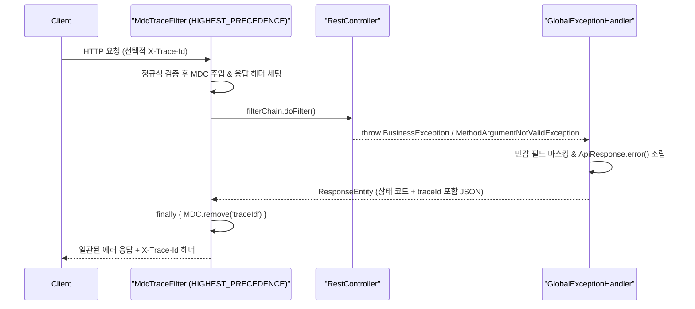

import Alert from '@/components/Alert.astro';
import LinkInline from '@/components/LinkInline.astro';

에러 코드 체계를 프로젝트 첫 주에 잡지 않으면 프론트엔드 팀과 어떤 일이 벌어질까요? 같은 `400 Bad Request`나 `409 Conflict` 응답인데 어떤 API는 문자열 메시지를, 어떤 API는 스프링 기본 에러 JSON을 내려주어 클라이언트 코드 곳곳에 한글 에러 문구를 정규식으로 비교하는 기형적인 분기문이 자라나게 됩니다.

[1편의 패키지 경계 구축](/dev/spring-boot-4-project-package-structure)에 이은 이번 2편(`step-02`)에서는 성공과 실패는 물론 뒤이어 붙일 시큐리티 필터 에러까지 단 하나의 규격으로 통일하는 `ApiResponse<T>` 봉투와 도메인 확장형 `ErrorCode` 체계, 요청 추적용 `MDC traceId`, 그리고 **Spring Boot 4의 핵심 변경점인 Jackson 3 전환 시 반드시 알아야 할 패키지 규칙**을 구현합니다.

## `ApiResponse<T>` 봉투 vs RFC 9457 `ProblemDetail` 트레이드오프

앞서 [REST API 표준 에러 응답 설계: RFC 9457과 비즈니스 예외 처리](/dev/rest-api-error-handling-rfc9457)에서 다뤘듯, 모든 요청을 무조건 `200 OK`로 감싸 내려보내는 '성공 위장 에러'는 HTTP 캐시와 모니터링 체계를 망가뜨리는 최악의 안티패턴입니다. 따라서 HTTP 상태 코드(`400`, `401`, `403`, `409`, `423`, `500`)는 프로토콜 의미에 맞게 정확히 내려주는 것이 대원칙입니다.

그 위에서 응답 본문(Body) 구조를 정할 때 두 가지 선택지가 남습니다. <LinkInline href="https://www.rfc-editor.org/rfc/rfc9457.html" label="IETF RFC 9457 Problem Details" />(`ProblemDetail`)를 쓸 것인가, 아니면 HTTP 상태 코드는 정직하게 지키면서 본문만 일관된 `ApiResponse<T>` 봉투로 감쌀 것인가 하는 결정이죠.

| 비교 항목 | `ApiResponse<T>` 공통 봉투 (HTTP 상태 코드 준수) | RFC 9457 `ProblemDetail` 단독 사용 |
| :--- | :--- | :--- |
| **최적 적용 환경** | 웹 SPA·모바일 앱과 긴밀히 협업하는 B2C·어드민 백엔드 | 외부 서드파티 개발자에게 개방하는 퍼블릭 Open API |
| **성공·실패 스키마 일관성** | `success`, `timestamp`, `traceId`가 성공·실패 모두 동일 위치에 존재 | 성공(Raw DTO)과 실패(`type`, `title`, `detail`)의 최상위 구조가 다름 |
| **프론트엔드 타입 추론** | `if (res.success)` 단일 판별자로 TypeScript 타입 내로잉 즉시 완료 | HTTP 상태 분기 후 커스텀 확장 프로퍼티(`properties`) 별도 타입 단언 필요 |
| **목록 페이징 결합** | `ApiResponse<PageResponse<T>>`로 [페이징 메타데이터](/dev/rest-api-pagination-offset-cursor)와 일관 결합 | 헤더(`Link`) 또는 별도 컬렉션 래퍼 규격 추가 설계 필요 |

풀스택 제품 팀이 바로 가져다 쓰는 베이스캠프의 목적상, 적절한 HTTP 상태 코드를 그대로 유지하면서 클라이언트 인터셉터 구현이 가장 간결해지는 `ApiResponse<T>` 레코드를 채택했습니다.

```java
package one.eone.app.global.common;

import com.fasterxml.jackson.annotation.JsonInclude;
import java.time.Instant;
import java.util.List;
import one.eone.app.global.error.ErrorCode;
import one.eone.app.global.filter.MdcTraceFilter;
import org.jspecify.annotations.Nullable;
import org.slf4j.MDC;

@JsonInclude(JsonInclude.Include.NON_NULL)
public record ApiResponse<T>(
        boolean success,
        @Nullable T data,
        @Nullable ErrorDetail error,
        Instant timestamp,
        @Nullable String traceId
) {
    public static <T> ApiResponse<T> ok(@Nullable T data) {
        return new ApiResponse<>(true, data, null, Instant.now(), currentTraceId());
    }

    public static <T> ApiResponse<T> error(ErrorCode errorCode, String message, List<FieldErrorDetail> fields) {
        return new ApiResponse<>(
                false,
                null,
                new ErrorDetail(errorCode.getCode(), message, fields),
                Instant.now(),
                currentTraceId()
        );
    }

    private static @Nullable String currentTraceId() {
        return MDC.get(MdcTraceFilter.TRACE_ID_KEY);
    }

    @JsonInclude(JsonInclude.Include.NON_EMPTY)
    public record ErrorDetail(
            String code,
            String message,
            List<FieldErrorDetail> fields
    ) {
    }

    public record FieldErrorDetail(
            String field,
            @Nullable String rejectedValue,
            String reason
    ) {
    }
}
```

## Spring Boot 4 + Jackson 3 전환의 결정적 함정

위 코드 상단의 `import com.fasterxml.jackson.annotation.JsonInclude;` 한 줄에 Spring Boot 4 마이그레이션의 가장 흔한 함정이 숨어 있습니다. <LinkInline href="https://github.com/spring-projects/spring-boot/wiki/Spring-Boot-4.0-Migration-Guide" label="Spring Boot 4 공식 마이그레이션 문서" />에 명시된 대로 기본 JSON 엔진이 Jackson 2에서 **Jackson 3**로 올라가면서 매퍼와 기능 플래그 패키지가 **`tools.jackson.*` 네임스페이스**로 이동했습니다.

그런데 IDE에서 문자열 일괄 치환을 돌려 어노테이션까지 `tools.jackson.annotation.*`으로 바꾸면 곧바로 컴파일 에러가 터집니다.

<Alert type="warning" title="Jackson 3의 패키지 이원화 규칙 (tools.jackson vs com.fasterxml.jackson.annotation)">
Jackson 3는 수많은 외부 라이브러리의 어노테이션 호환성을 지키기 위해 매퍼(`tools.jackson.databind.json.JsonMapper`), 기능 설정(`tools.jackson.databind.DeserializationFeature`), 부트 자동 설정 커스터마이저(`org.springframework.boot.jackson.autoconfigure.JsonMapperBuilderCustomizer`)만 새 패키지로 옮기고, **`@JsonInclude`, `@JsonIgnore`, `@JsonProperty` 등 어노테이션 모듈은 기존의 `com.fasterxml.jackson.annotation.*` 패키지를 그대로 유지**합니다.
</Alert>

따라서 `JacksonConfig`에서는 구버전 `Jackson2ObjectMapperBuilderCustomizer` 대신 아래와 같이 새 빌더 커스터마이저를 등록해 클라이언트가 전송한 미정의 필드에 유연하게 대응하도록 구성합니다.

```java
package one.eone.app.global.config;

import org.springframework.boot.jackson.autoconfigure.JsonMapperBuilderCustomizer;
import org.springframework.context.annotation.Bean;
import org.springframework.context.annotation.Configuration;
import tools.jackson.databind.DeserializationFeature;

@Configuration
public class JacksonConfig {

    @Bean
    public JsonMapperBuilderCustomizer jsonMapperBuilderCustomizer() {
        return builder -> builder.disable(DeserializationFeature.FAIL_ON_UNKNOWN_PROPERTIES);
    }
}
```

## 로그 인젝션을 막는 `MdcTraceFilter`와 예외 변환 흐름

운영 환경에서 사용자에게 "오류가 발생했습니다(추적 번호: `a9f1...`)"라고 안내했을 때 그 번호 하나로 요청 진입부터 SQL, 예외 스택까지 단번에 묶여 나오려면 모든 보안 필터보다 앞선 최상단에서 `traceId`를 심어야 합니다.



이때 놓치기 쉬운 보안 취약점이 바로 <LinkInline href="https://cheatsheetseries.owasp.org/cheatsheets/Logging_Cheat_Sheet.html" label="OWASP 로깅 치트시트" />가 경고하는 **로그 인젝션**(Log Forging)입니다. 외부에서 넘어온 `X-Trace-Id` 헤더를 무검증으로 신뢰해 SLF4J `MDC`에 그대로 넣으면, 공격자가 헤더 값에 개행문자(`\r\n`)와 가짜 관리자 로그인 성공 문구를 섞어 서버 로그를 오염시킬 수 있습니다.

그래서 `MdcTraceFilter`는 안전한 영숫자·하이픈·언더스코어 64자 이내(`^[a-zA-Z0-9_-]{1,64}$`) 패턴을 통과한 헤더만 수용하고, 형식이 어긋나면 즉시 새 UUID로 덮어쓴 뒤 `finally` 블록에서 스레드 풀 재사용 오염을 막기 위해 `MDC.remove()`를 호출합니다.

## 도메인 확장형 `ErrorCode`와 민감 입력값 마스킹

단일 거대 `enum` 파일 하나에 전사 에러 코드를 몰아넣으면 모든 도메인 작업자가 한 파일을 건드리느라 매주 병합 충돌을 겪습니다. `global.error`에는 얇은 `ErrorCode` 인터페이스와 공통 코드(`CommonErrorCode`)만 두고, 각 도메인이 자체 열거형을 구현하게 분리했습니다.

| 프리픽스 | 담당 열거형 (`package`) | 대표 코드 예시 및 HTTP 상태 |
| :--- | :--- | :--- |
| **`COMMON_`** | `CommonErrorCode` (`global.error`) | `COMMON_001` 입력 검증 실패(`400`), `COMMON_002` 본문 파싱 오류(`400`), `COMMON_500` 미처리 서버 오류(`500`) |
| **`AUTH_`** | `SecurityErrorCode` / `AuthErrorCode` | `AUTH_001` 자격 증명 불일치(`401`), `AUTH_002` 계정 잠금(`423`), `AUTH_005` 만료 토큰(`401`), `AUTH_007` 권한 부족(`403`) |
| **`USER_`** | `UserErrorCode` (`domain.user`) | `USER_001` 이메일 중복(`409`), `USER_002` 사용자 미존재(`404`) |
| **`ROLE_` · `MENU_`** | `RoleErrorCode` / `MenuErrorCode` | `ROLE_002` 미등록 권한 코드(`400`), `MENU_003` 계층 순환 참조(`400`), `MENU_004` 하위 메뉴 존재(`409`) |

전역 예외 처리기인 `GlobalExceptionHandler`에서 특히 공들인 방어 로직은 `@Valid` 검증 실패 시 내려가는 `rejectedValue` 마스킹입니다. 사용자가 비밀번호를 8자 미만(`"1234"`)으로 잘못 입력했을 때 스프링의 `FieldError.getRejectedValue()`를 그대로 응답에 실어 보내면, 프론트엔드 에러 수집기(Sentry 등)나 브라우저 로그에 사용자가 입력한 비밀번호 조각이 평문으로 박히게 됩니다.

```java
private @Nullable String maskIfSensitive(String fieldName, @Nullable Object rejectedValue) {
    if (rejectedValue == null) {
        return null;
    }
    String normalized = fieldName.toLowerCase(Locale.ROOT);
    if (normalized.contains("password") || normalized.contains("secret") || normalized.contains("token")) {
        return "[REDACTED]";
    }
    return String.valueOf(rejectedValue);
}
```

필드명에 `password`, `secret`, `token`이 들어가면 실패 사유(`reason`)만 안내하고 입력값은 자동으로 `"[REDACTED]"` 처리합니다. 미처리 서버 예외(`Exception.class`) 역시 내부 테이블명이나 스택 트레이스가 외부로 절대 노출되지 않도록 서버 에러 로그에만 남기고 `500 COMMON_500` 표준 메시지로 치환합니다.

마지막으로 Spring Boot 4에서 모듈화에 따라 패키지가 `org.springframework.boot.webmvc.test.autoconfigure.WebMvcTest`로 이동한 슬라이스 테스트(`GlobalExceptionHandlerSliceTest`)로 정상 봉투, 비정상 `X-Trace-Id` 치환, 비밀번호 마스킹, 깨진 JSON 본문 처리까지 검증을 마쳤습니다(`step-02`). 다음 3편에서는 운영 오픈 직후 CS 문의를 유발하는 JPA 감사(Audit) 필드 설계 실수와 소프트 삭제 재가입 버그를 해결합니다.

## 참고 자료

- [RFC 9457: Problem Details for HTTP APIs — IETF](https://www.rfc-editor.org/rfc/rfc9457.html)
- [Spring Boot 4.0 Migration Guide (Jackson 3 & Modular WebMvc Test)](https://github.com/spring-projects/spring-boot/wiki/Spring-Boot-4.0-Migration-Guide)
- [OWASP Logging Cheat Sheet — Log Injection Prevention](https://cheatsheetseries.owasp.org/cheatsheets/Logging_Cheat_Sheet.html)
