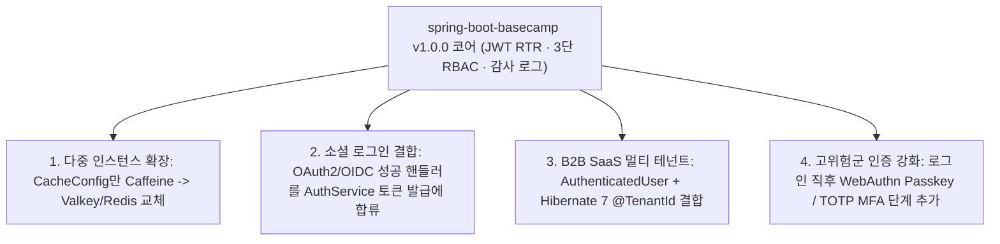

import Alert from '@/components/Alert.astro';
import GitHubRepoCard from '@/components/GitHubRepoCard.astro';
import LinkInline from '@/components/LinkInline.astro';

좋은 백엔드 템플릿의 기준은 얼마나 화려한 기술을 잔뜩 욱여넣었느냐가 아니라, **내 도메인에 필요 없는 코드를 얼마나 안전하고 빠르게 덜어낼 수 있느냐**에 달려 있습니다. 욕심을 부려 카프카, 레디스, 엘라스틱서치, 결제 모듈까지 한데 엮어 놓은 거대한 보일러플레이트는 정작 가벼운 신규 서비스를 띄우려 할 때 걷어내는 데만 사흘이 걸리는 애물단지가 되기 십상입니다.

[프롤로그](/dev/spring-boot-4-basecamp-prologue)부터 [10편의 운영 체크리스트](/dev/spring-boot-4-testing-production-checklist)까지 달려온 **Spring Boot 4 실전 베이스캠프**의 마지막 11편(`v1.0.0`)에서는 완성된 템플릿을 10초 만에 내 조직의 프로젝트로 바꾸는 초기화 스크립트 파괴 테스트 결과를 공유하고, Java 25 LTS + Spring Boot 4 실전 도입 회고와 사내 공통 Starter 분리·대규모 확장 로드맵을 정리합니다.

<GitHubRepoCard
  repo="veryfaraway/spring-boot-basecamp"
  description="Production-grade Java 25 LTS + Spring Boot 4 backend template (JWT RTR · 3-tier RBAC · Audit Log · Detachable Menu)"
  language="Java"
  comment="v1.0.0 최종 릴리스와 step-01 ～ step-10 마일스톤 태그가 모두 포함되어 있습니다."
/>

## 10초 패키지 전환(`init-project.sh`)과 메뉴 모듈 탈착 파괴 테스트

템플릿을 복제한 개발자가 가장 먼저 겪는 번거로움은 기본 패키지인 `one.eone.app`과 `BasecampApplication`을 자신의 회사 도메인(예: `com.acme.commerce`, `CommerceApplication`)으로 바꾸는 일입니다. IDE 리팩토링 메뉴로 패키지 깊이를 바꿀 때 상위 폴더가 겹치면 빈 디렉터리가 남고, `compose.yaml` 컨테이너 이름이나 `application.yml`의 로깅 패키지 문자열이 누락되기 일쑤입니다.

이를 단 한 줄의 명령어로 끝내기 위해 POSIX 호환 쉘 스크립트인 `scripts/init-project.sh`를 제작했습니다. 실제 사용자 환경을 고려해 세 가지 방어 로직을 심어두었어요.

1. **Java 예약어 세그먼트 사전 차단**: 사용자가 실수로 `--package com.acme.switch`나 `com.acme.internal.record`처럼 자바 예약어가 포함된 패키지명을 넘기면 파일 수십 개를 다 치환한 뒤에야 컴파일 에러 폭탄을 맞습니다. 실행 초기에 점(`.`) 단위로 세그먼트를 쪼개 예약어 여부를 검사하고 즉시 중단합니다.
2. **macOS와 Linux `sed -i` 호환성**(BSD vs GNU): macOS 기본 `sed`는 `-i ''` 빈 백업 인자를 요구하는 반면 Linux GNU `sed`는 이를 파일명으로 오인할 수 있어 `uname -s` 분기 래퍼로 양쪽 OS 모두에서 동일하게 동작하도록 맞췄습니다.
3. **경로 중첩 안전한 스테이징 이동**: `one.eone.app`을 `one.eone.commerce`처럼 상위 경로 일부가 겹치는 패키지로 바꿀 때도 폴더 충돌이 나지 않도록 임시 스테이징 폴더를 거친 뒤 빈 상위 폴더를 루트까지 깨끗이 정리합니다.

실제로 `/tmp` 격리 디렉터리에 저장소를 복사해 아래 두 단계 검증을 연속 수행했습니다.

```bash
# 1단계: 새 조직 패키지와 서비스명으로 일괄 치환 후 36개 전체 테스트 실행
./scripts/init-project.sh \
  --group com.acme \
  --package com.acme.commerce \
  --name commerce-api \
  --app-class CommerceApplication
./gradlew check

# 2단계: 선택 모듈(menu) 소스·테스트 폴더와 V3·V4 SQL 삭제 후 클린 빌드 검증
rm -rf src/main/java/com/acme/commerce/domain/menu \
       src/test/java/com/acme/commerce/domain/menu \
       src/main/resources/db/migration/V3__init_menu_schema.sql \
       src/main/resources/db/migration/V4__seed_menu_data.sql
./gradlew clean check
```

1편에서 `PackageArchitectureTest`의 기준 패키지를 `BasecampApplication.class.getPackageName()`(치환 후 `CommerceApplication.class.getPackageName()`)으로 동적 추출해 둔 덕분에 테스트 코드 수정 없이 치환 직후 36개 전체 케이스가 그대로 통과했고, 이어서 메뉴 모듈을 통째로 삭제한 두 번째 클린 빌드 역시 컴파일·Flyway 마이그레이션·ArchUnit·통합 테스트 모두 단번에 통과했습니다.

## Java 25 LTS + Spring Boot 4 실전 구축 회고

11개 마일스톤을 처음부터 끝까지 구현하고 부딪히며 체감한 **Java 25 LTS + Spring Boot 4**(`4.1.3`) 조합의 장단점은 분명했습니다.

- **세분화된 스타터와 깔끔해진 클래스패스**: `spring-boot-starter-webmvc`, `spring-boot-starter-flyway` 및 슬라이스별 테스트 스타터 분리는 처음 `libs.versions.toml`을 잡을 때만 한 번 확인하면 이후 불필요한 자동 설정 충돌을 크게 줄여줍니다.
- **Jackson 3와 공식 `NimbusJwt`의 시너지**: `tools.jackson` 매퍼 전환 시 어노테이션 패키지(`com.fasterxml.jackson.annotation.*`) 유지 예외와 언체크 `JacksonException` 계층만 익혀두면 직렬화 코드가 훨씬 간결해지며, 서드파티 `jjwt` 대신 선택한 `NimbusJwtEncoder`·`NimbusJwtDecoder` 덕분에 구버전 Jackson 2 의존성이 단 한 줄도 유입되지 않았습니다.
- **진짜 운영 장애를 막아준 Testcontainers**: H2 인메모리 DB나 과도한 Mock 대신 실제 PostgreSQL 17 컨테이너를 기본값으로 쓴 덕분에, 7편의 `SELECT FOR UPDATE` + `REQUIRES_NEW` 셀프 데드락과 10편의 `UsernameNotFoundException` 트랜잭션 롤백 오염 버그를 배포 전에 잡아낼 수 있었습니다.

## 사내 MSA용 커스텀 Starter로 `global` 분리하는 법

단일 서비스로 빠르게 출발한 팀이 성장해 [클라우드·MSA 환경](/dev/cloud-provider-selection-guide)에서 마이크로서비스를 5개, 10개로 늘리게 되면, 그때 비로소 각 저장소에 복제된 공통 인프라 코드를 사내 표준 라이브러리(`acme-spring-boot-starter-core`)로 추출할 시점이 찾아옵니다.

우리 베이스캠프는 첫 커밋부터 ArchUnit으로 **`global`이 `domain`을 절대 참조하지 못하도록** 단방향 경계를 지켜왔기 때문에 분리 절차가 매우 간결합니다.

<Alert type="tip" title="리팩토링 없이 그대로 추출되는 global 패키지">
`global` 내부에는 `User`나 `Role` 엔티티 의존성이 단 한 줄도 없고 오직 `AuthenticatedUser`, `ErrorCode`, `UserAuthorityResolver` 계약만 존재합니다. <LinkInline href="https://docs.spring.io/spring-boot/reference/features/developing-auto-configuration.html" label="Spring Boot 공식 커스텀 Auto-Configuration 가이드" />에 따라 `global` 패키지를 별도 모듈로 옮기고 설정 클래스를 `@AutoConfiguration`으로 전환한 뒤 `META-INF/spring/org.springframework.boot.autoconfigure.AutoConfiguration.imports` 파일에 등록하면 30분 안에 사내 전용 Starter가 완성됩니다.
</Alert>

## 베이스캠프 코어 위 4대 확장 아키텍처 로드맵

이 베이스캠프는 닫힌 완성품이 아니라 팀의 비즈니스 요구사항에 맞춰 증축하기 좋은 단단한 기초 콘크리트입니다. 트래픽 규모와 제품 요건이 커질 때 바로 얹을 수 있는 네 가지 확장 경로는 다음과 같습니다.



| 확장 과제 | 기존 베이스캠프 변경 지점 | 핵심 구현 방향 |
| :--- | :--- | :--- |
| **1. 다중 서버 분산 캐시** | `global.config.CacheConfig` 단 1개 파일 | 서비스의 `@Cacheable`·`@CacheEvict`는 그대로 두고 [Valkey·Redis 캐시 매니저](/dev/msa-redis-valkey-session-lock)로 교체 |
| **2. OAuth2 소셜 로그인** | `OAuth2AuthenticationSuccessHandler` 추가 | 구글·카카오 프로필 검증 후 내부 `User` 자동 매핑 → `AuthService` 토큰 패밀리 발급 재사용 |
| **3. B2B 멀티 테넌시** | `AuthenticatedUser` + 엔티티 `@TenantId` | JWT와 `MDC`에 `tenantId`를 포함하고 <LinkInline href="https://docs.jboss.org/hibernate/orm/7.0/userguide/html_single/Hibernate_User_Guide.html#multitenacy" label="Hibernate 7 판별자 멀티 테넌시(@TenantId)" />로 고객사 데이터 격리 |
| **4. 2단계 인증**(MFA) | `AuthService.login()` 중간 상태 분기 | 1차 통과 시 짧은 `MFA_CHALLENGE` 토큰 발급 → <LinkInline href="https://docs.spring.io/spring-security/reference/servlet/authentication/passkeys.html" label="Spring Security 7 WebAuthn Passkey" />·TOTP 통과 후 정식 토큰 발급 |

새 프로젝트를 열 때마다 바닥부터 인증 필터와 예외 처리기를 다시 짜느라 소모하던 에너지를, 이제 여러분의 진짜 도메인 문제를 푸는 데 온전히 쏟으실 수 있기를 바랍니다. 저장소를 클론해 직접 돌려보시며 겪은 피드백이나 확장 아이디어는 언제든 GitHub 이슈와 댓글로 남겨주세요!

## 참고 자료

- [Spring Boot 4 Reference — Creating Your Own Auto-configuration](https://docs.spring.io/spring-boot/reference/features/developing-auto-configuration.html)
- [Hibernate ORM 7.0 User Guide — Discriminator-based Multi-tenancy (@TenantId)](https://docs.jboss.org/hibernate/orm/7.0/userguide/html_single/Hibernate_User_Guide.html#multitenacy)
- [Spring Security 7 Reference — Passkeys / WebAuthn Authentication](https://docs.spring.io/spring-security/reference/servlet/authentication/passkeys.html)
