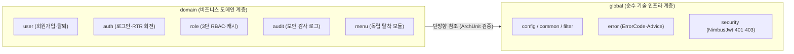
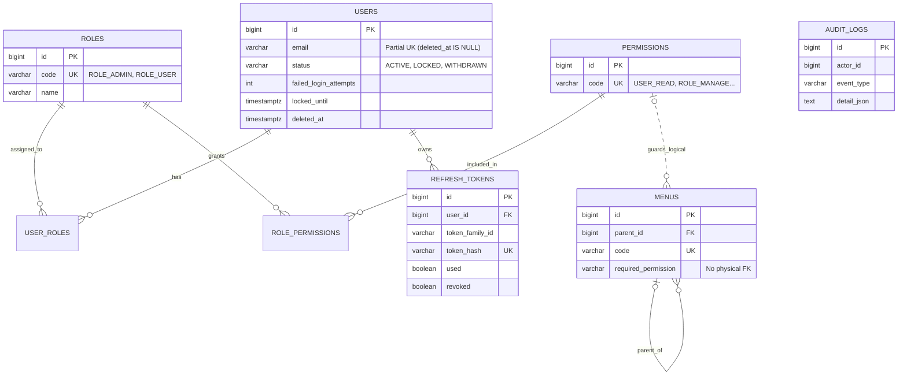

import Alert from '@/components/Alert.astro';
import GitHubRepoCard from '@/components/GitHubRepoCard.astro';
import LinkInline from '@/components/LinkInline.astro';

클론하면 3분 안에 로컬 DB 마이그레이션부터 Swagger UI까지 기동되고, 스크립트 한 줄이면 10초 만에 내 조직의 패키지명으로 탈바꿈하는 백엔드 출발선이 있다면 어떨까요? 새 서비스를 열 때마다 지난 프로젝트에서 인증 필터와 에러 핸들러를 복붙하며 이틀씩 허비하던 악순환을 끊어내기 위해 **Spring Boot 4 실전 베이스캠프** 12부작 시리즈를 연재합니다.

현업에서 신규 백엔드 저장소를 만들 때 정작 시간을 뺏기는 지점은 비즈니스 로직이 아닙니다. 패키지 경계를 어떻게 나눌지, 공통 응답과 에러 코드는 어떤 모양으로 맞출지, 탈퇴한 회원이 같은 이메일로 재가입할 때 유니크 인덱스는 어떻게 풀지, 토큰 탈취와 권한 변경 캐시는 어떻게 다룰지 매번 처음부터 다시 논쟁하곤 해요. 이 시리즈에서는 장난감 예제가 아니라 실제 운영 환경의 까다로운 엣지 케이스까지 방어한 프로덕션급 템플릿 `spring-boot-basecamp`를 바닥부터 완성해 나갑니다.

<GitHubRepoCard
  repo="veryfaraway/spring-boot-basecamp"
  description="Production-grade Java 25 LTS + Spring Boot 4 backend template (JWT RTR · 3-tier RBAC · Audit Log · Detachable Menu)"
  language="Java"
  comment="GitHub 상단의 'Use this template' 버튼으로 커밋 이력 없이 깔끔하게 새 저장소를 생성할 수 있습니다."
/>

| 영역 | 완성 기능 요약 | 핵심 방어 포인트 |
| :--- | :--- | :--- |
| **기반 아키텍처** (`1～3편`) | `global`·`domain` 단방향 격리, `ApiResponse<T>`, JPA 3단계 Auditing | ArchUnit 역참조 차단, 로그 인젝션 방어, Partial Unique Index |
| **회원·인증** (`4～7편`) | 동시성 안전 회원가입, Spring Security 7 + `NimbusJwt`, RTR 토큰 회전 | 10스레드 중복 가입 `409` 변환, `401`·`403` JSON 통일, 탈취 재사용 탐지 |
| **권한·메뉴** (`8～9편`) | `User`–`Role`–`Permission` 3단 RBAC, 인메모리 O(N) 계층형 메뉴 트리 | Caffeine 캐시 즉시 무효화, 코드 수정 없는 `domain/menu` 완전 탈착 |
| **운영·검증** (`10～11편`) | 5회 실패 계정 잠금(`423`), 보안 감사 로그, 4계층 테스트·CI, 초기화 스크립트 | 트랜잭션 롤백 오염 차단, Actuator 최소 노출, 10초 패키지 일괄 치환 |

## 왜 공통 `.jar` 라이브러리가 아닌 클론형 템플릿인가?

사내 플랫폼 팀이나 시니어 개발자가 반복 작업을 줄이겠다고 나설 때 가장 먼저 떠올리는 유혹은 `company-spring-boot-starter` 같은 외부 `.jar` 라이브러리를 배포하는 방식입니다. 로깅 필터나 단순 유틸리티 수준이라면 꽤 괜찮은 선택이에요. 하지만 `User`, `Role`, `Menu`처럼 도메인 엔티티와 데이터베이스 스키마가 얽히는 영역까지 `.jar` 의존성 안으로 가두면 첫 번째 기획 변경에서 곧바로 벽에 부딪힙니다.

어떤 서비스는 회원가입 시 휴대폰 번호와 약관 동의 이력이 필수이고, 다른 서비스는 사번과 부서 코드가 필요합니다. 컴파일된 외부 라이브러리의 `User` 엔티티에 컬럼 하나를 추가하려고 `@MappedSuperclass` 상속을 비틀거나 Flyway 마이그레이션 버전 충돌을 맞추다 보면 배보다 배꼽이 더 커지기 마련입니다. 요즘처럼 AI 코딩 에이전트와 협업하는 환경에서도 소스 코드가 내 저장소 안에 직접 노출되어 있어야 에이전트가 도메인 맥락을 100% 읽고 수정할 수 있습니다.

그래서 `spring-boot-basecamp`는 프론트엔드 생태계의 `shadcn/ui`처럼 **코드를 복제해 개발자가 완전히 소유하고 자유롭게 고쳐 쓰는 클론형 GitHub Template** 방식을 택했습니다. 대신 내부적으로는 순수 기술 인프라 계층인 `global`이 비즈니스 도메인 계층인 `domain`을 단 한 줄도 역참조하지 못하도록 격리했어요. 처음에는 단일 템플릿으로 가볍게 출발하고, 추후 마이크로서비스가 10개 이상으로 늘어나면 그때 `global` 패키지만 그대로 떼어내 사내 공통 Starter로 승격할 수 있습니다.



## 완성될 베이스캠프의 데이터 모델과 API 명세

12편에 걸쳐 구축할 핵심 테이블 구조는 실무 백엔드의 단골 요구사항을 빈틈없이 담고 있습니다. 사용자 계정 상태와 로그인 실패 잠금, Refresh Token 계보(`token_family_id`) 추적, 3단 권한 매핑, 자기 참조 계층형 메뉴, 그리고 불변 보안 감사 로그까지 총 8개 테이블이 맞물려 돌아갑니다.



특히 두 가지 스키마 설계가 템플릿의 실전 수명을 결정합니다. 첫째, `users` 테이블은 일반 유니크 제약 대신 PostgreSQL의 부분 인덱스(`WHERE deleted_at IS NULL`)를 걸어 소프트 삭제 탈퇴 직후 같은 이메일로 재가입해도 충돌이 나지 않습니다. 둘째, `menus` 테이블의 `required_permission`은 물리적 외래키 없이 권한 코드 문자열만 느슨하게 참조하며 마이그레이션 파일(`V3`, `V4`)까지 분리되어 있어요. 어드민 메뉴가 필요 없는 모바일 앱 백엔드라면 디렉터리 하나와 SQL 두 개만 지워 흔적 없이 덜어낼 수 있습니다.

최종 완성 시점에 바로 호출할 수 있는 기본 API 엔드포인트 목록은 다음과 같습니다.

| 도메인 | Method & URI | 요구 권한 | 핵심 동작 |
| :--- | :--- | :--- | :--- |
| **Health** | `GET /actuator/health` | Public | 서버 및 DB 연결 상태 확인 (`prod` 상세 정보 은닉) |
| **Auth** | `POST /api/v1/auth/signup` | Public | 이메일 정규화·BCrypt 해싱·동시성 방어 회원가입 |
| **Auth** | `POST /api/v1/auth/login` | Public | 인증 검증·실패 잠금(`423`)·Access + Refresh(`HttpOnly` 쿠키 겸용) 발급 |
| **Auth** | `POST /api/v1/auth/refresh` | Public (Refresh) | 토큰 회전(RTR) 및 과거 토큰 재사용 탐지 시 세션 패밀리 전체 폐기 |
| **Auth** | `POST /api/v1/auth/logout` | Authenticated | 현재 기기 세션 패밀리 폐기 및 브라우저 쿠키 즉시 만료 |
| **User** | `GET·PATCH·DELETE /api/v1/users/me` | Authenticated | 내 프로필·권한 조회, 이름·비밀번호 변경, 소프트 삭제 탈퇴 |
| **Role** | `GET /api/v1/admin/roles` | `ROLE_READ` | 전체 역할 및 매핑된 권한 코드 목록 조회 |
| **Role** | `PUT /api/v1/admin/roles/{roleId}/permissions` | `ROLE_MANAGE` | 역할별 권한 일괄 교체 및 로컬 권한 캐시 즉시 무효화 |
| **Menu** | `GET /api/v1/menus/me` | Authenticated | 보유 권한 기준 접근 가능한 사이드바 메뉴 트리 조회(빈 폴더 제거) |
| **Menu** | `POST·PATCH·DELETE /api/v1/admin/menus` | `MENU_MANAGE` | 계층형 메뉴 생성·순환 참조 방어 수정·하위 존재 검증 삭제 |

## Java 25 LTS + Spring Boot 4 기술 스택 선정 기준

앞서 [자바 버전별 특징과 LTS 선택 가이드](/dev/java-lts-spring-boot-guide)에서 짚었듯 2026년 하반기 신규 스프링 프로젝트의 표준 기준선은 **Java 25 LTS**와 **Spring Boot 4**(`4.1.3`) 조합입니다. <LinkInline href="https://github.com/spring-projects/spring-boot/wiki/Spring-Boot-4.0-Migration-Guide" label="Spring Boot 4.0 공식 마이그레이션 가이드" />에서 안내하는 세대교체 변경점을 실제 빌드와 통합 테스트로 검증해 반영했습니다.

- **Java 25 LTS & Gradle 9.4**: 모든 Request/Response DTO, 보안 Principal, `@ConfigurationProperties`에 불변 `record`를 적용하고 패턴 매칭과 Text Blocks를 활용합니다.
- **세분화된 Spring Boot 4 모듈형 스타터**: 기존의 거대한 단일 스타터 대신 `spring-boot-starter-webmvc`, `spring-boot-starter-flyway`, 그리고 슬라이스 테스트용 `spring-boot-starter-webmvc-test`, `spring-boot-starter-data-jpa-test`, `spring-boot-starter-security-test`를 명시해 불필요한 자동 설정 간섭을 줄였습니다.
- **Jackson 3 기본 탑재**: JSON 직렬화 엔진이 `com.fasterxml.jackson`에서 `tools.jackson.databind.json.JsonMapper`로 전환되었습니다. 단, `@JsonInclude` 같은 어노테이션은 기존 패키지를 유지하는 하위 호환 규칙까지 정확히 구분했습니다.
- **Spring Security 7 + 공식 `NimbusJwt`**: 내부적으로 구버전 Jackson 2에 의존하는 서드파티 `jjwt`를 배제하고, <LinkInline href="https://docs.spring.io/spring-security/reference/servlet/oauth2/resource-server/jwt.html" label="Spring Security 공식 OAuth2 JOSE 모듈" />의 `NimbusJwtEncoder`·`NimbusJwtDecoder`로 의존성 충돌을 원천 차단했습니다.
- **JSpecify `@NullMarked` & JUnit 6 + Testcontainers 2.x**: <LinkInline href="https://jspecify.dev/docs/user-guide/" label="JSpecify 표준 어노테이션" /> 기반 Null 안전성 계약과 `@ServiceConnection` PostgreSQL 17 컨테이너 테스트를 기본값으로 고정했습니다.

<Alert type="warning" title="macOS Homebrew 환경에서의 Gradle 데몬 JVM 주의점">
macOS에서 Temurin 25를 설치한 뒤 [Homebrew](/tools/install-homebrew-2026)로 전역 `gradle` 패키지를 설치하면, 수식 의존성으로 최신 비-LTS OpenJDK(예: 27)가 함께 깔리면서 시스템 `gradle` 명령 실행 시 데몬 JVM이 Java 27로 기동될 수 있습니다. 반드시 저장소에 포함된 `./gradlew` 래퍼를 사용하고 `build.gradle.kts`에 Java Toolchain 25를 명시해야 로컬과 CI의 바이트코드 타겟이 100% 일치합니다.
</Alert>

초기 [`.gitignore` 설정](/tools/gitignore-cleanup)에서 흔히 겪는 함정도 미리 바로잡았습니다. `*.jar` 와일드카드 무시 규칙을 `!gradle/wrapper/gradle-wrapper.jar` 예외 규칙보다 아래쪽에 적으면 Git이 예외 선언을 덮어써 원격 저장소에 래퍼 실행 파일이 누락됩니다. 다른 개발자가 템플릿을 클론하자마자 `./gradlew` 실행에 실패하게 만드는 단골 사고 지점이므로 예외 규칙의 순서를 반드시 `*.jar` 아래에 두어야 합니다.

## 클론 후 3분 기동과 10초 패키지 전환 미리 보기

완성된 템플릿은 무거운 외부 Redis나 메시지 브로커 설치를 강요하지 않습니다. 권한·메뉴 캐시는 인메모리 Caffeine이 담당하고 데이터베이스는 `compose.yaml` 하나로 즉시 올라옵니다.

```bash
# 1. PostgreSQL 17 컨테이너 기동 및 애플리케이션 실행 (http://localhost:8080/swagger-ui.html)
docker compose up -d
./gradlew bootRun --args='--spring.profiles.active=local'

# 2. 내 조직 패키지와 서비스명으로 10초 만에 일괄 치환
./scripts/init-project.sh \
  --group com.acme \
  --package com.acme.commerce \
  --name commerce-api \
  --app-class CommerceApplication
```

시리즈의 모든 진행 단계는 저장소의 Git 태그(`step-01` ～ `step-10`, 최종 `v1.0.0`)와 1:1로 매핑되어 있어 원하는 구간의 스냅샷을 언제든 체크아웃해 테스트를 돌려보실 수 있습니다. 이어지는 1편(`step-01`)에서는 6개월 뒤에도 무너지지 않는 `global`·`domain` 패키지 전략과 ArchUnit 자동 경계 검증부터 코드를 작성합니다.

## 참고 자료

- [Spring Boot 4.0 Migration Guide — Spring Projects Wiki](https://github.com/spring-projects/spring-boot/wiki/Spring-Boot-4.0-Migration-Guide)
- [Spring Security 7 Reference — OAuth 2.0 Resource Server JWT](https://docs.spring.io/spring-security/reference/servlet/oauth2/resource-server/jwt.html)
- [JSpecify Nullness User Guide](https://jspecify.dev/docs/user-guide/)
