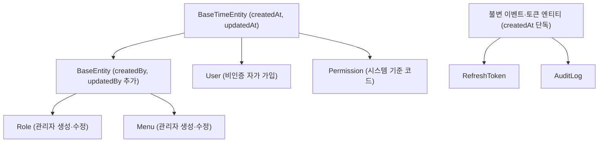

import Alert from '@/components/Alert.astro';
import LinkInline from '@/components/LinkInline.astro';

대부분의 JPA 입문 예제가 무심코 넘기는 두 가지 설계 구멍 때문에, 서비스 오픈 직후 CS 창구에 "탈퇴했는데 왜 같은 이메일로 다시 가입이 안 되나요?"라는 문의가 쏟아지곤 합니다. 모든 테이블에 똑같은 `BaseEntity` 하나를 기계적으로 상속시키다 비인증 가입 구간에서 모순을 겪거나, 소프트 삭제(`deleted_at`)와 이메일 유니크 인덱스가 정면으로 충돌하는 전형적인 실수죠.

[2편의 공통 예외 응답 체계](/dev/spring-boot-4-api-response-exception-handling)에 이어 이번 3편(`step-03`)에서는 Hibernate 7 환경에서 `open-in-view: false`를 기본 전제로 깔고, 엔티티 생명주기에 맞춰 감사(Audit) 상속 계층을 3단계로 나누는 기준과 `@EnableJpaAuditing` 설정 분리 원칙, 그리고 **PostgreSQL Partial Unique Index**로 소프트 삭제 재가입 문제를 해결하는 방법을 구현합니다.

## 왜 모든 엔티티에 하나의 `BaseEntity`를 물려주면 안 될까?

실무 코드베이스를 보면 `createdAt`, `updatedAt`, `createdBy`, `updatedBy` 네 개 컬럼을 단일 `BaseEntity`에 몰아넣고 전 테이블에 일괄 상속시키는 경우가 흔합니다. 당장은 코드가 줄어든 것처럼 보이지만 운영 데이터가 쌓이기 시작하면 곧장 도메인 모순이 드러납니다.

- **비인증 상태에서 스스로 가입하는 엔티티**(`User`): 회원가입 시점에는 아직 로그인된 인증 주체가 없습니다. 누가 생성했는지(`createdBy`) 남길 주체가 없거나 자기 자신의 PK가 채번되기 전이므로 불필요한 `NULL` 컬럼만 방치됩니다.
- **시스템 기준 코드**(`Permission`): Flyway 마이그레이션으로 적재되는 정적 권한 코드 역시 관리자 수정 추적 대상이 아닙니다.
- **불변 이력·토큰 테이블**(`RefreshToken`, `AuditLog`): 한 번 발급되거나 기록된 보안 감사 로그에 `updated_at`과 `updated_by` 컬럼이 열려 있으면 "감사 기록이 사후에 수정될 수 있다"는 잘못된 스키마 신호를 남깁니다.

그래서 `spring-boot-basecamp`는 테이블의 변경 생명주기에 따라 감사 필드를 정확히 세 단계로 나눕니다.



`@EntityListeners(AuditingEntityListener.class)`로 생성·수정 시각을 기록하는 `BaseTimeEntity` 위에, 관리자 행위 추적이 필요한 `BaseEntity`를 작성할 때도 놓치지 말아야 할 디테일이 있습니다. 초기 시드 스크립트(`V2`, `V4`)로 적재되는 기본 역할과 메뉴는 인증 컨텍스트 없이 들어가므로, 1편에서 적용한 JSpecify `@NullMarked` 패키지 안에서도 `createdBy`와 `updatedBy`는 반드시 `@Nullable Long`으로 열어두어야 합니다.

```java
package one.eone.app.global.common;

import jakarta.persistence.Column;
import jakarta.persistence.MappedSuperclass;
import org.jspecify.annotations.Nullable;
import org.springframework.data.annotation.CreatedBy;
import org.springframework.data.annotation.LastModifiedBy;

@MappedSuperclass
public abstract class BaseEntity extends BaseTimeEntity {

    @CreatedBy
    @Column(name = "created_by", updatable = false)
    private @Nullable Long createdBy;

    @LastModifiedBy
    @Column(name = "updated_by")
    private @Nullable Long updatedBy;

    protected BaseEntity() {
    }

    public @Nullable Long getCreatedBy() {
        return createdBy;
    }

    public @Nullable Long getUpdatedBy() {
        return updatedBy;
    }
}
```

## `@EnableJpaAuditing`을 메인 클래스에 붙이면 벌어지는 참사

<LinkInline href="https://docs.spring.io/spring-data/jpa/reference/auditing.html" label="Spring Data JPA Auditing" />을 활성화할 때 습관적으로 `@SpringBootApplication`이 붙은 메인 클래스(`BasecampApplication`) 위에 `@EnableJpaAuditing`을 함께 적는 예제가 많습니다. `@SpringBootTest` 전체 통합 테스트만 돌릴 때는 조용히 넘어갈지 몰라도, 2편에서 작성한 `@WebMvcTest` 컨트롤러 슬라이스 테스트를 실행하는 순간 빌드가 즉시 깨집니다.

<Alert type="danger" title="JPA metamodel must not be empty 슬라이스 테스트 장애">
`@WebMvcTest`는 웹 계층 빈만 가볍게 띄우기 때문에 `EntityManagerFactory`나 JPA 리포지토리를 로드하지 않습니다. 그런데 모든 슬라이스 테스트가 기본 스캔하는 메인 클래스에 `@EnableJpaAuditing`이 박혀 있으면, JPA 메타모델이 비어 있는 상태에서 Auditing 인프라가 강제 초기화되면서 모든 웹 슬라이스 테스트가 연쇄 실패합니다.
</Alert>

해법은 명확합니다. `@EnableJpaAuditing`을 별도의 `@Configuration` 클래스인 `JpaConfig`로 분리해 JPA 컨텍스트가 실제로 뜰 때만 활성화되게 격리하는 것입니다.

```java
package one.eone.app.global.config;

import org.springframework.context.annotation.Configuration;
import org.springframework.data.jpa.repository.config.EnableJpaAuditing;

@Configuration
@EnableJpaAuditing(auditorAwareRef = "securityAuditorAware")
public class JpaConfig {
}
```

연결된 `SecurityAuditorAware`(`AuditorAware<Long>`) 역시 `global -> domain` 역참조 금지 규칙을 지킵니다. `domain.user.User` 엔티티를 직접 꺼내지 않고 `global.security.AuthenticatedUser` 레코드에서 `userId`만 읽어 반환하며, 배치 작업이나 시스템 초기화 코드에서 인증 필터 없이도 감사 주체를 명시할 수 있도록 `ThreadLocal` 스코프 기반 `callWithAuditor(actorId, supplier)`·`runWithAuditor(actorId, runnable)` 헬퍼(`finally` 자동 복원)를 함께 제공합니다.

## 소프트 삭제(`deleted_at`)와 이메일 유니크 충돌 해법

회원 탈퇴를 구현할 때 감사 로그나 거래 증빙 정합성을 지키기 위해 물리적 `DELETE` 대신 `deleted_at` 타임스탬프를 남기는 **소프트 삭제**(Soft Delete)를 흔히 택합니다. 문제는 그 직후에 터집니다. `users` 테이블의 `email` 컬럼에 단순 `UNIQUE` 제약이 걸려 있으면, 이미 탈퇴한 행(`deleted_at = '2026-11-19T10:00:00Z'`)이 테이블에 남아 있어 같은 이메일로 재가입할 때 `Duplicate Key` 에러가 발생합니다.

현업에서 이 충돌을 피하겠다며 선택하곤 하는 우회책들은 저마다 심각한 부작용을 안고 있습니다.

| 우회 방식 | 발생하는 부작용 및 한계 |
| :--- | :--- |
| **`UNIQUE (email, deleted_at)` 복합 인덱스** | SQL 표준상 `NULL`은 다른 `NULL`과 동등하지 않으므로(PostgreSQL 기본 동작), 활성 계정(`deleted_at IS NULL`)이 동시에 2개 INSERT 되어도 인덱스가 막지 못하는 치명적 결함 발생 (`NULLS NOT DISTINCT`를 쓰면 반대로 2회 이상 탈퇴가 막힘) |
| **탈퇴 시 이메일 변조** (`withdrawn_1732_a@eone.one`) | 원본 이메일 데이터가 훼손되어 부정 가입 이력 대조나 CS 조회 쿼리가 지저분해짐 |
| **Hibernate `@SoftDelete` 전역 적용** | 모든 연관 조인에 암묵적 조건절이 강제 결합되어, 관리자가 탈퇴 회원 내역을 조회할 때 `EntityNotFoundException`을 유발 |

[오픈소스 RDBMS 선택 가이드](/dev/msa-rdbms-mysql-mariadb-aurora)에서 비교한 것처럼 PostgreSQL을 주력 DB로 선택했을 때 누릴 수 있는 강력한 무기가 바로 <LinkInline href="https://www.postgresql.org/docs/17/indexes-partial.html" label="PostgreSQL 17 공식 문서의 Partial Unique Index" />(부분 유니크 인덱스)입니다. `V1__init_schema.sql`에 아래 세 줄을 선언하면 모든 모순이 스키마 수준에서 해결됩니다.

```sql
-- 활성 회원(deleted_at IS NULL)에 한해서만 이메일 유일성 강제
CREATE UNIQUE INDEX uk_users_email_active
    ON users (email)
    WHERE deleted_at IS NULL;
```

이 인덱스는 조건절(`WHERE deleted_at IS NULL`)을 만족하는 **활성 계정 행들만** 인덱스 트리에 포함합니다.

1. 활성 상태인 이메일로 중복 가입이 들어오면 DB 엔진이 찰나의 오차도 없이 유니크 위반으로 차단합니다.
2. 회원이 탈퇴해 `deleted_at`에 시각이 기록되는 순간 해당 행은 유니크 감시 대상에서 즉시 빠집니다.
3. 같은 사용자가 재가입했다가 다시 탈퇴해 테이블에 동일 이메일의 과거 탈퇴 이력이 여러 건 쌓여도 원본 이메일을 훼손하지 않은 채 완벽히 공존합니다. *(참고로 MySQL 8.4 환경으로 이식해야 할 때는 `CASE WHEN deleted_at IS NULL THEN email END` 가상 생성 컬럼에 유니크 인덱스를 거는 방식으로 대체할 수 있습니다.)*

## Testcontainers로 실제 PostgreSQL 17 동작 증명하기

테스트 속도를 핑계로 H2 인메모리 DB를 썼다면 위 부분 유니크 인덱스의 정확한 동작을 보장할 수 없었을 것입니다. `JpaAuditingAndSoftDeleteIntegrationTest`에서는 실제 PostgreSQL 17 컨테이너 위에서 두 가지 핵심 시나리오를 검증했습니다.

첫째, `101L` 감사 주체로 역할을 생성한 뒤 `202L` 주체로 이름을 수정했을 때 `createdBy`는 `101L`로 불변 유지되고 `updatedBy`만 `202L`로 갱신되는지 확인했습니다. 둘째, 활성 계정 중복 INSERT 차단 → 소프트 삭제 전환 → 동일 이메일 재가입 INSERT 성공 → 두 번째 탈퇴 이력 공존까지 전 주기를 테스트로 고정했습니다(`step-03`).

영속성 계층의 지뢰를 모두 치웠으니, 다음 4편(`step-04`)에서는 `existsByEmail` 중복 체크를 넣었는데도 실무에서 동시 요청 시 `500` 에러가 터지는 원인을 파헤치고 10스레드 경합 테스트를 통과하는 회원가입 API를 완성합니다.

## 참고 자료

- [PostgreSQL 17 Documentation — Section 11.8 Partial Indexes](https://www.postgresql.org/docs/17/indexes-partial.html)
- [Spring Data JPA Reference — Auditing](https://docs.spring.io/spring-data/jpa/reference/auditing.html)
- [Hibernate ORM 7.0 User Guide](https://docs.jboss.org/hibernate/orm/7.0/userguide/html_single/Hibernate_User_Guide.html)
