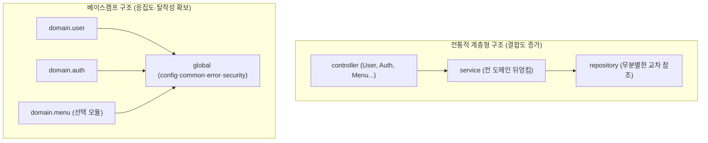

import Alert from '@/components/Alert.astro';
import LinkInline from '@/components/LinkInline.astro';

왜 프로젝트 첫날 아무 고민 없이 만든 `controller`, `service`, `repository` 폴더 구조가 6개월 뒤에는 팀 전체의 발목을 잡을까요? 도메인이 서너 개일 때는 평화롭던 저장소가 열 개를 넘어서는 순간, 기능 하나를 고치기 위해 모든 최상위 패키지를 위아래로 뒤져야 하고 서로 다른 도메인의 리포지토리가 거미줄처럼 엉켜버리기 때문입니다.

[프롤로그](/dev/spring-boot-4-basecamp-prologue)에 이은 이번 1편(`step-01`)에서는 베이스캠프의 뼈대가 되는 단방향 도메인형 패키지 구조를 잡고, 코드 리뷰에서의 구두 약속 대신 **ArchUnit** 테스트로 의존성 경계를 자동 강제합니다. 아울러 Spring Boot 4의 모듈형 Version Catalog, JSpecify `@NullMarked`, 프로파일 분리, PostgreSQL 17 + Flyway 초기 스키마까지 첫 단추를 단단하게 끼웁니다.

## 계층형(Layered) vs 도메인형(Domain) 패키지 구조

전통적인 계층형 구조는 기술 역할(`controller`, `service`, `entity`, `repository`)을 기준으로 최상위 폴더를 나눕니다. 입문서 예제에서는 보기 깔끔하지만 실무에서는 두 가지 치명적인 약점을 드러내요. 첫째, 다른 폴더에 있는 클래스를 호출해야 하므로 패키지 전용(`package-private`) 가시성을 활용하지 못하고 거의 모든 클래스가 `public`으로 열립니다. 둘째, 나중에 어드민 메뉴(`menu`) 같은 특정 기능을 덜어내거나 별도 서비스로 분리하려 할 때 관련 파일이 전 폴더에 흩어져 있어 외과 수술이 불가능해집니다.

반면 `one.eone.app` 베이스캠프는 최상위를 순수 기술 인프라인 **`global` 계층**과 비즈니스 기능 단위인 **`domain.<feature>` 계층** 두 축으로 가릅니다.



지켜야 할 의존성 원칙은 단 두 줄입니다.

1. **`global`은 `domain`을 절대 import하지 않는다**: 인증 필터나 공통 응답, 감사(Audit) 인프라는 비즈니스 엔티티인 `User`의 존재조차 몰라야 합니다.
2. **`domain.menu`는 완전 독립 모듈로 격리한다**: 다른 어떤 도메인도 `domain.menu`를 참조하지 않아야 필요 없는 팀이 폴더째 삭제할 수 있습니다.

그렇다면 헥사고날 아키텍처(Port & Adapter)처럼 모든 도메인마다 `adapter/in`, `application/port/out`, 도메인 모델과 JPA 엔티티 이중 매핑까지 강제하지 않은 이유는 무엇일까요? 베이스캠프 템플릿에서 단순 CRUD 도메인까지 수십 개의 포트 인터페이스와 변환 매퍼를 강제하면 초기 개발 속도가 급격히 떨어집니다. 패키지 단위의 단방향 격리와 엔티티 캡슐화만 정확히 지켜도 실무 백엔드의 90% 이상에서 충분한 응집도와 확장성을 확보할 수 있습니다.

## Spring Boot 4 모듈형 스타터와 Version Catalog 구성

[Java 25 LTS와 Spring Boot 4 전환](/dev/java-lts-spring-boot-guide)에서 가장 먼저 체감되는 변화는 스타터 모듈의 세분화입니다. <LinkInline href="https://github.com/spring-projects/spring-boot/wiki/Spring-Boot-4.0-Release-Notes" label="Spring Boot 4.0 릴리스 노트" />에 정리된 것처럼 거대했던 자동 설정 모듈이 기술 단위로 명확히 쪼개졌어요. 구버전 습관대로 `spring-boot-starter-web`이나 단일 `spring-boot-starter-test`만 적는 대신, `gradle/libs.versions.toml`에서 세분화된 공식 아티팩트를 중앙 관리하도록 구성했습니다.

```toml
[versions]
spring-boot = "4.1.3"
spring-dependency-management = "1.1.7"
springdoc = "3.2.1"
archunit = "1.5.1"

[libraries]
spring-boot-starter-webmvc = { module = "org.springframework.boot:spring-boot-starter-webmvc" }
spring-boot-starter-validation = { module = "org.springframework.boot:spring-boot-starter-validation" }
spring-boot-starter-data-jpa = { module = "org.springframework.boot:spring-boot-starter-data-jpa" }
spring-boot-starter-flyway = { module = "org.springframework.boot:spring-boot-starter-flyway" }
flyway-database-postgresql = { module = "org.flywaydb:flyway-database-postgresql" }
postgresql = { module = "org.postgresql:postgresql" }

spring-boot-starter-test = { module = "org.springframework.boot:spring-boot-starter-test" }
spring-boot-starter-webmvc-test = { module = "org.springframework.boot:spring-boot-starter-webmvc-test" }
spring-boot-starter-data-jpa-test = { module = "org.springframework.boot:spring-boot-starter-data-jpa-test" }
spring-boot-starter-security-test = { module = "org.springframework.boot:spring-boot-starter-security-test" }
spring-boot-testcontainers = { module = "org.springframework.boot:spring-boot-testcontainers" }
testcontainers-junit-jupiter = { module = "org.testcontainers:testcontainers-junit-jupiter" }
testcontainers-postgresql = { module = "org.testcontainers:testcontainers-postgresql" }
archunit-junit6 = { module = "com.tngtech.archunit:archunit-junit6", version.ref = "archunit" }
```

기존 Spring Boot 3.x 설정과 비교하면 세 가지 변경점이 눈에 띕니다. Flyway 자동 설정이 `spring-boot-starter-flyway` 전용 스타터로 독립했고, 기본 테스트 플랫폼이 **JUnit 6**로 올라가면서 ArchUnit 역시 Java 25 바이트코드를 지원하는 `archunit-junit6:1.5.1`을 사용합니다. <LinkInline href="https://java.testcontainers.org/modules/databases/postgres/" label="Testcontainers 2.x PostgreSQL 모듈" /> 또한 아티팩트명이 기존의 `org.testcontainers:postgresql`에서 `org.testcontainers:testcontainers-postgresql`로 바뀌었으니 의존성 선언 시 주의가 필요합니다.

## JSpecify `@NullMarked`로 패키지 단위 Null 계약 선언하기

Spring Framework 7과 Spring Boot 4는 그동안 파편화되어 있던 `org.springframework.lang.Nullable`, JSR-305, JetBrains 어노테이션을 걷어내고 <LinkInline href="https://jspecify.dev/docs/user-guide/" label="JSpecify" />(`org.jspecify.annotations`)를 포트폴리오 전체의 표준으로 채택했습니다. 모든 메서드 파라미터마다 일일이 `@NonNull`을 붙이는 수고를 덜기 위해, 각 패키지의 `package-info.java`에 `@NullMarked`를 선언합니다.

```java
@NullMarked
package one.eone.app.global;

import org.jspecify.annotations.NullMarked;
```

`@NullMarked`가 붙은 패키지 내부에서는 별도 어노테이션이 없는 모든 필드·파라미터·반환 타입이 기본적으로 **Non-Null 계약**을 맺게 되며, 의도적으로 빈 값을 허용하는 지점에만 `org.jspecify.annotations.Nullable`을 명시합니다. IDE 정적 분석기나 NullAway 같은 도구가 런타임 `NullPointerException` 후보를 빌드 단계에서 바로 짚어줍니다.

## ArchUnit으로 패키지 경계 자동 강제하기 (그리고 와일드카드 오탐 함정)

아키텍처 원칙은 위키 문서에만 적어두면 급한 야간 핫픽스 한 번에 깨집니다. `./gradlew check`를 실행할 때마다 컴파일된 바이트코드의 import 그래프를 전수 검사하는 <LinkInline href="https://www.archunit.org/userguide/html/000_Index.html" label="ArchUnit" /> 테스트(`PackageArchitectureTest`)를 첫 커밋부터 심어두었습니다.

```java
package one.eone.app.architecture;

import static com.tngtech.archunit.lang.syntax.ArchRuleDefinition.noClasses;

import com.tngtech.archunit.core.importer.ImportOption;
import com.tngtech.archunit.junit.AnalyzeClasses;
import com.tngtech.archunit.junit.ArchTest;
import com.tngtech.archunit.lang.ArchRule;
import one.eone.app.BasecampApplication;

@AnalyzeClasses(
        packagesOf = BasecampApplication.class,
        importOptions = ImportOption.DoNotIncludeTests.class
)
class PackageArchitectureTest {

    private static final String BASE_PACKAGE = BasecampApplication.class.getPackageName();

    @ArchTest
    static final ArchRule global_must_not_depend_on_domain =
            noClasses()
                    .that().resideInAPackage(BASE_PACKAGE + ".global..")
                    .should().dependOnClassesThat().resideInAPackage(BASE_PACKAGE + ".domain..")
                    .allowEmptyShould(true)
                    .because("global infrastructure must remain strictly independent of business domains");

    @ArchTest
    static final ArchRule other_domains_must_not_depend_on_menu_module =
            noClasses()
                    .that().resideInAPackage(BASE_PACKAGE + ".domain..")
                    .and().resideOutsideOfPackage(BASE_PACKAGE + ".domain.menu..")
                    .should().dependOnClassesThat().resideInAPackage(BASE_PACKAGE + ".domain.menu..")
                    .allowEmptyShould(true)
                    .because("domain.menu is an optional detachable module");
}
```

실제 구현 과정에서 겪은 값진 시행착오가 두 가지 녹아 있습니다.

<Alert type="tip" title="ArchUnit '..domain..' 와일드카드 오탐과 allowEmptyShould 설정">
처음에 습관적으로 `.resideInAPackage("..domain..")`처럼 앞뒤 와일드카드를 썼더니, 2편에서 `global.common.PageResponse`가 Spring Data의 `org.springframework.data.domain.Page`를 import하자마자 패키지 경로 중간의 `.domain`이 매칭되어 8건의 아키텍처 위반 에러가 터졌습니다. `BasecampApplication.class.getPackageName() + ".domain.."`처럼 루트 패키지를 동적으로 고정하면 외부 프레임워크 오탐을 막을 뿐 아니라, 나중에 `init-project.sh`로 패키지명을 통째로 치환해도 테스트 코드를 한 글자도 수정할 필요가 없습니다. 또한 `.allowEmptyShould(true)`를 붙여두어야 초기 스캐폴딩 단계나 `menu` 모듈을 삭제한 프로젝트에서도 빈 패키지 예외 없이 통과합니다.
</Alert>

## 프로파일 분리와 Flyway + Testcontainers 2.x 통합 검증

운영 데이터베이스 사고를 예방하는 가장 확실한 안전장치는 모든 런타임 프로파일(`local`, `test`, `prod`)에서 `spring.jpa.open-in-view: false`와 `spring.jpa.hibernate.ddl-auto: validate`를 기본값으로 잠그는 것입니다. 테이블과 인덱스 변경 권한은 오직 `src/main/resources/db/migration/V1__init_schema.sql` 같은 **Flyway** 스크립트에만 부여하고, Hibernate 7의 `SchemaValidator`는 엔티티와 컬럼 타입 정합성만 검증하게 만듭니다.

통합 테스트 역시 H2 인메모리 DB의 어설픈 호환 모드에 기대지 않고 Spring Boot의 `@ServiceConnection`과 실제 `postgres:17-alpine` 컨테이너를 연결했습니다.

```java
package one.eone.app.support;

import org.springframework.boot.test.context.TestConfiguration;
import org.springframework.boot.testcontainers.service.connection.ServiceConnection;
import org.springframework.context.annotation.Bean;
import org.testcontainers.postgresql.PostgreSQLContainer;
import org.testcontainers.utility.DockerImageName;

@TestConfiguration(proxyBeanMethods = false)
public class TestcontainersConfiguration {

    @Bean
    @ServiceConnection
    PostgreSQLContainer postgresContainer() {
        return new PostgreSQLContainer(DockerImageName.parse("postgres:17-alpine"));
    }
}
```

과거 `@DynamicPropertySource`로 JDBC URL과 계정 정보를 수동 바인딩하던 보일러플레이트가 사라졌고, Testcontainers 2.x의 `org.testcontainers.postgresql.PostgreSQLContainer`는 불필요한 셀프 제네릭(`<?>`)까지 걷어내 코드가 한결 정돈되었습니다. `./gradlew check` 한 줄로 Flyway `V1` 스키마 생성부터 ArchUnit 경계 검사까지 한 번에 통과하는 기반(`step-01`)이 완성되었으니, 다음 2편에서는 프론트엔드와의 협업 피로도를 덜어주는 공통 응답 봉투와 Jackson 3 예외 처리를 설계합니다.

## 참고 자료

- [Spring Boot 4.0 Release Notes — Spring Projects Wiki](https://github.com/spring-projects/spring-boot/wiki/Spring-Boot-4.0-Release-Notes)
- [ArchUnit 1.x User Guide](https://www.archunit.org/userguide/html/000_Index.html)
- [JSpecify Nullness Annotations User Guide](https://jspecify.dev/docs/user-guide/)
- [Testcontainers for Java — PostgreSQL Module](https://java.testcontainers.org/modules/databases/postgres/)
