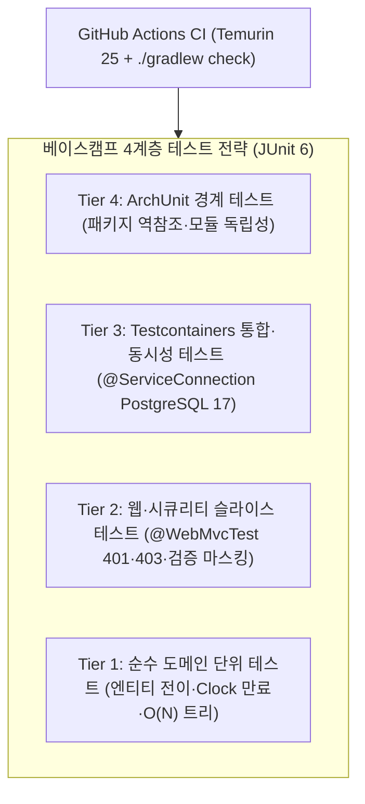

import Alert from '@/components/Alert.astro';
import LinkInline from '@/components/LinkInline.astro';

기능 구현을 모두 마치고 운영 배포를 하루 앞둔 밤, 우리 백엔드가 크리덴셜 스터핑(무차별 비밀번호 대입) 공격과 사후 보안 감사 준비를 마쳤는지 자문해 본 적 있으신가요? 로그인 API는 잘 돌아가지만 비밀번호를 만 번 연속 틀려도 계정이 안 잠기거나, 누가 언제 관리자 권한을 바꿨는지 추적할 로그가 없거나, `/actuator` 엔드포인트가 외부에 열려 있다면 아직 프로덕션에 올릴 준비가 되지 않은 상태입니다.

[9편의 탈착형 메뉴 모듈 구축](/dev/spring-boot-hierarchical-menu-tree-rbac)에 이은 이번 10편(`step-10`)에서는 베이스캠프를 실전 운영 등급으로 마무리하는 **연속 로그인 실패 계정 잠금**(`423 Locked`), **불변 보안 감사 로그**(`audit_logs`), **Actuator 최소 노출 정책**, 그리고 전 구간 36개 검증 케이스를 13초 만에 끝내는 **JUnit 6 기반 4계층 테스트 피라미드와 GitHub Actions CI**를 완성합니다.

## 13초 만에 전 구간을 검증하는 4계층 테스트 피라미드

모든 테스트 클래스 위에 습관적으로 `@SpringBootTest`를 붙이면 케이스가 100개만 넘어가도 CI 피드백이 수 분씩 밀립니다. 반대로 모든 의존성을 Mockito 가짜 객체로 덮어버리면 [7편에서 잡아냈던 PostgreSQL 셀프 데드락](/dev/spring-boot-jwt-refresh-rotation-logout) 같은 실제 트랜잭션 결함을 놓치게 됩니다. `spring-boot-basecamp`는 검증 목적에 맞춰 테스트를 정확히 네 계층으로 나눴습니다.



- **Tier 1**(순수 도메인 단위 테스트): 스프링 컨텍스트를 전혀 띄우지 않고 `User`의 잠금 상태 전이, 고정 `Clock`을 주입한 JWT 만료 검증, `MenuService`의 빈 폴더 가지치기 로직을 수십 밀리초 안에 검증합니다.
- **Tier 2**(웹·보안 슬라이스 테스트): `@WebMvcTest`로 보안 필터 체인의 `401`·`403` `ApiResponse` JSON 일치성과 민감 필드 마스킹을 격리 검증합니다.
- **Tier 3**(PostgreSQL 17 통합 테스트): `@ServiceConnection`으로 재사용되는 단일 컨테이너와 내장 톰캣 위에서 10스레드 동시 가입 경합, 부분 유니크 인덱스, RTR 재사용 폐기, RBAC 캐시 무효화를 끝단까지 검증합니다.
- **Tier 4**(ArchUnit 아키텍처 테스트): 새 기능을 개발하는 도중 누군가 실수로 `global`에서 `domain`을 참조하거나 `menu` 모듈을 침범하면 즉시 빌드를 멈춰 세웁니다.

## 브루트포스 방어를 위한 계정 임시 잠금(`423 Locked`)과 감사 로그

<LinkInline href="https://cheatsheetseries.owasp.org/cheatsheets/Authentication_Cheat_Sheet.html#account-lockout" label="OWASP 인증 치트시트(Account Lockout)" /> 권고에 따라 연속 5회 비밀번호가 틀리면 해당 계정을 15분 동안 임시 잠금(`UserStatus.LOCKED`, `lockedUntil = now + 15m`) 상태로 전환합니다.

여기서 5편에서 표준 `AuthenticationManager`(`DaoAuthenticationProvider`)를 그대로 탄 설계가 빛을 발합니다. `DaoAuthenticationProvider`는 CPU 연산이 비싼 BCrypt 해시 비교에 들어가기 **전에** 먼저 `UserDetails.isAccountNonLocked()`를 검사해 `LockedException`을 던집니다. 즉 일단 계정이 잠긴 15분 동안은 공격자가 설령 **올바른 비밀번호**를 찔러 넣더라도 해시 연산조차 태우지 않고 즉시 `423 AUTH_002`(`ACCOUNT_LOCKED`)로 차단해 서버 CPU 고갈까지 방어합니다.

주요 보안 사건 5종(`LOGIN_SUCCESS`, `LOGIN_FAILED`, `ACCOUNT_LOCKED`, `REFRESH_TOKEN_REUSE_DETECTED`, `ROLE_PERMISSIONS_UPDATED`)은 도메인 간 결합을 피하기 위해 스프링 이벤트(`SecurityAuditEvent`)로 발행하고, `SecurityAuditEventListener`가 Jackson 3 `JsonMapper`로 상세 맥락을 직렬화해 `audit_logs` 테이블에 기록합니다.

```java
package one.eone.app.domain.audit;

import org.slf4j.Logger;
import org.slf4j.LoggerFactory;
import org.springframework.context.event.EventListener;
import org.springframework.stereotype.Component;
import org.springframework.transaction.annotation.Transactional;
import tools.jackson.core.JacksonException;
import tools.jackson.databind.json.JsonMapper;

@Component
public class SecurityAuditEventListener {

    private static final Logger log = LoggerFactory.getLogger(SecurityAuditEventListener.class);
    private final AuditLogRepository auditLogRepository;
    private final JsonMapper jsonMapper;

    public SecurityAuditEventListener(AuditLogRepository auditLogRepository, JsonMapper jsonMapper) {
        this.auditLogRepository = auditLogRepository;
        this.jsonMapper = jsonMapper;
    }

    @EventListener
    @Transactional
    public void onSecurityAuditEvent(SecurityAuditEvent event) {
        String detailJson = serializeDetails(event);
        AuditLog auditLog = AuditLog.record(
                event.actorId(),
                event.eventType(),
                event.targetResource(),
                event.clientIp(),
                detailJson
        );
        auditLogRepository.save(auditLog);
    }

    private String serializeDetails(SecurityAuditEvent event) {
        try {
            return jsonMapper.writeValueAsString(event.details());
        } catch (JacksonException ex) {
            log.warn("Failed to serialize security audit details: {}", ex.getMessage());
            return "{}";
        }
    }
}
```

눈여겨볼 Spring Boot 4 변경점이 `catch (JacksonException ex)`입니다. Jackson 2 시절에는 `writeValueAsString()`이 체크 예외인 `JsonProcessingException`을 던졌지만, **Jackson 3**에서는 모든 예외가 언체크 런타임 예외인 `tools.jackson.core.JacksonException` 계층으로 개편되었습니다. 부가 메타데이터 직렬화 오류 하나 때문에 본 인증 흐름이 깨지지 않도록 안전하게 폴백(`"{}"`) 처리했습니다.

## 실전 삽질기: 미가입 이메일 로그인에서만 터진 `UnexpectedRollbackException(500)`

실패 횟수 누적과 실패 감사 로그(`LOGIN_FAILED`)가 인증 실패 시에도 롤백되지 않고 커밋되어야 하므로, `AuthService.login()`에도 `@Transactional(noRollbackFor = BusinessException.class)`를 적용했습니다.

그런데 통합 테스트를 돌리자 아주 교묘한 버그가 튀어나왔습니다. 가입된 회원이 비밀번호를 틀렸을 때는 감사 로그도 잘 쌓이고 `401 AUTH_001`이 내려오는데, **가입되지 않은 유령 이메일로 로그인했을 때만 `500` 에러**(`ghost@eone.one` → `Application exception overridden by commit exception`)가 터진 것입니다.

<Alert type="danger" title="내부 @Transactional 빈의 RuntimeException이 상위 트랜잭션을 오염시키는 원리">
원인은 `CustomUserDetailsService` 클래스에 습관적으로 붙여두었던 `@Transactional(readOnly = true)`에 있었습니다. `AuthService.login`이 연 물리 트랜잭션에 합류한 상태에서, `loadUserByUsername()`이 미가입 이메일을 만나 `UsernameNotFoundException`(`RuntimeException`)을 던지며 자신의 AOP 프록시 경계를 빠져나오는 순간 스프링 트랜잭션 인터셉터가 공유 트랜잭션에 이미 **`rollbackOnly = true`** 마킹을 찍어버린 것입니다. 뒤이어 `DaoAuthenticationProvider`가 그 예외를 잡아 `BadCredentialsException`으로 감싸고 `AuthService`가 감사 로그를 INSERT한 뒤 커밋을 시도하자 `UnexpectedRollbackException`이 폭발했습니다.
</Alert>

원인을 정확히 짚어낸 뒤 해법은 단 한 줄이었습니다. `CustomUserDetailsService`에 `noRollbackFor = UsernameNotFoundException.class`를 명시하자 내부 조회 예외가 상위 인증 트랜잭션의 롤백 마크를 오염시키지 않게 되었고, 미가입 이메일 로그인 시도 역시 `USER_NOT_FOUND` 감사 로그 커밋과 함께 정확히 `401 AUTH_001`을 반환했습니다.

```java
@Service
@Transactional(readOnly = true, noRollbackFor = UsernameNotFoundException.class)
public class CustomUserDetailsService implements UserDetailsService {
    // ...
}
```

## 운영 투입 전 최종 보안·인프라 점검표

배포 직전 누락하기 쉬운 운영 설정들을 프로젝트 기본값으로 고정하고 GitHub Actions CI(`.github/workflows/ci.yml`)에 연결했습니다.

| 점검 영역 | 적용 설정 및 파일 경로 | 방어하는 운영 사고 |
| :--- | :--- | :--- |
| **Actuator 노출 차단** | `management.endpoints.web.exposure.include: health` + `prod` `show-details: never` (<LinkInline href="https://docs.spring.io/spring-boot/reference/actuator/endpoints.html" label="Actuator 보안 가이드" />) | `/actuator/env`·`heapdump` 노출로 인한 DB 비밀번호·시크릿 유출 차단 |
| **운영 시크릿 Fail-Fast** | `application-prod.yml` 기본값 없는 `${JWT_SECRET}`, `${DB_PASSWORD}`, `cookie-secure: true` | 개발용 기본 시크릿 키가 운영 서버에 그대로 배포되는 참사 원천 차단 |
| **영속성 안전성** | 전 프로파일 `open-in-view: false`, `ddl-auto: validate` | 지연 로딩 커넥션 고갈 방지 및 운영 테이블 의도치 않은 스키마 변경 차단 |
| **자동화 CI 검증** | `ubuntu-latest` + Temurin JDK 25 + `./gradlew check --no-daemon` | PR·푸시마다 4계층 36개 테스트 및 ArchUnit 규칙 전수 검증 |

이제 보안 방어선과 테스트 자동화까지 모두 프로덕션 기준선을 통과했습니다(`step-10`). 마지막 11편(`v1.0.0`)에서는 스크립트 한 줄로 이 템플릿을 내 회사 패키지로 전환하는 초기화 검증과 사내 MSA 공통 모듈로의 확장 로드맵을 다룹니다.

## 참고 자료

- [OWASP Authentication Cheat Sheet — Account Lockout & Brute-Force Protection](https://cheatsheetseries.owasp.org/cheatsheets/Authentication_Cheat_Sheet.html#account-lockout)
- [Spring Boot 4 Reference — Production-ready Endpoints (Actuator Security)](https://docs.spring.io/spring-boot/reference/actuator/endpoints.html)
- [Spring Framework 7 Reference — Transaction Propagation & Rollback Rules](https://docs.spring.io/spring-framework/reference/data-access/transaction/declarative/tx-propagation.html)
