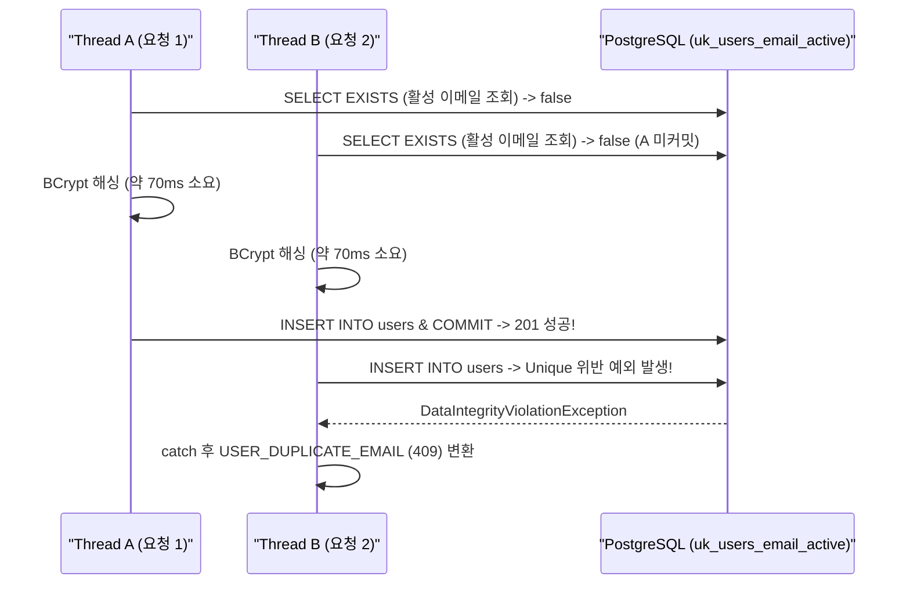

import Alert from '@/components/Alert.astro';
import LinkInline from '@/components/LinkInline.astro';

분명히 서비스 코드 첫 줄에 `if (userRepository.existsByEmail(email))` 중복 검사를 넣었는데, 왜 프론트엔드에서 가입 버튼을 빠르게 두 번 연타하거나 부하 테스트를 돌리면 `500 Internal Server Error`가 터질까요? 애플리케이션의 선조회 시점과 데이터베이스 INSERT 시점 사이의 빈틈(TOCTOU, Time-of-Check to Time-of-Use)을 파고드는 동시성 경합 때문입니다.

[3편의 소프트 삭제 부분 유니크 인덱스 설계](/dev/spring-boot-4-jpa-auditing-soft-delete)에 이어 이번 4편(`step-04`)에서는 무분별한 `@Setter`를 걷어낸 도메인 행위 중심 `User` 엔티티를 설계하고, `BCryptPasswordEncoder`의 숨은 길이 제약과 멀티스레드 동시 가입 경합에서도 단 한 건의 500 에러 없이 정확히 [`409 Conflict`](/dev/rest-api-http-methods-status-codes)를 반환하는 이중 방어선을 구축합니다.

## `@Setter` 없는 도메인 행위 중심 `User` 엔티티

엔티티 클래스 위에 `@Data`나 `@Setter`를 열어두면 서비스 코드 곳곳에 `user.setStatus(UserStatus.LOCKED)` 같은 파편화된 상태 변경문이 흩어집니다. 몇 달만 지나도 "계정을 잠글 때 실패 횟수 초기화나 잠금 만료 시각 세팅을 빠뜨린 곳은 없나?"를 아무도 장담할 수 없게 돼요.

[Java DTO·VO와 Spring 도메인 설계](/dev/java-dto-vo-spring-hybrid) 원칙에 따라 요청·응답 전달은 불변 `record` DTO에 맡기고, `User` 엔티티는 `protected` 기본 생성자로 JPA 스펙만 만족시킨 채 의미 있는 도메인 행위 메서드로만 상태를 전이하도록 캡슐화했습니다.

```java
package one.eone.app.domain.user;

import jakarta.persistence.Entity;
import jakarta.persistence.Table;
import java.time.Instant;
import java.util.Locale;
import one.eone.app.global.common.BaseTimeEntity;
import one.eone.app.global.error.BusinessException;
import org.jspecify.annotations.Nullable;

@Entity
@Table(name = "users")
public class User extends BaseTimeEntity {

    // 컬럼 매핑 생략 ...
    private @Nullable Instant lockedUntil;
    private @Nullable Instant deletedAt;

    protected User() {
    }

    private User(String email, String passwordHash, String name) {
        this.email = normalizeEmail(email);
        this.passwordHash = passwordHash;
        this.name = name.trim();
        this.status = UserStatus.ACTIVE;
        this.failedLoginAttempts = 0;
    }

    public static User create(String email, String passwordHash, String name) {
        return new User(email, passwordHash, name);
    }

    public static String normalizeEmail(String rawEmail) {
        return rawEmail.trim().toLowerCase(Locale.ROOT);
    }

    public void withdraw(Instant now) {
        ensureNotWithdrawn();
        this.status = UserStatus.WITHDRAWN;
        this.deletedAt = now;
        this.lockedUntil = null;
    }

    private void ensureNotWithdrawn() {
        if (this.status == UserStatus.WITHDRAWN || this.deletedAt != null) {
            throw new BusinessException(UserErrorCode.USER_ALREADY_WITHDRAWN);
        }
    }
}
```

작지만 사고를 막아주는 핵심 메서드가 `normalizeEmail()`입니다. PostgreSQL의 기본 `VARCHAR` 비교는 대소문자를 엄격히 구분해요. 가입 시점에 `"  Alice.Dev@Eone.One "`을 소문자와 공백 제거로 즉시 정규화하지 않으면 대소문자만 다른 중복 계정이 뚫리거나, 스마트폰 키보드의 첫 글자 자동 대문자 입력 때문에 로그인에 실패하는 불편이 생깁니다.

비밀번호 입력 DTO인 `SignupRequest`에도 실무 보안 제약을 명시했습니다.

```java
@NotBlank(message = "비밀번호는 필수입니다.")
@Size(min = 8, max = 72, message = "비밀번호는 8자 이상 72자 이하여야 합니다.")
String password
```

왜 최대 길이를 `100`자나 `255`자가 아닌 **`72`자**로 끊었을까요? <LinkInline href="https://cheatsheetseries.owasp.org/cheatsheets/Password_Storage_Cheat_Sheet.html" label="OWASP 비밀번호 저장 치트시트" />와 <LinkInline href="https://docs.spring.io/spring-security/reference/features/authentication/password-storage.html#authentication-password-storage-bcrypt" label="Spring Security BCrypt 레퍼런스" />가 짚어주듯, BCrypt 알고리즘은 구조상 최대 **72바이트**까지만 해시 연산을 지원합니다. 과거에는 초과분을 조용히 잘라내어 앞 72바이트만 같으면 인증이 뚫리는 왜곡(CVE-2025-22228)이 있었고, 이를 패치한 최신 Spring Security 7의 `BCryptPasswordEncoder`는 72바이트 초과 입력 시 즉시 `IllegalArgumentException`을 던집니다. 따라서 컨트롤러 진입 단계에서 미리 길이를 검증해 `500` 에러 대신 명확한 `400` 안내를 내려주는 편이 안전합니다(한글·이모지 등 멀티바이트 문자 허용 시에는 UTF-8 바이트 길이 검증을 함께 두는 것이 좋습니다).

## `existsByEmail`이 동시 요청 앞에서 무력해지는 순간

<LinkInline href="https://www.postgresql.org/docs/17/transaction-iso.html" label="PostgreSQL의 기본 트랜잭션 격리 수준" />은 `READ COMMITTED`입니다. 아직 커밋되지 않은 다른 트랜잭션의 변경분은 보이지 않는다는 뜻이죠. 동일 이메일로 두 개의 가입 요청(`Thread A`, `Thread B`)이 수 밀리초 간격으로 들어왔을 때 벌어지는 일을 시퀀스로 따라가 보면 원인이 선명해집니다.



특히 회원가입 경로에는 의도적으로 CPU 시간을 태우는 **BCrypt 해싱**(기본 cost 10 기준 약 60～80ms)이 자리 잡고 있습니다. `Thread A`가 `existsByEmailAndDeletedAtIsNull`을 통과한 뒤 해싱을 수행하는 수십 밀리초의 창 동안 `Thread B` 역시 아무 제지 없이 선조회에서 `false`를 받아 내려옵니다.

그렇다고 단순 회원가입 중복 방지를 위해 외부 Redis 분산 락을 얹는 것은 과잉 설계입니다. 이미 3편에서 만들어 둔 `uk_users_email_active` 인덱스가 DB 커밋 단계에서 완벽한 원자성을 보장해 주므로, 애플리케이션은 선조회로 평상시 불필요한 BCrypt 연산만 아끼고 경합 시 터지는 DB 제약 예외를 도메인 에러로 우아하게 번역하기만 하면 됩니다.

## 왜 `save()`가 아니라 `saveAndFlush()`여야 할까?

이중 방어선을 코드로 옮길 때 가장 많이 실수하는 지점이 바로 영속성 컨텍스트의 **쓰기 지연(Write-Behind) 타이밍**입니다.

```java
package one.eone.app.domain.user;

import one.eone.app.global.error.BusinessException;
import org.springframework.context.ApplicationEventPublisher;
import org.springframework.dao.DataIntegrityViolationException;
import org.springframework.security.crypto.password.PasswordEncoder;
import org.springframework.stereotype.Service;
import org.springframework.transaction.annotation.Transactional;

@Service
public class UserService {
    // 생성자 생략 ...

    @Transactional
    public SignupResponse signup(SignupRequest request) {
        String normalizedEmail = User.normalizeEmail(request.email());
        if (userRepository.existsByEmailAndDeletedAtIsNull(normalizedEmail)) {
            throw new BusinessException(UserErrorCode.USER_DUPLICATE_EMAIL);
        }

        String passwordHash = passwordEncoder.encode(request.password());
        User newUser = User.create(normalizedEmail, passwordHash, request.name());

        try {
            User savedUser = userRepository.saveAndFlush(newUser);
            eventPublisher.publishEvent(new UserSignedUpEvent(savedUser.getId()));
            return SignupResponse.from(savedUser);
        } catch (DataIntegrityViolationException ex) {
            throw new BusinessException(UserErrorCode.USER_DUPLICATE_EMAIL);
        }
    }
}
```

<Alert type="warning" title="save()만 호출하면 try-catch 블록이 예외를 놓칠 수 있습니다">
만약 `saveAndFlush()` 대신 일반 `save()`만 호출하고 flush 시점이 메서드 종료 이후 스프링의 `TransactionInterceptor` 커밋 단계로 밀리면, 실제 `INSERT`와 유니크 인덱스 충돌 예외(`DataIntegrityViolationException`)는 우리가 감싼 `try-catch` 블록 **바깥**에서 터집니다. 결국 변환 로직을 타지 못하고 클라이언트에게 `500` 에러가 노출되므로, 반드시 `saveAndFlush()`로 `try` 블록 내부에서 즉시 DB 제약 검증을 끝내야 합니다.
</Alert>

또한 `DataIntegrityViolationException`이 발생한 뒤에는 현재 하이버네이트 세션 상태가 깨지고 트랜잭션에 롤백 마크가 찍히므로 예외를 삼키고 다른 쿼리를 이어가려 하면 안 됩니다. 위처럼 즉시 `BusinessException`을 던져 트랜잭션을 깔끔히 롤백시키고 `GlobalExceptionHandler`가 `409 USER_001` 응답을 내려주게 하는 것이 정석입니다.

## 10스레드 동시 가입 통합 테스트로 증명하기

동시성 코드는 실제 멀티스레드 환경에서 부딪혀 보기 전에는 검증됐다고 말할 수 없습니다. 특히 테스트 메서드에 습관적으로 `@Transactional`을 붙이면 테스트 스레드의 단일 트랜잭션과 내장 톰캣 워커 스레드들이 분리되어 운영 환경의 커밋 경합을 똑같이 재현하지 못합니다.

`UserConcurrencyIntegrationTest`에서는 `@SpringBootTest(webEnvironment = RANDOM_PORT)`로 실제 톰캣 포트를 열고, Java 표준 `HttpClient`와 `CountDownLatch`를 조합해 10개 스레드가 출발 신호와 동시에 가입 요청을 쏘도록 구성했습니다. *(참고로 테스트 응답 JSON 검증 시 Jackson 3의 `tools.jackson.databind.JsonNode`에서는 구버전 `asText()` 대신 표준 메서드인 `asString()`을 사용합니다.)*

```java
assertThat(readyLatch.await(10, TimeUnit.SECONDS)).isTrue();
startLatch.countDown(); // 10개 스레드 동시 출발

long createdCount = responses.stream()
        .filter(res -> res.statusCode() == HttpStatus.CREATED.value())
        .count();
long conflictCount = responses.stream()
        .filter(res -> res.statusCode() == HttpStatus.CONFLICT.value())
        .count();

assertThat(createdCount).isEqualTo(1);
assertThat(conflictCount).isEqualTo(9);
```

실행 결과 10개의 동시 요청 가운데 정확히 **1건만** `201 Created`로 계정을 생성했고, 나머지 **9건은 단 하나의 500 에러 누출 없이** `409 Conflict`(`USER_001`)를 반환했습니다. 이어진 회원 탈퇴(`withdraw`) 후 동일 이메일 재가입 시나리오까지 모두 그린 라이트를 켜며 사용자 도메인(`step-04`)이 완성되었습니다. 다음 5편에서는 복붙으로 넘기던 **Spring Security 7 필터 체인 내부 구조**를 그림으로 해부하고 공식 `NimbusJwt` 기반 로그인을 구현합니다.

## 참고 자료

- [OWASP Password Storage Cheat Sheet — Maximum Password Lengths (BCrypt 72-byte limit)](https://cheatsheetseries.owasp.org/cheatsheets/Password_Storage_Cheat_Sheet.html)
- [Spring Security Reference — BCryptPasswordEncoder](https://docs.spring.io/spring-security/reference/features/authentication/password-storage.html#authentication-password-storage-bcrypt)
- [PostgreSQL 17 Documentation — Transaction Isolation (Read Committed)](https://www.postgresql.org/docs/17/transaction-iso.html)
