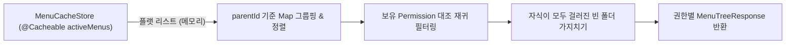

import Alert from '@/components/Alert.astro';
import LinkInline from '@/components/LinkInline.astro';

어드민 백오피스나 B2B SaaS 대시보드를 만들 때마다 등장하는 좌측 사이드바 메뉴, 혹시 JPA `@OneToMany` 자기 참조 컬렉션으로 매핑했다가 트리 깊이만큼 쏟아지는 N+1 쿼리와 `LazyInitializationException`에 데여본 적 없으신가요? 반대로 화면을 새로고침할 때마다 DB에 `WITH RECURSIVE` 재귀 쿼리를 날리는 것 역시 불필요한 낭비입니다.

[8편의 3단 RBAC 권한과 캐시 체계](/dev/spring-security-rbac-role-permission)에 이은 이번 9편(`step-09`)에서는 계층형 데이터를 표현하는 세 가지 모델링 기법을 비교하고, **플랫 캐시 + 인메모리 O(N) 트리 조립**으로 권한별 메뉴 트리를 깔끔하게 내려주는 방법을 구현합니다. 아울러 서버 관리형 메뉴가 필요 없는 프로젝트에서는 파일 몇 개만 지워 10초 만에 제거할 수 있는 **완전 탈착형 모듈 설계**까지 함께 다룹니다.

## 계층형 데이터 모델링 3종 비교: UI 메뉴에는 무엇이 최적일까?

관계형 데이터베이스에서 부모–자식 트리 구조를 저장할 때는 보통 세 가지 설계 패턴이 경합합니다.

| 모델링 기법 | 저장 구조 예시 | 장점 | 단점 및 실무 한계 | 최적 도메인 |
| :--- | :--- | :--- | :--- | :--- |
| **인접 리스트** (Adjacency List) | `parent_id BIGINT` 자기 참조 | 스키마가 직관적이며 부모 이동·순서 수정이 단일 행 업데이트로 끝남 | RDB 단독 서브트리 조회 시 <LinkInline href="https://www.postgresql.org/docs/17/queries-with.html#QUERIES-WITH-RECURSIVE" label="WITH RECURSIVE CTE" /> 필요 | **GNB·사이드바 메뉴** (수백 건 이하, 읽기 압도적) |
| **경로 열거** (Materialized Path) | `path VARCHAR` (`'/1/4/12/'`) | `LIKE '/1/4/%'` 인덱스 스캔으로 하위 트리 조회 빠름 | 상위 폴더 이동 시 모든 자손 행의 문자열 경로를 일괄 치환해야 함 | 변경이 드문 게시판 카테고리·폴더 경로 |
| **클로저 테이블** (Closure Table) | 별도 `menu_closure(ancestor, descendant, depth)` | 수만 건 규모의 깊은 계층 집계·서브트리 조인에 강력함 | 이동·삭제 시 조상–자손 매핑 행 재계산 복잡도가 높고 테이블 추가 필요 | 대형 커머스 상품 분류·대기업 조직도 |

네비게이션 메뉴의 도메인 특성을 짚어보면 답은 간명합니다. 전체 메뉴 행 수는 많아 봐야 수십～수백 건 이내이고, 메뉴 수정은 한 달에 몇 번 일어날까 말까 한 반면 읽기는 모든 사용자의 첫 진입마다 발생합니다. 따라서 DB에는 쓰기·수정 비용이 가장 낮은 **`parent_id` 인접 리스트**로 저장하고, 노출 대상(`visible = true`) 전체 목록을 통째로 Caffeine 캐시에 올려둔 뒤 애플리케이션 메모리에서 사용자 권한에 맞춰 O(N)으로 트리를 조립하는 방식이 가장 빠르고 명쾌합니다.



## `@Cacheable` 자가 호출 함정 회피와 빈 폴더 가지치기(Pruning)

캐시를 붙일 때 가장 먼저 피해야 할 스프링의 단골 함정이 <LinkInline href="https://docs.spring.io/spring-framework/reference/core/aop/proxying.html#aop-understanding-aop-proxies" label="Spring AOP 프록시 자가 호출(Self-Invocation)" />입니다. 만약 `MenuService` 안의 `getAccessibleMenuTree()` 메서드가 같은 클래스 내부의 `this.getVisibleMenus()`(`@Cacheable`)를 호출하면 스프링 프록시를 우회하기 때문에 캐시 어노테이션이 완전히 무시됩니다.

그래서 처음부터 캐시 조회와 무효화 책임만 전담하는 `MenuCacheStore` 빈을 별도 클래스로 분리했습니다. 또한 JPA 영속 엔티티를 캐시에 그대로 넣으면 트랜잭션 종료 후 준영속 상태 공유 문제가 생길 수 있으므로 불변 `record`인 `CachedMenuItem`으로 변환해 저장합니다.

```java
package one.eone.app.domain.menu;

import java.util.List;
import one.eone.app.global.config.CacheConfig;
import org.springframework.cache.annotation.CacheEvict;
import org.springframework.cache.annotation.Cacheable;
import org.springframework.stereotype.Component;
import org.springframework.transaction.annotation.Transactional;

@Component
@Transactional(readOnly = true)
public class MenuCacheStore {

    public static final String ALL_VISIBLE_KEY = "'ALL_VISIBLE'";
    private final MenuRepository menuRepository;

    public MenuCacheStore(MenuRepository menuRepository) {
        this.menuRepository = menuRepository;
    }

    @Cacheable(cacheNames = CacheConfig.ACTIVE_MENUS_CACHE, key = ALL_VISIBLE_KEY)
    public List<CachedMenuItem> getVisibleMenus() {
        return menuRepository.findAllByVisibleTrueOrderBySortOrderAscIdAsc().stream()
                .map(CachedMenuItem::from)
                .toList();
    }

    @CacheEvict(cacheNames = CacheConfig.ACTIVE_MENUS_CACHE, allEntries = true)
    public void evictMenuCache() {
    }
}
```

다음은 인메모리 트리 조립을 구현하며 통합 테스트에서 바로잡은 **빈 그룹 폴더 노출 버그**입니다. 시드 데이터에 `'시스템 관리'`(`SYSTEM_ADMIN`)라는 상위 그룹 폴더가 있고 그 아래에 `'역할·권한 관리'`(`ROLE_READ`), `'메뉴 관리'`(`MENU_MANAGE`), `'보안 감사 로그'`(`AUDIT_READ`) 세 개의 하위 메뉴가 달린 구조를 떠올려 보세요. 상위 폴더 자체는 클릭 이동 경로(`path = null`)도 없고 특정 단일 권한도 지정되어 있지 않습니다(세 하위 권한 중 하나만 있어도 열려야 하니까요).

그런데 단순 권한 비교만 거치면 일반 회원(`ROLE_USER`)이 메뉴 트리를 조회했을 때 하위 메뉴 3개는 권한 부족으로 모두 제거되는데, 정작 속이 텅 빈 `'시스템 관리'` 껍데기 폴더가 사이드바에 덩그러니 남게 됩니다.

```java
List<CachedMenuItem> rawChildren = childrenByParent.getOrDefault(node.id(), List.of());
List<MenuTreeResponse> filteredChildren = rawChildren.isEmpty()
        ? List.of()
        : buildSubtree(rawChildren, childrenByParent, userAuthorities, visitedIds);

// 원본에는 자식 메뉴가 있었으나 권한 필터링 후 하나도 남지 않은 순수 그룹 폴더(path == null)는 함께 제거
if (node.path() == null && !rawChildren.isEmpty() && filteredChildren.isEmpty()) {
    continue;
}
```

이 가지치기(Pruning) 조건을 추가한 덕분에 일반 회원에게는 `'대시보드'`와 `'내 계정 설정'` 2건만 깔끔하게 내려가고, 하위 관리 권한을 하나 이상 가진 운영자에게만 `'시스템 관리'` 폴더가 자동으로 열리는 완성도 높은 응답이 만들어졌습니다. *(다중 인스턴스 운영 환경에서는 [MSA 인메모리 DB 가이드: Valkey·Redis](/dev/msa-redis-valkey-session-lock)의 분산 캐시 매니저로 `CacheConfig`만 교체하면 모든 노드의 메뉴 캐시가 함께 갱신됩니다.)*

## 순환 참조(`A → B → A`) 차단과 하위 존재 삭제 방어

어드민 화면에서 드래그 앤 드롭으로 메뉴 계층을 수정(`PATCH /api/v1/admin/menus/{menuId}`)할 때 실수로 상위 폴더의 `parentId`를 자기 자신이나 자신의 손자 메뉴 ID로 지정하면, 트리 조립 시 무한 루프에 빠지거나 해당 서브트리 전체가 루트 목록에서 증발해 버립니다. 수정 시점에는 변경 대상 `targetParentId`로부터 루트(`null`)까지 부모 체인을 역추적하며 `menuId`와 만나는지 검사해 `400 MENU_003` 에러로 즉시 차단합니다.

```java
Long cursor = targetParentId;
Set<Long> visited = new HashSet<>();
while (cursor != null) {
    if (cursor.equals(menuId) || !visited.add(cursor)) {
        throw new BusinessException(MenuErrorCode.INVALID_MENU_HIERARCHY);
    }
    cursor = parentMap.get(cursor);
}
```

삭제(`DELETE`) 역시 하위 메뉴가 남아 있을 때(`existsByParentId(menuId)`) 조용히 연쇄 삭제해 운영 사고를 내는 대신 `409 MENU_004` 예외를 반환해 하위 항목을 먼저 정리하도록 강제했습니다.

## 10초 만에 덜어낼 수 있는 완전 탈착형 모듈 격리

기획 단계부터 가장 중요하게 여긴 원칙이 바로 **선택적 탈착성**입니다. 모바일 앱 전용 백엔드나 외부 연동 API 서버에는 DB 기반 메뉴 트리가 불필요한 테이블만 늘리는 짐이 될 수 있기 때문이죠. 그래서 `menu` 도메인은 세 겹의 격리 설계를 적용했습니다.

<Alert type="info" title="코드 수정 한 줄 없이 삭제만으로 끝나는 탈착 설계 3원칙">
1. **패키지 역참조 제로**: `user`, `auth`, `role`, `audit` 등 다른 어떤 패키지도 `domain.menu`를 import하지 못하도록 1편의 ArchUnit 규칙이 매 빌드마다 감시합니다.
2. **느슨한 권한 코드 참조**: `menus.required_permission` 컬럼에 `permissions` 테이블을 향한 물리적 FK 제약을 걸지 않고 권한 코드 문자열(`VARCHAR`)만 저장합니다.
3. **전용 Flyway 파일 분리**: 테이블 생성(`V3__init_menu_schema.sql`)과 `MENU_MANAGE` 권한·시드 메뉴 적재(`V4__seed_menu_data.sql`)를 코어 마이그레이션(`V1`, `V2`)과 완전히 분리했습니다.
</Alert>

덕분에 메뉴 관리가 필요 없는 프로젝트는 `src/main`과 `src/test`의 `domain/menu` 폴더 및 `V3`, `V4` SQL 파일 두 개만 삭제하면 나머지 코어 코드를 단 한 줄도 고치지 않고 빌드가 통과합니다(`step-09`). 다음 10편에서는 운영 투입 전날 반드시 점검해야 할 **로그인 연속 실패 계정 잠금, 보안 감사 로그, 트랜잭션 롤백 오염 해결, 그리고 4계층 테스트·CI 파이프라인**을 다룹니다.

## 참고 자료

- [PostgreSQL 17 Documentation — WITH Queries (Common Table Expressions & Recursive Queries)](https://www.postgresql.org/docs/17/queries-with.html#QUERIES-WITH-RECURSIVE)
- [Spring Framework 7 Reference — Understanding AOP Proxies (Self-Invocation)](https://docs.spring.io/spring-framework/reference/core/aop/proxying.html#aop-understanding-aop-proxies)
- [Spring Framework 7 Reference — Declarative Annotation-based Caching (@Cacheable)](https://docs.spring.io/spring-framework/reference/integration/cache/annotations.html)
