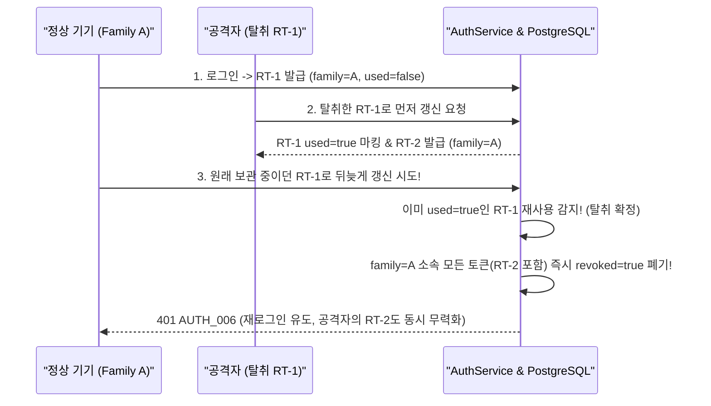

import Alert from '@/components/Alert.astro';
import LinkInline from '@/components/LinkInline.astro';

Access Token 유효기간을 30분으로 줄였다고 안심하고 계신가요? 정작 2주짜리 수명을 가진 Refresh Token을 DB에서 단순 조회만 하거나 갱신할 때마다 이전 행을 `DELETE` 해버리는 구조라면, 공격자가 탈취한 토큰으로 몰래 세션을 연장해도 서버는 피해자가 직접 로그아웃할 때까지 침해 사실조차 알아채지 못합니다.

[6편의 JWT 검증 필터와 에러 응답 통일](/dev/spring-security-7-jwt-filter-401-403)에 이은 이번 7편(`step-07`)에서는 <LinkInline href="https://www.rfc-editor.org/rfc/rfc9700.html#section-4.14.2" label="IETF RFC 9700 OAuth 2.0 보안 모범 사례" />가 권고하는 **Refresh Token Rotation**(RTR)과 **`tokenFamilyId` 기반 재사용 탐지**(Reuse Detection)를 구현합니다. 특히 재사용 탐지 강제 폐기를 구현하다 실제 PostgreSQL 17 통합 테스트에서 정면으로 부딪힌 **`SELECT FOR UPDATE` + `REQUIRES_NEW` 셀프 데드락** 사고와 단일 커넥션 해결법을 상세히 공유합니다.

## 왜 기존 토큰을 삭제하지 않고 `used = true`로 남겨야 할까?

흔히 볼 수 있는 토큰 갱신 코드는 새 토큰 쌍을 내줄 때 기존 Refresh Token 행을 테이블에서 곧바로 `DELETE` 합니다. 테이블 용량은 깔끔해 보일지 몰라도 보안 관점에서는 결정적인 침입 흔적을 스스로 지워버리는 셈입니다.

공격자가 악성 스크립트나 네트워크 스니핑으로 피해자의 기기에서 `RT-1`을 훔쳤다고 가정해 봅시다. 공격자가 먼저 `RT-1`로 `/refresh`를 호출해 `RT-2`를 챙겨가면, 잠시 뒤 정상 사용자의 브라우저가 만료된 Access Token을 갱신하려고 자신이 보관하던 `RT-1`을 서버에 제출합니다(반대로 정상 사용자가 먼저 회전한 뒤 공격자가 구 토큰 `RT-1`을 뒤늦게 찌를 수도 있죠). 이때 `RT-1`이 DB에서 물리 삭제되어 있으면 서버는 단순 만료·오류인지 탈취된 토큰의 재사용인지 구분할 방법이 없습니다.

반면 한 번의 로그인 뿌리에서 파생된 토큰들을 동일한 **`tokenFamilyId` 계보**로 묶고 소모된 토큰을 `used = true` 상태로 보존하면 정밀한 침입 탐지기가 완성됩니다.



여기에 두 가지 운영 설계 디테일을 더했습니다.

1. **원문 토큰 미저장**(SHA-256 해싱): Refresh Token은 자체 서명된 긴 JWT 대신 `SecureRandom` 256비트 난수 문자열(Opaque Token)로 발급하고, `refresh_tokens` 테이블에는 평문이 아닌 **SHA-256 해시값**(`token_hash`)만 저장합니다. 비밀번호 해시처럼 설령 DB 스냅샷이 유출되어도 공격자는 쿠키에 실어 보낼 원본 토큰을 역산할 수 없습니다.
2. **기기별 세션 격리**: 로그인할 때마다 기기 세션마다 고유한 `tokenFamilyId`를 발급합니다. 카페 공용 와이파이에서 쓴 노트북 세션(`Family A`)이 재사용 탐지로 강제 종료되더라도, 집에서 로그인해 둔 스마트폰 앱 세션(`Family B`)은 끊기지 않고 유지됩니다.

## 실전 삽질기: `SELECT FOR UPDATE`와 `REQUIRES_NEW`가 만든 셀프 데드락

재사용 탐지 로직을 작성할 때 가장 먼저 만나는 관문은 **스프링 선언적 트랜잭션의 기본 롤백 동작**입니다. `storedToken.isUsed()`가 `true`임을 확인해 패밀리 전체를 `revoked = true`로 업데이트한 직후 `throw new BusinessException(AuthErrorCode.REFRESH_TOKEN_REUSED)`(`RuntimeException`)를 던지면, 스프링이 예외를 감지하고 트랜잭션을 통째로 롤백시켜 방금 실행한 폐기 `UPDATE`까지 없던 일로 되돌려 버립니다.

이를 피하겠다며 많은 백엔드 개발자가 떠올리는 교과서적 처방이 폐기 쿼리를 별도 빈으로 분리해 `@Transactional(propagation = Propagation.REQUIRES_NEW)`로 독립 트랜잭션을 여는 방식입니다. 저 역시 첫 구현에서는 그렇게 분리한 뒤, 멀티 탭 동시 갱신 경합을 막는 비관적 잠금(`@Lock(LockModeType.PESSIMISTIC_WRITE)`)과 결합해 `./gradlew check`를 실행했습니다.

결과는 충격적이었습니다. 테스트가 끝나지 않고 **무한 대기**(Hang) 상태에 빠졌습니다.

<Alert type="danger" title="Mock 단위 테스트로는 절대 발견할 수 없는 PostgreSQL 셀프 데드락">
바깥 트랜잭션(`TX-1`)이 `findWithLockByTokenHash`(`SELECT ... FOR UPDATE`)로 재사용된 토큰 행(`RT-1`, 아직 `revoked = false`)에 배타적 행 잠금(Exclusive Row Lock)을 쥔 채 일시 중단(Suspend)됩니다. 그 상태에서 새로 열린 `REQUIRES_NEW` 안쪽 트랜잭션(`TX-2`, 두 번째 DB 커넥션)이 `UPDATE refresh_tokens SET revoked = true WHERE token_family_id = :id AND revoked = false`를 실행하면, `TX-2`는 `TX-1`이 쥐고 있는 `RT-1` 행 잠금이 풀리기만을 기다리고 자바 스레드의 `TX-1`은 `TX-2` 메서드가 리턴되기만을 기다리는 완벽한 **셀프 데드락**에 빠집니다.
</Alert>

만약 리포지토리를 Mockito로 가짜 모킹해서 단위 테스트만 통과시키고 운영에 내보냈다면, 토큰 재사용 시도가 들어올 때마다 HikariCP 커넥션이 두 개씩 영구 고갈되어 서버 전체가 뻗는 대형 장애로 이어졌을 것입니다. <LinkInline href="https://www.postgresql.org/docs/17/explicit-locking.html#LOCKING-ROWS" label="PostgreSQL 행 수준 잠금 동작" />을 그대로 재현하는 Testcontainers 통합 테스트 덕분에 커밋 전에 즉시 잡아낼 수 있었습니다.

## 단일 커넥션으로 깔끔하게 푸는 `noRollbackFor` 전략

생각을 바꾸면 커넥션을 두 개나 열면서 데드락 위험을 감수할 이유가 전혀 없습니다. `refresh()` 초반 검증 단계에서는 어떤 더티 체킹 쓰기도 일어나지 않도록 순서를 정돈한 뒤, 메서드에 `@Transactional(noRollbackFor = BusinessException.class)`를 선언하면 단일 트랜잭션·단일 커넥션 안에서 모든 요구사항이 깔끔하게 해결됩니다.

```java
package one.eone.app.domain.auth;

import java.time.Instant;
import java.util.Map;
import one.eone.app.domain.audit.SecurityAuditEvent;
import one.eone.app.domain.audit.SecurityAuditEventType;
import one.eone.app.domain.user.User;
import one.eone.app.domain.user.UserRepository;
import one.eone.app.global.error.BusinessException;
import one.eone.app.global.security.JwtTokenProvider;
import one.eone.app.global.security.SecurityErrorCode;
import org.jspecify.annotations.Nullable;
import org.springframework.context.ApplicationEventPublisher;
import org.springframework.stereotype.Service;
import org.springframework.transaction.annotation.Transactional;
import org.springframework.util.StringUtils;

@Service
@Transactional(readOnly = true)
public class AuthService {

    private final UserRepository userRepository;
    private final RefreshTokenRepository refreshTokenRepository;
    private final JwtTokenProvider jwtTokenProvider;
    private final ApplicationEventPublisher eventPublisher;
    // 생성자 및 login, logout 생략 ...

    @Transactional(noRollbackFor = BusinessException.class)
    public TokenResponse refresh(@Nullable String rawRefreshToken, ClientRequestMetadata metadata) {
        if (!StringUtils.hasText(rawRefreshToken)) {
            throw new BusinessException(SecurityErrorCode.INVALID_TOKEN);
        }

        String tokenHash = jwtTokenProvider.hashRefreshToken(rawRefreshToken);
        RefreshToken storedToken = refreshTokenRepository.findWithLockByTokenHash(tokenHash)
                .orElseThrow(() -> new BusinessException(SecurityErrorCode.INVALID_TOKEN));

        if (storedToken.isUsed()) {
            int revokedCount = refreshTokenRepository.revokeAllByTokenFamilyId(storedToken.getTokenFamilyId());
            eventPublisher.publishEvent(new SecurityAuditEvent(
                    storedToken.getUserId(),
                    SecurityAuditEventType.REFRESH_TOKEN_REUSE_DETECTED,
                    "tokenFamily:" + storedToken.getTokenFamilyId(),
                    metadata.clientIp(),
                    Map.of("revokedCount", revokedCount)
            ));
            throw new BusinessException(AuthErrorCode.REFRESH_TOKEN_REUSED);
        }

        Instant now = Instant.now();
        if (storedToken.isRevoked()) {
            throw new BusinessException(SecurityErrorCode.INVALID_TOKEN);
        }
        if (storedToken.isExpired(now)) {
            throw new BusinessException(SecurityErrorCode.EXPIRED_TOKEN);
        }

        User user = userRepository.findByIdAndDeletedAtIsNull(storedToken.getUserId())
                .orElseThrow(() -> new BusinessException(SecurityErrorCode.INVALID_TOKEN));
        if (user.isCurrentlyLocked(now)) {
            throw new BusinessException(AuthErrorCode.ACCOUNT_LOCKED);
        }

        storedToken.markUsed();
        return issueAndPersistTokenPair(user, storedToken.getTokenFamilyId(), metadata, now);
    }
}
```

동일한 물리 트랜잭션 안이므로 자신이 `FOR UPDATE`로 잠근 `RT-1` 행과 형제 토큰(`RT-2`)을 잠금 대기 없이 즉시 `revoked = true`로 업데이트하며, 뒤이어 `BusinessException`(`401 AUTH_006`)을 던지더라도 트랜잭션이 정상 커밋되어 공격자가 쥐고 있던 최신 토큰까지 영구 무력화됩니다.

## SPA 쿠키·모바일 바디 겸용 처리와 단일 로그아웃 vs 전체 탈퇴

클라이언트 플랫폼 제약 없이 바로 붙일 수 있도록 `AuthController`는 요청 JSON 바디(`RefreshTokenRequest`)에 토큰이 있으면 우선 읽고, 비어 있으면 브라우저가 자동 전송한 `HttpOnly` 쿠키(`refresh_token`)에서 폴백으로 추출합니다.

| 동작 구분 | 엔드포인트 | 세션 폐기 범위 | 도메인 결합 처리 |
| :--- | :--- | :--- | :--- |
| **단일 기기 로그아웃** | `POST /api/v1/auth/logout` | 현재 기기의 `tokenFamilyId`만 선택 폐기 + `Max-Age=0` 쿠키 삭제 | `AuthService.logout()` 직접 처리 (본인 소유 토큰 검증) |
| **회원 탈퇴** | `DELETE /api/v1/users/me` | 해당 `userId`의 **모든 기기 세션** 일괄 폐기(`revokeAllByUserId`) | `domain.user`가 `UserWithdrawnEvent` 발행 → `AuthService` 구독 |

회원 탈퇴 시 `UserService`가 `RefreshTokenRepository`를 직접 호출하지 않고 스프링 도메인 이벤트(`UserWithdrawnEvent`)로 느슨하게 연결한 덕분에 도메인 간 순환 참조도 깔끔하게 예방했습니다. *(추후 초당 수천 건의 토큰 회전이 일어나는 대규모 MSA 환경으로 확장할 때는 [MSA 인메모리 DB 가이드: Valkey·Redis 세션 설계](/dev/msa-redis-valkey-session-lock)에서 다룬 Lua 스크립트 원자적 회전 구조로 저장소만 교체할 수 있습니다.)*

`AuthTokenRotationIntegrationTest`를 통해 해시 저장 확인, 구 토큰 재사용 시 최신 토큰 동반 폐기, 타 기기 세션 격리 생존, 쿠키 단독 갱신, 탈퇴 시 전 기기 만료까지 검증을 완료했습니다(`step-07`). 다음 8편에서는 세 번째 기획 변경에도 코드 수정이 필요 없는 **Role·Permission 3단 RBAC 권한 모델과 실시간 캐시 무효화**를 구현합니다.

## 참고 자료

- [RFC 9700: Best Current Practice for OAuth 2.0 Security — Refresh Token Protection & Rotation](https://www.rfc-editor.org/rfc/rfc9700.html#section-4.14.2)
- [PostgreSQL 17 Documentation — Explicit Row-Level Locking (FOR UPDATE)](https://www.postgresql.org/docs/17/explicit-locking.html#LOCKING-ROWS)
- [Spring Framework 7 Reference — Rolling Back a Declarative Transaction (noRollbackFor)](https://docs.spring.io/spring-framework/reference/data-access/transaction/declarative/rolling-back.html)
