import Alert from '@/components/Alert.astro';
import LinkInline from '@/components/LinkInline.astro';

왜 Spring Security 설정 코드는 매번 예전 프로젝트에서 복사해 붙여넣으면서도, 막상 작은 인가 규칙 하나만 바꾸려 하면 어디를 손대야 할지 막막해질까요? 서블릿 컨테이너의 필터와 스프링 빈 컨텍스트를 잇는 다리 구조, 그리고 인증 매니저의 위임 흐름을 머릿속 지도로 그려본 적이 없기 때문입니다.

[4편의 동시성 안전 회원가입](/dev/spring-boot-4-user-signup-concurrency)에 이은 이번 5편(`step-05`)에서는 복붙 의존증을 끊어낼 수 있도록 **Spring Security 7**의 내부 실행 파이프라인을 명쾌하게 해부합니다. 이어서 왜 관성적으로 쓰던 서드파티 `jjwt` 대신 스프링 공식 **NimbusJwt 인코더·디코더**(`NimbusJwtEncoder`·`NimbusJwtDecoder`)를 채택했는지, 그리고 `Thread.sleep()` 없이 만료를 검증하는 JWT 로그인 플로우를 어떻게 구성하는지 코드로 정리합니다.

## 한 장으로 끝내는 Spring Security 7 필터 체인 구조

```mermaid
flowchart LR
    Req["HTTP 요청"] --> Mdc["MdcTraceFilter (최상위 서블릿 필터)"]
    Mdc --> DFP["DelegatingFilterProxy (서블릿 ↔ 스프링 브리지)"]
    DFP --> FCP["FilterChainProxy (springSecurityFilterChain)"]
    FCP --> SFC["SecurityFilterChain (Lambda DSL 규칙)"]
    SFC --> Ctrl["DispatcherServlet & AuthController"]
    Ctrl --> AM["AuthenticationManager (ProviderManager)"]
    AM --> DAO["DaoAuthenticationProvider"]
    DAO --> UDS["CustomUserDetailsService + PasswordEncoder"]
```

내장 톰캣 같은 서블릿 컨테이너는 스프링의 `@Bean`이 무엇인지 알지 못합니다. 오직 서블릿 표준 `jakarta.servlet.Filter` 목록만 순서대로 호출할 뿐이죠. 그렇다면 우리가 스프링 빈으로 등록한 `SecurityFilterChain`은 어떻게 HTTP 요청을 가로채는 걸까요? <LinkInline href="https://docs.spring.io/spring-security/reference/servlet/architecture.html" label="Spring Security 공식 서블릿 아키텍처 문서" />의 핵심 위임 구조를 우리 베이스캠프 코드에 대입해 그리면 아래와 같습니다.



요청이 흘러가는 세 구간만 이해하면 시큐리티 설정이 더 이상 블랙박스로 보이지 않습니다.

1. **`DelegatingFilterProxy` 브리지**: 서블릿 컨테이너에 등록된 얇은 대리인입니다. 직접 보안 검사를 하지 않고 스프링 애플리케이션 컨텍스트 안의 `FilterChainProxy` 빈에게 처리를 넘깁니다. 2편에서 만든 `MdcTraceFilter`는 `Ordered.HIGHEST_PRECEDENCE`를 가졌기 때문에 이 브리지에 진입하기 전 가장 먼저 `traceId`를 발급합니다.
2. **`FilterChainProxy`와 `SecurityFilterChain`**: `SecurityConfig`에서 `@Bean`으로 정의하는 Lambda DSL의 결과물입니다. 세션을 쓰지 않는 REST API 서버이므로 여기서 기본 FormLogin, HttpBasic, 세션 기반 Logout, CSRF 필터를 걷어내 체인을 가볍게 유지합니다.
3. **`AuthenticationManager` 표준 인증 위임**: 로그인 서비스가 이메일·비밀번호 토큰을 전달하면 `DaoAuthenticationProvider`가 `CustomUserDetailsService`로 계정을 조회해 잠금 여부(`isAccountNonLocked`), 활성 여부(`isEnabled`), 그리고 `BCryptPasswordEncoder` 해시 일치를 차례대로 검증합니다.

간혹 시큐리티가 번거롭다며 `AuthenticationManager`를 건너뛰고 서비스 메서드에서 `if (!passwordEncoder.matches(...))`만 직접 비교하는 구현도 보입니다. 하지만 표준 `DaoAuthenticationProvider` 파이프라인을 타야 미가입 이메일 조회 시에도 더미 BCrypt 해시 연산을 수행해 응답 시간 차이로 가입 여부를 떠보는 **타이밍 공격**(Timing Attack) 완화 혜택을 프레임워크 기본값으로 챙길 수 있습니다.

## 왜 서드파티 `jjwt` 대신 공식 `NimbusJwt`인가?

오랜 기간 국내 스프링 예제 상당수가 JWT 라이브러리로 `io.jsonwebtoken:jjwt`를 사용해 왔습니다. 초기 기획 단계에서도 익숙함을 고려해 후보에 올렸지만, 실제 **Spring Boot 4** 의존성 트리를 점검한 뒤 공식 모듈로 선회했습니다.

<Alert type="info" title="Spring Boot 4 Jackson 3 환경과 jjwt의 전이 의존성 충돌">
`jjwt-jackson` 아티팩트는 내부 JSON 직렬화를 구버전 Jackson 2(`com.fasterxml.jackson.databind.ObjectMapper`)에 의존합니다. Jackson 3(`tools.jackson`)로 깔끔하게 정리된 Spring Boot 4 클래스패스에 토큰 라이브러리 하나 때문에 구버전 Jackson 2 코어를 중복으로 끌어들이게 됩니다.
</Alert>

반면 스프링 공식 `spring-boot-starter-oauth2-resource-server`에 포함된 `spring-security-oauth2-jose`는 금융권·엔터프라이즈 표준으로 검증된 **Nimbus JOSE + JWT** 기반의 `NimbusJwtEncoder`와 `NimbusJwtDecoder`를 기본 제공합니다. Spring Boot 4 BOM이 버전을 직접 관리하므로 Jackson 3와의 마찰이 전혀 없고, 추후 대칭키(`HMAC-SHA256`)에서 비대칭키(`RSA`/`ECDSA` JWKS)로 전환할 때도 키 소스만 갈아끼우면 끝납니다.

## `Clock` 주입과 Fail-Fast 키 검증을 갖춘 `JwtTokenProvider`

먼저 `@ConfigurationProperties` 레코드인 `JwtProperties`의 Compact Constructor에서 서명 키 길이를 부팅 즉시 검증합니다. <LinkInline href="https://www.rfc-editor.org/rfc/rfc7518.html#section-3.2" label="RFC 7518 Section 3.2 (HMAC-SHA256 규격)" />는 최소 256비트(32바이트) 이상의 시크릿 키를 강제하는데, 짧은 문자열을 넣어두면 서버 기동은 통과했다가 첫 로그인 요청이 들어올 때야 `KeyLengthException` 런타임 장애가 터지기 때문입니다.

```java
package one.eone.app.global.security;

import java.nio.charset.StandardCharsets;
import java.time.Duration;
import org.springframework.boot.context.properties.ConfigurationProperties;

@ConfigurationProperties(prefix = "app.security.jwt")
public record JwtProperties(
        String issuer,
        String secret,
        Duration accessExpiration,
        Duration refreshExpiration,
        String refreshCookieName,
        boolean cookieSecure
) {
    private static final int MIN_SECRET_BYTES = 32;

    public JwtProperties {
        if (secret == null || secret.getBytes(StandardCharsets.UTF_8).length < MIN_SECRET_BYTES) {
            throw new IllegalArgumentException("JWT secret must be at least 32 bytes for HMAC-SHA256.");
        }
    }
}
```

다음으로 `JwtTokenProvider`에서 가장 신경 쓴 설계는 테스트 가능한 `java.time.Clock` 생성자 분리입니다. 만료 토큰 단위 테스트를 짤 때 `Thread.sleep(2000)`을 넣는 코드는 빌드를 느리게 만들고 CI 환경에서 간헐적 실패를 유발합니다. 스프링 컨테이너가 호출하는 `@Autowired` 생성자는 `Clock.systemUTC()`를 기본 연결하고, 단위 테스트용 오버로딩 생성자에서는 고정된 `Clock`을 받아 `JwtTimestampValidator`에 바인딩해 두면 시간을 31분 뒤로 점프시켜 만료 검증을 1밀리초 만에 끝낼 수 있습니다.

```java
package one.eone.app.global.security;

import com.nimbusds.jose.jwk.source.ImmutableSecret;
import java.nio.charset.StandardCharsets;
import java.time.Clock;
import java.time.Duration;
import javax.crypto.SecretKey;
import javax.crypto.spec.SecretKeySpec;
import org.springframework.beans.factory.annotation.Autowired;
import org.springframework.security.oauth2.core.DelegatingOAuth2TokenValidator;
import org.springframework.security.oauth2.jose.jws.MacAlgorithm;
import org.springframework.security.oauth2.jwt.JwtDecoder;
import org.springframework.security.oauth2.jwt.JwtEncoder;
import org.springframework.security.oauth2.jwt.JwtIssuerValidator;
import org.springframework.security.oauth2.jwt.JwtTimestampValidator;
import org.springframework.security.oauth2.jwt.NimbusJwtDecoder;
import org.springframework.security.oauth2.jwt.NimbusJwtEncoder;
import org.springframework.stereotype.Component;

@Component
public class JwtTokenProvider {

    private final JwtProperties properties;
    private final Clock clock;
    private final JwtEncoder jwtEncoder;
    private final JwtDecoder jwtDecoder;

    @Autowired
    public JwtTokenProvider(JwtProperties properties) {
        this(properties, Clock.systemUTC());
    }

    public JwtTokenProvider(JwtProperties properties, Clock clock) {
        this.properties = properties;
        this.clock = clock;

        SecretKey secretKey = new SecretKeySpec(
                properties.secret().getBytes(StandardCharsets.UTF_8),
                "HmacSHA256"
        );
        this.jwtEncoder = new NimbusJwtEncoder(new ImmutableSecret<>(secretKey));

        NimbusJwtDecoder decoder = NimbusJwtDecoder.withSecretKey(secretKey)
                .macAlgorithm(MacAlgorithm.HS256)
                .build();

        JwtTimestampValidator timestampValidator = new JwtTimestampValidator(Duration.ZERO);
        timestampValidator.setClock(clock);
        decoder.setJwtValidator(new DelegatingOAuth2TokenValidator<>(
                timestampValidator,
                new JwtIssuerValidator(properties.issuer())
        ));
        this.jwtDecoder = decoder;
    }
    // createAccessToken, decodeAndValidate, generateOpaqueRefreshToken 생략 ...
}
```

Access Token 클레임에는 무거운 권한 목록을 굽지 않고 `sub`(`userId`), `email`, `type=access` 세 가지만 가볍게 담았습니다. 토큰에 권한 배열을 구워 넣었을 때 운영에서 벌어지는 권한 회수 지연 문제와 캐시 해법은 8편에서 본격적으로 다룹니다.

## Spring Security 7 필수 Lambda DSL과 쿠키·바디 겸용 로그인

Spring Security 7에서는 과거의 체이닝 `.and()` 메서드가 완전히 삭제되어 <LinkInline href="https://docs.spring.io/spring-security/reference/migration/configuration.html" label="Lambda DSL 구성" />이 유일한 표준 문법입니다. `@EnableConfigurationProperties(JwtProperties.class)`를 함께 선언해 앞서 정의한 불변 설정 레코드도 안전하게 바인딩합니다.

```java
@Configuration
@EnableWebSecurity
@EnableConfigurationProperties(JwtProperties.class)
public class SecurityConfig {

    @Bean
    public SecurityFilterChain securityFilterChain(HttpSecurity http) throws Exception {
        return http
                .csrf(AbstractHttpConfigurer::disable)
                .formLogin(AbstractHttpConfigurer::disable)
                .httpBasic(AbstractHttpConfigurer::disable)
                .logout(AbstractHttpConfigurer::disable)
                .sessionManagement(session -> session.sessionCreationPolicy(SessionCreationPolicy.STATELESS))
                .authorizeHttpRequests(auth -> auth
                        .requestMatchers("/actuator/health", "/actuator/health/**").permitAll()
                        .requestMatchers(HttpMethod.POST,
                                "/api/v1/auth/signup",
                                "/api/v1/auth/login",
                                "/api/v1/auth/refresh"
                        ).permitAll()
                        .anyRequest().authenticated()
                )
                .build();
    }
}
```

로그인 성공 시 `AuthController`는 웹 브라우저 SPA의 XSS 토큰 탈취를 방어하기 위해 `HttpOnly; SameSite=Lax; Path=/api/v1/auth` 속성이 지정된 `ResponseCookie` 헤더에 Refresh Token을 담아 내려보내면서, 쿠키 저장소를 쓰지 않는 네이티브 모바일 앱·외부 API 클라이언트를 위해 응답 바디에도 토큰 쌍을 함께 제공합니다. 또한 미가입 이메일과 비밀번호 불일치 모두 동일하게 `401 AUTH_001`(`"이메일 또는 비밀번호가 올바르지 않습니다."`)을 내려 계정 존재 여부 열거 공격(User Enumeration)을 차단했습니다.

참고로 프로젝트에 `spring-boot-starter-security` 의존성이 추가되는 순간, 앞서 2편에서 작성한 `@WebMvcTest` 슬라이스 테스트에도 기본 시큐리티 필터와 CSRF 검사가 자동 개입해 `POST` 요청이 `403`으로 막힙니다. 이때 `@AutoConfigureMockMvc(addFilters = false)`로 필터 전체를 꺼버리면 우리가 검증해야 할 `MdcTraceFilter`까지 함께 비활성화되므로, 테스트 내부에 경량 `@TestConfiguration`으로 `permitAll()` 체인을 등록해 서블릿 필터 동작을 온전히 유지하며 통과시켰습니다(`step-05`). 다음 6편에서는 매 요청마다 Bearer 토큰을 검증하는 필터 구현과 **왜 필터 단 예외는 `@RestControllerAdvice`가 못 잡는지**에 대한 해답을 완성합니다.

## 참고 자료

- [Spring Security 7 Reference — Servlet Security Architecture](https://docs.spring.io/spring-security/reference/servlet/architecture.html)
- [Spring Security 7 Migration — Configuration (Mandatory Lambda DSL)](https://docs.spring.io/spring-security/reference/migration/configuration.html)
- [Spring Security 7 Reference — OAuth 2.0 Resource Server JWT (Nimbus)](https://docs.spring.io/spring-security/reference/servlet/oauth2/resource-server/jwt.html)
- [RFC 7518: JSON Web Algorithms (JWA) — Section 3.2 HMAC with SHA-2 Functions](https://www.rfc-editor.org/rfc/rfc7518.html#section-3.2)
