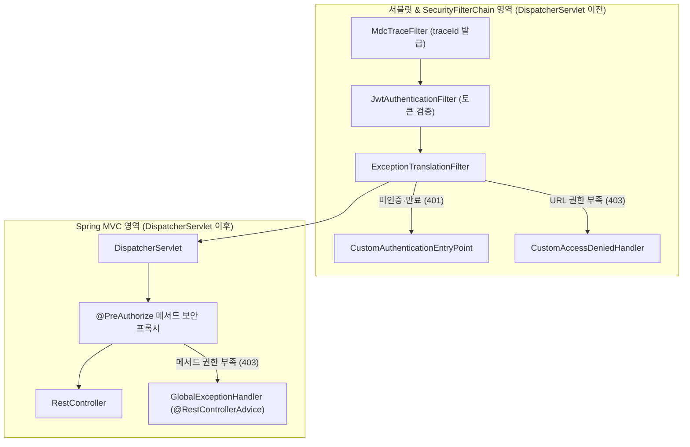

import Alert from '@/components/Alert.astro';
import LinkInline from '@/components/LinkInline.astro';

왜 `@RestControllerAdvice`로 전역 예외 처리기를 빈틈없이 만들어 두었는데도, 토큰이 만료되거나 권한이 부족할 때만 엉뚱한 빈 본문이나 기본 에러 응답이 내려올까요? 게다가 `401 Unauthorized`와 `403 Forbidden`의 경계까지 뒤섞이면 프론트엔드의 자동 토큰 갱신 인터셉터는 무한 재시도 루프에 빠지고 맙니다.

[5편의 Spring Security 7 로그인 파이프라인](/dev/spring-security-7-architecture-jwt-login)에 이은 이번 6편(`step-06`)에서는 서블릿 필터 단과 Spring MVC 컨트롤러 단의 예외 처리 경계를 명확히 가르고, Jackson 3의 `JsonMapper`를 이용해 어떤 보안 예외가 터져도 100% 동일한 `ApiResponse` 봉투가 내려가도록 통일합니다. 아울러 실제 테스트 과정에서 잡아낸 **`JwtAuthenticationFilter`의 `@Component` 슬라이스 테스트 오염 문제**와 **`@PreAuthorize` 500 에러 둔갑 함정**까지 함께 정리합니다.

## 왜 필터 예외는 `@RestControllerAdvice`에 닿지 못할까?

스프링의 `@RestControllerAdvice`는 만능 그물이 아닙니다. 오직 `DispatcherServlet` 안으로 진입해 컨트롤러 핸들러가 호출되는 과정에서 발생한 예외만 가로챌 수 있어요. 반면 Spring Security 필터 체인은 `DispatcherServlet` **앞단**에서 동작합니다.



도식을 따라가 보면 보안 예외가 처리되는 지점이 정확히 두 곳으로 나뉜다는 사실이 드러납니다.

1. **필터 단 차단**(`DispatcherServlet` 진입 전): 미인증 요청이나 `SecurityConfig`의 URL 인가 실패는 <LinkInline href="https://docs.spring.io/spring-security/reference/servlet/architecture.html#servlet-exceptiontranslationfilter" label="ExceptionTranslationFilter" />가 포착해 `AuthenticationEntryPoint`(`401`)와 `AccessDeniedHandler`(`403`)에서 응답 스트림에 직접 JSON을 써야 합니다.
2. **메서드 단 차단**(`DispatcherServlet` 진입 후): 컨트롤러 메서드 위의 `@PreAuthorize` AOP 프록시가 던지는 `AuthorizationDeniedException`(`AccessDeniedException` 하위 타입)은 이미 MVC 영역 안에 있으므로 필터로 되돌아가기 전에 `@RestControllerAdvice`가 먼저 가로챕니다.

<Alert type="danger" title="GlobalExceptionHandler의 Exception.class 핸들러가 403을 500으로 둔갑시키는 함정">
2편에서 만든 `GlobalExceptionHandler`에 최상위 안전망인 `@ExceptionHandler(Exception.class)`가 등록되어 있으면, `@PreAuthorize`가 던진 `AccessDeniedException`이 시큐리티의 `CustomAccessDeniedHandler`까지 전파되지 못하고 `Exception.class` 핸들러에 잡혀 **`500 Internal Server Error`로 둔갑**합니다. 반드시 `GlobalExceptionHandler` 안에도 `AccessDeniedException`(`403 AUTH_007`)과 `AuthenticationException`(`401 AUTH_003`) 전용 핸들러를 함께 선언해야 필터 단과 메서드 단 응답이 완벽히 일치합니다.
</Alert>

[HTTP 상태 코드 설계 원칙](/dev/rest-api-http-methods-status-codes)에 따라 프론트엔드 인터셉터가 분기할 수 있도록 상태 코드와 비즈니스 에러 코드 역할도 명확히 매핑했습니다.

| 구분 | HTTP 상태 | 베이스캠프 코드 | 발생 조건 | 프론트엔드 인터셉터 표준 처리 |
| :--- | :--- | :--- | :--- | :--- |
| **미인증** | `401 Unauthorized` | `AUTH_003` | Authorization 헤더 누락 | 로그인 페이지로 이동 |
| **위변조 토큰** | `401 Unauthorized` | `AUTH_004` | 서명 불일치·손상·Refresh 타입 오용 | 로컬 토큰 즉시 삭제 후 재로그인 유도 |
| **만료 토큰** | `401 Unauthorized` | `AUTH_005` | Access Token 유효시간 경과 | `/api/v1/auth/refresh` 자동 갱신 후 원 요청 재시도 |
| **인가 거부** | `403 Forbidden` | `AUTH_007` | 인증은 됐으나 요구 역할·권한 부족 | 토큰 갱신 시도 금지(무한 루프 방지) 및 권한 안내 표시 |

## 만료 헤더가 붙은 `/refresh` 요청까지 배려한 `JwtAuthenticationFilter`

실무 SPA(Axios·Fetch 전역 인터셉터)에서는 메모리에 보관 중인 Access Token을 모든 API 요청 헤더에 일괄 첨부하곤 합니다. 그러다 토큰이 만료되면 만료된 `Authorization: Bearer <expired>` 헤더가 달린 채로 `POST /api/v1/auth/refresh`(`permitAll`)를 호출하는 일이 빈번하게 일어납니다.

만약 `JwtAuthenticationFilter`가 만료된 토큰을 발견하자마자 필터 안에서 곧장 `response.setStatus(401)`을 쓰고 체인을 끊어버리면 어떻게 될까요? 정작 새 토큰을 발급받아야 할 `/refresh` 엔드포인트조차 `401`에 가로막혀 사용자가 영원히 세션을 복구하지 못하는 사고로 이어집니다.

```java
package one.eone.app.global.security;

import jakarta.servlet.http.HttpServletRequest;
import java.util.List;
import java.util.Set;
import org.springframework.beans.factory.ObjectProvider;
import org.springframework.security.authentication.UsernamePasswordAuthenticationToken;
import org.springframework.security.core.authority.SimpleGrantedAuthority;
import org.springframework.security.core.context.SecurityContextHolder;
import org.springframework.security.oauth2.jwt.Jwt;
import org.springframework.security.oauth2.jwt.JwtException;
import org.springframework.security.oauth2.jwt.JwtValidationException;
import org.springframework.web.filter.OncePerRequestFilter;

public class JwtAuthenticationFilter extends OncePerRequestFilter {

    private final JwtTokenProvider jwtTokenProvider;
    private final ObjectProvider<UserAuthorityResolver> authorityResolverProvider;
    // 생성자 및 doFilterInternal 생략 ...

    private void authenticateRequest(HttpServletRequest request, String token) {
        try {
            Jwt jwt = jwtTokenProvider.decodeAndValidate(token);
            if (!"access".equals(jwt.getClaimAsString("type"))) {
                request.setAttribute(CustomAuthenticationEntryPoint.AUTH_ERROR_ATTRIBUTE, SecurityErrorCode.INVALID_TOKEN);
                return;
            }

            Long userId = Long.parseLong(jwt.getSubject());
            String email = jwt.getClaimAsString("email");
            if (email == null) {
                request.setAttribute(CustomAuthenticationEntryPoint.AUTH_ERROR_ATTRIBUTE, SecurityErrorCode.INVALID_TOKEN);
                return;
            }

            UserAuthorityResolver resolver = authorityResolverProvider.getIfAvailable();
            Set<String> authorities = resolver != null ? resolver.resolveAuthorities(userId) : Set.of();

            AuthenticatedUser principal = new AuthenticatedUser(userId, email, authorities);
            List<SimpleGrantedAuthority> grantedAuthorities = authorities.stream()
                    .map(SimpleGrantedAuthority::new)
                    .toList();

            UsernamePasswordAuthenticationToken authentication =
                    new UsernamePasswordAuthenticationToken(principal, null, grantedAuthorities);
            SecurityContextHolder.getContext().setAuthentication(authentication);
        } catch (JwtValidationException ex) {
            boolean expired = ex.getErrors().stream()
                    .anyMatch(err -> err.getDescription() != null && err.getDescription().contains("expired"));
            request.setAttribute(
                    CustomAuthenticationEntryPoint.AUTH_ERROR_ATTRIBUTE,
                    expired ? SecurityErrorCode.EXPIRED_TOKEN : SecurityErrorCode.INVALID_TOKEN
            );
            SecurityContextHolder.clearContext();
        } catch (JwtException | IllegalArgumentException ex) {
            request.setAttribute(CustomAuthenticationEntryPoint.AUTH_ERROR_ATTRIBUTE, SecurityErrorCode.INVALID_TOKEN);
            SecurityContextHolder.clearContext();
        }
    }
}
```

해법은 요청 속성 위임입니다. 토큰 검증이 실패해도 필터는 응답 스트림에 손을 대지 않고 `request.setAttribute(AUTH_ERROR_ATTRIBUTE, ...)`에 구체적인 실패 코드(`AUTH_005` 만료 vs `AUTH_004` 위변조)만 기록한 채 `filterChain.doFilter()`를 그대로 통과시킵니다. 덕분에 `/refresh` 같은 공개 경로는 만료 헤더가 붙어 있어도 정상 실행되고, 보호된 경로만 뒤쪽 `CustomAuthenticationEntryPoint`가 호출되어 Jackson 3 `JsonMapper`로 정확한 `ApiResponse` JSON을 직렬화해 내려줍니다.

```java
package one.eone.app.global.security;

import jakarta.servlet.http.HttpServletRequest;
import jakarta.servlet.http.HttpServletResponse;
import java.io.IOException;
import java.nio.charset.StandardCharsets;
import one.eone.app.global.common.ApiResponse;
import one.eone.app.global.error.ErrorCode;
import org.springframework.http.MediaType;
import org.springframework.security.core.AuthenticationException;
import org.springframework.security.web.AuthenticationEntryPoint;
import org.springframework.stereotype.Component;
import tools.jackson.databind.json.JsonMapper;

@Component
public class CustomAuthenticationEntryPoint implements AuthenticationEntryPoint {

    public static final String AUTH_ERROR_ATTRIBUTE = "one.eone.app.security.auth_error";
    private final JsonMapper jsonMapper;

    public CustomAuthenticationEntryPoint(JsonMapper jsonMapper) {
        this.jsonMapper = jsonMapper;
    }

    @Override
    public void commence(
            HttpServletRequest request,
            HttpServletResponse response,
            AuthenticationException authException
    ) throws IOException {
        ErrorCode errorCode = request.getAttribute(AUTH_ERROR_ATTRIBUTE) instanceof ErrorCode attrCode
                ? attrCode
                : SecurityErrorCode.UNAUTHORIZED;

        response.setStatus(errorCode.getStatus().value());
        response.setCharacterEncoding(StandardCharsets.UTF_8.name());
        response.setContentType(MediaType.APPLICATION_JSON_VALUE);
        jsonMapper.writeValue(response.getWriter(), ApiResponse.error(errorCode));
    }
}
```

## `JwtAuthenticationFilter`에 `@Component`를 붙이면 안 되는 이유

필터 구현 직후 `./gradlew check`를 실행했을 때 실제로 마주쳤던 함정입니다. 처음에 `JwtAuthenticationFilter` 위에 습관적으로 `@Component`를 붙였더니, 보안과 무관한 2편의 `GlobalExceptionHandlerSliceTest`(`@WebMvcTest`) 7개 케이스가 일제히 `UnsatisfiedDependencyException: No qualifying bean of type 'JwtTokenProvider'` 에러를 내며 실패했습니다.

이유는 두 가지입니다. 첫째, `@WebMvcTest`는 `@Component`로 등록된 모든 `jakarta.servlet.Filter` 빈을 스캔 대상에 자동 포함시킵니다. 둘째, <LinkInline href="https://docs.spring.io/spring-security/reference/servlet/architecture.html#adding-custom-filter" label="Spring Security 커스텀 필터 가이드" />가 경고하듯 커스텀 보안 필터를 스프링 빈으로 그대로 노출하면 서블릿 컨테이너 기본 필터 체인과 `SecurityFilterChain` 양쪽에 이중 등록될 위험까지 생깁니다.

`JwtAuthenticationFilter`에서 `@Component`를 완전히 제거하고, `SecurityConfig.securityFilterChain()` 내부에서만 `new JwtAuthenticationFilter(...)`로 생성해 `.addFilterBefore(...)`에 연결하자 슬라이스 테스트 오염과 이중 등록 위험이 동시에 사라졌습니다.

## `@WithMockAuthenticatedUser`와 OpenAPI 3.2 연동

마지막으로 컨트롤러에서 `@AuthenticationPrincipal AuthenticatedUser` 레코드를 바로 주입받기 위해, 테스트에서도 기본 `@WithMockUser`(Principal 타입 불일치로 `null` 주입됨) 대신 동일한 `AuthenticatedUser`를 보안 컨텍스트에 심어주는 `@WithMockAuthenticatedUser` 어노테이션을 제작했습니다. 아울러 <LinkInline href="https://springdoc.org/" label="SpringDoc OpenAPI 3.2" /> 설정(`OpenApiConfig`)에 `bearerAuth` 스키마를 등록해 Swagger UI의 **Authorize** 버튼 하나로 내 프로필 API(`/api/v1/users/me`)까지 브라우저에서 즉시 호출할 수 있게 연결했습니다(`step-06`). 다음 7편에서는 운영 보안의 핵심인 **Refresh Token 회전**(RTR)과 **탈취 재사용 탐지**, 그리고 실제 PostgreSQL 통합 테스트에서 잡아낸 셀프 데드락 해결기를 다룹니다.

## 참고 자료

- [Spring Security 7 Reference — Handling Security Exceptions (ExceptionTranslationFilter)](https://docs.spring.io/spring-security/reference/servlet/architecture.html#servlet-exceptiontranslationfilter)
- [Spring Security 7 Reference — Adding a Custom Filter to the Filter Chain](https://docs.spring.io/spring-security/reference/servlet/architecture.html#adding-custom-filter)
- [springdoc-openapi v3 Official Documentation](https://springdoc.org/)
