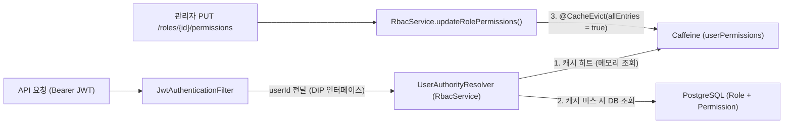

import Alert from '@/components/Alert.astro';
import LinkInline from '@/components/LinkInline.astro';

처음에는 관리자와 일반 회원 두 개면 충분할 줄 알고 컨트롤러마다 `@PreAuthorize("hasRole('ADMIN')")`을 박아 넣었다가, 세 번째 기획 변경에서 전체 API를 다시 뜯어고친 경험이 있으신가요? "CS 매니저 역할도 회원 조회는 열어주세요", "콘텐츠 에디터에게는 메뉴 수정만 허용해 주세요"라는 운영 요구가 들어오는 순간 직무 이름(`Role`)에 직접 묶인 인가 코드는 순식간에 무너집니다.

[7편의 Refresh Token 회전 보안](/dev/spring-boot-jwt-refresh-rotation-logout)에 이은 이번 8편(`step-08`)에서는 자바 코드 재배포 없이 직무 권한 구성을 바꿀 수 있는 **`User`–`Role`–`Permission` 3단 RBAC 모델**을 구축합니다. 나아가 Stateless JWT 환경의 고질병인 **권한 회수 후 토큰 만료 전까지의 반영 지연**(Stale Authority) 문제를 Caffeine 로컬 캐시와 `@CacheEvict`로 해결하는 아키텍처를 구현합니다.

## 왜 `Role`과 `Permission`을 분리해야 할까?

설계의 핵심 원칙은 명확합니다. **애플리케이션 코드는 오직 불변의 기능 행위 단위인 `Permission`만 바라보고, 회사 조직도에 따라 수시로 신설·변경되는 직무 묶음인 `Role`은 데이터베이스 매핑으로만 다룬다**는 것입니다(예: `ROLE_READ`·`ROLE_MANAGE` 권한 vs `ROLE_ADMIN`·`ROLE_CS_MANAGER` 역할).

```java
@PreAuthorize("hasAuthority('ROLE_MANAGE')")
@PutMapping("/{roleId}/permissions")
public ApiResponse<RoleDetailResponse> updateRolePermissions(
        @PathVariable Long roleId,
        @Valid @RequestBody UpdateRolePermissionsRequest request
) {
    return ApiResponse.ok(rbacService.updateRolePermissions(roleId, request.permissionCodes()));
}
```

<LinkInline href="https://docs.spring.io/spring-security/reference/servlet/authorization/method-security.html" label="Spring Security 메서드 보안(@PreAuthorize)" />을 이처럼 세밀한 `Permission` 단위로 선언해 두면, 내일 당장 `ROLE_AUDITOR`라는 감사팀 직군이 신설되어 역할 목록 조회(`ROLE_READ`)와 보안 로그 조회(`AUDIT_READ`)만 허용해야 할 때도 서버 재빌드 없이 어드민 API로 매핑 데이터만 넣으면 즉시 반영됩니다.

JPA 매핑에서도 실무 디테일을 지켰습니다. `@ManyToMany` 어노테이션으로 암묵적 조인 테이블을 쓰면 권한이 언제 누구에게 부여되었는지(`created_at`) 이력을 남길 수 없고, 권한 일괄 교체 시 Hibernate가 비효율적인 단건 삭제 쿼리를 연발합니다. 대신 연결 테이블을 `UserRole`, `RolePermission` 명시적 엔티티로 모델링하고 벌크 `@Modifying` 쿼리로 제어했습니다.

## Stateless JWT의 딜레마와 로컬 캐시 결합 해법

JWT 인증을 도입한 팀이 보안 감사에서 가장 자주 지적받는 약점이 **권한 변경 반영 지연**입니다. 로그인 시점에 사용자의 권한 배열을 JWT 클레임 안에 그대로 구워 넣으면 어떻게 될까요? 관리자가 퇴사자나 사고 직원의 `ROLE_MANAGE` 권한을 DB에서 즉시 회수하더라도, 이미 발급된 Access Token의 남은 수명(예: 30분) 동안은 그 토큰으로 관리자 API가 버젓이 호출됩니다.

그렇다고 모든 보호된 API 요청마다 `users`–`user_roles`–`role_permissions`–`permissions` 테이블 조인 쿼리를 날리면 이번에는 DB 커넥션 부하가 발목을 잡습니다.

해답은 **JWT에는 최소 식별자인 `userId`만 담고, 인가 시점의 권한 집합은 인메모리 캐시에서 0.01ms 만에 읽어오되 관리자가 권한 매핑을 수정하는 즉시 캐시를 비우는 구조**입니다.



여기서 [1편에서 세운 단방향 패키지 경계](/dev/spring-boot-4-project-package-structure)가 다시 빛을 발합니다. `global.security`에 속한 `JwtAuthenticationFilter`가 `domain.role.RbacService`를 직접 import하면 `global -> domain` 금지 규칙(ArchUnit)이 깨집니다. 그래서 `global.security`에는 얇은 `UserAuthorityResolver` 함수형 인터페이스만 정의하고 `RbacService`가 이를 구현하는 의존성 역전(DIP)으로 깔끔하게 연결했습니다.

## `Caffeine` 캐시 설정과 일괄 무효화 구현

먼저 `CacheConfig`에서 외부 인프라 설치 없이 고성능 W-TinyLFU 알고리즘으로 동작하는 <LinkInline href="https://docs.spring.io/spring-framework/reference/integration/cache.html" label="Spring Cache 추상화" /> 기반 `CaffeineCacheManager`를 등록합니다. `@EnableCaching` 역시 슬라이스 테스트 간섭을 막기 위해 전용 설정 클래스로 격리했습니다.

```java
package one.eone.app.global.config;

import com.github.benmanes.caffeine.cache.Caffeine;
import java.time.Duration;
import java.util.List;
import org.springframework.cache.CacheManager;
import org.springframework.cache.annotation.EnableCaching;
import org.springframework.cache.caffeine.CaffeineCacheManager;
import org.springframework.context.annotation.Bean;
import org.springframework.context.annotation.Configuration;

@Configuration
@EnableCaching
public class CacheConfig {

    public static final String USER_PERMISSIONS_CACHE = "userPermissions";
    public static final String ACTIVE_MENUS_CACHE = "activeMenus";

    @Bean
    public CacheManager cacheManager() {
        CaffeineCacheManager manager = new CaffeineCacheManager();
        manager.setCacheNames(List.of(USER_PERMISSIONS_CACHE, ACTIVE_MENUS_CACHE));
        manager.setCaffeine(
                Caffeine.newBuilder()
                        .maximumSize(10_000)
                        .expireAfterWrite(Duration.ofMinutes(10))
        );
        return manager;
    }
}
```

이어서 `RbacService`에서는 권한 해석에 `@Cacheable`을, 역할 권한 수정과 사용자 역할 부여에 `@CacheEvict`를 맞물려 놓습니다.

```java
@Service
@Transactional(readOnly = true)
public class RbacService implements UserAuthorityResolver {
    // 리포지토리 필드 및 생성자 생략 ...

    @Override
    @Cacheable(cacheNames = CacheConfig.USER_PERMISSIONS_CACHE, key = "#userId")
    public Set<String> resolveAuthorities(Long userId) {
        Set<String> merged = new LinkedHashSet<>();
        merged.addAll(userRoleRepository.findRoleCodesByUserId(userId));
        merged.addAll(userRoleRepository.findPermissionCodesByUserId(userId));
        return Set.copyOf(merged);
    }

    @Transactional
    @CacheEvict(cacheNames = CacheConfig.USER_PERMISSIONS_CACHE, allEntries = true)
    public RoleDetailResponse updateRolePermissions(Long roleId, Set<String> permissionCodes) {
        Role role = roleRepository.findById(roleId)
                .orElseThrow(() -> new BusinessException(RoleErrorCode.ROLE_NOT_FOUND));

        // 권한 코드 검증 후 기존 매핑 벌크 삭제 & 신규 매핑 일괄 저장
        rolePermissionRepository.deleteAllByRoleId(roleId);
        // ...
    }
}
```

왜 특정 사용자 키만 지우지 않고 `allEntries = true`로 비웠을까요? 하나의 `Role`(예: `ROLE_USER`)에 연결된 권한 집합을 바꾸면 그 역할을 보유한 수천 명의 사용자 권한이 동시에 바뀌기 때문입니다. 직무별 권한 정책 변경은 하루에 몇 번 일어나지 않는 희소한 관리자 작업이므로 캐시 전체를 비우는 비용은 무시할 수준이고 정합성은 100% 보장됩니다. 반면 특정 회원 한 명에게 새 역할을 부여하는 `assignRoleToUser`에서는 `key = "#userId"`로 해당 사용자 엔트리만 정밀 타격해 비웁니다.

<Alert type="tip" title="벌크 DELETE 직후 재삽입 시 영속성 컨텍스트 동기화 주의점">
`deleteAllByRoleId` 같은 JPQL 벌크 삭제 쿼리에는 반드시 `@Modifying(clearAutomatically = true, flushAutomatically = true)` 옵션을 명시해야 합니다. 1차 캐시(영속성 컨텍스트)에 방금 지운 `RolePermission` 엔티티가 남아 있는 상태에서 동일한 조합을 다시 `saveAllAndFlush`하면 유니크 제약 위반이나 상태 불일치가 발생할 수 있습니다.
</Alert>

## 시드 분리 원칙(`V2`)과 무재로그인 반영 통합 검증

코어 시드 스크립트인 `V2__seed_data.sql`에는 `ROLE_ADMIN`, `ROLE_USER`와 핵심 권한들(`USER_READ`, `USER_WRITE`, `ROLE_READ`, `ROLE_MANAGE`, `AUDIT_READ`)만 적재하고, 선택 모듈인 메뉴 관리 권한(`MENU_MANAGE`)은 의도적으로 비워 두어 다음 9편의 `V4` 파일로 격리했습니다. 또한 4편 회원가입 시 발행한 `UserSignedUpEvent`를 수신해 신규 가입자에게 기본 `ROLE_USER`가 자동 할당되도록 연결했습니다.

`RbacPermissionCacheIntegrationTest`에서는 일반 회원이 로그인해 받은 Access Token으로 `/api/v1/admin/roles` 호출 시 `403 AUTH_007`로 차단되는 것을 먼저 확인한 뒤, 관리자가 `ROLE_USER`에 `ROLE_READ` 권한을 추가한 직후 **재로그인이나 토큰 재발급 없이 아까 그 동일한 Access Token으로 다시 호출했을 때 즉시 `200 OK`로 전환되는 전 과정**을 검증했습니다(`step-08`). 다음 9편에서는 DB 재귀 쿼리 없이 권한별 사이드바 트리를 조립하는 **완전 탈착형 계층형 메뉴 모듈**을 구현합니다.

## 참고 자료

- [Spring Security 7 Reference — Method Security (@PreAuthorize)](https://docs.spring.io/spring-security/reference/servlet/authorization/method-security.html)
- [Spring Framework 7 Reference — Cache Abstraction (@Cacheable & @CacheEvict)](https://docs.spring.io/spring-framework/reference/integration/cache.html)
- [Caffeine High Performance Java Caching Library Wiki](https://github.com/ben-manes/caffeine/wiki)
