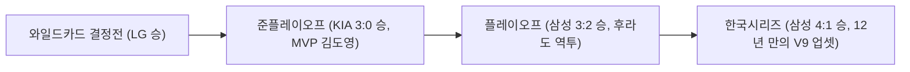

import Alert from '@/components/Alert.astro';
import Chart from '@/components/Chart.astro';

어제(11월 8일) 대구 삼성라이온즈파크를 가득 메운 2만 4천 관중의 파란색 물결과 함께 2026 KBO 리그 대장정이 막을 내렸습니다. 이제 11월 말 KBO 시상식과 골든글러브만을 남겨둔 시점이지만, 올 한 해 다이아몬드 위에서 펼쳐진 드라마는 야구팬들의 가슴을 뜨겁게 달구기에 충분했죠.


지난 3월 개막을 앞두고 정리했던 [[2026 KBO 개막! 알고 보면 두 배 재미있는 관전 포인트]](/life/2026-kbo-season-preview) 포스트를 다시 꺼내 보니 감회가 새롭습니다. 당시 던졌던 물음표들이 가을의 끝자락에서 어떤 느낌표와 마침표로 바뀌었는지, 정규시즌·한국시리즈 결산부터 이미 판이 짜인 2027 신인드래프트 1라운드 루키들의 면면까지 한 번에 짚어봅니다.

---

## 2026 KBO 정규시즌 & 한국시리즈 총결산: KT의 90승 돌풍과 삼성의 12년 만의 V9 업셋


올 시즌 정규리그는 개막 전 전문가들의 예상을 통쾌하게 뒤엎은 KT의 독주와, 가을야구에서 불꽃을 태운 삼성의 대역전극으로 요약할 수 있습니다.

### 2026 정규시즌 최종 순위표 (1위～10위)

720경기를 모두 소화한 10개 구단의 최종 성적표입니다.

| 순위 | 구단 | 경기수 | 승 | 무 | 패 | 승률 | 게임차 | 한 줄 총평 |
| :---: | :--- | :---: | :---: | :---: | :---: | :---: | :---: | :--- |
| **1** | **kt wiz** | 144 | 90 | 5 | 49 | 0.647 | – | 외인 전원 교체 적중과 탄탄한 투수진으로 정규시즌 제패 |
| **2** | **삼성 라이온즈** | 144 | 83 | 3 | 58 | 0.589 | 8.0 | 원투펀치 안정과 화끈한 라팍 홈런포의 완벽한 조화 |
| **3** | **KIA 타이거즈** | 144 | 79 | 2 | 63 | 0.556 | 12.5 | '45홈런' 김도영의 괴물 본능과 네일의 에이스 본색 |
| **4** | **LG 트윈스** | 144 | 78 | 1 | 65 | 0.545 | 14.0 | 임찬규 다승왕 활약 속 불펜 과부하를 버텨내며 가을 진출 |
| **5** | **두산 베어스** | 144 | 73 | 5 | 66 | 0.525 | 17.0 | 김원형 감독 부임 첫해, 곽빈 2관왕 질주로 5강 안착 |
| **6** | **SSG 랜더스** | 144 | 65 | 5 | 74 | 0.468 | 25.0 | 화이트와 에레디아 분전에도 5할 문턱에서 아쉬운 고배 |
| **7** | **롯데 자이언츠** | 144 | 64 | 3 | 77 | 0.454 | 27.0 | 레이예스 211안타 대기록에도 마운드 재편 진통 노출 |
| **8** | **NC 다이노스** | 144 | 64 | 2 | 78 | 0.451 | 27.5 | 데이비슨 거포 화력 대비 선발·불펜 뎁스 붕괴의 한계 |
| **9** | **한화 이글스** | 144 | 57 | 4 | 83 | 0.407 | 33.5 | 100억 강백호의 34홈런 고군분투, 그러나 무너진 불펜 |
| **10** | **키움 히어로즈** | 144 | 50 | 4 | 90 | 0.357 | 40.5 | 송성문 공백과 저비용 외인 한계, 전면 리빌딩 돌입 |

<Chart
  type="bar"
  caption="2026 KBO 정규시즌 10개 구단 승수 비교"
  height={320}
  data={{
    labels: ['KT', '삼성', 'KIA', 'LG', '두산', 'SSG', '롯데', 'NC', '한화', '키움'],
    datasets: [{
      label: '정규시즌 승수',
      data: [90, 83, 79, 78, 73, 65, 64, 64, 57, 50],
      backgroundColor: [
        '#000000',
        '#005BAC',
        '#C70125',
        '#C30452',
        '#131230',
        '#CE0E2D',
        '#002955',
        '#1D467E',
        '#FF6600',
        '#570514'
      ]
    }]
  }}
/>

정규시즌은 그야말로 KT의 독무대였습니다. 개막 전 외국인 선수를 3명 모두 바꾸는 파격적인 도박을 감행했을 때만 해도 전문가들 사이에서 우려의 목소리가 컸지만, 뚜껑을 열어보니 90승 고지를 밟으며 일찌감치 한국시리즈 직행 티켓을 거머쥐었습니다.

### 가을의 기적: 삼성이 써 내려간 12년 만의 V9 업셋 스토리

하지만 진짜 승부는 단기전에서 갈렸습니다. 4위 LG가 와일드카드 결정전에서 두산을 꺾고 올라왔지만 준플레이오프에서 3위 KIA에게 3연패 스윕을 당했고, 그 KIA를 상대로 플레이오프에서 삼성이 5차전 끝장 승부 끝에 3승 2패로 승리하며 한국시리즈 무대에 올랐습니다.



정규 1위 KT와 2위 삼성의 맞대결로 펼쳐진 한국시리즈는 시리즈 전부터 팽팽한 긴장감이 흘렀습니다. 1차전은 수원 원정에서 KT가 선발 보쉴리의 역투를 앞세워 3:1로 기선을 제압했죠. 하지만 승부의 흐름은 2차전부터 급격히 요동쳤습니다.

삼성은 2차전 승리로 균형을 맞춘 뒤, 대구 홈으로 돌아온 3차전(5:1 승)과 4차전(10:5 승)에서 에이스 아리엘 후라도와 불펜진의 호투로 내리 승리를 따냈습니다. 그리고 어제 11월 8일 대구 삼성라이온즈파크에서 열린 5차전, 선발 **원태인**이 위력적인 역투를 선보이고 타선이 대폭발하며 12:1 대승을 거뒀습니다.

1차전 패배 후 내리 4연승. 삼성이 2014년 이후 무려 **12년 만에 들어 올린 통산 9번째 한국시리즈 우승 트로피**(V9)였습니다. 2016년 대구 삼성라이온즈파크 개장 이후 홈구장에서 헹가래를 친 것은 구단 역사상 이번이 처음이라 감격이 두 배였죠. 

시리즈 최고의 별인 **한국시리즈 MVP**는 캡틴 **구자욱**에게 돌아갔습니다. 플레이오프 도중 입은 부상에도 투혼을 발휘하며 5경기 타율 0.500, 1홈런 6타점 맹타를 휘두른 그의 활약은 대구 팬들의 눈시울을 붉히기에 충분했습니다.

---

## 개막 전 프리뷰 대조표 — 2026 시즌을 뒤흔든 4대 사건과 관중 1,277만 대기록

시즌 개막 당시 짚었던 핵심 변수들과 실제 시즌 결과는 얼마나 일치했을까요? 2026 KBO 리그를 강타한 4대 핵심 사건을 복기해 봅니다.

### 사건 1. 사상 최초 2년 연속 1,200만 돌파, 누적 1,277만 관중 신기록

2024년 1,000만, 2025년 1,200만 관중을 돌파했던 프로야구 열기는 2026년에도 식지 않았습니다. 720경기 최종 누적 관중 **12,770,551명**(경기당 평균 17,736명)을 기록하며 KBO 역사상 역대 최다 관중 신기록을 경신했습니다.

- **8개 구단 100만 관중 돌파**: 10개 구단 중 무려 8개 구단이 단일 시즌 100만 관중을 넘어섰습니다.
- **삼성 라이온즈 단일 구단 최다 171만 명 달성**: 우승 열기에 힘입어 라팍 홈 경기에서 총 1,717,050명을 동원, KBO 10개 구단 체제 최초 단일 구단 170만 관중 신기록을 세웠습니다.
- **쾌적한 관전 문화의 정착**: 투구 간격을 2초씩 단축한 **피치클락 강화** 규정(주자 없을 시 18초, 주자 있을 시 23초)과 정착 3년 차를 맞은 **ABS** 시스템 덕분에 9이닝 평균 경기 시간이 **3시간 안쪽**으로 안정화되었습니다. 판정 시비가 사라지고 경기 템포가 빨라지면서 주중 직관 관람객의 만족도가 크게 올라갔죠.

### 사건 2. 아시아쿼터 원년의 명암과 '20만 달러의 기적' 스기모토 코우키

연봉·계약금 상한선 20만 달러로 도입된 아시아쿼터 제도는 각 구단의 안목을 여실히 증명한 시험대였습니다. 

가장 인상적인 결실을 거둔 팀은 단연 정규시즌 1위 KT였습니다. KT가 영입한 일본 독립리그 출신 우완 **스기모토 코우키**는 **25홀드**를 수확하며 당당히 **홀드왕** 타이틀을 차지했습니다. 20만 달러라는 가성비로 리그 최정상급 셋업맨을 얻어낸 셈이죠. 여기에 새로 영입한 외국인 타자 샘 힐리어드가 139타점을 쓸어 담아 타점왕에 오르며 KT의 외인 전원 교체는 '대성공'으로 귀결되었습니다.

반면 20만 달러 상한선의 한계로 인해 시즌 중반 부상이나 부진으로 교체 카드를 소진한 구단도 적지 않아, 아시아쿼터 시장의 뚜렷한 명암을 보여주었습니다.

### 사건 3. 100억 FA 강백호의 고군분투와 한화의 눈물

지난겨울 스토브리그에서 가장 뜨거웠던 이슈는 단연 한화의 **강백호 100억 영입**이었습니다. 강백호 개인의 활약만 놓고 보면 실패라고 부를 수 없었습니다. 131경기에 출장해 타율 0.285, 34홈런 118타점, OPS 0.883을 기록하며 노시환과 함께 막강한 중심 타선을 꾸렸으니까요.

하지만 개막 전 지적받았던 **마운드·불펜 불안**이라는 시한폭탄이 결국 터지고 말았습니다. 필승조와 불펜진의 집단 난조로 후반부 역전패가 속출하면서, 중심 타선의 맹타에도 불구하고 정규시즌 9위로 추락했습니다. 아무리 타선이 점수를 뽑아도 마운드가 지키지 못하면 가을야구는 요원하다는 야구계의 격언을 뼈아프게 확인한 한 해였습니다.

### 사건 4. 남은 시상식의 주인공은? 2026 타이틀 홀더 & 정규시즌 MVP 경쟁

정규시즌 타이틀 홀더 명단이 확정되면서 11월 말 열릴 KBO 시상식의 트로피 주인공에 이목이 쏠리고 있습니다.

| 부문 | 수상자 (구단) | 공식 기록 | 비고 |
| :--- | :--- | :---: | :--- |
| **타율** | **구자욱** (삼성) | 0.371 | 타격왕 등극 |
| **출루율** | **구자욱** (삼성) | 0.458 | 타격 2관왕 |
| **홈런** | **김도영** (KIA) | 45홈런 | 개인 최다 홈런 신기록 |
| **장타율** | **김도영** (KIA) | 0.647 | 홈런·장타율 2관왕 |
| **최다안타** | **빅터 레이예스** (롯데) | 211안타 | KBO 단일시즌 최다안타 신기록 경신 |
| **타점** | **샘 힐리어드** (KT) | 139타점 | KT 중심타선 해결사 |
| **평균자책점** | **곽빈** (두산) | 2.24 | 김원형 감독 부임 후 커리어 하이 |
| **탈삼진** | **곽빈** (두산) | 197탈삼진 | 토종 투수 2관왕 달성 |
| **다승** | **임찬규** (LG) / **고영표** (KT) | 15승 | 공동 다승왕 타이틀 |
| **세이브** | **김재윤** (삼성) | 35세이브 | 우승팀 뒷문 단속 완성 |
| **홀드** | **스기모토 코우키** (KT) | 25홀드 | 아시아쿼터 최초 타이틀 홀더 |

가장 뜨거운 관심사는 단연 **정규시즌 MVP** 투표입니다.
- **김도영**(KIA): 45홈런 118타점 120득점, OPS 1.060을 기록하며 리그를 지배한 압도적 장타력.
- **구자욱**(삼성): 타율(0.371)과 출루율(0.458) 2관왕에 오르며 정규 2위와 한국시리즈 우승을 견인한 리더십.
- **곽빈**(두산): 평균자책점 2.24와 197탈삼진으로 투수 2관왕을 차지하며 토종 에이스의 자존심을 지킨 역투.

순수 개인 임팩트 면에서는 45홈런의 김도영이 한 발 앞서 있다는 평가지만, 타격 2관왕에 팀 우승 프리미엄을 더한 구자욱과 리그 유일 2점대 평균자책점 2관왕 곽빈의 득표력도 만만치 않아 치열한 3파전이 예상됩니다. 

한편 신인왕 부문에서는 한화 안방에서 존재감을 드러낸 포수 **허인서**, SSG 마운드의 활력소 **김민준**, LG의 내야 유망주 **문정빈**, 롯데 투수 **박정민** 등이 각축을 벌이고 있습니다.

---

## 2027시즌을 폭격할 슈퍼 루키 총정리: 2027 KBO 신인드래프트 1라운드 분석

야구팬들의 시선은 이미 내년 그라운드를 밟을 새로운 유망주들에게 닿아 있습니다. 

<Alert type="info" title="KBO 신인드래프트 개최 시점과 지명 순번의 이해">
KBO 신인드래프트의 공식 연도 명칭은 신인들이 **프로 무대에 정식 등록되어 활약할 시즌 연도**를 기준으로 붙습니다. 즉, 2027시즌에 뛸 신인을 선발하는 **'2027 KBO 신인드래프트'**는 이미 지난 **2026년 9월 21일**에 열렸습니다. 

이때의 지명 순번은 전년도인 **2025시즌 최종 순위의 역순** (키움→두산→KIA→롯데→KT→NC→삼성→SSG→한화→LG)으로 진행되었습니다. 반대로 어제(11월 8일) 결정된 **2026시즌 최종 순위의 역순**은 내년 2027년 9월에 열릴 **'2028 신인드래프트'** 지명권이 됩니다.
</Alert>

### 2027 신인드래프트 1라운드 지명 명단 및 계약금

지난 9월 21일 진행된 드래프트에서 각 구단이 선택한 1라운드 10인의 면면과 최종 계약금 현황입니다.

| 순번 | 지명 구단 | 선수명 | 출신교 | 포지션 | 투타 | 핵심 특징 | 계약금 |
| :---: | :--- | :---: | :--- | :---: | :---: | :--- | :---: |
| **1** | **키움 히어로즈** | **하현승** | 부산고 | 투수/야수 | 좌투좌타 | 194cm 좌완 파이어볼러 겸 거포 (투타겸업) | **16억 원** |
| **2** | **두산 베어스** | **김지우** | 서울고 | 내야수 | 우투우타 | 공수겸장 대형 내야수 겸 투타겸업 재능 | **5억 원** |
| **3** | **KIA 타이거즈** | **이호민** | 경남고 | 내야수 | 우투우타 | '리틀 이대호'로 불리는 우타 거포 내야수 | **3.5억 원** |
| **4** | **롯데 자이언츠** | **박근서** | 서울디자인고 | 투수 | 좌투좌타 | 최고 149km/h 즉시전력감 좌완 에이스 | **3.0억 원** |
| **5** | **kt wiz** | **이승원** | 유신고 | 투수 | 우투우타 | 안정적인 제구와 구위를 갖춘 로컬 우완 | **2.5억 원** |
| **6** | **NC 다이노스** | **박보승** | 경남고 | 외야수 | 우투좌타 | 고교 최다 51안타, 공수주 5툴 플레이어 | **2.5억 원** (옵션 0.5억) |
| **7** | **삼성 라이온즈** | **김민훈** | 광주진흥고 | 투수 | 우투우타 | 청소년 국가대표 에이스, 정교한 제구력 | **2.5억 원** |
| **8** | **SSG 랜더스** | **이윤성** | 마산고 | 투수 | 좌투좌타 | 최고 150km/h 강속구를 던지는 정통 좌완 | **2.5억 원** |
| **9** | **한화 이글스** | **민주홍** | 설악고 | 투수 | 우투우타 | 150km/h대 묵직한 구위의 우완 파이어볼러 | **2.5억 원** |
| **10** | **LG 트윈스** | **윤예성** | 인창고 | 투수 | 우투우타 | 191cm/105kg, 최고 154～157km/h 괴물 우완 | **2.5억 원** |

<Chart
  type="bar"
  caption="2027 KBO 신인드래프트 1라운드 계약금 현황 (단위: 억 원)"
  height={320}
  data={{
    labels: ['하현승(키움)', '김지우(두산)', '이호민(KIA)', '박근서(롯데)', '이승원(KT)', '박보승(NC)', '김민훈(삼성)', '이윤성(SSG)', '민주홍(한화)', '윤예성(LG)'],
    datasets: [{
      label: '계약금 (억 원)',
      data: [16.0, 5.0, 3.5, 3.0, 2.5, 2.5, 2.5, 2.5, 2.5, 2.5],
      backgroundColor: [
        '#570514',
        '#131230',
        '#C70125',
        '#002955',
        '#000000',
        '#1D467E',
        '#005BAC',
        '#CE0E2D',
        '#FF6600',
        '#C30452'
      ]
    }]
  }}
/>

### 2027시즌 주목해야 할 핵심 루키 프로필

#### 1. 전체 1순위 하현승 (키움 히어로즈) — KBO 역사를 바꾼 16억 특급 루키
194cm, 92kg의 압도적인 피지컬을 자랑하는 부산고의 투타겸업 괴물 **하현승**은 이번 드래프트의 절대적인 주인공이었습니다. 최고 153km/h의 묵직한 패스트볼을 던지는 좌완 투수이면서, 고교 3년간 통산 14홈런을 기록한 초고교급 거포죠. 

메이저리그 30개 구단 스카우트들이 집요하게 미국 직행을 제안했으나, 키움 구단은 2006년 한기주가 세웠던 KBO 신인 최고 계약금(10억 원)을 20년 만에 깨뜨리고 **역대 최고액인 16억 원**을 안기며 그를 국내에 잔류시키는 데 성공했습니다. 키움은 하현승을 위해 주 1회 선발 등판과 지명타자 출장을 병행하는 '한국판 오타니' 루틴을 준비 중입니다.

#### 2. 전체 2순위 김지우 (두산 베어스) — 10년을 책임질 5억 거포 내야수
서울고의 공수겸장 내야수 **김지우**는 고교 타자 중 가장 완벽한 타격 메커니즘과 타구 스피드를 인정받았습니다. 188cm의 건장한 체격에 유격수와 3루수를 모두 완벽히 소화하는 강견과 풋워크를 갖췄죠. 김원형 두산 감독이 "팀의 향후 10년 내야 코어를 책임질 자원"으로 직접 지목하며 계약금 5억 원을 안겼습니다.

#### 3. 장타력을 채운 야수 원투펀치: 이호민 (KIA) & 박보승 (NC)
- **이호민**(KIA 타이거즈, 경남고): '리틀 이대호'라는 별명에 걸맞게 고교 통산 장타율 0.720을 기록한 정통 우타 거포입니다. 부드러운 손목 힘과 밀어쳐서도 담장을 넘기는 비거리가 압권으로, 김도영의 뒤를 받칠 차세대 클린업 트리오로 기대를 모읍니다.
- **박보승**(NC 다이노스, 경남고): 고교 단일 시즌 51안타를 때려낸 컨택 능력과 100m를 11초대에 주파하는 스피드, 그리고 강한 어깨까지 겸비한 전형적인 5툴 외야수입니다. 계약금 2.5억 원에 신인으로선 이례적으로 옵션 5천만 원이 포함되었습니다.

#### 4. 마운드를 뒤흔들 파이어볼러 군단
1라운드 투수 풀 역시 그 어느 해보다 탄탄합니다.
- **박근서**(롯데, 서울디자인고): 최고 149km/h를 구사하는 완성형 좌완으로, 예리한 변화구와 디셉션 덕분에 스프링캠프 즉시전력감으로 평가받습니다.
- **이승원**(KT, 유신고): 유신고 마운드를 이끈 로컬 에이스. 140km/h대 후반의 속구와 안정된 경기 운영으로 KT 선발 왕국의 바통을 이어받을 재목입니다.
- **김민훈**(삼성, 광주진흥고): 청소년 대표팀 에이스 출신으로 커맨드와 제구력이 이미 프로 수준에 도달했다는 평가를 받습니다.
- **이윤성**(SSG, 마산고): 150km/h를 가볍게 찍는 좌완 강속구 유망주로, 청라돔 시대를 대비하는 랜더스 마운드의 핵심 카드입니다.
- **민주홍**(한화, 설악고): 묵직한 구위와 브레이킹볼이 돋보이는 우완 파이어볼러로, 한화의 마운드 갈증을 풀어줄 기대주입니다.
- **윤예성**(LG, 인창고): 191cm, 105kg의 거구에서 공식 154km/h(비공식 최고 157km/h)의 광속구를 꽂아 넣는 하드웨어 최대어입니다. 제구 안정화가 과제지만 잠재력만큼은 이번 드래프트 투수 중 손에 꼽힙니다.

---

## 순위에 따른 구단별 드래프트 지명 전략과 2026 최종 순위 기반 차기(2028) 드래프트 판도

각 구단의 지명 성향을 분석해 보면, 팀의 현재 순위와 전력 불균형이 신인 수급 전략에 고스란히 반영되었음을 알 수 있습니다.

### 그룹별 신인 선발 기조

```text
[구단별 드래프트 성향 3대 그룹]
┌─────────────────────────────────────────────────────────────┐
│ 1. 하위권 리빌딩 그룹 (키움·한화·NC·롯데)                      │
│    → 판을 바꿀 게임 체인저(하현승 16억) 선점 및 상위 야수 코어 확보 │
├─────────────────────────────────────────────────────────────┤
│ 2. 중위권 도약 그룹 (SSG·두산·LG)                            │
│    → 즉시전력감 내야 코어(김지우) 및 157km/h급 하이엔드 피지컬(윤예성) │
├─────────────────────────────────────────────────────────────┤
│ 3. 대권 도전 그룹 (KIA·삼성·KT)                              │
│    → 기존 전력 공백 메우기(KIA 거포 이호민, 삼성 완성형 김민훈)     │
└─────────────────────────────────────────────────────────────┘
```

- **하위권 리빌딩 그룹** (키움·한화·NC·롯데):
  키움은 송성문의 이탈과 전력 약화를 극복하기 위해 하현승이라는 역사적인 괴물에게 16억 원을 베팅하는 승부수를 띄웠습니다. NC와 롯데 역시 당장 1군 라인업에 활력을 불어넣을 외야 5툴(박보승)과 완성형 좌완(박근서)을 선택했죠.
- **중위권 도약 그룹** (SSG·두산·LG):
  내야 세대교체가 시급했던 두산은 김지우를 과감히 2순위로 선택했고, SSG는 청라돔 시대를 이끌 좌완 이윤성을 확보했습니다. 특히 LG는 10순위라는 불리한 위치에서도 154～157km/h를 뿌리는 윤예성을 과감하게 지명하며 '하이리스크 하이리턴'의 정석을 보여주었습니다.
- **대권 도전 그룹** (KIA·삼성·KT):
  KIA는 김도영 중심의 타선에 묵직함을 더해줄 거포 이호민을 지명해 미래 화력을 다졌고, 우승팀 삼성은 제구와 경기 운영이 검증된 김민훈으로 선발 뎁스를 채웠습니다. KT 역시 로컬 팜 출신 이승원을 챙기며 선발 왕국의 기조를 유지했습니다.

### 2026 최종 순위로 결정된 차기(2028) 드래프트 지명 순번

어제 끝난 2026 정규시즌 최종 순위에 따라, 내년 2027년 9월에 열릴 **2028 KBO 신인드래프트의 1라운드 지명 순번**도 공식 확정되었습니다.

| 지명 순번 | 대상 구단 | 2026시즌 최종 순위 | 차기 드래프트 최우선 보강 포지션 |
| :---: | :--- | :---: | :--- |
| **1순위** | **키움 히어로즈** | 10위 (50승 4무 90패) | 최상위 토종 선발 및 센터라인 야수 |
| **2순위** | **한화 이글스** | 9위 (57승 4무 83패) | 필승조급 즉시전력 불펜 및 마운드 뎁스 |
| **3순위** | **NC 다이노스** | 8위 (64승 2무 78패) | 선발 로테이션 투수 및 내야 세대교체 자원 |
| **4순위** | **롯데 자이언츠** | 7위 (64승 3무 77패) | 안정적인 토종 선발 자원 및 포수 뎁스 |
| **5순위** | **SSG 랜더스** | 6위 (65승 5무 74패) | 차세대 중심 타자 및 마운드 코어 |
| **6순위** | **두산 베어스** | 5위 (73승 5무 66패) | 불펜 필승조 보강 및 외야 뎁스 |
| **7순위** | **LG 트윈스** | 4위 (78승 1무 65패) | 토종 선발 로테이션 및 불펜 세대교체 |
| **8순위** | **KIA 타이거즈** | 3위 (79승 2무 63패) | 불펜 마운드 보강 및 안방 포수 육성 |
| **9순위** | **삼성 라이온즈** | 2위 (83승 3무 58패) | 좌완 불펜 요원 및 백업 내야 자원 |
| **10순위** | **kt wiz** | 1위 (90승 5무 49패) | 차세대 거포 야수 및 투수 뎁스 확충 |

특히 2026시즌 10위와 9위에 머문 키움과 한화는 차기 2028 드래프트에서도 나란히 **전체 1·2순위 지명권**을 쥐게 되었습니다. 키움은 하현승에 이어 또 한 명의 초고교급 자원을 선점할 기회를 잡았고, 불펜 붕괴로 9위까지 추락한 한화는 내년 드래프트에서 마운드를 전면 재건할 강력한 반등 카드를 확보한 셈입니다.

---

11월 8일 대구의 밤하늘을 수놓았던 축포와 함성은 잦아들었지만, 스토브리그라는 또 다른 계절이 우리를 기다리고 있습니다. 11월 말 열릴 KBO 시상식의 트로피가 누구의 품에 안길지, 그리고 16억 특급 루키 하현승을 비롯한 10인의 유망주들이 2027시즌 어떤 반란을 일으킬지 지켜보는 것만으로도 겨울 야구는 결코 심심하지 않을 것입니다.
