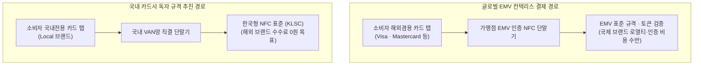

import Alert from '@/components/Alert.astro';
import AdSlot from '@/components/AdSlot.astro';
import Chart from '@/components/Chart.astro';
import LinkInline from '@/components/LinkInline.astro';

해외 여행지 편의점이나 카페에서 카드를 단말기 위에 가볍게 올렸더니 **삑—** 소리와 함께 1초도 안 돼 결제가 끝났던 쾌감, 한 번쯤 경험해 보셨을 겁니다. 그런데 귀국 직후 똑같은 카드를 동네 식당 단말기에 대봤다가 아무 반응이 없어 민망하게 다시 IC칩을 깊숙이 꽂아 넣었던 기억도 있으실 거고요.

카드 앞면이나 뒷면을 들여다보면 분명히 옆으로 누운 와이파이 모양의 네 줄 전파 마크가 선명하게 새겨져 있습니다. 전 세계 주요 도시에서는 이미 일상이 된 이 편하고 안전한 기술이 왜 유독 IT 강국이라는 한국에서만 수년째 멈춰 서 있었는지, 그 구조적 이유와 최근 달라진 결제 현장을 2026년 하반기 기준으로 다시 짚어봤습니다.

## ⚡ 10초 판별표: 내 지갑 속 카드도 '터치 결제'가 될까?

본격적인 원리를 따져보기 전에 지금 지갑에서 카드를 한 장 꺼내 아래 네 가지 조건만 먼저 대조해 보세요. 국내 매장에서 터치 결제가 먹히지 않았던 이유 절반은 여기서 바로 갈립니다.

| 확인 항목 | 터치 결제 가능 (EMV 컨택리스) | 터치 결제 불가 또는 제한 |
| :--- | :--- | :--- |
| **물결 전파 마크** | 카드 앞·뒷면에 **네 줄 부채꼴 전파 기호** 인쇄됨 | 전파 기호 없음 (접촉식 IC 전용 카드) |
| **발급 브랜드** | **Visa · Mastercard · Amex · JCB · UnionPay** 등 해외겸용 | **국내전용**(Local) 단독 표기 카드 대다수 |
| **매장 단말기** | 단말기 화면·패드에 **컨택리스 또는 Apple Pay 로고** 부착 | 카드 투입구만 있는 구형 접촉식 IC 단말기 |
| **후불교통 표시** | 상점 컨택리스 결제와 **별개 규격** (교통만 되고 상점 탭 안 될 수 있음) | 뒷면에 `후불교통` 글자만 있고 전파 마크가 없는 경우 |

가장 흔한 착각이 바로 "**버스나 지하철 개찰구에서 찍히는 후불교통카드니까 편의점에서도 찍히겠지**"라고 생각하는 것입니다. 한국의 선·후불 교통카드(티머니·이즐)와 글로벌 상점 터치 결제 규격은 같은 근거리 무선 주파수(`13.56MHz`)를 쓸 뿐, 서로 주고받는 암호 규격이 완전히 달라 호환되지 않습니다(대중교통 개방형 전환 흐름은 [2편: 오픈루프 교통카드와 애플페이 티머니 가이드](/life/korea-open-loop-apple-pay-tmoney-guide)에서 자세히 다룹니다).

## 카드 테두리에 숨은 안테나와 '꽂는 것보다 안전한' 보안 원리

카드에 새겨진 전파 모양 아이콘의 공식 명칭은 **EMV 컨택리스 표시**(EMV Contactless Indicator)입니다. <LinkInline href="https://www.emvco.com/emv-technologies/contactless/" label="EMVCo 컨택리스 공식 규격" />에 따르면, 카드 브랜드와 상관없이 이 표식이 인쇄된 카드는 국제 표준 근거리 무선 통신인 **NFC**(Near Field Communication) 방식으로 단말기와 대화합니다.

배터리도 없는 얇은 플라스틱 카드가 어떻게 무선으로 신호를 보낼까요? 비밀은 카드 플라스틱 층 사이에 숨겨진 구리 안테나에 있습니다.

<figure class="not-prose my-6">
  <svg viewBox="0 0 720 290" class="w-full h-auto rounded-xl border border-border bg-card p-4 text-foreground" role="img" aria-label="컨택리스 카드 내부 루프 안테나와 EMV 동적 암호화 통신 원리 구조도">
    <defs>
      <linearGradient id="cardGrad" x1="0%" y1="0%" x2="100%" y2="100%">
        <stop offset="0%" stop-color="#1e293b" />
        <stop offset="100%" stop-color="#0f172a" />
      </linearGradient>
    </defs>
    {/* Left: Card X-ray */}
    <rect x="28" y="34" width="330" height="206" rx="16" fill="url(#cardGrad)" stroke="#38bdf8" stroke-width="1.5" />
    {/* Perimeter Copper Loop Antenna */}
    <rect x="42" y="48" width="302" height="178" rx="10" fill="none" stroke="#f59e0b" stroke-width="2" stroke-dasharray="6 3" />
    <rect x="49" y="55" width="288" height="164" rx="8" fill="none" stroke="#f59e0b" stroke-width="1.5" opacity="0.7" />
    {/* EMV IC Chip */}
    <rect x="74" y="106" width="54" height="42" rx="6" fill="#fbbf24" stroke="#fef3c7" stroke-width="1.5" />
    <line x1="92" y1="106" x2="92" y2="148" stroke="#78350f" stroke-width="1.2" />
    <line x1="110" y1="106" x2="110" y2="148" stroke="#78350f" stroke-width="1.2" />
    <line x1="74" y1="127" x2="128" y2="127" stroke="#78350f" stroke-width="1.2" />
    {/* Connection from chip to loop */}
    <path d="M 74 120 L 49 120 M 74 134 L 49 134" stroke="#f59e0b" stroke-width="2" />
    {/* Contactless Waves Icon (4 graduated arcs per EMVCo spec) */}
    <g transform="translate(280, 112)" stroke="#38bdf8" stroke-width="2.3" fill="none" stroke-linecap="round">
      <path d="M 3 10 A 7 7 0 0 1 3 20" />
      <path d="M 9 7 A 12 12 0 0 1 9 23" />
      <path d="M 15 3.5 A 17 17 0 0 1 15 26.5" />
      <path d="M 21 0 A 22 22 0 0 1 21 30" />
    </g>
    <text x="193" y="82" text-anchor="middle" fill="#fde68a" font-size="12" font-weight="600">테두리 내장 NFC 구리 코일 안테나 (3～4회 권선)</text>
    <text x="101" y="168" text-anchor="middle" fill="#e2e8f0" font-size="11" font-weight="600">보안 IC칩</text>
    <text x="193" y="206" text-anchor="middle" fill="#94a3b8" font-size="11">배터리 없음 · 단말기 자기장으로 순간 전력 유도</text>

    {/* Center: 4cm Wireless Field */}
    <g stroke="#0ea5e9" stroke-width="2" fill="none">
      <path d="M 374 115 Q 392 137 374 159" opacity="0.9" />
      <path d="M 388 106 Q 410 137 388 168" opacity="0.65" />
      <path d="M 402 97 Q 428 137 402 177" opacity="0.4" />
    </g>
    <text x="415" y="78" text-anchor="middle" fill="#0284c7" font-size="12" font-weight="700">4cm 이내 접근</text>
    <line x1="368" y1="137" x2="462" y2="137" stroke="#0284c7" stroke-width="1.5" stroke-dasharray="4 3" />
    <text x="415" y="204" text-anchor="middle" fill="currentColor" opacity="0.75" font-size="11">1회용 동적 암호</text>
    <text x="415" y="220" text-anchor="middle" fill="currentColor" opacity="0.75" font-size="11">(Cryptogram) 전송</text>

    {/* Right: EMV POS Terminal */}
    <rect x="472" y="48" width="218" height="178" rx="14" fill="#0f172a" stroke="#64748b" stroke-width="1.5" />
    <rect x="490" y="66" width="182" height="86" rx="8" fill="#1e293b" stroke="#38bdf8" stroke-width="1.2" />
    <text x="581" y="96" text-anchor="middle" fill="#38bdf8" font-size="13" font-weight="700">EMV NFC 리더기</text>
    <text x="581" y="118" text-anchor="middle" fill="#cbd5e1" font-size="11">결제 속도: 0.5초 내외</text>
    <text x="581" y="138" text-anchor="middle" fill="#4ade80" font-size="11" font-weight="600">✓ 복제 · 재사용 불가능</text>
    <rect x="490" y="166" width="182" height="42" rx="6" fill="#334155" />
    <text x="581" y="191" text-anchor="middle" fill="#f8fafc" font-size="11">가맹점 승인 요청 시에만 활성화</text>
  </svg>
  <figcaption class="mt-2 text-center text-sm text-muted-foreground">
    컨택리스 카드 내부 투시 구조 — 단말기 4cm 이내 자기장이 테두리 코일에 미세 전류를 일으켜 IC칩이 매 거래마다 새로운 일회성 암호를 생성한다.
  </figcaption>
</figure>

단말기에 칩을 물리적으로 꽂아 읽는 일반 접촉식 IC 결제와 나란히 비교해 보면 체감 차이가 훨씬 뚜렷합니다.

| 구분 | 접촉식 IC 카드 (꽂는 방식) | 컨택리스 카드 (터치 방식) |
| :--- | :--- | :--- |
| **통신 방식** | 슬롯 단자에 금속 칩을 물리적으로 밀착 | **4cm 이내** 접근 시 전자기 유도 무선 통신 |
| **결제 소요 시간** | 칩 인식 후 서명·승인까지 평균 **3～5초** | 단말기에 대는 순간 **0.5～1초 미만** |
| **물리적 내구성** | 잦은 마찰로 금도금 단자 마모·인식 불량 발생 | 비접촉 방식이라 **칩 마모·단말기 걸림 없음** |
| **보안 메커니즘** | 스마트칩 정적·동적 인증 | 매 결제마다 바뀌는 **일회성 동적 암호**(Cryptogram) |
| **점원 전달 여부** | 점원에게 카드를 건네줘야 함 (시야 이탈 위험) | **내 손에 쥔 채** 직접 단말기에 탭하고 끝냄 |

흔히 "무선으로 찍히면 지하철에서 소매치기가 단말기를 가방에 스쳐 돈을 빼갈 수 있는 것 아니냐"고 걱정하시는 분들도 계십니다. 결론부터 말하면 **불가능에 가깝습니다.**

<Alert type="info" title="지갑 스치면 돈이 빠져나간다는 괴담이 성립하지 않는 이유">
컨택리스 통신 거리는 최대 **4cm 이내**로 극히 짧고, 무엇보다 정식 가맹점 등록을 마친 단말기가 특정 금액 승인 대기 신호를 보낼 때만 카드가 응답합니다. 설령 해커가 중간에서 무선 패킷을 가로채더라도 매 결제마다 **단 한 번만 유효한 일회성 암호 코드**가 생성되기 때문에 복제 카드를 만들거나 재결제에 악용할 수 없습니다. 오히려 점원 손에 카드를 넘겼다가 뒷면 CVC 번호가 노출되거나 마그네틱 선이 불법 복제기(스키머)에 긁히는 전통적 사고까지 원천 차단해 줍니다.
</Alert>

<AdSlot slot="inArticle" />

## 세계는 90%가 터치 결제인데, 왜 한국만 수년째 IC칩에 머물렀을까?

유럽과 오세아니아, 싱가포르 등에 나가보면 노점상이나 동네 빵집은 물론 성당 헌금함까지 컨택리스 단말기가 깔려 있습니다. 반면 한국은 불과 얼마 전까지 오프라인 카드 결제의 90% 가까이가 꽂는 IC 방식과 독자 규격에 묶여 있었죠.

<Chart
  type="bar"
  height={290}
  caption="주요 국가·권역별 오프라인 대면 카드 결제 중 EMV 컨택리스 비중 비교 (단위: %, Visa·Mastercard 글로벌 네트워크 및 국내 업계 추산치 종합)"
  data={{
    labels: ['호주 · 싱가포르', '영국', '유럽 평균', '미국', '대한민국'],
    datasets: [
      {
        label: '대면 결제 중 EMV 컨택리스 비중 (%)',
        data: [95, 93, 82, 60, 10],
        backgroundColor: [
          'rgba(14, 165, 233, 0.85)',
          'rgba(14, 165, 233, 0.80)',
          'rgba(59, 130, 246, 0.78)',
          'rgba(99, 102, 241, 0.75)',
          'rgba(245, 158, 11, 0.90)',
        ],
        borderRadius: 6,
      },
    ],
  }}
/>

스마트폰 보급률과 초고속 인터넷 세계 최상위권인 한국에서 왜 이런 '결제 갈라파고스' 현상이 벌어졌을까요? 기술력이 부족해서가 아니라 세 가지 정교한 이해관계와 경로 의존성이 맞물린 결과였습니다.

### 1. 너무 일찍 완성된 IC 단말기 전환과 삼성페이(MST)의 역설

2010년대 중반 마그네틱(긁는 카드) 불법 복제 사고가 잇따르자, 금융당국은 여신전문금융업법을 손봐 2015년부터 2018년 사이 전국 가맹점 단말기를 **접촉식 IC 단말기**로 일제히 교체했습니다. 당시엔 아직 해외에서도 비접촉 NFC가 완전히 대중화되기 직전이라, 막대한 비용을 들여 막 교체를 끝낸 단말기를 몇 년 만에 다시 들어낼 명분이 없었습니다.

여기에 2015년 등장한 **삼성페이의 MST**(마그네틱 보안 전송) 기술이 결정타를 날렸습니다. 가맹점이 비싼 돈을 들여 신형 NFC 단말기로 바꾸지 않아도, 스마트폰이 구형 단말기 쪽으로 자기장 신호를 쏴서 마그네틱 카드를 긁은 것처럼 결제를 통과시켜 버렸거든요. 소비자는 이미 폰으로 편하게 결제하고 있고 가맹점도 단말기를 바꿀 필요가 없으니, 역설적으로 **글로벌 표준 인프라로 넘어갈 시장의 갈증 자체가 사라져 버린 셈**입니다 <LinkInline href="https://www.bok.or.kr/portal/main/contents.do?menuNo=200363" label="한국은행 지급결제보고서" variant="badge" />.

### 2. 300만 가맹점 단말기 교체 비용, 누가 총대를 멜 것인가

컨택리스 실물 카드를 인식하려면 단말기에 EMVCo 보안 인증을 통과한 **NFC 리더 패드**가 달려 있어야 합니다. 문제는 국내 300만 개가 넘는 자영업자·소상공인 매장에 깔린 단말기 교체 비용이 대당 **15만～30만 원**에 달한다는 점입니다.

과거에는 결제 대행망 사업자인 VAN사가 가맹점에 단말기를 무상으로 깔아주는 관행이 있었지만, 여신전문금융업법상 대형 가맹점 리베이트 금지 규제와 가맹점 카드 우대수수료율 인하가 겹치며 VAN사와 카드사 모두 수천억 원대 보급 비용을 선뜻 떠안지 못했습니다. "꽂아도 3초면 결제되는데 내 돈 20만 원 내고 단말기를 왜 바꾸느냐"는 점주들의 반응도 당연했고요.

### 3. 결정적 이유: 국제 브랜드 로열티 수수료와 '결제 주권(KLSC)' 논쟁

가장 첨예한 본질은 **수수료와 데이터 주도권**이었습니다. 전 세계 컨택리스 표준인 EMV 규격은 유로페이·마스터카드·비자가 주도해 만든 연합 표준입니다. 국내 가맹점과 카드사가 이 글로벌 EMV 비접촉 결제망과 토큰 규격을 그대로 타면, 단말기 EMV 인증 비용은 물론 해외겸용 카드 결제 시 국제 브랜드사에 지급하는 네트워크·로열티 비용 부담이 따라붙습니다.

국내 카드업계 입장에서는 "**한국 소비자가 서울 한복판 편의점에서 한국 카드사 카드로 삼각김밥을 사는데, 왜 해외 브랜드 규격에 종속되어 수수료를 내야 하느냐**"는 반감이 클 수밖에 없었습니다. 실제로 여신금융협회와 국내 8개 전업 카드사는 해외 브랜드 의존도를 낮추겠다며 독자 규격인 **KLSC**(Korea Local Smart Card, 한국형 NFC 결제 표준) 개발을 수년째 추진해 왔습니다.

하지만 이미 스마트폰 제조사와 글로벌 단말기 생태계가 EMV 표준으로 완전히 통합된 상황에서 한국만의 독자 규격을 가맹점 단말기에 별도로 심는 작업은 속도를 내지 못했고, 그 줄다리기 사이에서 애꿎은 소비자들의 지갑 속 컨택리스 기능만 수년간 개점휴업 상태로 방치됐던 것입니다 <LinkInline href="https://www.crefia.or.kr" label="여신금융협회" variant="badge" />.

<AdSlot slot="inArticle" />

## 2025～2026년, 마침내 얼음이 깨지기 시작한 세 가지 변곡점

수년째 꿈쩍 않던 국내 오프라인 결제 시장도 최근 1～2년 사이 눈에 띄게 균열이 일고 있습니다. 굳어 있던 인프라를 움직인 건 법령이 아니라 소비자들의 경험 변화였습니다.

1. **애플페이 확산이 부른 '실물 카드 무임승차' 효과**: 2023년 현대카드의 애플페이 도입을 기점으로 대형 편의점, 프랜차이즈 카페, 백화점, 마트에 EMV 컨택리스 단말기가 빠르게 보급됐습니다. 여기에 **2025년 7월 애플페이 티머니 교통카드 정식 출시**와 **2026년 11월 16일 은행권 최초인 카카오뱅크(체크·mini카드)의 합류**까지 이어지며 가맹점주들의 NFC 패드 도입이 이제 선택이 아닌 기본 옵션이 되고 있습니다. 핵심은 **애플페이가 되는 매장 단말기라면 아이폰이 없어도 내 지갑 속 컨택리스 실물 카드가 100% 똑같이 찍힌다**는 점입니다.
2. **버스·지하철 개찰구의 '오픈루프' 개방**: 2025년 8월 제주도 시내버스가 국내 최초로 비자·마스터 컨택리스 카드를 바로 찍고 타는 개방형 결제(Open-Loop)를 상용화했고, 서울시와 티머니도 2030년까지 지하철·버스 단말기를 EMV 겸용으로 단계적 교체하는 로드맵에 착수했습니다. 국내 대중교통 개편과 K-패스 환급 연계법은 이어지는 [**2편: 오픈루프 교통카드와 애플페이 티머니·모두의 카드 완벽 정리**](/life/korea-open-loop-apple-pay-tmoney-guide)에서 바로 확인하실 수 있습니다.
3. **수백만 해외 여행객이 체감한 '트래블카드 학습 효과'**: 엔데믹 이후 일본·유럽·동남아에서 트래블로그·트래블월렛 같은 외화 체크카드로 0.5초 탭 결제의 편리함을 맛본 소비자들이 귀국 후에도 자연스럽게 카드를 꽂는 대신 단말기 위에 올리기 시작했습니다. 해외 현지 개찰구 상한제와 원화결제 수수료 함정을 피하는 실전 노하우는 [**3편: 해외여행 컨택리스 카드 실전 가이드**](/life/overseas-contactless-travel-card-dcc-guide)에 따로 모았습니다.

## 오늘 편의점에서 카드를 꽂지 말고 단말기에 툭 대보세요

한국에서 컨택리스 보급이 유독 더뎠던 건 기술이 뒤처져서가 아니라, 너무 일찍 잘 깔아둔 IC 단말기망과 MST라는 기발한 우회로, 그리고 수수료 주권을 둘러싼 보이지 않는 셈법 때문이었습니다.

<Alert type="tip" title="오늘 바로 써먹는 한 줄 실전 팁">
지갑 속 카드에 물결 전파 마크와 `VISA` 또는 `Mastercard` 로고가 함께 있다면 오늘 CU·GS25·세븐일레븐 편의점이나 스타벅스, 다이소, 맥도날드에서 카드를 투입구에 꽂지 마세요. 대신 단말기 액정이나 서명패드 위 NFC 마크에 카드를 1초만 가볍게 대보세요. 만약 점원이 "컨택리스요?" 하고 생소해한다면 "**애플페이로 결제할게요**"라고 말한 뒤 실물 카드를 갖다 대면 거짓말처럼 **삑—** 하고 승인이 떨어집니다.
</Alert>

한 번 손에 익으면 지갑에서 카드를 반쯤만 빼서 툭 대고 끝내는 그 간결함에서 다시 돌아가기 어렵습니다. 오랫동안 장식처럼 박혀 있던 카드 위 네 줄 전파 마크, 이제 한국에서도 제대로 깨워 쓸 때가 됐습니다.

## 참고 자료

- [EMV Contactless Specifications & Worldwide Deployment Statistics — EMVCo](https://www.emvco.com/emv-technologies/contactless/)
- [연차 지급결제보고서 및 지급수단·모바일금융서비스 이용행태 조사 — 한국은행](https://www.bok.or.kr/portal/main/contents.do?menuNo=200363)
- [국내 신용카드 가맹점 단말기 및 여신전문금융업 현황 — 여신금융협회](https://www.crefia.or.kr)
- [Apple Pay 대한민국 지원 및 보안 개요 — Apple 지원](https://support.apple.com/ko-kr/apple-pay)
