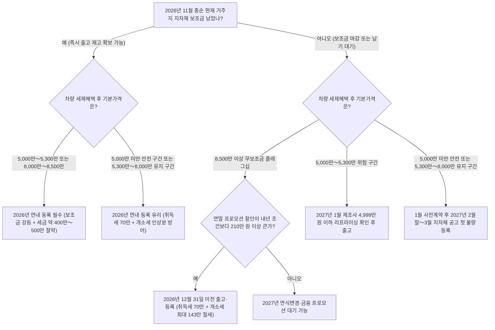

import Alert from '@/components/Alert.astro';
import Chart from '@/components/Chart.astro';

11월 중순에 접어들면서 서울과 경기 주요 시·군의 2026년 전기차 지자체 보조금이 줄줄이 마감되고 있습니다. 당장 영업사원이 제시하는 연말 재고 할인을 받고 출고할지, 아니면 보급 물량이 43만 대로 늘어나는 **2027 전기차 보조금** 개시와 신차 출시를 기다려 내년 봄에 등록할지 계산기가 가장 복잡해지는 시점이에요.

보급 대수는 늘어나지만 보조금 100% 가격 기준선은 낮아지고 취득세·개별소비세 감면 폭까지 동시에 축소될 예정이라, 고른 차종에 따라 해를 넘기는 순간 최대 500만～800만 원의 손익이 갈립니다. 차종별 **구매 시기** 판독표부터 **모델 Y 스탠다드**가 부를 가격 인상 시나리오까지 핵심만 짚어봅니다.

<Alert type="info" title="2026년 11월 중순 기준 정책 확정 단계 안내">
본문의 2027년 보급 예산안(2조 1,403억 원), 보조금 가격 구간(5,000만·8,000만 원), 취득세 감면 축소(140만 → 70만 원), 개별소비세 감면 축소(300만 → 200만 원)는 현재 **정부 예산안·세제개편안 및 기후에너지환경부(구 환경부) 사전 예고안** 기준입니다. 세부 단가는 12월 국회 본회의 의결을 거쳐 2027년 1월 기후에너지환경부 「전기자동차 보급사업 보조금 업무처리지침」 최종 고시로 확정됩니다.
</Alert>

## 바쁜 분들을 위한 상단 10초 요약표

| 내 관심 차종 · 현재 상황 | 최적의 선택 | 핵심 판단 근거 |
| :--- | :--- | :--- |
| **5,000만～5,300만 / 8,000만～8,500만 원 구간** (거주지 26년 보조금 잔여 시) | **2026년 연내 등록 강추** | 해를 넘기면 보조금 강등(100%→50% 또는 50%→0%)에 취득세 +70만 원이 겹쳐 실구매가가 400만～500만 원 급등합니다. |
| **테슬라 모델 Y 프리미엄 RWD** (`4,999만 원`) 패밀리카 수요 | **2026년 연내 등록 강추** | 모델 Y 스탠다드 출시 시 프리미엄 RWD가 5,000만 원대 중반(보조금 50% 구간)으로 인상될 위험이 큽니다. |
| **5,000만～5,300만 원 구간** (거주지 26년 보조금 이미 소진) | **제조사 리프라이싱 확인 후 결정** | 보조금 없이 출고하기보다 2027년 초 완성차 업계의 `4,999만 원` 이하 가격 재조정 여부를 보고 계약하세요. |
| **4,800만 원 이하 안전지대 + 지자체 보조금 마감 지역** | **2027년 2～3월 출고 대기 유리** | 취득세 70만 원을 더 내더라도 내년 43만 대 확대 물량으로 지자체 보조금을 수령하는 편이 훨씬 이득이에요. |
| **8,500만 원 이상 고가 플래그십** (연말 할인 210만 원 이상) | **2026년 연내 등록 강추** | 보조금은 원래 0원이지만 해를 넘겨 출고·등록하면 취득세(+70만 원)·개소세 축소(최대 +143만 원)로 세금만 약 213만 원 늘어납니다. |

---

## 2027년 전기차 보조금 & 세제 개편 예고안의 두 얼굴

내년 전기차 정책은 보급 물량을 크게 풀면서 대당 가격 기준과 세제 혜택은 조이는 구조입니다.

### 1. 호재: 예산 2.14조 원, 보급 물량 43만 대로 역대 최대 확대

기후에너지환경부 2027년 예산안 기준 전기차 보급 예산은 **2조 1,403억 원**으로 전년(1조 6,114억 원) 대비 **32.8%** 늘었습니다. 지원 물량도 약 30만 대에서 **43만 대**(전기승용 36만 8,160대, 화물 6만 1,000대 등)로 대폭 확대돼 내년 상반기 지자체 보조금 조기 마감 우려는 한결 줄어들 전망입니다.

3년 이상 보유한 내연기관차(하이브리드 제외)를 폐차·매각할 때 주는 **전환지원금**(국비 최대 100만 원)도 유지되며, 2027년에는 **영업용**(택시 등) 전환지원금이 신설됩니다. 단, 전환지원금은 기본 국고보조금이 500만 원을 넘는 국산차만 100만 원 전액이 나오고, 기본 국비가 170만 원인 테슬라 모델 Y RWD는 비례 삭감되어 약 **34만 원**만 지급된다는 함정을 유의하세요. 예산안 상 승용 평균 단가(300만 원)와 실제 지침상 중·대형 성능보조금 상한(최대 580만 원)도 별개 기준입니다.

### 2. 악재 ①: 100%·50% 가격 커트라인 동시 하향 예고

보조금 구간을 나누는 기준은 옵션·할인을 뺀 제조사 신고 **세제혜택 후 기본가격**(부가세 포함)입니다. 선택 옵션을 더해 실결제액이 기준을 넘어도 기본가격이 미만이면 100%를 받지만, 내년에는 두 기준선이 나란히 내려갑니다.

- **100% 전액 구간**: 2026년 `5,300만 원 미만` → 2027년 **5,000만 원 미만** (-300만 원 하향 예고)
- **50% 반액 구간**: 2026년 `5,300만～8,500만 원 미만` → 2027년 **5,000만～8,000만 원 미만** (상한선 -500만 원 하향 예고)
- **0% 미지원 구간**: 2026년 `8,500만 원 이상` → 2027년 **8,000만 원 이상**

### 3. 악재 ②: 취득세·개별소비세 감면 축소 (해 넘기면 숨만 쉬어도 나가는 세금)

계약일은 세금 기준이 아닙니다. **취득세는 실제 등록일**, **개별소비세는 제조장 반출일**(국산차)·**수입신고일**(수입차) 기준으로 끊깁니다.

- **취득세 감면 반토막**(행안부 지방세제 개편안): 감면 기한을 2029년까지 연장하되 한도가 현행 **140만 원에서 2027년 1월 1일 등록분부터 70만 원**으로 줄어 등록비 부담이 **+70만 원** 증가합니다.
- **개별소비세 감면 축소**(재정경제부 세제개편안): 대당 한도가 현행 **300만 원 → 2027년 200만 원 → 2028년 100만 원**으로 축소됩니다. 교육세(30%)·부가세(10%) 연쇄 연동 시 고가 전기차는 세제혜택 후 표시가격이 **최대 약 143만 원 상승** 압력을 받아요. 공장도가 4,000만 원 이하 엔트리 전기차는 원래 산출세액이 200만 원 이하라 영향이 미미하지만, `4,990만 원`대나 `7,990만 원` 턱걸이 차종은 제조사가 공급가를 깎아 방어하지 않으면 보조금 커트라인을 뚫고 올라갈 수 있습니다.

---

## 2027 보조금 구간별 전 브랜드 라인업 & 최상의 선택 가이드

시판 중이거나 출시 예정인 주요 브랜드 전기차를 세제혜택 후 기본가격 기준 4개 구간으로 정리했습니다.

| 2027 예고 구간 | 국산 주요 라인업 (세제혜택 후 기본가) | 수입 주요 라인업 & 특수 분류 |
| :--- | :--- | :--- |
| **① 5,000만 원 미만** (100% 안전) | 캐스퍼 일렉트릭(`2,787만～3,457만`), 레이 EV(`2,807만～`), EV3 2WD 전 트림(`3,995만～4,895만`), 코란도 EV(`4,028만～`), EV4(`4,042만～`), 코나 일렉트릭(`4,152만～`), EV5 스탠다드·롱레인지 에어(`4,155만～4,855만`), 더 뉴 EV6 스탠다드 라이트/에어·롱레인지 라이트(`4,360만～4,860만`), 토레스 EVX(`4,602만～`), 아이오닉 5 스탠다드 E-Value+(`4,735만`), 더 뉴 아이오닉 6 스탠다드 E-Value+(`4,856만`) | 볼보 EX30(`3,991만～4,479만`), 테슬라 모델 3 RWD(`4,699만`), 모델 Y 프리미엄 RWD(`4,999만`), 모델 Y 스탠다드 RWD(출시 대기) |
| **② 5,000만～5,300만 미만** (50% 강등 위험) | 아이오닉 5 롱레인지 E-Lite(`5,064만`)·모던(`5,290만`), 더 뉴 아이오닉 6 롱레인지 E-Lite(`5,064만`)·스탠다드 익스클루시브(`5,095만`), EV5 롱레인지 어스(`5,230만`), 더 뉴 EV6 롱레인지 에어(`5,260만`) | 르노 세닉 E-Tech 테크노(`5,159만`), 벤츠 신형 전기 CLA 200 에센셜(`5,290만`), 폭스바겐 ID.4 Pro Lite(`5,299만`) |
| **③ 5,300만～8,000만 미만** (50% 유지) | 아이오닉 5·6 상위 트림, EV3·4·5·6 GT·GT-Line, EV9(`6,197만～`), GV60(`6,490만～`), 아이오닉 9(`6,715만～7,941만`), 일렉트리파이드 GV70(`7,300만～`), 아이오닉 5 N(`7,879만`)·아이오닉 6 N(`7,990만`) | 모델 3 롱레인지 RWD(`5,999만`)·퍼포먼스(`6,999만`), 신형 CLA 250+(`6,370만～6,770만`)·EQA·EQB, Q4 e-tron(`6,630만～`), 폴스타 4(`6,690만～6,990만`), 모델 Y AWD(`6,699만`)·모델 Y L 6인승(`7,299만`), 폴스타 3 리어모터(`7,790만`), BMW iX1·iX2·i4, 차세대 iX3 50 xDrive SE(`7,990만`) |
| **④ 8,000만 이상 & 특수 변수** | EV9 GT(`8,474만`, 0% 탈락), 일렉트리파이드 G80, 제네시스 GV90(`1억 3,950만～2억 3,950만`) / KGM 무쏘 EV(`4,800만 원대`, 전기화물 별도) | Q6 e-tron 퍼포먼스(`8,290만`)·i5 eDrive40 SE(`8,490만`, 탈락), EX90(`1억 620만～`), 폴스타 5(27년 상반기 예정), 리릭·에스컬레이드 IQ / BYD 전 차종(수행자 평가 탈락 0원) |

### ① 5,000만 원 미만: 2027년에도 보조금 100% 안전지대

유럽 전략형 소형차인 현대 아이오닉 3와 기아 EV2는 국내 출시가 미정이지만, 현행 라인업만으로도 선택지가 탄탄합니다. 국산 올라운더 가성비 1순위는 전 트림 5,000만 원 미만으로 NCM 배터리 국비 상한 혜택을 다 챙기는 **기아 EV3 롱레인지**와 **EV5 롱레인지 에어**(중국 내수용 LFP와 달리 국내형은 NCM 배터리 탑재)입니다. 세단 취향이라면 **기아 EV4**와 **모델 3 RWD**가 돋보이고, 수입 프리미엄 중 유일하게 4,000만 원대 초중반인 **볼보 EX30**([볼보 전기차 플랫폼 진화 분석](/life/volvo-polestar-spa-platform-ev-strategy) 참고)도 내년 개소세 축소 타격이 없는 알짜 모델이에요.

### ② 5,000만～5,300만 원 미만: 보조금 반토막 직격탄 위험 구간

올해 `5,300만 원` 기준선에 맞춰 설계됐다가 내년에 50%로 강등될 위기 트림들입니다. 국산 주력인 아이오닉 5·6 E-Lite와 EV5 어스, EV6 에어뿐 아니라 2026년 10월 출시된 MMA 플랫폼 신차 **벤츠 신형 전기 CLA 200 에센셜**(`5,290만 원`)과 **폭스바겐 ID.4 Pro Lite**(`5,299만 원`, [도요타 vs 폭스바겐 전동화 전략](/life/toyota-vs-volkswagen-ev-strategy) 참고)까지 몰려 있죠. 해를 넘기면 보조금 반토막(약 300만～400만 원 손실)에 취득세 축소(+70만 원)로 실구매가가 **400만～500만 원** 치솟으므로, 연내 잔여 보조금 출고가 어렵다면 2027년 초 제조사의 `4,999만 원` 이하 **리프라이싱** 여부를 확인한 뒤 계약해야 합니다.

### ③ 5,300만～8,000만 원 미만: 50% 반액 유지 & 7,990만 원 턱걸이 신차

중형 프리미엄 쿠페형 SUV는 주행거리와 옵션 완성도가 뛰어난 **폴스타 4**, 3열 패밀리 전기 SUV는 **아이오닉 9**와 **모델 Y L**이 최적의 픽입니다. 신차 중에서는 2027년 8,000만 원 커트라인을 10만 원 차이로 정조준한 차세대 노이어 클라쎄 **BMW iX3 50 xDrive SE**(`7,990만 원`, 국내 인증 611km — [BMW 노이어 클라쎄 전략 분석](/life/bmw-neue-klasse-history-and-ev-strategy) 참고)가 800V 전비·주행거리 끝판왕으로 꼽히며, 내년 개소세 감면 축소 시 `7,990만 원` 방어 여부만 체크하면 됩니다.

### ④ 8,000만 원 이상 무보조금 & 두 가지 특수 변수 (BYD · 전기픽업)

올해 50%를 받던 **EV9 GT**, **Q6 e-tron 퍼포먼스**, **i5 eDrive40 SE**는 내년 상한 하향(`8,000만 원`)으로 보조금이 0원이 되니 연내 등록이 유리합니다. 2026년 11월 10일 공식 출시된 **제네시스 GV90**이나 볼보 **EX90**, 내년 상반기 출시 예정인 **폴스타 5** 등 초고가 플래그십은 원래 무보조금 구간이라 세금 인상분만 고려하면 돼요.

차값과 별개로 움직이는 두 가지 예외도 기억하세요. **BYD**는 돌핀(`2,450만～`), 아토 3(`3,150만～`), 씰(`3,990만～`), 씨라이언 7(`4,490만～`) 모두 5,000만 원 미만이지만, 2026년 7월 환경부 **보급사업 수행자 선정 평가**(직영·협력 정비망, 공급망 기여도 등 60점 커트라인) 탈락으로 국고·지자체 보조금이 **전면 제외**(0원)되어 내년 초 재평가 통과 여부가 관건입니다. 반대로 **KGM 무쏘 EV**(`4,800만 원대`)는 승용이 아닌 **전기화물** 분류라 승용 커트라인과 무관하게 1,000만 원대 화물 보조금과 개소세 면제, 사업자 부가세 환급 혜택을 받습니다.

---

## 2026년 말 출고 vs 2027년 봄 대기, 언제 사는 게 이득일까?

거주지 지자체 보조금 잔여 여부와 가격 구간, 연말 할인 폭(`210만 원` 손익분기)을 순서대로 대입해 보세요.

내년 출고를 택할 때 놓치기 쉬운 복병이 **1～2월 보조금 보릿고개**입니다. 지자체 보조금은 계약순이 아닌 **출고·등록순**으로 집행되는데, 매년 1월～2월 중순은 환경부 지침 고시 후 지자체별 공고 전이라 접수 자체가 멈추는 공백기예요. 2027년 구매자는 **1월 사전계약 → 2월 말～3월 첫 물량 출고** 타임라인으로 움직여야 안전합니다. 유종 간 장기 유지비와 충전요금 손익분기 계산이 먼저 필요하다면 [전기차 vs 하이브리드 vs 가솔린 손익분기 계산기](/life/ev-hybrid-gasoline-breakeven)에서 비교해 보세요.

---

## 테슬라 저가형(모델 Y 스탠다드) 등장이 부를 나비효과와 구매 전략

중국 상하이 기가팩토리 생산 **모델 Y 스탠다드 RWD**는 이미 국내 환경부 인증을 마쳤습니다(62kWh LFP 배터리, 복합 **411km**, 전비 5.9km/kWh, 급속 피크 175kW). 북미(`$39,990` vs 프리미엄 RWD `$44,990～$45,990`) 기준 원가 절감 폭은 꽤 매섭습니다. 전·후면 일자형 라이트바가 삭제됐고 실내 직물 혼방 시트 적용과 함께 **1열 통풍시트**·**2열 8인치 모니터** 삭제, 7스피커 축소, 주행거리 70km 이상 단축이 이뤄졌습니다.

### "스탠다드가 4,999만 원을 꿰차고 프리미엄 RWD는 오른다"

핵심은 옵션 삭제보다 **2026년 7월 1일 모델 3 기습 인상의 데자뷔**입니다. 테슬라코리아는 모델 3 보급형 RWD를 4,199만 원에 먼저 푼 뒤, 7월 1일 모델 3 RWD를 **4,699만 원**(+500만 원)으로 올리고 상위 모델 3 프리미엄 롱레인지 RWD를 `5,299만 원`에서 **5,999만 원**(+700만 원, 보조금 50% 구간 이탈)으로 인상했습니다. 당시 모델 Y 프리미엄 RWD만 **4,999만 원**으로 동결한 건 하위 트림이 없는 상태에서 보조금 100% 방패가 필요했기 때문이죠.

현재 모델 3 스탠다드 RWD(`4,699만 원`)에 통상적인 **SUV 차급 격차 300만 원**을 더하면 정확히 **4,999만 원**입니다. 모델 Y 스탠다드 RWD가 출시 초기 잠깐 `4,599만～4,699만 원` 미끼가를 찍더라도, 결국 2027년 보조금 100% 마지노선(`5,000만 원 미만`)인 **4,699만～4,999만 원 자리를 스탠다드가 이어받고**, 현행 `4,999만 원`인 **모델 Y 프리미엄 RWD는 5,499만～5,699만 원대**(보조금 50% 구간)로 인상될 가능성이 매우 높습니다.

<Chart
  type="bar"
  height={320}
  caption="테슬라 모델 Y 트림·시나리오별 서울 기준 취등록세 포함 예상 실구매가 비교 (단위: 만 원)"
  data={{
    labels: [
      '26년 말 프리미엄 RWD (4,999만)',
      '27년 스탠다드 RWD (4,699만 가정)',
      '27년 스탠다드 RWD (4,999만 가정)',
      '27년 프리미엄 RWD 인상 시 (5,599만 가정)',
    ],
    datasets: [
      {
        label: '서울 기준 취등록세 포함 실구매가 (만 원)',
        data: [4956, 4718, 5037, 5775],
        backgroundColor: ['#10b981', '#3b82f6', '#f59e0b', '#ef4444'],
      },
    ],
  }}
/>

서울 기준 취등록세 포함 예상 실구매가를 비교하면 역설이 선명해집니다.

- **26년 말 프리미엄 RWD**(`4,999만 원`): 국·시비 221만 원과 취득세 140만 원 감면으로 실구매가는 **약 4,956만 원**입니다.
- **27년 스탠다드 RWD**(`4,699만 원` 출시 가정): 국·시비 약 210만 원과 취득세 70만 원 감면 반영 시 **약 4,718만 원** 수준입니다.
- **27년 스탠다드 RWD**(`4,999만 원` 안착 가정): 동일 보조금(약 210만 원)과 취득세 감면 축소를 반영하면 **약 5,037만 원**이 되어, 지금보다 약 81만 원을 더 내고 통풍시트·2열 모니터·주행거리 70km를 잃습니다.
- **27년 프리미엄 RWD 인상 시**(`5,599만 원` 가정): 차값(+600만 원)과 보조금 반토막(+111만 원), 취득세 축소·과표 상승(+108만 원)이 겹쳐 **약 5,775만 원**(**체감 +819만 원** 폭등)으로 치솟습니다.

### 테슬라 실전 구매 팁

1. **패밀리카 구매자**: 1열 통풍시트·2열 디스플레이·주니퍼 라이트바·넉넉한 주행거리가 필수라면 스탠다드 대기는 실익보다 가격 인상 리스크가 압도적으로 큽니다. 보조금 잔여 지역은 현행 `4,999만 원` 프리미엄 RWD 연내 등록을 서두르고, 마감 지역은 인상 전 가격으로 주문 홀딩 및 연초 빠른 배정이 가능한지부터 공략하세요.
2. **세컨드카 · 1인 운전자**: 옵션에 둔감하고 오토파일럿·FSD와 공간만 본다면 초기 미끼가가 **4,499만～4,599만 원 수준**으로 나올 때만 유효합니다. 만약 스탠다드가 `4,800만～4,999만 원`에 나온다면 미련 없이 국산 보조금이 큰 **기아 EV5·EV3 롱레인지**로 선회하는 편이 실구매가가 수백만 원 저렴합니다.
