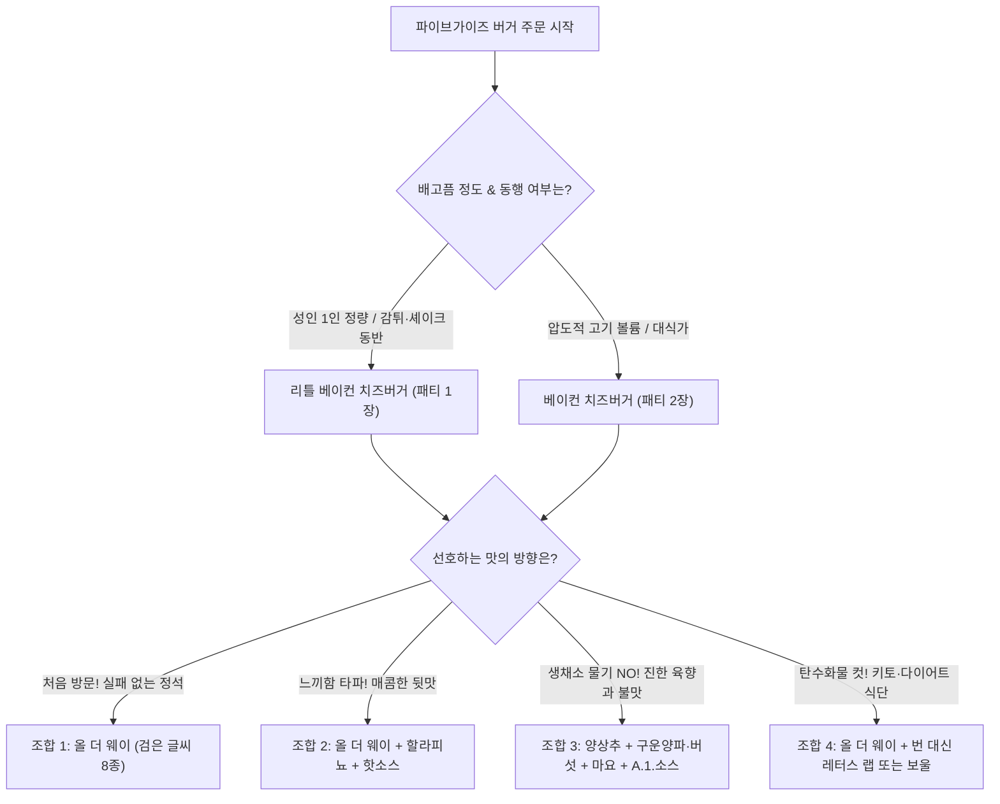

import Alert from '@/components/Alert.astro';
import Chart from '@/components/Chart.astro';

버거 단품 하나에 1만 7천 원이 넘는데도 가끔 그 묵직한 육즙과 땅콩기름 감자튀김이 강렬하게 생각날 때가 있습니다. 하지만 막상 카운터 앞에 섰을 때 직원의 "리틀로 하시겠어요? 토핑은 어떻게 해드릴까요?"라는 질문에 당황해 본 적 있으실 텐데요. 세트 메뉴조차 없는 낯선 시스템이지만, 핵심이 되는 **파이브가이즈 주문방법**과 기본 공식인 **올더웨이**, 그리고 입맛에 맞춘 토핑 **꿀조합**만 미리 파악해 두면 비싼 가격 이상의 본전을 뽑을 수 있습니다.

---

## 찬바람 부는 국내 프리미엄 버거 시장, 그럼에도 파이브가이즈를 찾는 이유

최근 몇 년 사이 한국에 상륙했던 해외 유명 프리미엄 버거 브랜드들의 성적표는 꽤나 씁쓸합니다. 한때 강남과 잠실 일대를 달궜던 샌프란시스코 명물 **슈퍼두퍼**(Super Duper)는 실적 부진 끝에 2025년 2월 국내 전 매장을 철수했고, 오바마 버거로 이름을 알렸던 **굿스터프이터리**는 오픈 5개월 만에 문을 닫았습니다. 14만 원짜리 버거로 화제를 모았던 **고든램지 버거**와 캐주얼 라인업인 **스트리트 버거** 역시 고물가 기조와 가성비 피로감 속에서 점포 축소 및 부침을 겪고 있죠.

초기 오픈런 열풍을 일으켰던 **파이브가이즈**(Five Guys)라고 해서 이 한파에서 완전히 자유로운 것은 아닙니다. 한화갤러리아가 자회사 에프지코리아를 통해 2023년 6월 강남 1호점을 연 이후 여의도 더현대, 고속터미널, 서울역, 판교, 광교, 압구정로데오, 용산 등으로 매장을 넓히며 외형을 키웠지만, 높은 원가율과 본사 로열티, 매장 운영비 부담 속에 결국 M&A 시장에 매물로 나와 사모펀드(H&Q에쿼티파트너스)를 우선협상대상자로 선정하며 매각 절차를 밟게 되었습니다. 국내 외식 시장에서 2～3만 원대 프리미엄 버거가 지속 성장하기가 그만큼 녹록지 않다는 방증입니다.

소비자 입장에서도 가장 큰 장벽은 역시 사악한 가격과 초보자에게 불친절해 보이는 단품 위주 주문 체계입니다. 파이브가이즈에는 패스트푸드점 특유의 할인 세트 메뉴가 아예 없습니다. 대표 메뉴인 베이컨 치즈버거(17,400원)에 가장 작은 리틀 프라이(6,900원), 탄산음료(3,900원)만 담아도 **28,200원**이 나오고, 탄산 대신 시그니처인 밀크셰이크(8,900원)를 고르면 1인 식사 비용이 **33,200원**까지 치솟습니다.

<Chart
  type="bar"
  caption="국내 주요 버거 브랜드 1인 대표 구성(버거+감자튀김+음료) 가격 비교 (단위: 원)"
  data={{
    labels: [
      '파이브가이즈 (베이컨치즈+감튀+셰이크)',
      '파이브가이즈 (베이컨치즈+감튀+탄산)',
      '파이브가이즈 (리틀치즈+감튀+탄산)',
      '고든램지 스트리트버거 세트',
      '쉐이크쉑 (스모크쉑 더블 세트)',
      '슈퍼두퍼 (철수 전 트러플 세트)',
      '맥도날드 (빅맥 세트)'
    ],
    datasets: [
      {
        label: '1인 구성 가격 (원)',
        data: [33200, 28200, 22200, 21800, 21600, 20800, 7800]
      }
    ]
  }}
/>

경쟁 브랜드보다도 한참 비싼 가격표는 분명 부담스럽지만, 개인적으로 프리미엄 버거 중에서는 파이브가이즈가 원재료의 신선도와 포만감 면에서 가장 돈값이 아깝지 않은 브랜드라고 생각합니다. 기왕 큰맘 먹고 지갑을 열기로 했다면, 특유의 조리 방식과 주문 시스템을 제대로 이해하고 내 입맛에 딱 맞게 즐기는 것이 중요합니다.

---

## 비싼 값을 납득시키는 파이브가이즈의 3대 고집

파이브가이즈는 1986년 미국 버지니아주 알링턴에서 제리 머렐(Jerry Murrell)과 그의 다섯 아들이 시작한 브랜드입니다. "대학 등록금으로 쓸래, 아니면 그 돈으로 함께 장사를 시작할래?"라는 아버지의 제안에서 출발한 이 작은 버거 가게는 창업 초기부터 타협하지 않는 조리 원칙을 고수해 왔습니다.

### 1. 주방의 3무 원칙: 냉동고·전자레인지·타이머가 없다

파이브가이즈 주방에는 패스트푸드점의 필수 장비로 꼽히는 세 가지가 존재하지 않습니다. 이른바 **3무 원칙**(No Freezers, No Microwaves, No Timers)입니다.

* **냉동고 없음**: 한 번도 얼리지 않은 냉장 생소고기 패티를 매일 아침 직원이 직접 손으로 빚어 성형합니다.
* **전자레인지 없음**: 미리 구워둔 재료를 데워 내는 과정이 없습니다. 모든 메뉴는 주문이 들어오는 즉시 뜨거운 철판 위에서 조리를 시작합니다.
* **타이머 없음**: 기계 알람에 의존하지 않고, 숙련된 그릴 마스터가 육안과 손끝의 감각만으로 고기 표면의 마이야르 반응과 내부 육즙 상태를 판별해 구워냅니다.

### 2. 100% 땅콩기름과 국내산 생감자 실명제

감자튀김 역시 냉동 감자를 쓰지 않습니다. 매일 매장으로 배송되는 생감자를 직접 씻고 썰어 전분을 뺀 뒤, 콜레스테롤 0%의 순수 **100% 땅콩기름**으로 두 번 튀겨냅니다. 매장 한쪽 벽면에 걸린 '오늘의 감자' 칠판을 보면 강원도 평창·정선, 전남 보성 등 당일 공급받은 국내 농가 산지와 농부의 이름이 실명으로 적혀 있습니다. 미국 본사의 감자 품질 기준을 맞추기 위해 국내 산지를 계절별로 직접 발굴해 운영하는 디테일이 겉바속촉한 식감의 비결이죠.

### 3. 무료 땅콩과 반드시 지켜야 할 안전 에티켓

주문 후 버거가 나오기까지 걸리는 7～10분의 대기 시간 동안, 매장 한편에 쌓인 볶은 땅콩을 종이 트레이에 담아 무제한으로 먹을 수 있습니다. 짭조름하게 볶아낸 미국산 땅콩은 훌륭한 에피타이저지만, 한 가지 엄격한 규칙이 따릅니다.

<Alert type="warning" title="무료 땅콩, 매장 밖으로 가져가면 안 되는 이유">
매장 내 비치된 무료 땅콩은 **매장 밖 반출이 엄격히 금지**되어 있습니다. 얌체 고객을 막으려는 목적이 아니라, 땅콩 알레르기가 있는 보행자나 대중교통 이용객이 의도치 않게 땅콩 가루·껍질에 노출되어 겪을 수 있는 **급성 아나필락시스 쇼크 사고를 예방**하고 식품위생 안전 규정을 준수하기 위한 전 세계 공통 매뉴얼입니다. 반드시 매장 안에서만 드시고 남은 땅콩은 버리고 나와야 합니다.
</Alert>

---

## 첫 방문자가 가장 많이 속는 3가지 주문 함정

파이브가이즈 카운터에서 당황하지 않으려면 일반 프랜차이즈 버거 매장과 완전히 다른 세 가지 기준부터 머릿속에 넣어두어야 합니다.

### 함정 1: '리틀'은 어린이용 미니 버거가 아니다

메뉴판에 적힌 기본 버거 4종(햄버거, 치즈버거, 베이컨버거, 베이컨치즈버거)은 모두 **패티 2장**(더블 패티, 약 840～1,060kcal)이 들어가는 대용량 메뉴입니다.

반면 이름 앞에 **리틀**(Little)이 붙은 버거는 빵이나 채소 크기가 작아진 미니 버거가 아닙니다. 기본 버거와 **동일한 크기의 참깨 번과 토핑에 패티만 1장**(싱글 패티, 약 540～690kcal) 들어가는 구성으로, 성인 1명이 먹기에 충분한 버거킹 와퍼급 볼륨을 자랑합니다.

* **소식가이거나 감자튀김·셰이크를 곁들일 예정이라면**: 주저 없이 **리틀** 라인업을 고르세요.
* **치즈와 베이컨 선택 주의**: 파이브가이즈에서 크래프트 아메리칸 치즈와 사과나무 훈연 베이컨은 무료 토핑이 아닙니다. 치즈나 베이컨을 원한다면 처음부터 '치즈버거' 또는 '베이컨 치즈버거'를 주문해야 합니다.

### 함정 2: 감자튀김 '토퍼' 폭격과 사이즈 선택법

파이브가이즈에서 버거를 주문한 인원수대로 감자튀김을 시키면 테이블 위가 감자 산으로 변하는 참사가 벌어집니다. 컵에 감자튀김을 가득 채워 넣은 뒤, 포장용 갈색 종이봉투 바닥에 전용 스쿱으로 한 바가지를 더 쏟아부어 주는 **토퍼**(Topper) 문화가 본사 공식 정량 매뉴얼이기 때문입니다.

* **2인 방문 시**: 무조건 **리틀 프라이**(6,900원) **1개**만 주문하세요. 리틀 사이즈라지만 토퍼까지 합친 실중량이 227g 이상으로, 일반 패스트푸드점 라지 감자튀김 2개를 합친 양과 맞먹습니다.
* **3～4인 방문 시**: **레귤러 프라이**(8,900원) 또는 **라지 프라이**(10,900원) 1개를 시켜 나눠 먹는 것이 알맞습니다.
* **시즈닝 선택**: 땅콩기름 본연의 고소함과 감자 맛을 살린 담백한 소금 간의 **파이브가이즈 스타일**과, 파프리카·카이엔페퍼·마늘·양파 시즈닝을 입혀 매콤짭짤한 중독성을 자랑하는 **케이준 스타일** 중 고를 수 있습니다. 한국 매장에서는 느끼함을 잡아주는 케이준 스타일의 인기가 압도적입니다.

### 함정 3: 밀크셰이크 8가지 믹스인은 몇 개를 넣든 0원

음료는 디스펜서에서 무한 리필이 가능한 **탄산음료**(3,900원)와 꾸덕한 질감의 **밀크셰이크**(8,900원)로 나뉩니다. 밀크셰이크를 주문할 때 꼭 기억해야 할 점은 바닐라 베이스에 추가할 수 있는 **8가지 믹스인**(Mix-ins) 토핑이 몇 개를 고르든 **전액 무료**라는 사실입니다.

| 믹스인 구분 | 선택 가능한 토핑 (중복 선택 무료) | 추천 조합 및 특징 |
| :--- | :--- | :--- |
| **단짠 & 고소** | 베이컨, 피넛버터, 솔티드 카라멜 | **베이컨 + 피넛버터** 또는 **솔티드 카라멜 + 베이컨**: 짭조름한 훈연 베이컨 조각과 고소한 땅콩버터·카라멜이 만나 극강의 미국식 단짠 풍미를 냅니다. |
| **크런치 & 달콤** | 오레오 쿠키, 로투스 비스코프, 초콜릿 | **오레오 + 로투스** 또는 **오레오 + 솔티드 카라멜**: 바삭하게 씹히는 쿠키 식감이 살아 있어 입문자에게 가장 무난합니다. |
| **과일 과육** | 딸기, 바나나 | **딸기 + 바나나**: 시럽이 아닌 실제 과육을 갈아 넣어 상큼하고 부드러운 생과일 셰이크 맛을 냅니다. |

주문할 때 "밀크셰이크에 오레오랑 베이컨 넣어주세요"처럼 원하는 재료를 1개든 8개 전부든 자유롭게 부르면 됩니다. 잘 튀겨진 뜨거운 감자튀김을 차갑고 꾸덕한 셰이크에 푹 찍어 먹는 디핑 조합은 파이브가이즈의 필수 코스입니다.

---

## 15가지 무료 토핑 완벽 해독과 취향별 버거 꿀조합 4선

버거 사이즈를 골랐다면 이제 **15가지 무료 토핑**으로 속을 채울 차례입니다. 메뉴판에 적힌 토핑 색깔만 구분해도 주문이 훨씬 쉬워집니다.

* **검은색 글씨 토핑 8종**(올 더 웨이 기본 포함): 마요네즈, 케첩, 머스타드, 양상추, 피클, 토마토, 그릴드 어니언(구운 양파), 그릴드 머쉬룸(구운 버섯)
* **빨간색 글씨 토핑 7종**(개별 추가 무료): 렐리시(다진 피클), 어니언(생양파), 할라피뇨, 그린페퍼(생피망), A.1. 스테이크소스, 바비큐소스, 핫소스

어떤 조합을 골라야 할지 고민된다면 아래 플로우차트를 따라 내 입맛에 맞는 스타일을 먼저 찾아보세요.

### 조합 1. 실패 없는 정통 아메리칸 클래식 — '올 더 웨이'

* **추천 대상**: 파이브가이즈 첫 방문자, 단짠과 촉촉한 육즙의 황금 밸런스를 맛보고 싶은 분
* **주문 스크립트**: `"베이컨 치즈버거(또는 리틀 베이컨 치즈버거) 올 더 웨이로 주세요."`
* **맛의 특색**: 전 세계 매장에서 가장 많이 팔리는 부동의 1위 조합입니다. 철판에서 달콤하게 캐러멜라이징된 구운 양파와 쫄깃한 구운 버섯이 고기 패티의 감칠맛을 끌어올리고, 신선한 토마토·양상추·피클의 아삭함이 마요네즈·케첩·머스타드와 어우러져 빈틈없는 조화를 보여줍니다.

### 조합 2. 한국인 입맛 저격 느끼함 컷 — '매콤 할라피뇨 커스텀'

* **추천 대상**: 더블 패티와 녹아내린 아메리칸 치즈의 묵직한 기름기가 쉽게 물리는 분
* **주문 스크립트**: `"치즈버거 올 더 웨이에 할라피뇨랑 핫소스(또는 생양파) 추가해 주세요."`
* **맛의 특색**: 절임 피클 대신 매장에서 직접 썰어 넣는 두툼한 생할라피뇨가 아삭하게 씹히며 알싸한 청량감을 줍니다. 여기에 프랭크 레드핫 기반 핫소스의 산미와 매콤함이 더해져 버터와 육즙의 느끼함을 마지막 한 입까지 깔끔하게 잡아줍니다.

### 조합 3. 육향과 불맛의 극대화 — '고메 스테이크하우스 스타일'

* **추천 대상**: 물기 많은 생채소보다 고기 패티와 치즈의 진한 풍미에 집중하고 싶은 육식파
* **주문 스크립트**: `"베이컨 치즈버거에 양상추, 그릴드 어니언, 그릴드 머쉬룸, 마요네즈, A.1. 스테이크소스(또는 바비큐소스)만 넣어주세요."`
* **맛의 특색**: 수분이 많은 차가운 토마토와 피클을 과감히 빼버리면 버거 내부 온도가 식사 끝까지 뜨겁게 유지되고 번이 눅눅해지지 않습니다. 묵직한 우스터 풍미의 A.1. 스테이크소스가 구운 버섯·양파와 만나면서 수제버거라기보다 잘 구운 채끝 스테이크 샌드위치를 베어 무는 듯한 진한 감칠맛을 냅니다.

### 조합 4. 탄수화물 제로 다이어터·키토 식단 — '번리스(레터스 랩 & 보울)'

* **추천 대상**: 저탄고지(키토제닉) 식단 관리 중이거나 밀가루 글루텐 소화가 부담스러운 분
* **주문 스크립트**: `"베이컨 치즈버거 올 더 웨이를 번 대신 레터스 랩(양상추 번) 또는 보울(Bowl)로 주세요."`
* **맛의 특색**: 참깨 번을 빼는 대신 아삭하고 넓적한 통양상추 여러 겹으로 패티와 토핑을 단단하게 감싸주거나(**레터스 랩**), 알루미늄 포일 용기에 샐러드 스테이크처럼 담아 포크와 나이프로 먹을 수 있게 내어줍니다(**보울**). 설탕이 들어간 케첩과 바비큐소스만 제외하면 탄수화물 걱정 없는 완벽한 고단백 한 끼가 완성됩니다.

---

## 고수들만 아는 시크릿 메뉴와 디테일 주문 팁

네 가지 기본 조합에 익숙해졌다면, 미국 현지 단골들이 즐겨 찾는 히든 옵션으로 주문 레벨을 한 단계 높여보세요.

### 1. 숨은 역작 '패티 멜트' 만들어 먹기

메뉴판 아래쪽 샌드위치 코너에 있는 **그릴드 치즈 샌드위치**(8,400원)는 참깨 번을 안팎으로 뒤집어 버터를 듬뿍 바른 철판에 바삭하게 구운 뒤 아메리칸 치즈 2장을 녹여낸 메뉴입니다.

여기에 **유료 패티 1장**(또는 2장)을 추가하고 무료 토핑인 **그릴드 어니언, 그릴드 머쉬룸, 머스타드**를 넣어달라고 요청해 보세요. 폭신한 일반 버거 번과 달리 겉면이 크루아상처럼 바삭하고 고소하게 구워진 정통 미국식 **패티 멜트**(Patty Melt)가 탄생합니다. 일반 리틀 치즈버거보다 가격도 소폭 저렴하면서 치즈의 풍미는 훨씬 진하게 느껴지는 숨은 명작입니다.

### 2. 베이컨과 감자튀김 '엑스트라 크리스피' 옵션

파이브가이즈는 재료의 굽기 디테일도 조정할 수 있습니다. 버거에 들어가는 베이컨이나 감자튀김을 평소보다 더 바삭하게 즐기고 싶다면 주문할 때 `"베이컨이나 프라이는 엑스트라 크리스피(Extra Crispy)로 부탁드려요"`라고 덧붙여 보세요. 과자처럼 바삭하게 구워진 베이컨이 버거 속에서 확실한 식감 포인트를 만들어 줍니다. 반대로 토핑 양을 두 배로 늘리고 싶다면 무료 토핑 앞에 **엑스트라**(Extra)를 붙여 요청하면 됩니다.

### 3. 알루미늄 포일 포장과 수증기 관리 팁

파이브가이즈의 모든 버거는 뜨거운 열기로 치즈를 완벽히 녹이고 재료들을 하나로 밀착시키기 위해 알루미늄 포일에 단단히 감싸서 제공됩니다. 매장에서 바로 먹을 때는 이 포일 덕분에 갓 구운 일체감을 맛볼 수 있지만, 수증기가 빠져나가지 못해 시간이 조금만 지나도 빵이 축축해지기 쉽습니다.

음식을 픽업해 자리에 앉았다면 사진 찍기 전에 **포일 윗부분을 즉시 넓게 펼쳐 열기를 한 번 빼주는 것**이 좋습니다. 포장이나 배달로 가져갈 때도 종이봉투 상단과 버거 포일 끝을 살짝 열어두어야 마지막 한 입까지 눅눅함 없이 쫄깃한 참깨 번의 식감을 지킬 수 있습니다.
