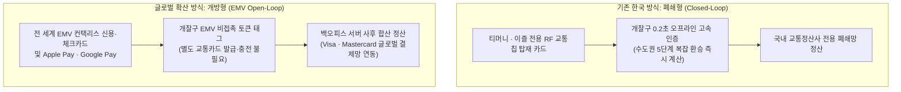

import Alert from '@/components/Alert.astro';
import AdSlot from '@/components/AdSlot.astro';
import LinkInline from '@/components/LinkInline.astro';

서울역 공항철도 개찰구 앞에서 외국인 관광객이 본국에서 쓰던 비자 카드를 단말기에 연신 갖다 대며 당황해하는 모습, 출퇴근길에 종종 마주치셨을 겁니다. 한국인에게도 불편함은 매한가지여서 아이폰 사용자들은 수년 동안 맥세이프 카드지갑에 실물 교통카드를 한 장씩 꽂고 다녀야만 했죠.

앞선 [1편: 왜 유독 한국만 수년째 IC칩을 꽂았을까?](/life/contactless-card-korea)에서는 상점 결제 단말기의 갈라파고스 구조를 살펴봤는데요. 사실 대한민국 지급결제 시장에서 가장 거대한 지각변동이 일어나고 있는 현장은 바로 매일 아침저녁으로 찍는 **버스·지하철 개찰구**입니다. 2025년 여름 **애플페이 티머니** 상륙부터 제주 버스의 **오픈루프** 상용화, 그리고 2026년 하반기 **모두의 카드**(K-패스 정액·정률 통합 체계) 개편까지 한꺼번에 쏟아진 변화를 내 출퇴근 기준으로 명쾌하게 정리해 드립니다.

## ⚡ 10초 요약: 내 스마트폰·상황별 대중교통 최적 세팅 판별표

복잡한 규격 용어보다 당장 내일 아침 출근길에 무엇을 찍어야 가장 편하고 교통비를 많이 돌려받는지부터 아래 표로 확인해 보세요.

| 이용자 유형 | 최적 태그 수단 | 환급 · 할인 연동 | 핵심 체크포인트 |
| :--- | :--- | :--- | :--- |
| **아이폰 · 애플워치 통근자** (월 15회 이상 이용) | **Apple 지갑 내 티머니** (익스프레스 모드 ON) | **모바일티머니 앱 + K-패스(모두의 카드)** 번호 등록 필수 | 화면 깨우기·Face ID 없이 개찰구 통과 · 정률/정액 자동 최대 환급 |
| **갤럭시 통근자** (월 15회 이상 이용) | **삼성월렛 교통카드** 또는 **K-패스 실물 후불카드** | 발급받은 **K-패스 신용·체크카드** 그대로 연동 | 별도 선불 충전 불필요 · 카드사 전월 실적 추가 할인 중복 가능 |
| **대중교통 월 15회 미만** (자차 위주 · 가끔 탑승) | 일반 **후불교통 신용·체크카드** 또는 애플페이 티머니 | 카드사 자체 대중교통 청구할인 카드 활용 | K-패스 최소 기준(월 15회) 미달 시 환급 미적용 |
| **제주도 여행객 · 방한 외국인** | **EMV 컨택리스 카드 / Apple Pay** 직접 태그 (제주 버스) | 서울 단기 체류 시 **기후동행 단기권**(1·2·3·5·7일권) | 제주 시내버스는 충전 없이 해외겸용 카드 바로 태그 가능 (환승 조건 유의) |

## 왜 내 비자·마스터카드는 지하철에서 먹통이었을까? 폐쇄형 vs 오픈루프

런던이나 뉴욕, 싱가포르에서는 공항에 내리자마자 교통카드를 살 필요 없이 내 지갑 속 신용카드를 지하철 개찰구에 바로 찍고 들어갑니다. 반면 세계 최초로 비접촉 대중교통 카드를 대중화했던 한국에서는 유독 해외 발행 신용카드나 일반 EMV 컨택리스 기능이 개찰구 앞에서 무용지물이었습니다.

원인은 상점 단말기 때와 놀라울 만큼 닮아 있습니다. 한국이 1990년대 중후반부터 구축한 대중교통 정산망이 **국내 독자 규격의 폐쇄형**(Closed-Loop) 시스템으로 너무 일찍, 너무 완벽하게 자리 잡았기 때문이에요.

한국의 수도권 통합환승제는 거리 비례 요금에 지하철·시내버스·마을버스·광역버스·GTX까지 얽혀 세계에서 가장 복잡한 요금 계산식을 단말기 접촉 **0.2초 이내**에 처리하도록 설계되어 있습니다. 이를 위해 국내 카드사들은 일반 신용카드를 발급할 때도 글로벌 EMV 결제 칩 옆에 **티머니·이즐 전용 후불교통 RF 기능**을 별도로 심어 왔습니다.

반면 해외에서 주류가 된 **오픈루프**(Open-Loop, 개방형 교통결제)는 개찰구 단말기에서 복잡한 잔액을 즉시 깎는 대신, 탑승 기록만 빠르게 수집해 두었다가 하루가 끝난 뒤 백오피스 서버에서 요금과 환승 할인을 계산해 신용카드망으로 일괄 청구하는 구조입니다. 한국 내국인은 이미 후불교통카드로 불편 없이 타고 다녔지만, 한국 전용 교통칩이 없는 해외 발행 카드와 초기 애플페이는 개찰구를 통과할 방법이 없었던 것이죠.

<AdSlot slot="inArticle" />

## 국내 오픈루프 대중교통, 지금 어디까지 열렸나?

외국인 관광객 급증과 글로벌 표준 전환 요구가 맞물리면서 철옹성 같던 국내 개찰구도 마침내 문을 열기 시작했습니다.

### 1. 제주도 시내버스: 국내 최초 EMV 오픈루프 전면 상용화 (2025년 8월～)

가장 먼저 테이프를 끊은 곳은 외국인 자유여행객 비중이 높은 제주도입니다. 제주특별자치도는 **2025년 8월**부터 도내 전 노선 시내버스에 EMV 컨택리스 오픈루프 단말기를 전면 도입했습니다 <LinkInline href="https://www.visakorea.com" label="Visa 코리아" variant="badge" />.

이제 제주에서는 교통카드 기능이 없는 해외 발행 카드나 외화 트래블카드, 해외 계정이 연결된 스마트폰 지갑이라도 컨택리스 마크만 있다면 버스 단말기에 바로 대고 탈 수 있습니다.

<Alert type="warning" title="제주 버스 오픈루프 이용 시 내국인이 주의할 점">
해외 관광객에게는 혁신적이지만, 한국 거주 내국인이 제주 여행 중 K-패스 환급이나 도내 무료 환승 혜택을 온전히 챙기려면 여전히 **기존 후불교통카드 또는 모바일 티머니**로 태그하는 편이 유리할 수 있습니다. 또한 오픈루프 특성상 1장의 카드로 다인승(2명 이상) 결제를 지원하지 않는 경우가 있어 동반 가족 수만큼 결제 매체를 각각 준비하는 것이 안전합니다.
</Alert>

### 2. 서울시 · 티머니 2030 단계적 오픈루프 로드맵

하루 수백만 명이 환승하는 수도권은 단말기 수량과 정산 복잡도가 차원이 달라 단계적 전환을 택했습니다. 서울특별시와 티머니는 **2030년까지 수도권 대중교통에 EMV 오픈루프를 순차 도입**하는 중장기 로드맵을 가동 중입니다 <LinkInline href="https://www.seoul.go.kr" label="서울특별시" variant="badge" />.

- **1단계 (2025～2026년 기반 구축 · 2027년 1월 버스 가동 목표)**: 시내버스 단말기 EMV 인증 모듈 탑재 및 정산 백오피스 서버 구축, 지하철 역사 내 신형 키오스크 해외 신용카드 결제 지원 확대
- **2단계 (2027년)**: 서울 지하철 1～8호선 개찰구 EMV 컨택리스 리더기 순차 교체
- **3단계 (2028～2030년)**: 마을버스, 민자철도 및 경기·인천 등 수도권 통합환승 기관 전체로 확대

즉 수도권 전철 개찰구에 아무 해외 비자·마스터카드를 그대로 찍고 타는 완전 개방까지는 조금 더 시간이 걸리지만, 내국인 아이폰 사용자들의 숙원은 그보다 먼저 다른 경로로 완전히 해결됐습니다.

## 아이폰 유저의 해방: 애플페이 티머니 + 2026 '모두의 카드' 환급 공식

### 1. 화면 켤 필요 없는 '익스프레스 모드'와 방전 예비 전력

<LinkInline href="https://www.apple.com/kr/newsroom/" label="Apple 대한민국 뉴스룸" /> 발표와 함께 **2025년 7월 22일** 정식 출시된 **Apple Pay 티머니**는 그동안 아이폰 뒷면에 실물 카드를 붙이고 다니던 풍경을 단숨에 바꿨습니다.

가장 빛나는 기능은 역시 **익스프레스 모드**(Express Mode)입니다. 상점에서 일반 애플페이로 커피값을 낼 때는 측면 버튼을 두 번 누르고 Face ID 인증을 거쳐야 하지만, 교통카드로 지정된 티머니는 **화면을 깨우거나 잠금을 풀 필요 없이 꺼진 아이폰 상단(또는 애플워치)을 개찰구에 툭 대기만 하면 0.2초 만에 통과**됩니다. 심지어 퇴근길에 아이폰 배터리가 완전히 방전되어 전원이 꺼진 직후라도, 내부 **전원 예비 모드**(Power Reserve) 덕분에 최대 수 시간 동안 개찰구 태그가 작동해 지하철역에 갇힐 일을 막아줍니다.

### 2. 2026 하반기 교통비 개편 핵심: 기후동행 30일권 종료와 '모두의 카드' 통합

교통카드 태그 방식만큼이나 2026년 하반기에 출퇴근족을 헷갈리게 만든 변화가 바로 대중교통 환급 제도의 대통합입니다.

그동안 서울·수도권 직장인들은 국토교통부의 정률 환급형 **K-패스**(20～53% 환급)와 서울시의 월정액 무제한 **기후동행카드**(30일권) 사이에서 "이번 달엔 며칠 출근하니까 어느 쪽이 2천 원 더 이득일까?"를 매달 계산해야 했습니다. 하지만 2026년 9월을 기점으로 서울시의 기존 선·후불 기후동행카드 30일권 운영은 공식 종료됐고, 국토교통부 대도시권광역교통위원회의 **모두의 카드**(K-패스 정액·정률 통합 체계, 서울시민 특화 '기후동행패스' 연동)로 일원화됐습니다 <LinkInline href="https://korea-pass.kr" label="K-패스(모두의 카드) 공식 누리집" />.

달라진 핵심 규칙은 단 세 줄로 요약됩니다.

1. **정률 vs 정액 자동 유리한 쪽 환급**: 월 15회 이상 대중교통을 타면 시스템이 알아서 **기존 비율 환급액**과 **기준금액(수도권 일반 국민 기준 일반형 6만 2천 원, 플러스형 10만 원) 초과분 전액 무제한 환급액**을 비교해 더 큰 금액을 돌려줍니다.
2. **일반형 vs 플러스형 포괄**: 1회 요금 3,000원 미만 시내버스·전철 위주인 일반형뿐 아니라 요금이 비싼 **GTX · 신분당선 · 광역버스**까지 제한 없이 아우르는 플러스형 기준이 마련돼 장거리 경기·인천 통근자의 체감 혜택이 커졌습니다.
3. **서울시민 청년 연령 만 39세 유지 & 단기권 존치**: 기존 K-패스 등록 서울시민은 카드를 새로 발급받지 않아도 만 19～39세 청년 기준 등 지자체 추가 혜택이 자동 반영되며, 서울을 방문한 관광객용 **기후동행 단기권**(1·2·3·5·7일권)은 그대로 유지됩니다.

<Alert type="danger" title="가장 많이 놓치는 함정: Apple 지갑에만 추가하면 환급이 0원입니다">
아이폰에서 대중교통 탑승만 되면 끝인 줄 알고 K-패스 연동 절차를 건너뛰면 **모두의 카드 환급금은 한 푼도 쌓이지 않습니다.** 반드시 ① 아이폰에 **모바일티머니 앱**을 설치해 안내에 따라 Apple 지갑(Wallet)용 티머니 교통카드를 발급·연동(애플페이 현대·카카오뱅크 카드뿐 아니라 앱 내 계좌이체·타사 카드로도 충전 가능)한 뒤, ② 모바일티머니 앱 내 K-패스 메뉴와 **K-패스 공식 앱·누리집(`korea-pass.kr`)에 해당 티머니 카드 번호를 등록**해야 등록일 탑승분부터 월 15회 횟수와 환급액이 정상 집계됩니다.
</Alert>

<AdSlot slot="inArticle" />

## 국내 오프라인 상점에서도 실물·모바일 터치 결제를 넓히는 요령

대중교통 세팅을 끝냈다면 일상 쇼핑과 외식에서도 카드를 꽂는 수고를 덜어낼 차례입니다. 2026년 말 현재 국내에서 EMV 컨택리스(실물 카드 터치 및 애플페이)가 매끄럽게 작동하는 대표 가맹점군은 다음과 같습니다.

- **편의점 4사**: CU, GS25, 세븐일레븐, 이마트24 전 매장
- **카페 · 패스트푸드**: 스타벅스, 투썸플레이스, 폴바셋, 메가MGC커피, 컴포즈커피, 맥도날드, 롯데리아, 버거킹, 쉐이크쉑, 그리고 무인·카운터 단말기가 최신화된 [파이브가이즈 국내 매장](/life/five-guys-order-guide)
- **생활 · 대형 유통**: 다이소(직영 및 신형 무인 키오스크 매장), 올리브영, 롯데·신세계·현대백화점, 코스트코, 이케아, 하나로마트

현장에서 유용한 요령이 하나 있습니다. 키오스크에서 결제할 때는 화면에서 **신용카드**가 아니라 **Apple Pay / NFC 결제** 버튼이 따로 분리되어 있는지 먼저 확인하세요. 일반 신용카드 버튼만 누르면 투입구 슬롯만 불이 들어오고 상단 NFC 패드는 깨어나지 않는 기종이 꽤 많습니다.

카운터 대면 결제 역시 마찬가지입니다. 아르바이트생에게 "컨택리스 결제할게요"라고 말하면 낯선 용어 탓에 당황하는 경우가 종종 있는데, 이럴 땐 그냥 "**애플페이로 결제할게요**"라고 말한 뒤 서명패드 위 물결 마크에 내 해외겸용 실물 카드를 가볍게 대면 군더더기 없이 1초 만에 영수증이 출력됩니다.

이제 국내 출퇴근길과 동네 매장까지 터치 결제가 손에 익으셨다면, 마지막 관문은 **해외여행지**입니다. 런던·뉴욕 지하철에서 실물 카드와 아이폰을 번갈아 찍었다가 요금 폭탄을 맞는 이유와 트래블카드 3대장 비교는 시리즈 완결편인 [**3편: 해외여행 컨택리스 카드 실전 가이드**](/life/overseas-contactless-travel-card-dcc-guide)에서 이어집니다.

## 참고 자료

- [K-패스 · 모두의 카드 공식 안내 및 카드 등록 누리집 — 국토교통부 대도시권광역교통위원회](https://korea-pass.kr)
- [Apple Pay 티머니 대한민국 출시 및 익스프레스 모드 안내 — Apple 대한민국 뉴스룸](https://www.apple.com/kr/newsroom/)
- [서울특별시 대중교통 정책 및 EMV 오픈루프 단계적 도입 안내 — 서울특별시 교통실](https://news.seoul.go.kr/traffic/)
- [제주특별자치도 버스 오픈루프(Tap to Ride) 도입 발표 — Visa 코리아](https://www.visakorea.com)
