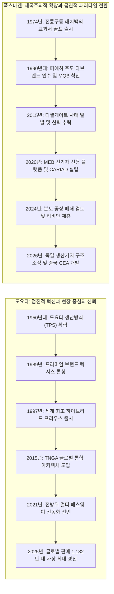
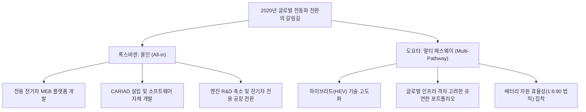
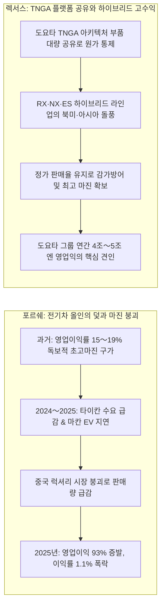
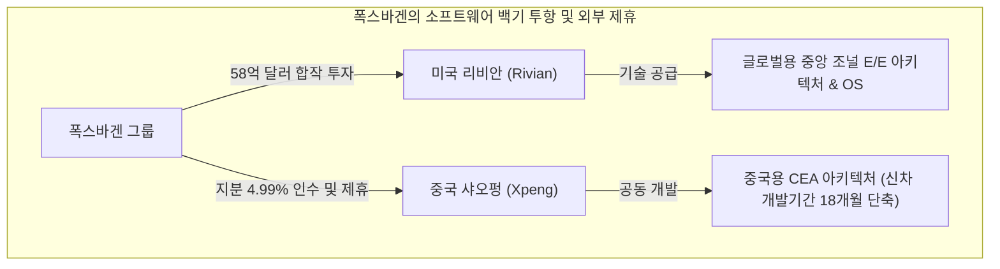
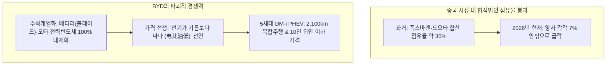

import Alert from '@/components/Alert.astro';

2021년 월가와 글로벌 테크 미디어는 도요타를 향해 "변화를 거부하다 화석이 될 갈라파고스의 공룡"이라며 거센 조롱을 퍼부었습니다. 반면 디젤게이트의 오명을 씻겠다며 수십조 원을 전기차 전용 플랫폼과 자체 소프트웨어에 쏟아부은 폭스바겐은 전통 레거시 완성차 업계의 유일한 혁신가로 추앙받았죠.

그로부터 5년이 흐른 2026년 현재, 두 거인이 받아 든 성적표는 시장의 모든 예측을 비웃듯 정반대로 뒤집혔습니다.

폭스바겐은 87년 역사상 처음으로 독일 본토 완성차 공장 폐쇄와 생산 이전까지 검토하는 초유의 구조조정에 돌입했고, 2025～2026년 그룹 영업이익률은 1%대 안팎까지 곤두박질쳤습니다. 반면 '전기차 지각생'이라는 비난 속에서도 묵묵히 내연기관과 하이브리드 고도화에 매달렸던 도요타는 연간 1,130만 대를 팔아치우며 6년 연속 세계 1위를 수성했습니다. 연간 영업이익 역시 4조～5조 엔(한화 약 35조～44조 원)을 넘나드는 경이로운 수익성을 과시하고 있습니다.

미래를 가장 먼저 열겠다며 질주했던 폭스바겐은 왜 절체절명의 수렁에 빠졌으며, 시장의 비난을 견디며 시간을 벌었던 도요타는 어떻게 글로벌 자동차 제국의 패권을 틀어쥐었을까요? 

두 회사의 엇갈린 과거와 결단의 순간, 2026년 현재의 냉혹한 실적, 그리고 중국 BYD라는 거대한 포식자 앞에서 2030년 벌어질 최후의 생존 방정식을 입체적으로 파헤쳐 봅니다.

---

## 두 거인의 역사: 실용적 신뢰와 확장적 제국주의

도요타와 폭스바겐이 전동화라는 거대한 파고 앞에서 상반된 결정을 내린 배경을 이해하려면, 두 회사의 DNA가 형성된 궤적부터 되짚어야 합니다.

### 도요타: 마른 수건도 다시 짜는 TPS와 1997년 프리우스 신화

도요타를 지탱하는 가장 강력한 기둥은 오노 다이이치(大野耐一)가 체계화한 **도요타 생산방식**(TPS, Toyota Production System)입니다. 필요한 부품을 필요한 때에 필요한 만큼만 생산하는 '적기생산'(Just-In-Time)과 결함이 발생하면 라인 전체를 멈추고 근본 원인을 해결하는 '지속적 개선'(改善, Kaizen)은 도요타를 전 세계에서 품질 편차가 가장 적은 완성차 메이커로 올려놓았습니다.

도요타의 전동화 여정은 유행처럼 시작되지 않았습니다. 1997년, 교토의정서 채택과 발맞추어 세계 최초의 양산형 하이브리드 차량인 **프리우스**(Prius)를 세상에 내놓은 것이 출발점이었습니다.

당시 자동차 업계는 가솔린 엔진과 전기 모터, 배터리를 복잡하게 얽어맨 파워트레인을 두고 "수리비만 많이 나오는 괴짜 차"라며 평가절하했습니다. 하지만 도요타는 지난 28년 동안 유성기어 기반의 독자 하이브리드 시스템(THS)을 5세대에 걸쳐 다듬었습니다. 인버터의 소형화, 모터의 고효율화, 배터리 충·방전 제어 소프트웨어의 극단적 최적화를 거치며 하이브리드 생산 단가를 순수 내연기관 엔진 수준에 근접할 만큼 낮춰버렸습니다.

여기에 1989년 출범한 고급 브랜드 **렉서스**(Lexus)는 플래그십 LS400의 정숙성과 견고한 품질로 북미 럭셔리 시장의 판도를 단번에 뒤흔들었습니다. 대중차 시장의 두터운 볼륨과 렉서스의 높은 마진 구조라는 이상적인 포트폴리오를 완성한 것입니다.

### 폭스바겐: 피에히 제국, MQB의 규모의 경제, 그리고 디젤게이트

폭스바겐의 역사는 공격적인 합종연횡과 엔지니어링 집착의 산물입니다. 1990년대 전설적인 엔지니어이자 경영자인 페르디난트 피에히(Ferdinand Piëch) 전 회장은 아우디, 포르쉐, 세아트, 스코다는 물론 벤틀리, 람보르기니, 부가티, 만(MAN), 스카니아에 이르기까지 대중차와 슈퍼카, 상용차를 아우르는 12개 브랜드 제국을 구축했습니다.

이 거대한 제국을 묶어낸 기술적 열쇠가 2012년 선보인 **MQB**(Modularer Querbaukasten) 모듈러 플랫폼이었습니다. 엔진의 장착 위치와 전륜 차축 거리를 표준화하여 폴로 같은 소형 해치백부터 파사트, 티구안, 아틀라스 같은 대형 SUV까지 부품의 80%를 공유하며 극한의 규모의 경제를 실현했습니다.

그러나 승승장구하던 폭스바겐을 벼랑 끝으로 몬 것은 바로 '디젤 신화'였습니다. 유럽 연합의 엄격한 CO2 규제를 우회하고 미국 시장을 뚫기 위해 '클린 디젤'을 전면에 내세웠지만, 2015년 9월 배출가스 검사 조작 소프트웨어를 심은 사실이 발각되는 **디젤게이트**(Dieselgate)가 터졌습니다.

300억 유로(한화 약 45조 원)가 넘는 천문학적인 벌금과 소송 비용, 그리고 곤두박질친 기업 이미지는 폭스바겐의 수뇌부를 극심한 공황 상태로 몰아넣었습니다. 디젤의 죄책감을 가장 빠르고 극적으로 털어낼 수 있는 탈출구는 오직 하나, 바로 '완전한 전기차 메이커로의 급진적 탈바꿈'이었습니다.

---

## 갈림길: 전기차 시대를 맞이한 서로 다른 선택

2020년 전후, 글로벌 자동차 산업은 테슬라의 급부상과 각국 정부의 내연기관 퇴출 시간표 발표로 거대한 패러다임 전환기를 맞이했습니다. 두 거인은 완전히 다른 길을 선택했습니다.

### 폭스바겐의 도박: MEB 플랫폼과 CARIAD의 잔혹사

폭스바겐의 사령탑을 잡은 헤르베르트 디스(Herbert Diess) 전 회장은 사내외의 반발을 무릅쓰고 '테슬라 타도'를 외치며 올인을 선언했습니다.

그 결과물이 순수 전기차 전용 플랫폼인 **MEB**(Modular Electric Drive Matrix)였습니다. ID.3를 시작으로 ID.4, ID. Buzz 등 순수 전기차 라인업을 단기간에 쏟아냈습니다. 전통 완성차 제조사 중 폭스바겐만큼 거액의 자본을 신속하게 전기차 전용 라인으로 전환한 곳은 없었습니다.

하지만 진정한 비극은 섀시가 아니라 소프트웨어에서 터져 나왔습니다. 디스 회장은 "차량 가치의 90%가 소프트웨어에서 나올 것"이라며 사내 소프트웨어 조직을 통합해 2020년 **CARIAD**를 설립했습니다. 차량용 독자 운영체제(vw.os)와 차세대 E3 1.2 전자 아키텍처를 자체 개발하겠다는 야심이었습니다.

결과는 참담했습니다. 100년 동안 하드웨어와 기계 설계를 다뤄온 전통 완성차의 관료주의적 조직 문화는 실리콘밸리식 애자일 소프트웨어 개발 방식을 전혀 수용하지 못했습니다. 수천 명의 소프트웨어 개발자를 채용했음에도 인포테인먼트 화면 멈춤, 통신 먹통, 주행 보조 시스템 오류가 끊이지 않았습니다. 

급기야 E3 1.2 플랫폼 개발이 2년 넘게 지연되면서 그룹의 핵심 수익원이어야 할 **포르쉐 마칸 EV**와 **아우디 Q6 e-tron**의 출시가 연쇄적으로 연기되었습니다. 매년 수십억 유로의 적자를 쏟아내던 CARIAD는 결국 폭스바겐 그룹 전체의 발목을 잡는 '블랙홀'로 전락했고, 디스 회장은 2022년 여름 전격 경질되었습니다.

<Alert type="danger" title="CARIAD 소프트웨어 내재화의 뼈아픈 교훈">
폭스바겐은 기계 부품 조립에서 발휘되던 '모듈러 플랫폼의 마법'이 코드와 네트워크로 얽힌 SDV(소프트웨어 중심 자동차)에서도 그대로 통할 것이라 오판했습니다. 수백 개의 분산형 전자제어장치(ECU)를 중앙 집중형 조널(Zonal) 아키텍처로 통합하는 작업은 단순한 인력 투입으로 해결될 문제가 아니었습니다.
</Alert>

유럽 완성차 업계가 겪고 있는 소프트웨어 중심 자동차(SDV) 전환의 진통은 비단 폭스바겐만의 문제가 아닙니다. [볼보가 차세대 EX90 출시를 2년 넘게 미루며 중앙 코어 컴퓨팅(SPA2) 도입에 애를 먹었던 사례](/life/volvo-polestar-spa-platform-ev-strategy)나, [BMW가 전기차 전용 노이어 클라세(Neue Klasse)로 승부수를 던진 배경](/life/bmw-neue-klasse-history-and-ev-strategy) 역시 전통 제조사들이 소프트웨어라는 낯선 생태계에서 겪는 거대한 문화적 충돌을 잘 보여줍니다.

### 도요타의 계산: '멀티 패스웨이'와 1:6:90의 법칙

폭스바겐이 전동화 깃발을 흔들 때, 도요타 아키오(豊田章男) 회장은 고집스럽게 다른 주장을 폈습니다.

> "탄소는 우리의 적이지만, 내연기관 그 자체가 적은 아니다. 전 세계 고객의 처한 환경과 에너지 믹스는 제각각이며, 진정한 탄소 중립으로 가는 길은 여러 갈래(Multi-Pathway)여야 한다."

도요타는 하이브리드(HEV), 플러그인 하이브리드(PHEV), 순수 전기차(BEV), 수소연료전지(FCEV), 심지어 수소를 직접 연소시키는 수소 엔진까지 모든 가능성을 열어두는 **멀티 패스웨이** 전략을 고수했습니다.

당시 월가 애널리스트들과 ESG 펀드들은 도요타를 향해 맹비난을 쏟아냈습니다. 기존 내연기관 설비와 협력업체를 지키기 위해 핑계를 대고 있다는 비판이었습니다. 하지만 도요타의 계산서 이면에는 냉철한 팩트가 자리 잡고 있었습니다.

첫째, **글로벌 전력망과 충전 인프라의 양극화**입니다. 미국 캘리포니아나 서유럽 일부 대도시를 제외하면, 동남아시아, 남미, 아프리카, 미국 중서부는 10년 내에 전기차를 안정적으로 수용할 전력망과 충전망을 갖추기 불가능했습니다.

둘째, **배터리 자원 효율성에 대한 '1:6:90의 법칙'**입니다. 도요타 연구진은 한정된 핵심 광물(리튬, 니켈, 코발트) 공급망 하에서 100kWh 배터리를 탑재한 대형 순수 전기차 1대를 만들 자원으로:
- 18kWh 배터리를 장착한 플러그인 하이브리드 6대, 또는
- 1.1kWh 배터리를 장착한 일반 하이브리드 90대를 만들 수 있다고 계산했습니다.

1대의 순수 전기차가 달릴 때 나머지 89대의 내연기관 차가 화석연료를 태우는 것보다, 90대의 하이브리드 차량을 도로에 보급해 즉시 배출가스를 30～40% 줄이는 것이 지구 전체의 누적 탄소 감축량에서 훨씬 현실적이고 압도적이라는 논리였습니다.

그리고 2024년 이후, 고금리와 경기 침체, 보조금 삭감으로 순수 전기차 시장이 '캐즘'(Chasm, 일시적 수요 정체)에 빠지자 도요타의 예측은 정확히 적중했습니다.

---

## 기술 및 파워트레인 전략 비교

두 회사가 주력으로 삼은 전동화 파워트레인은 구조와 경제성 측면에서 극단적인 차이를 보입니다.

| 구분 | 하이브리드 (HEV) | 플러그인 하이브리드 (PHEV) | 순수 전기차 (BEV) |
| :--- | :--- | :--- | :--- |
| **핵심 구동 원리** | 내연기관 + 소형 배터리·모터 (감속 시 회생제동 자동 충전) | 내연기관 + 중형 배터리 (외부 충전 가능, 50～100km 순수 전기 주행) | 대용량 배터리 + 모터 (100% 전기 주행, 무배출) |
| **외부 충전 의존도** | **0%** (기존 주유소 인프라 100% 활용) | 선택적 (배터리 방전 시 하이브리드 주행) | **100% 필수** (급속·완속 인프라 및 충전 대기 시간 발생) |
| **원가 및 수익성** | 엔진 부품 공유로 원가 최적화 완료, **제조사 최고 마진율 보장** | HEV 대비 고가, 배터리 용량 증대로 보조금 없이는 가격 저항 | 배터리 원가 비중 30～40%, 보조금 축소 시 **마진 급감 및 적자** |
| **도요타의 포지션** | **절대적 주력 캐시카우** (전동화 판매 비중의 약 90% 독점) | 프리우스·RAV4 PHEV 등 장거리 친환경 대안으로 육성 | 점진적 확대, 차세대 기가캐스팅 및 전고체 배터리 상용화 대기 |
| **폭스바겐의 포지션** | 라인업 사실상 부재 (48V 마일드 하이브리드 수준에 그침) | 과도기 규제 대응용으로 활용했으나 주력에서 배제 | **사활을 건 주력 파워트레인** (MEB 플랫폼 기반 대량 양산 강행) |
| **2026년 시장 평가** | **캐즘 국면의 최대 승자**, 가성비와 편의성을 모두 만족 | 전기차의 충전 불안과 내연기관의 유류비를 절충한 완충 지대 | 충전 스트레스, 중고차 잔존가치 폭락, 비싼 보험료로 성장 정체 |

---

## 2026년 성적표: 숫자가 증명하는 엇갈린 운명

두 회사의 선택은 2026년 현재 재무제표와 공장 가동률이라는 냉혹한 지표로 그 결과를 드러냈습니다.

### 최근 5년간 글로벌 판매량 추이

글로벌 인도량 기준으로 도요타는 확고부동한 1위를 지켰을 뿐 아니라 폭스바겐과의 격차를 200만 대 이상으로 벌렸습니다.

| 연도 | 도요타 그룹 (Toyota Group) | 폭스바겐 그룹 (VW Group) | 격차 (도요타 우위) | 시장 주요 맥락 |
| :---: | :---: | :---: | :---: | :--- |
| **2021년** | 1,049만 대 | 888만 대 | +161만 대 | 글로벌 차량용 반도체 대란 속 도요타의 재고 관리 역량 부각 |
| **2022년** | 1,048만 대 | 826만 대 | +222만 대 | 우크라이나 전쟁 발발 및 폭스바겐의 중국 공장 락다운 직격탄 |
| **2023년** | 1,123만 대 | 924만 대 | +199만 대 | 부품 공급망 정상화로 양사 일시 반등, 도요타 역대 최다 판매 기록 |
| **2024년** | 1,101만 대 | 903만 대 | +198만 대 | 글로벌 전기차 캐즘 심화, 북미 중심 도요타 하이브리드 품귀 현상 |
| **2025년** | **1,132만 대** | **898만 대** | **+234만 대** | 도요타 사상 최대 실적 경신, 폭스바겐 900만 대 선 붕괴 |

폭스바겐은 2025년 인도량이 898만 대에 그치며 심리적 저항선이었던 900만 대 벽마저 무너졌습니다. 반면 도요타는 전동화 차량(HEV+PHEV+BEV) 판매량이 연간 500만 대를 돌파(전체 판매의 약 48～50%)했고, 이 중 90% 이상을 차지한 하이브리드가 판매 신기록을 견인했습니다.

### 최근 5년간 영업이익률 추이

더 극적인 대비는 바로 이익의 질, 즉 영업이익률에서 나타납니다.

| 연도 | 도요타 (회계연도 4월～익년 3월) | 폭스바겐 그룹 (달력연도 1월～12월) | 실적 격차 및 세부 요인 |
| :---: | :---: | :---: | :--- |
| **2021년** | 8.1% | 7.7% | 신차 공급 부족으로 인한 가격 방어로 양사 모두 양호한 마진 |
| **2022년** | 9.5% | 8.1% | 엔저 호조와 원가 절감(도요타) vs 고급차 포르쉐·아우디 방어(폭스바겐) |
| **2023년** | 7.3% | 7.0% | 원자재 인플레이션 및 배터리 공급망 투자 확대로 마진 조정 |
| **2024년** | **11.9%** | **5.9%** | 도요타 일본 기업 최초 영업익 5.35조 엔 돌파 vs 폭스바겐 수익성 둔화 |
| **2025년** | **10.0%** | **2.8%** | 도요타 두 자릿수 마진 수성 vs 폭스바겐 영업이익 반토막(-53%) |
| **2026년 예상** | **약 7.4%** | **약 1.0%** | 도요타 관세 및 R&D 반영 vs 폭스바겐 포르쉐 감액 및 구조조정 비용 |

폭스바겐은 2025년 영업이익이 전년 대비 53% 급감한 89억 유로(마진율 2.8%)로 추락한 데 이어, 2026년에는 포르쉐 영업권 감액 손실과 대규모 구조조정 충당금이 겹치며 연간 영업이익률 전망치가 1.0% 수준까지 주저앉았습니다.

반면 도요타는 FY2024 11.9%, FY2025 10.0%라는 두 자릿수 영업이익률을 연달아 기록했습니다. 2026년에는 미국 관세 불확실성과 차세대 배터리 R&D 비용, 부품 협력사 단가 인상 지원 등으로 7%대로 숨고르기에 들어갔지만, 폭스바겐과는 비교가 불가능한 현금 창출력을 입증하고 있습니다.

---

## 럭셔리 캐시카우의 반전: 렉서스 vs 포르쉐

두 그룹의 수익성 격차를 가른 숨은 결정타는 볼륨 모델이 아닌 럭셔리 브랜드의 명암이었습니다.

### 포르쉐의 충격: 15%대 황금알에서 1.1%로의 추락

포르쉐 AG는 오랫동안 폭스바겐 그룹 전체 영업이익의 25～30%를 홀로 벌어들이는 '황금 거위'였습니다. 911과 카이엔, 파나메라가 뿜어내는 15～19%의 영업이익률은 페라리를 제외하면 양산차 업계에서 적수가 없었죠.

그러나 급진적인 전동화 추진이 부메랑으로 돌아왔습니다. 최초의 순수 전기 스포츠 세단 타이칸(Taycan)은 초기 반짝 흥행 이후 중고차 감가 폭락과 배터리 결함 이슈로 글로벌 수요가 급랭했습니다. 더욱이 중국 부동산 침체와 경기 둔화로 포르쉐의 최대 시장이었던 중국 내 판매량이 2025～2026년 연속으로 두 자릿수(-16% 이상) 감소세를 보였습니다.

여기에 CARIAD 사태로 마칸 EV의 인도가 2년 가까이 늦어지며 고정비가 치솟았습니다. 그 결과 2024년 56.4억 유로에 달했던 포르쉐의 영업이익은 2025년 **4.13억 유로로 무려 93% 증발**했고, **영업이익률은 1.1%로 폭락**했습니다. 이 충격으로 모회사 폭스바겐 그룹은 약 64억 유로(한화 약 9조 5,000억 원)에 달하는 장부상 영업권 손상차손을 떠안아야 했습니다.

### 렉서스의 저력: TNGA 공유와 흔들림 없는 하이브리드 캐시카우

반면 도요타의 프리미엄 디비전 **렉서스**는 정반대의 궤적을 그렸습니다.

도요타는 렉서스를 별도 법인으로 분리 상장해 단기 주가 부양을 노리는 대신, 그룹 내부에 둔 채 **TNGA**(Toyota New Global Architecture) 플랫폼을 완벽히 공유했습니다. 캠리·라브4와 부품 및 파워트레인을 대규모로 공유함으로써 R&D와 생산 원가를 극한으로 통제한 것입니다.

여기에 RX, NX, ES로 이어지는 하이브리드 주력 라인업이 폭발적인 인기를 끌었습니다. 충전 걱정 없이 ℓ당 15～20km를 달리는 렉서스 하이브리드는 북미와 한국, 동남아 시장에서 웃돈을 얹어 주거나 수개월을 대기해야 인도받을 수 있을 정도로 견고한 정가 판매 구조를 유지했습니다. 렉서스는 도요타 그룹 전체의 10%대 영업이익률을 지탱하는 가장 든든한 방파제 역할을 해냈습니다.

---

## 폭스바겐의 총체적 위기와 기술 백기 투항

2026년 현재 폭스바겐이 마주한 현실은 단순한 실적 부진을 넘어 기업의 존립을 뒤흔드는 수준입니다.

### 87년 역사상 첫 본토 공장 폐쇄와 노사 대치

폭스바겐은 1937년 창사 이래 단 한 번도 독일 본토의 완성차 공장을 닫아본 적이 없습니다. 그러나 올리버 블루메 경영진은 마침내 금기를 깼습니다.

독일 내 **엠덴**(Emden), **츠비카우**(Zwickau), **하노버**(Hanover) 완성차 공장과 아우디 **네카르줄름**(Neckarsulm) 공장 등 4개 주요 생산기지에 대해 2027년 중반까지 획기적인 원가 절감 방안을 도출하라는 최후통첩을 보낸 것입니다. 노조와의 합의가 불발될 경우 2031～2034년에 걸쳐 생산 라인을 슬로바키아, 체코, 폴란드 등 동유럽으로 이전하거나 영구 폐쇄하겠다는 방침입니다.

<Alert type="warning" title="독일 공장의 고비용 덫">
독일 자동차 노동자의 시간당 인건비는 약 62유로(한화 약 9만 3,000원)로, 체코나 헝가리의 3배, 중국의 5배 이상에 달합니다. 우크라이나 전쟁 이후 치솟은 산업용 전기료와 맞물려, 전기차 가동률이 50～60%로 떨어진 츠비카우와 엠덴 공장은 가동할수록 막대한 고정비 적자를 유발하는 구조로 전락했습니다.
</Alert>

독일 최대 금속노조(IG Metall)는 최대 10만 명에 달하는 인력 감축 위협에 맞서 총파업을 예고하며 격렬히 대치하고 있습니다. 독일 경제의 심장이자 상징이었던 폭스바겐이 내부 갈등의 소용돌이에 휩싸인 셈입니다.

### 굴욕적인 외부 수혈: 리비안 58억 달러와 샤오펑 동맹

소프트웨어 자체 개발의 실패를 인정한 폭스바겐은 결국 막대한 자본을 들여 외부 스타트업에 손을 벌리는 결단을 내렸습니다.

첫 번째 파트너는 미국의 전기차 스타트업 **리비안**(Rivian)입니다. 폭스바겐은 2024년 말부터 2026년에 걸쳐 총 58억 달러(한화 약 8조 원)를 리비안에 투자하며 합작 법인을 세웠습니다. 리비안이 보유한 중앙 집중식 조널 E/E 아키텍처와 차량 제어 소프트웨어 스택을 통째로 이식받아 2020년대 후반 출시될 아우디, 포르쉐, 폭스바겐 신차에 적용하기 위함입니다. 유럽 최대 자동차 제국이 설립 15년 차 미국 적자 스타트업의 소프트웨어 기술에 사활을 거는 굴욕적인 장면이 연출된 것입니다.

두 번째 파트너는 중국의 **샤오펑**(Xpeng)입니다. 중국 내 점유율 급락을 막기 위해 샤오펑 지분 4.99%를 전격 인수하고, 중국 전용 전자 아키텍처인 **CEA**(China Electronic Architecture)를 공동 개발했습니다. CEA를 통해 차량 내 전자제어장치(ECU) 수를 30% 줄이고 부품 비용을 50% 절감했으며, 신차 개발 주기를 기존 48개월에서 18개월로 단축했습니다. 폭스바겐은 이 중국산 저비용 아키텍처를 유럽 내 보급형 소형 전기차(ID.2 등)에 역수입하는 방안까지 진지하게 검토하고 있습니다.

---

## 도요타의 샴페인 뒤에 숨은 리스크

도요타가 현재 압도적인 승기를 잡은 것은 분명하지만, 장밋빛 미래만 놓여 있는 것은 아닙니다. 도요타 내부에서도 경계의 목소리가 터져 나오고 있습니다.

1. **엔화 환율과 거시경제 변동성**:
   지난 2년 동안 도요타의 역대급 실적에는 달러당 150～160엔대를 넘나든 기록적인 엔저(円安) 착시 효과가 상당 부분 기여했습니다. 글로벌 환율 기조가 엔고로 반전되고 원자재 인플레이션이 지속될 경우 마진 압박이 불가피합니다.

2. **미국 시장의 정치적 리스크와 관세 장벽**:
   도요타의 최대 시장은 단연 미국입니다. 하지만 미국 행정부의 수입차에 대한 관세 부과 위협과 공급망 재편 압박은 도요타의 수출 수익성을 언제든 뒤흔들 수 있는 뇌관입니다.

3. **품질 인증 부정 스캔들과 거버넌스 균열**:
   2023～2025년에 걸쳐 자회사 다이하쓰(Daihatsu), 히노자동차, 도요타 자동직기에서 충돌 테스트 및 배출가스 인증 조작 사건이 연이어 터졌습니다. "납기를 맞추기 위해 현장에 과도한 압박을 가했다"는 비판이 쏟아지며, 도요타 아키오 회장이 대국민 사과를 하기에 이르렀습니다. 무결점 품질을 자랑하던 TPS 신화에 내부적 피로가 누적되고 있다는 명백한 경고등입니다.

---

## 두 기업의 공통된 포식자: BYD와 중국 전기차의 공습

폭스바겐과 도요타가 서로 다른 전략으로 각축전을 벌이는 사이, 글로벌 자동차 산업의 판을 근본적으로 뒤흔든 제3의 세력이 등장했습니다. 바로 왕촨푸(王传福)가 이끄는 **BYD**(비야디)입니다.

### '전기가 기름보다 싸다': 10만 위안의 충격

2024년을 기점으로 BYD는 **'전기가 기름보다 싸다'**(电比油低)라는 슬로건을 내걸고 무자비한 치킨게임을 개시했습니다. 

배터리 셀(블레이드 배터리)부터 모터, 차량용 SiC 전력반도체까지 100% 수직계열화한 원가 경쟁력을 바탕으로 동급 가솔린 차량보다 저렴한 전기차와 플러그인 하이브리드를 쏟아냈습니다. 특히 2024년 발표된 5세대 **DM-i** 파워트레인은 열효율 46.06%, 1회 주유 및 충전으로 2,100km를 달리는 플러그인 하이브리드 세단(친 L, 실 06)을 불과 9만 9,800위안(한화 약 1,900만 원)에 내놓으며 시장을 초토화했습니다.

중국 신에너지차(NEV: BEV+PHEV) 월간 침투율은 2025년 50%를 돌파하여 2026년 현재 60%대를 넘나들고 있습니다.

### 중국 시장 점유율 30%에서 7%대로의 추락

이 가격 전쟁의 직격탄을 맞은 곳이 바로 폭스바겐과 도요타의 중국 합작법인(FAW-폭스바겐, 상하이-폭스바겐, 광치도요타, 일기도요타)이었습니다.

불과 5년 전만 해도 중국 승용차 시장의 30%를 나눠 먹던 두 거인의 점유율은 2026년 현재 **양사 모두 각각 7% 안팎**으로 쪼그라들었습니다. 중국 중산층의 첫차였던 폭스바겐 라비다·골프, 도요타 코롤라·카무리의 자리를 BYD 친(Qin), 송(Song), 지리 갤럭시가 완벽히 대체해 버린 것입니다.

이에 대응하는 두 회사의 방식도 엇갈립니다:
- **폭스바겐**: 샤오펑과 손잡고 CEA 플랫폼을 만들어 '중국 속도'에 맞춘 로컬 전기차를 내놓는 한편, 본사 중심 통제를 포기하고 허페이(合肥) 폭스바겐 VCTC 센터에 연구개발 전권을 넘겼습니다.
- **도요타**: 장쑤성 창수에 위치한 R&D 센터를 'IEM by TOYOTA'로 독립시키고, 현지 엔지니어 주도로 BYD 모터·배터리를 채용한 중국 맞춤형 bZ 시리즈를 재편하는 등 '현지 완결형 체제'로 전환하고 있습니다.

하지만 중국 내수에서 단련된 BYD, 지리, 상하이자동차는 이제 동남아시아(도요타의 안방)와 유럽(폭스바겐의 본토), 남미로 수백 척의 자동차 운반선을 띄우며 양사의 텃밭을 정조준하고 있습니다.

---

## 2030년 미래 승부처: SSP와 전고체의 대결

두 거인의 진짜 승부는 2028～2030년에 펼쳐질 차세대 아키텍처 전쟁에서 판가름 납니다.

### 도요타: 차세대 기가캐스팅과 전고체 배터리의 영리한 포석

도요타는 하이브리드로 벌어들인 막대한 현금을 차세대 전기차 기술에 쏟아붓고 있습니다.

1. **차세대 기가캐스팅 플랫폼**(Giga Casting Platform):
   차체를 전면, 중앙, 후면 3분할로 나누어 대형 알루미늄 다이캐스팅으로 한 번에 찍어내는 구조를 도입합니다. 컨베이어 벨트를 없애고 무인 운반차(AGV)가 조립 중인 차체를 자율 주행으로 이동시키는 '자주(自走) 조립 라인'을 통해 공장 투자비를 50%, 조립 공정을 절반으로 단축할 계획입니다.

2. **전고체 배터리 상용화**(Solid-State Battery, 2027～2028년):
   도요타는 전고체 배터리 관련 글로벌 특허를 가장 많이 보유한 기업입니다. 석유화학 기업 이데미쓰 코산(出光興産)과 손잡고 황화물계 고체 전해질 대량 양산 파일럿 라인을 가동 중입니다.
   
   여기서 도요타의 영리한 전략이 다시 한번 드러납니다. 고가의 전고체 배터리를 처음부터 80～100kWh 대용량 BEV에 탑재하지 않고, **용량이 1～2kWh에 불과한 하이브리드 차량에 먼저 적용**한다는 로드맵입니다. 하이브리드에 먼저 탑재해 생산 원가 리스크를 통제하고 대량 생산 내구성을 철저히 검증한 뒤, 점진적으로 고성능 렉서스 전기차로 확대하겠다는 노련한 수순입니다.

### 폭스바겐: 단일 통합 플랫폼 SSP와 리비안 조널 아키텍처

뼈아픈 구조조정을 겪고 있는 폭스바겐의 최종 목적지는 차세대 단일 모듈러 플랫폼 **SSP**(Scalable Systems Platform)입니다.

1. **SSP를 통한 파편화 극복**:
   현재 폭스바겐 그룹은 MEB, PPE(아우디·포르쉐용), J1(타이칸용), 내연기관 MQB 등으로 플랫폼이 어지럽게 쪼개져 있습니다. SSP는 160마력 대중차부터 1,700마력 슈퍼카까지 그룹 내 전체 차량의 80% 이상을 단 하나의 뼈대로 통합하는 것을 목표로 합니다. 이를 통해 플랫폼 규모의 경제를 극대화하고 개발 비용을 30% 절감하겠다는 구상입니다.

2. **리비안 기술 이식을 통한 조널 SDV 완성**:
   CARIAD의 실패를 뒤로하고, 리비안과 공동 개발한 고성능 중앙 컴퓨터 기반 조널 아키텍처를 SSP에 이식합니다. 수십 개의 와이어링 하네스를 걷어내고 무게와 원가를 획기적으로 줄이며, 무선 소프트웨어 업데이트(OTA)와 고도화된 자율주행 기능을 온전히 구현하겠다는 계획입니다.

---

## 2030년 3대 미래 시나리오 비교

2030년 글로벌 자동차 시장의 패권은 어떤 시나리오로 흘러갈까요? 시장 환경에 따라 두 회사의 운명은 극적으로 달라질 수 있습니다.

| 미래 시나리오 | 핵심 발생 조건 및 시장 환경 | 도요타에 미치는 영향 | 폭스바겐에 미치는 영향 | 2030년 패권 향방 |
| :--- | :--- | :--- | :--- | :--- |
| **시나리오 1: 전기차 급가속** | 배터리 원가 급락(LFP 등), 충전 인프라 고속 확충, 각국 탄소 규제 및 페널티 집행 강화 | **경고등 발생**: 하이브리드 수요가 급격히 전기차로 이탈, 순수 BEV 라인업 부족으로 글로벌 점유율 급락 위기 | **화려한 반등**: 조기 착수한 공장 구조조정과 리비안 결합 SSP 플랫폼 양산 결실로 전통 강자 부활 | **폭스바겐·테슬라·BYD 삼자 과점** |
| **시나리오 2: 장기 공존 지속** (현재 기본 경로) | 신흥국 전력망 미비 지속, 선진국 보조금 중단, 전동화 목표 연기 및 현실화 | **압도적 독주**: 하이브리드의 하이퍼 캐시카우 흐름 지속, 전고체 HEV 선점으로 전 세계 1위 확고히 수성 | **수익성 정체**: 전기차 공장 가동률 저하 및 동유럽 이전 고정비 부담으로 장기 저마진 늪 지속 | **도요타의 독보적 지배력 유지** |
| **시나리오 3: 중국 전기차 잠식** | BYD·지리의 유럽·남미·동남아 공장 본격 가동, 1만 유로대 초저가 모델 글로벌 폭격 | **텃밭 방어 비상**: 태국, 인도네시아 등 동남아 내연기관·하이브리드 독점 시장이 중국산 가성비에 잠식 | **유럽 본토 함락 위기**: 2만 유로대 보급형 소형차 시장 수성에 실패하며 폭스바겐 브랜드 존립 위협 | **BYD 등 중국 완성차 제국 부상** |

---

## 결론: 2026년의 승자가 2030년의 승자일까?

폭스바겐과 도요타의 지난 5년을 한 문장으로 압축한다면 다음과 같습니다.

> **"폭스바겐은 오지 않은 미래를 억지로 앞당기려다 넘어졌고, 도요타는 미래가 올 때까지 시간을 벌며 금고를 채웠다."**

폭스바겐은 시장의 충전 인프라와 소비자 준비도를 과대평가했고, 자체 소프트웨어 역량을 맹신했습니다. 반면 도요타는 전 세계 10억 명 운전자의 현실적인 지갑 사정과 충전 환경을 누구보다 냉정하게 계산했습니다. 그 결과가 2026년 현재 양사의 극명한 실적 양극화입니다.

하지만 2026년의 승자가 2030년의 승자를 보장하지는 않습니다.

도요타의 현재 승리는 영구적인 방패가 아닙니다. 하이브리드가 벌어다 준 천문학적인 현금에 취해 차세대 기가캐스팅과 SDV 플랫폼, 배터리 혁신을 게을리한다면, 1990년대 필름 카메라의 제왕이었던 코닥이나 피처폰의 절대 강자 노키아가 맞이했던 비극이 도요타에게 일어나지 말라는 법이 없습니다.

역설적이게도 지금 뼈를 깎는 수술대에 오른 폭스바겐의 고통은 2030년대를 위한 값비싼 예방주사가 될 수 있습니다. 87년 만의 공장 폐쇄라는 결단을 통해 비대한 고정비를 털어내고, 리비안과 샤오펑이라는 외부 혈액을 수혈받아 소프트웨어 병목을 해결한 폭스바겐이 SSP 플랫폼을 완성하는 순간, 그들은 누구보다 가볍고 강력한 전기차 군단으로 부활할 잠재력을 품고 있습니다.

자동차 산업 140년 역사에서 가장 거대한 전환기. 최종 승자는 누가 먼저 깃발을 꽂았는가가 아니라, 거대한 패러다임의 변곡점마다 **현실에 발을 딛고 끝까지 살아남아 이익을 남기는 자**가 될 것입니다.

당신이 지금 새로운 차를 선택해야 한다면, 오랜 세월 검증된 도요타의 하이브리드에 올라타시겠습니까, 아니면 극심한 성장통을 겪으며 미래를 향해 질주하는 유럽과 중국의 전기차를 선택하시겠습니까?
