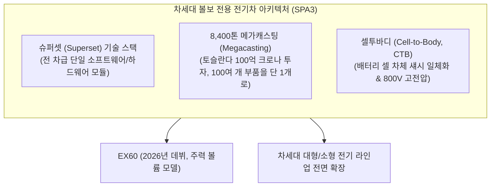
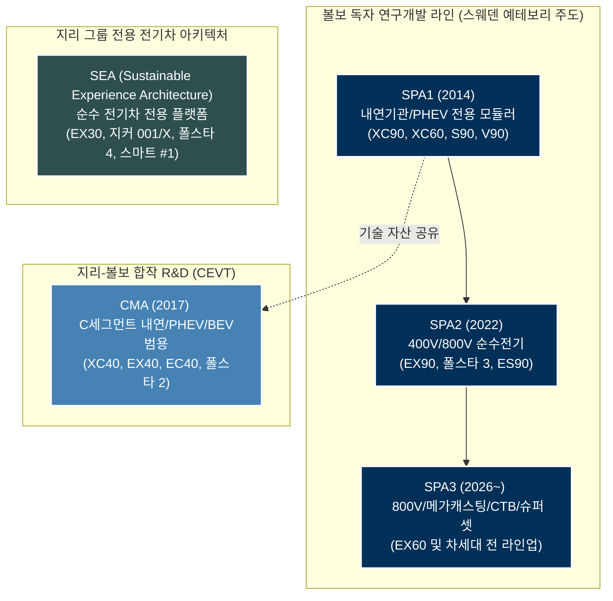

import Alert from '@/components/Alert.astro';

“볼보 신형 전기차 샀는데, 까보니까 지리자동차 뼈대라던데요?”

온라인 자동차 커뮤니티에서 볼보 전기차 이야기만 나오면 어김없이 튀어나오는 단골 댓글입니다. 입문형 소형 SUV인 EX30이 모회사 지리그룹의 SEA(Sustainable Experience Architecture) 플랫폼을 활용해 만들어진 사실이 알려지면서, “이제 볼보도 중국차 껍데기만 바꾼 것 아니냐”는 볼멘소리가 나왔기 때문이죠. 반면 브랜드의 기함이어야 할 플래그십 EX90은 소프트웨어 문제로 출고가 거의 2년이나 밀리는 굴욕을 겪었습니다.

도대체 볼보 차체 밑바닥에서는 무슨 일이 벌어지고 있는 걸까요? 내 차는 진짜 스웨덴 예테보리 엔지니어들이 깎아 만든 볼보 뼈대가 맞을까요? 

내연기관 시대를 화려하게 부활시켰던 **SPA1**부터, 중앙 집중식 코어 컴퓨팅 도입 과정에서 극심한 성장통을 앓은 **SPA2**, 그리고 볼보의 사활이 걸린 차세대 **SPA3**와 2030 전동화 목표 수정의 이면까지 기술과 비즈니스의 민낯을 가감 없이 파헤쳐 봅니다.

---

## SPA1: 모듈러의 태동과 배터리 센터터널 패키징

2010년 포드가 재정난으로 볼보를 중국 지리자동차(Geely)에 매각했을 때만 해도 수많은 자동차 마니아들이 볼보의 미래를 비관했습니다. 하지만 지리자동차의 자본을 수혈받은 볼보는 간섭 없이 독자 연구개발에 몰두했고, 2014년 세상을 놀라게 한 걸작을 내놓았습니다. 바로 2세대 XC90과 함께 첫선을 보인 **SPA1(Scalable Product Architecture 1)** 플랫폼입니다.

SPA1은 전륜 구동(FF)을 기반으로 앞바퀴 차축과 엔진 사이의 거리(대시보드 비율)를 길게 뽑아내 후륜 구동 고급 세단과 같은 우아한 비율을 구현한 모듈러 플랫폼이었습니다. XC90을 시작으로 S90, V90, XC60, S60 등 볼보의 핵심 라인업 60 및 90 클러스터가 전부 이 뼈대 위에서 태어났죠.

```text
[SPA1 플랫폼의 핵심 특징]
- 적용 차종: XC90 (2세대), XC60 (2세대), S90, V90, S60, V60, 폴스타 1
- 파워트레인: 드라이브-E (Drive-E) 가솔린/디젤 4기통 + 플러그인 하이브리드(T8)
- 구동 방식: 전륜 구동(FF) 기반 기계식/전자식 사륜구동(e-AWD)
```

### 배터리를 센터 터널에 숨긴 이유: 공간과 안전의 타협

SPA1의 설계에서 가장 독창적이면서도 지금까지 회자되는 부분은 바로 **T8 플러그인 하이브리드(PHEV)의 배터리 패키징**입니다.

당시 대부분의 제조사는 기존 내연기관 플랫폼에 모터와 배터리를 얹을 때 트렁크 바닥 밑 스페어타이어 공간에 배터리를 욱여넣었습니다. 그 결과 트렁크 바닥이 불룩 솟아오르고, 골프백 하나 제대로 싣지 못하거나 7인승 SUV에서 3열 좌석을 포기해야 했죠.

볼보는 전혀 다른 길을 택했습니다. 4륜 구동을 위한 기계식 프로펠러 샤프트가 지나가던 **차량 중앙 실내 바닥 통로(Center Tunnel)**에 리튬이온 배터리 팩을 세로로 길게 배치한 것입니다.

이 설계는 두 가지 결정적인 강점을 가져왔습니다:

1. **완벽한 실내 및 적재 공간 보존**: 트렁크 바닥과 3열 시트 하부에 배터리가 없으므로 순수 내연기관 모델과 100% 동일한 트렁크 용량과 7인승 시트 포지션을 유지했습니다.
2. **독보적인 측면 충돌 안전성**: 측면에서 거대한 충돌 에너지가 가해졌을 때, 차체 가장자리(사이드 실)에서 가장 멀리 떨어진 차체 중심부에 배터리가 자리 잡고 있어 배터리 셀 손상으로 인한 화재 위험을 원천 차단했습니다.

<Alert type="info" title="SPA1의 명확한 한계: 전기차로의 확장 불가">
센터 터널 배터리 배치는 11.6~18.8kWh 안팎의 PHEV 배터리를 수납하기에는 최적이었지만, 순수 전기차(BEV)로 전환하기에는 치명적인 한계가 있었습니다. 70~100kWh에 달하는 대용량 배터리를 실으려면 차량 바닥 전체를 스케이트보드 형태로 깔아야 하는데, SPA1 차체 프레임 구조상 바닥 전체에 배터리를 깔면 실내 바닥이 지나치게 높아져 탑승자의 헤드룸이 망가지기 때문입니다.
</Alert>

결국 볼보가 순수 전기차 전용 모델을 만들기 위해서는 SPA1의 설계를 완전히 뜯어고친 차세대 아키텍처가 반드시 필요했습니다.

---

## SPA2와 뼈아픈 진통: 코어 컴퓨팅, 400V, 그리고 라이다의 진실

순수 전기차 시대를 위해 볼보가 2020년대 초반 야심 차게 기획한 뼈대가 바로 **SPA2(Scalable Product Architecture 2)**입니다. 대표 모델은 플래그십 전기 SUV인 **EX90**과 형제차인 **폴스타 3(Polestar 3)**입니다.

SPA2는 단순한 파워트레인의 전동화를 넘어, 자동차 산업의 패러다임이 기계에서 소프트웨어로 넘어가는 SDV(Software Defined Vehicle) 시대를 정조준했습니다. 하지만 이 원대한 야망은 볼보 역사상 유례없는 뼈아픈 성장통을 안겨주었습니다.

```text
[SPA2 플랫폼의 핵심 제원]
- 적용 차종: 볼보 EX90, 폴스타 3, 볼보 ES90
- 배터리 용량: 111kWh (EX90/폴스타 3, CATL 프리즘 각형) / 최대 106kWh (ES90)
- 시스템 전압: 400V (EX90/폴스타 3) / 800V (ES90 세단)
- 코어 하드웨어: NVIDIA DRIVE Orin (듀얼) + Qualcomm Snapdragon Cockpit
- 운영체제: 볼보 카스 OS (Volvo Cars.OS)
```

### 1. 분산형 ECU에서 중앙 집중식 '코어 컴퓨팅'으로의 전환

기존 자동차는 에어컨 제어기, 창문 모터, 에어백, ADAS 센서 등 기능마다 100여 개가 넘는 소형 컴퓨터(ECU)가 제각각 그물망처럼 얽혀 있었습니다. 이 방식은 기능 하나를 업데이트하려면 수십 개 협력사의 코드를 일일이 맞춰야 해 무선 소프트웨어 업데이트(OTA)가 사실상 불가능합니다.

볼보는 SPA2에서 이를 과감히 걷어내고 중앙에서 모든 연산을 총괄하는 **코어 시스템(Core Computing)**을 채택했습니다. 

두 개의 강력한 **엔비디아 드라이브 오린(NVIDIA DRIVE Orin)** 시스템 온 칩(SoC)이 초당 254조 번(ES90은 듀얼 508 TOPS)에 달하는 연산을 수행하며 자율주행과 능동 안전 센서를 실시간 처리하고, 퀄컴 스냅드래곤 디지털 콕핏 플랫폼이 구글 안드로이드 오토모티브 OS 기반 인포테인먼트를 구동합니다.

하지만 하드웨어의 야심을 소프트웨어 개발 속도가 따라가지 못했습니다. 수많은 센서 데이터와 안전 제어 로직을 자체 운영체제인 'Volvo Cars.OS'로 통합하는 과정에서 치명적인 소프트웨어 버그와 시스템 충돌이 연이어 터져 나왔습니다.

결국 2022년 말 공개되었던 EX90은 양산 개시가 무려 2년 가까이 연기되어 2024년 하반기에야 고객 인도가 시작되었습니다. 심지어 초기 인도 물량조차 양방향 충전(V2G), 스마트 플러그 앤 차지, 일부 첨단 운전자 보조 시스템이 비활성화된 채 "추후 OTA로 켜주겠다"는 안내문과 함께 출고되는 수모를 겪었습니다.

### 2. EX90 초기형의 400V 한계와 ES90의 800V 전환

EX90은 111kWh라는 거대한 배터리를 탑재했습니다. 하지만 2025년형 초기 출시 모델의 충전 및 구동 시스템 전압은 현대차 E-GMP나 포르쉐 타이칸이 채택한 800V가 아닌 **400V 시스템**에 머물렀습니다.

최대 급속 충전 출력이 250kW에 달하지만, 111kWh 대용량 배터리를 10%에서 80%까지 채우는 데 약 30분이 걸립니다. 800V 초급속 충전 차량들이 18분 만에 충전을 끝내는 것과 비교하면 고속도로 휴게소에서의 체감 충전 속도 차이가 상당합니다. 또한 400V 시스템은 높은 전류를 견뎌야 하므로 고전압 와이어링 하네스(구리 배선)의 굵기와 무게가 늘어나는 태생적 단점을 안고 있었습니다.

다행히 볼보는 SPA2 아키텍처의 한계를 빠르게 보완했습니다. 동일한 SPA2 플랫폼을 기반으로 개발된 플래그십 전기 세단 **ES90에서는 볼보 최초로 800V 고전압 시스템(최대 350kW 급속 충전 지원, 10-80% 충전 22분)**을 전격 채택하며 고전압 충전 경쟁력을 회복했습니다.

### 3. 루미나(Luminar) 라이다 기본 탑재 정책의 파기와 결말

EX90 발표 당시 전 세계 자동차 업계를 뒤흔든 선언이 있었습니다. 지붕 앞쪽 중앙에 마치 택시 갓등처럼 솟아오른 **루미나(Luminar) 사의 아이리스(Iris) 라이다(LiDAR)**를 전 세계 모든 트림에 기본 장착하겠다는 발표였습니다. "안전의 볼보답게 비용과 타협하지 않고 자율주행 하드웨어를 표준화하겠다"는 찬사가 쏟아졌죠.

<Alert type="warning" title="루미나 계약 전격 해지와 조기 출고자 보상">
하지만 이 야심 찬 구상은 2024~2025년을 거치며 최악의 악재로 변했습니다. 루미나의 차세대 센서 공급 지연과 심각한 경영난(파산 보호 신청)으로 소프트웨어 완성 일정이 무기한 표류했고, 볼보는 결국 **루미나와의 공급 계약을 공식 해지**했습니다.

볼보는 **2026년형(MY26) EX90 및 차세대 세단 ES90부터 라이다 하드웨어 탑재를 전면 백지화(미탑재/삭제)**하기로 결정했습니다. 또한 지붕에 라이다 하드웨어를 달고도 영구히 소프트웨어 기능을 활성화받지 못하게 된 **2025년형 초기 출고자들에게 약 1,500달러(유럽 1,500유로, 캐나다 2,000달러) 상당의 서비스 크레딧 및 현금 보상책**을 제공하며 고개를 숙였습니다.
</Alert>

결과적으로 볼보는 값비싼 라이다 대신 검증된 고해상도 카메라 비전과 레이더 센서 스위트 중심으로 회귀했으며, SPA2는 볼보에게 "소프트웨어 정의 차량(SDV)으로 가는 길은 기계 섀시를 만드는 것보다 백배는 험난하다"는 뼈아픈 교훈을 남긴 과도기적 플랫폼이 되었습니다.

---

## SPA3와 미래: 90/90 Day가 밝힌 진짜 승부수

2024년 9월 4일, 스웨덴 예테보리 본사에서 열린 '90/90 Day' 행사. 볼보자동차 CEO 짐 로완(Jim Rowan)은 SPA2의 시행착오를 단번에 뒤집을 진정한 차세대 전용 전기차 아키텍처, **SPA3**를 공식 발표했습니다.

SPA3는 볼보의 향후 10년을 책임질 플랫폼이자, 브랜드의 명운이 걸린 혁신의 집합체입니다.



### 1. 슈퍼셋(Superset) 기술 스택: 개발의 레고 블록화

SPA3의 핵심 철학은 **슈퍼셋(Superset) 기술 스택**입니다.

과거에는 소형차(EX30)와 대형차(EX90)의 플랫폼과 전자 아키텍처가 제각각이라 신차를 개발할 때마다 소프트웨어 코드를 처음부터 다시 짜야 했습니다. 하지만 슈퍼셋 스택 아래에서는 배터리 모듈, 전기 모터 인버터, 코어 컴퓨터, 안전 알고리즘 등 하드웨어와 소프트웨어가 하나의 거대한 모듈형 라이브러리로 통합됩니다.

엔지니어들은 이 거대한 기술 풀에서 필요한 모듈을 마치 레고 블록처럼 꺼내어 소형 크로스오버부터 대형 7인승 플래그십까지 자유자재로 조합합니다.

무엇보다 강력한 점은 **소프트웨어의 연속성**입니다. EX60 개발 과정에서 개선된 충전 제어 로직이나 주행 보조 알고리즘이 있다면, 슈퍼셋 기술 스택을 공유하는 EX90이나 향후 출시될 전기 세단에도 코드 수정 없이 무선 업데이트(OTA)로 즉각 반영됩니다. 개발 비용과 기간을 절반 가까이 줄일 수 있는 혁신적인 체계입니다.

### 2. 토슬란다 공장 100억 크로나 투자와 8,400톤 메가캐스팅

볼보는 스웨덴 예테보리 토슬란다(Torslanda) 공장에 약 100억 스웨덴 크로나(한화 약 1조 3,000억 원)라는 천문학적인 자금을 쏟아부었습니다. 그 핵심에는 테슬라의 기가캐스팅을 뛰어넘는 스위스 뷜러(Bühler) 사의 **8,400톤급 메가캐스팅(Megacasting)** 다이캐스팅 머신이 있습니다.

- **부품 수의 드라마틱한 감축**: 기존 차량의 후륜 하부 차체(Rear Underbody)는 약 100~140개의 개별 강판 부품을 수천 번 용접하고 리벳으로 이어 붙여 만들었습니다. 메가캐스팅 공정은 녹인 알루미늄 합금을 거대한 금형에 고압 사출하여 **단 하나의 일체형 알루미늄 부품**으로 찍어냅니다.
- **15% 경량화와 충돌 강성 향상**: 수많은 접합부가 사라지면서 차체 뒷부분 무게가 15% 이상 줄어들었고, 비틀림 강성은 비약적으로 상승했습니다.
- **안전성 재정의**: 볼보의 엄격한 충돌 안전 기준에 맞춰 후방 추돌 시 충격 에너지를 차체 레일이 단계적으로 흡수하도록 주조 형상 자체를 정밀하게 설계했습니다.

```text
[메가캐스팅 공정 도입 전후 비교]
- 기존 (SPA1/SPA2): 100여 개 강판 부품 프레스 + 로봇 스폿 용접 + 구조용 접착제
- 차세대 (SPA3): 8,400톤 고압 주조 장비로 단 1개의 일체형 알루미늄 주물 성형
```

### 3. 셀투바디(Cell-to-Body, CTB)와 800V의 전면 도입

SPA3에서는 배터리 패키징 역시 근본적인 구조 혁신을 맞이합니다.

기존 전기차는 배터리 셀을 묶어 모듈을 만들고, 모듈을 모아 팩을 짠 뒤, 이를 차량 섀시 프레임 밑에 볼트로 결합하는 3중 구조였습니다. 안전하긴 하지만 공간 손실이 크고 무게가 무거웠죠.

SPA3는 배터리 셀을 차체 바닥 섀시 구조물에 직접 접착하는 **셀투바디(CTB)** 방식을 적용합니다. 배터리 팩 상단 덮개가 곧 차량 실내 바닥면이 되는 구조입니다.

<Alert type="tip" title="셀투바디(CTB)가 가져오는 실제 이점">
1. **바닥 두께 최소화**: 배터리 두께가 얇아지면서 실내 바닥이 낮아져, 전기차 특유의 "무릎이 가슴까지 올라오는" 어색한 뒷좌석 착좌감이 완전히 사라집니다.
2. **에너지 밀도 극대화**: 죽은 공간(데드 스페이스)을 없애 동일한 휠베이스 안에 더 많은 배터리 셀을 집어넣을 수 있어 1회 충전 주행거리가 획기적으로 늘어납니다.
3. **초고속 800V 충전**: 드디어 800V 고전압 시스템이 전면 도입되어 10%에서 80%까지 15~18분 만에 충전이 가능해집니다.
</Alert>

### 4. SPA3의 첫 번째 주인공: 차세대 볼륨 리더 EX60

SPA3 플랫폼의 첫 번째 수혜자는 볼보 전 세계 판매량의 든든한 기둥인 중형 SUV XC60의 전기차 버전, **EX60**입니다.

2026년 공개를 목표로 개발 중인 EX60은 테슬라 모델 Y, 포르쉐 마칸 EV, BMW 노이어 클라쎄 iX3와 정면으로 맞붙는 볼보의 최대 전략 차종입니다. 메가캐스팅으로 가벼워진 차체, 800V 초급속 충전, 완성도 높은 슈퍼셋 코어 소프트웨어가 집약되어 볼보 전동화의 성패를 가를 분수령이 될 전망입니다.

---

## 볼보·폴스타·지리 플랫폼 계통도와 족보 정리

소비자 입장에서 가장 혼란스러운 점은 "도대체 내 차 플랫폼의 뿌리가 어디인가?"입니다. 볼보와 폴스타, 지리그룹 사이에서 복잡하게 얽힌 플랫폼 족보를 다이어그램과 비교표로 명쾌하게 정리해 드립니다.



| 플랫폼명 | 개발 주체 | 구동 전압 | 지원 파워트레인 | 대표 적용 차종 | 핵심 특징 |
| :--- | :--- | :---: | :--- | :--- | :--- |
| **SPA1** | 볼보자동차 | 400V (PHEV) | 가솔린, 디젤, PHEV | XC90, XC60, S90, V90, S60, 폴스타 1 | 센터 터널 T자 배터리 배치, 7인승 공간 보존 |
| **CMA** | 볼보 + 지리 (CEVT) | 400V | 내연기관, MHEV, BEV | 볼보 XC40, EX40, EC40, 폴스타 2 | 소형/준중형 범용 플랫폼, 실용성 중심 |
| **SEA** | 지리자동차 홀딩스 | 400V / 800V | 순수 전기(BEV) 전용 | 볼보 EX30, 폴스타 4, 지커 001, 스마트 #1 | 지리그룹 전기차 공용 플랫폼, 압도적 원가경쟁력 |
| **SPA2** | 볼보자동차 | 400V (EX90) / 800V (ES90) | 순수 전기(BEV) 전용 | 볼보 EX90, 폴스타 3, 볼보 ES90 | 중앙 집중 코어 연산, 듀얼 오린 칩, SDV 전환기 (ES90서 800V 최초 적용) |
| **SPA3** | 볼보자동차 | 800V | 순수 전기(BEV) 전용 | 볼보 EX60 (2026년 예정) | 슈퍼셋 스택, 8,400톤 메가캐스팅, CTB 일체화 |

표에서 알 수 있듯, **EX30은 지리그룹의 SEA 플랫폼을 기반으로 볼보의 안전 사양과 인테리어 감성을 입힌 모델**이며, **EX90과 향후 출시될 EX60은 볼보가 스웨덴 본사 주도로 자체 개발한 순수 혈통의 SPA 계열**입니다.

---

## 2030 전동화 전략 수정: 100% 전기차에서 유턴한 냉혹한 현실

2021년, 볼보는 글로벌 완성차 업계 중 가장 급진적인 전동화 로드맵을 선언했었습니다. 
> "2030년까지 하이브리드를 포함한 내연기관 엔진을 단 1대도 만들지 않고 100% 순수 전기차 브랜드로 탈바꿈하겠다."

그러나 2024년 9월, 볼보는 이 목표를 공식적으로 수정했습니다. 

새로운 목표는 **"2030년까지 글로벌 판매량의 90~100%를 전동화 모델(순수 전기차 + 플러그인 하이브리드)로 구성하고, 시장 상황에 따라 나머지 0~10%는 48V 마일드 하이브리드(MHEV)를 유지한다"**는 내용이었습니다. 사실상 순수 100% 전기차 선언에서 발을 빼고 PHEV에 생명 연장의 호흡기를 달아준 것입니다.

볼보가 자존심을 굽히고 전략을 수정한 데에는 세 가지 냉혹한 대외 변수가 작용했습니다.

### 1. 지정학적 무역 갈등과 징벌적 관세 장벽
중국 장자커우 공장에서 생산되던 가성비 전기차 EX30은 미국과 유럽의 집중 타깃이 되었습니다. 미국 정부는 중국산 전기차에 100% 관세를 부과했고, 유럽연합(EU) 역시 고율의 상계관세를 매겼습니다. 볼보는 급히 벨기에 겐트 공장으로 EX30 생산 기지를 이전해야 했고, 이 과정에서 천문학적인 설비 투자비와 공급 지연 손실이 발생했습니다.

### 2. 글로벌 전기차 수요 캐즘과 인프라 지연
유럽과 북미의 전기차 보조금 축소, 그리고 고속 충전 인프라의 확충 지연으로 인해 대중 소비자들의 전기차 전환 속도가 급격히 둔화되었습니다. 충전 스트레스 없이 엔진과 전기모터를 병용할 수 있는 하이브리드로 수요가 회귀하는 현상이 뚜렷해졌습니다.

### 3. 수익성 방어를 위한 캐시카우 확보
순수 전기차 전용 공장 전환과 SPA2 소프트웨어 개발 지연으로 인한 막대한 R&D 비용을 감당하려면 안정적인 영업이익을 뽑아낼 캐시카우가 절실했습니다. 마진율이 높은 대형 PHEV 라인업을 단종시키는 것은 자살골에 가까웠던 것이죠.

### 신형 XC90과 EX90의 영리한 투 트랙(Two-Track) 공존

전략 수정의 결과물이 바로 2024년 9월 공개된 **신형 XC90(SPA1 기반 2차 페이스리프트)**입니다. 

볼보는 2014년 등장해 10년이 지난 SPA1 플랫폼의 뼈대를 그대로 유지한 채, 외관 디자인을 신형 EX90과 똑같은 최신 패밀리룩으로 뜯어고치고 실내에 11.2인치 독립형 최신 인포테인먼트 스크린을 이식했습니다.

```text
[볼보 플래그십의 투 트랙 전략]
- EX90 (SPA2): 충전 인프라가 완벽히 갖춰진 도심 하이엔드 얼리어답터를 위한 순수전기 플래그십
- XC90 PHEV (SPA1): 충전 스트레스 없이 장거리 주행과 패밀리 레저를 즐기려는 전통적 럭셔리 고객을 위한 플래그십
```

단종될 뻔했던 XC90을 화려하게 부활시켜 당장의 현금 흐름을 확보하고, 동시에 시간을 벌어 SPA3 플랫폼을 완벽하게 담금질하겠다는 볼보의 영리한 생존 전략인 셈입니다.

---

## 폴스타와의 독립: 지분 18% 축소와 갈라진 두 개의 길

볼보의 전기차 전략을 이야기할 때 빼놓을 수 없는 형제 브랜드가 바로 **폴스타(Polestar)**입니다. 

과거 볼보의 고성능 모터스포츠 부서로 출발해 2017년 프리미엄 전기차 독립 브랜드로 출범했던 폴스타는 볼보와 수많은 하드웨어와 플랫폼(SPA1, CMA, SPA2)을 공유해 왔습니다. 

하지만 2024년 2월, 볼보자동차 이사회는 충격적인 결정을 발표합니다.

<Alert type="warning" title="볼보의 폴스타 지분 축소 및 자금 지원 중단">
볼보는 보유하고 있던 폴스타 지분 약 48% 중 상당수를 주주들에게 배당 형태로 넘겨 지분율을 **18% 수준으로 대폭 축소**하고, 폴스타에 대한 **추가적인 재정 지원을 전면 중단**하기로 선언했습니다. 폴스타의 지분 관리와 추가 자금 조달 책임은 전적으로 모회사인 지리 홀딩스(Geely Sweden Holdings)로 이관되었습니다.
</Alert>

볼보가 한때 한 몸이었던 폴스타의 손을 놓은 이유는 명확합니다.

볼보 자체적으로도 EX90의 소프트웨어 위기를 수습하고 SPA3 및 토슬란다 공장 메가캐스팅 설비에 수조 원을 투자해야 하는 절체절명의 시기였습니다. 이런 상황에서 매 분기 수억 달러의 적자를 기록하며 자금을 집어삼키던 폴스타의 유상증자에 볼보의 현금을 계속 쏟아붓는 것은 볼보 주주들의 거센 반발을 샀기 때문입니다.

이 결별을 계기로 두 브랜드의 정체성은 완전히 다른 길을 걷게 되었습니다:

- **볼보 (Volvo)**: "안전(Safety), 실용성, 인간 중심 스칸디나비안 럭셔리." 철저히 가족 중심의 SUV와 일상적인 프리미엄 라이프스타일에 집중합니다.
- **폴스타 (Polestar)**: "포르쉐를 겨냥한 극도의 퍼포먼스 디자인." 볼보의 그늘에서 벗어나 영국 R&D 센터 주도로 독자 개발한 **본드 접합 알루미늄 스페이스프레임 플랫폼**을 기반으로 884마력의 고성능 4도어 GT '폴스타 5', 전기 로드스터 '폴스타 6'를 내놓으며 하이엔드 스포츠카 영역으로 완전히 독자 노선을 굳혔습니다.

---

## 지금 시점의 오너와 예비 구매자를 위한 선택 가이드

볼보의 플랫폼 진화 과정과 비즈니스 현실을 이해하고 나면, 전시장에서 어떤 차를 골라야 할지 시야가 명확해집니다.

1. **가성비 도심형 컴팩트 전기차를 원한다면**: 
   - **EX30**이 훌륭한 선택지입니다. 지리의 SEA 플랫폼을 썼다는 점이 찜찜할 수 있지만, 역설적으로 그 덕분에 4천만~5천만 원대라는 경쟁력 있는 가격과 뛰어난 배터리 패키징 효율을 얻었습니다. 볼보 특유의 안전 설계와 디자인 감성은 충분히 녹아 있습니다.

2. **완벽한 충전 환경을 갖춘 대형 패밀리카를 원한다면**:
   - **EX90**은 SDV 전환기의 진통을 거쳐 마침내 본궤도에 올랐습니다. 400V 충전 속도가 다소 아쉽더라도, 111kWh의 거대한 배터리 용량과 듀얼 오린 코어 컴퓨터가 제공하는 실내 정숙성, 독보적인 충돌 안전성은 여전히 플래그십다운 가치를 발휘합니다.

3. **장거리 주행이 잦고 충전 인프라 스트레스가 싫다면**:
   - 새로 페이스리프트된 **신형 XC90 플러그인 하이브리드(T8)**가 가장 검증된 정답입니다. 10년간 갈고닦은 SPA1 플랫폼의 내구성과 센터 터널 배터리가 보장하는 7인승 광활한 공간, 그리고 1회 주유와 충전으로 800km 이상을 달리는 신뢰성은 전기차 캐즘 시대에 가장 마음 편한 대안입니다.

4. **볼보의 기술적 정수를 제대로 맛보고 싶다면**:
   - 2026년 공개될 **SPA3 기반 EX60**을 기다리길 권합니다. 8,400톤 메가캐스팅으로 경량화된 차체, 셀투바디(CTB)가 선사할 이상적인 시트 포지션, 15분대 800V 초급속 충전, 완성도 높은 슈퍼셋 코어 소프트웨어까지. 진정한 볼보의 3세대 전동화 혁신은 바로 이 차에서 시작됩니다.
