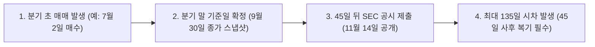

import Alert from '@/components/Alert.astro';
import CloudinaryImage from '@/components/CloudinaryImage.astro';
import BookCard from '@/components/BookCard.astro';
import StockCard from '@/components/StockCard.astro';
import StockInline from '@/components/StockInline.astro';

"유명 헤지펀드, 빅테크 수억 달러 폭락 베팅!", "버크셔 해서웨이 신규 종목 전격 매수!" 분기마다 쏟아지는 자극적인 속보만 보고 프리마켓에서 추격 매수했다가 고점에 물려본 경험, 미국 주식 투자자라면 한 번쯤 있으실 겁니다. **미국 SEC 13F 공시**는 월가 큰손들의 실제 장부를 무료로 열어볼 수 있는 강력한 무기지만, 45일의 시차와 옵션 표기 규칙을 모른 채 읽으면 오히려 독이 됩니다.

바쁜 분들을 위해 13F 공시의 핵심 규격과 실전 판독 원칙을 먼저 표로 압축했습니다.

| 핵심 항목 | 공식 기준 및 실전 판독 포인트 |
| :--- | :--- |
| **제출 대상** | 미국 상장 13(f) 증권을 **1억 달러 이상** 운용하는 기관 투자자 (약 7,000여 곳) |
| **연간 마감일** | 분기 종료 후 **45일 이내** — **5/15** (Q1) · **8/14** (Q2) · **11/14** (Q3) · **2/14** (Q4) |
| **공개 범위** | 미국 상장 주식·ETF·일부 ADR·상장 매수 옵션(`CALL`/`PUT`) 수량 및 분기 말 평가액 |
| **사각지대** | 현금·미국 단기국채(T-Bills), 공매도(Short), 비미국 본주, 비상장·장외 스왑 제외 |
| **최우선 원칙** | 공시 직후 추격 매수 금지 → **지난 45일간의 주가·실적 궤적**(사후 성적표) 대조 후 판단 |

---

## 13F 공시란 무엇인가? — 공개 항목 vs 비공개 사각지대

**Form 13F**는 1934년 미국 증권거래법 섹션 13(f)에 따라 1975년 도입된 기관 투자자 분기 보유 증권 보고서입니다. 헤지펀드·자산운용사·연기금·패밀리 오피스 등 미국 거래소에 상장된 13(f) 대상 증권을 **1억 달러 이상** 굴리는 기관은 국적을 불문하고 미국 증권거래위원회(SEC) EDGAR에 의무 제출해야 해요.

문제는 많은 개인 투자자가 13F를 기관의 '전체 자산 명세서'로 오해한다는 점입니다. 실제로 13F가 비추는 영역은 수면 위로 드러난 **미국 상장 롱 포지션**(매수)이라는 빙산의 일각뿐입니다.

<CloudinaryImage
  publicId="posts/money/2026/13f-sec-top10-investors-guide/fig-01-blindspot-iceberg"
  width={1376}
  height={768}
  alt="수면 위로 드러난 미국 상장 롱 포지션 주식과 수면 아래 숨겨진 현금·단기국채·해외주식·공매도 사각지대를 대비한 빙산 일러스트"
/>

| 구분 | 세부 포함·제외 자산 | 판독 시 주의점 |
| :--- | :--- | :--- |
| **수면 위** (13F 공개) | 미국 상장 주식, 상장 ETF, 미국 상장 ADR, 상장 콜·풋 매수 옵션, 일부 전환사채 | 매수 평단가가 아닌 **분기 말 종가 기준 평가액**만 기재 |
| **수면 아래** (13F 비공개) | 현금·단기국채(T-Bills), 회사채, **공매도 포지션**(Short), 비미국 본토 주식, 장외 스왑·선물 | 현금 실탄 증감이나 롱·숏 페어 트레이딩 반대 포지션 비공개 |

어떤 헤지펀드가 13F에서 반도체 주식을 2억 달러어치 보유했더라도, 수면 아래에서 동종 섹터 ETF를 3억 달러어치 공매도했다면 실제 방향성은 '순매도'입니다. 롱·숏 멀티스트래티지 펀드의 13F를 덮어놓고 따라 사면 안 되는 이유가 바로 여기에 있습니다.

---

## 연 4회 13F 정기 공시 일정표 (북마크용 캘린더)

SEC는 매 분기 말일을 기준일(As of Date)로 삼아 **45일 이내** 제출을 강제하며, 마감일이 주말이나 미국 연방 공휴일이면 **익영업일**로 순연됩니다.

| 대상 분기 | 운용 기간 | 기준일 | SEC 제출 마감일 | 한국 시간 확인 타이밍 |
| :--- | :--- | :--- | :--- | :--- |
| **1분기** (Q1) | 1～3월 | 3월 31일 | **5월 15일** | 5월 16일 새벽 5～7시 집중 공개 |
| **2분기** (Q2) | 4～6월 | 6월 30일 | **8월 14일** | 8월 15일 새벽 5～7시 집중 공개 |
| **3분기** (Q3) | 7～9월 | 9월 30일 | **11월 14일** | 11월 15일 새벽 (주말 시 화요일 새벽) |
| **4분기** (Q4) | 10～12월 | 12월 31일 | **다음 해 2월 14일** | 2월 15일 새벽 (주말 시 화요일 새벽) |

버크셔 해서웨이를 비롯한 주요 운용사 대부분은 모방 매매를 피하려고 마감 당일 [미국 정규장 종료 직후](/money/us-stock-trading-time)(동부시간 오후 4시～5시 30분)에 공시를 일제히 올립니다. 이 네 날짜만 북마크해 두어도 분기마다 월가 자금 이동을 놓치지 않고 챙길 수 있습니다.

---

## 초보자가 가장 많이 속는 13F 3대 함정과 판독법

일정을 확인했다면 숫자의 행간에 숨은 제도적 착시를 걷어낼 차례입니다. SEC 공식 Form 13F 작성 지침(FAQ)을 바탕으로 개인 투자자가 가장 자주 속는 세 가지 함정을 정리했습니다.

### 1. 최대 135일 시차와 '45일 사후 복기' 원칙

기관이 분기 첫날 주식을 샀다면 우리가 공시를 열어볼 때까지 **최장 135일**, 분기 말일에 샀더라도 **최소 45일**의 시차가 벌어집니다. 그 45일 사이에 기관이 전량 익절하고 나갔어도 다음 공시 전까지는 알 길이 없죠.

따라서 13F가 공개된 날에는 무작정 매수 버튼을 누르기보다 **기준일 이후 공시일까지 지난 45일간 주가와 실적이 어떻게 움직였는가**부터 대조해야 합니다. 분기 말 종가 대비 주가가 이미 25% 급등해 안전마진이 사라졌는지, 반대로 일시적 조정 덕분에 대가의 매수 구간보다 더 싸게 살 기회가 열렸는지 사후 성적표를 따져보는 것이 핵심입니다.

### 2. 콜·풋옵션 명목가액(Notional Value) 착시

마감일마다 경제 뉴스를 달구는 "전설적 투자자, 기술주 수억 달러 폭락 베팅!" 헤드라인의 상당수는 SEC 옵션 표기 규칙이 빚어낸 착시입니다.

SEC 공식 지침상 상장 매수 옵션(`CALL`·`PUT`)은 실제 지불한 **옵션 프리미엄**(매수 원금)이 아니라, 계약 행사 시 인도받을 **기초자산 주식 수 × 분기 말 본주 종가**(명목가액, Notional Value) 전체 금액으로 기재해야 합니다. 주당 500달러짜리 지수 ETF의 외가격 풋옵션 1만 계약(100만 주 상당)을 포트폴리오 보험용으로 300만 달러만 주고 사도, 13F 장부에는 **5억 달러**(`100만 주 × 500달러`) 포지션으로 찍히는 구조예요. 공매도와 파생 헤지 메커니즘은 [공매도·헤지펀드 기초 가이드](/money/short-selling-hedge-fund-guide-for-beginners)를 함께 읽어두시면 과장 보도에 휘둘리지 않습니다.

### 3. 기밀 유지 유예(Form 13F-CT)와 해외 본주·현금 누락

대형 기관이 지분을 한창 매집 중일 때는 시장의 선행매매를 막기 위해 SEC에 **기밀 유지 유예**(`Form 13F-CT`)를 신청해 특정 종목 공개를 수개월간 합법적으로 미룰 수 있습니다. 이후 매집이 완료되면 정정 공시(`13F-HR/A`)로 뒤늦게 반영되므로, 깜짝 등장한 대규모 신규 편입주는 직전 분기 정정 공시까지 대조해야 실제 매수 시점이 보입니다.

또한 도쿄거래소에 상장된 일본 5대 종합상사 등 해외 본토 상장주와 미국 단기국채(현금 실탄)는 13F 집계에서 빠집니다. 주식 순매도 규모만 보지 말고 빠져나온 현금이 단기국채 금고에 쌓였는지 주주서한과 분기 보고서(`10-Q`)를 함께 읽어야 기관의 진짜 뷰를 읽을 수 있습니다.

---

## 무료 13F 조회 사이트 5곳 비교 및 실전 루틴

블룸버그 단말기가 없어도 아래 무료 사이트 5곳만 조합하면 기관 수량 증감을 손쉽게 추적할 수 있습니다.

| 사이트 | 핵심 강점 | 추천 활용 용도 | 주소 |
| :--- | :--- | :--- | :--- |
| **Dataroma** | 검증된 가치투자 대가 80여 명 선별 큐레이션 | 대가들이 동시 매수한 **합의 종목**(Grand Portfolio) 스캔 | `dataroma.com` |
| **WhaleWisdom** | 분기별 비중 증감·추정 매수가·집중도 시각화 | 운용사별 장기 성과 추적 및 보유 기간 비교 | `whalewisdom.com` |
| **13f.info** | 광고 없이 깔끔한 초고속 분기 비교 테이블 | 직전 분기 대비 신규 편입·전량 매도 수량 즉시 대조 | `13f.info` |
| **SEC EDGAR** | 지연 없는 1차 공식 원문 및 XML 데이터 | 마감 새벽 실시간 확인 및 `13F-HR/A` 정정본 검증 | `sec.gov/edgar` |
| **Fintel** | 종목별 전체 기관 지분율·내부자 거래 통합 | 내 보유 종목에 새로 진입한 기관 역추적 | `fintel.io` |

분기 마감 다음 날 아침 **Dataroma**로 대가들의 공통 매수·매도 종목을 5분 만에 훑고, 관심 가는 운용사의 세부 수량 변화를 **13f.info**와 **WhaleWisdom**에서 교차 확인하는 2단 루틴이 가장 실용적입니다.

---

## 월가 투자 대가 TOP 10 — 13F 추적 필수 기관 (2026 최신판)

분기마다 13F를 내는 7,000여 곳 중 초단타 퀀트 하우스는 회전율이 너무 높아 45일 뒤 장부를 봐도 실익이 없습니다. **확고한 선별 철학**과 **수십 년 검증된 복리 성과**를 기준으로 압축한 필수 추적 기관 10곳입니다.

<CloudinaryImage
  publicId="media/person/investors/i_masters_dfp28f"
  width={971}
  height={445}
  alt="월가 장기투자 대가 포트폴리오 일러스트"
/>

### 1위. 워런 버핏 & 그레그 아벨 — 버크셔 해서웨이 (`Berkshire Hathaway Inc.`)

2026년 1월 그레그 아벨이 공식 CEO로 취임하고 2026년 9월 워런 버핏이 명예회장으로 전환하며 세대교체를 마쳤습니다(글로벌 빅테크·금융권 리더십 재편은 [2026년 세대교체 현역 CEO 15인](/money/global-ceo-top-15) 참조). 체제 전환 이후에도 <StockInline ticker="AAPL" name="애플" />, <StockInline ticker="AXP" name="아메리칸 익스프레스" />, <StockInline ticker="KO" name="코카콜라" /> 등 상위 5종목에 주식 자산의 약 70%를 집중하는 초저회전율 원칙은 굳건합니다. 버크셔 13F는 반드시 `10-Q` 보고서의 **3,500억 달러대 미국 단기국채 규율** 및 자사주 매입 여부와 한 세트로 읽어야 증시 고평가에 대한 버크셔의 판단이 보입니다.

<StockCard
  ticker="BRK-B"
  name="Berkshire Hathaway (Class B)"
  website="berkshirehathaway.com"
  sector="복합금융 · 지주"
  comment="보험 플로트와 철도·에너지 자회사 현금흐름을 바탕으로 우량 주식과 3,500억 달러대 단기국채 비중을 조절하는 가치투자의 기준점."
/>

### 2위. 세스 클라만 — 보포스트 그룹 (`The Baupost Group LLC`)

전설적 투자서 『안전마진』(Margin of Safety)의 저자이자 역발상 가치투자의 거장입니다. 평상시에는 자산의 20～40%를 현금으로 쥐고 인내하다가, 신용 경색이나 폭락장에서 쏟아지는 강제 청산(Distressed) 매물을 헐값에 사들입니다. 보포스트 13F 상단에 굵직한 신규 종목이 잡혔다면 해당 업종이 과매도 바닥권을 지나고 있다는 신호로 해석할 수 있습니다.

### 3위. 리루 (Li Lu) — 히말라야 캐피탈 (`Himalaya Capital Management LLC`)

찰리 멍거가 생전에 가족 자산을 맡긴 유일한 외부 운용자입니다. 미국 13F 보유 종목이 보통 **6～10개 안팎**에 불과할 만큼 극단적인 소수 정예 투자를 고수하며, <StockInline ticker="BAC" name="뱅크오브아메리카" />와 알파벳처럼 해자가 확실한 기업을 5～10년 이상 보유해 공시 시차 부담이 적습니다. 아시아 본토 상장주는 13F에 빠진다는 점만 감안해 미국 핵심 픽의 비중 변화를 추적하세요.

### 4위. 브리지워터 어소시에이츠 (`Bridgewater Associates LP`)

창립자 레이 달리오가 뿌리내린 **올웨더**(All Weather) 자산배분 DNA를 바탕으로, 현재 차세대 공동 CIO 체제로 전환을 완료한 세계 최대 매크로 헤지펀드입니다. 채권·물가연동채·금·원자재 비중이 높은 운용 특성상 미국 주식·ETF만 찍히는 13F는 전체 전략의 반쪽 그림만 보여줍니다. 개별 종목 픽보다는 신흥국 대 선진국 ETF, 방어주 대 기술주 비중 이동을 읽는 거시 지표로 활용하세요.

### 5위. 데브 칸테사리아 — 밸리 포지 캐피털 (`Valley Forge Capital Management LP`)

하버드 의대와 바이오 VC 업계를 거쳤지만, 임상 결과 하나에 명운이 갈리는 바이오주는 철저히 배제합니다. 대신 <StockInline ticker="SPGI" name="S&P 글로벌" />, <StockInline ticker="MCO" name="무디스" />, <StockInline ticker="FICO" name="페어 아이작" />처럼 독과점 해자와 가격 결정력을 지닌 복리 기업 **8～10종목에 100% 가까이 집중**해 수년간 보유합니다(2026년 하반기에는 ASML 등 반도체 독점 장비주까지 해자 범위를 넓혔죠). 회전율이 극히 낮아 개인이 복기하기 가장 좋은 공시(CIK `0001697868`)입니다.

### 6위. 스탠리 드러켄밀러 — 듀케인 패밀리 오피스 (`Duquesne Family Office LLC`)

조지 소로스의 퀀텀 펀드 CIO 출신으로 30년간 연평균 약 30% 수익률을 기록한 매크로 전설입니다. 자기 자본만 굴리는 패밀리 오피스라 회전율이 매우 높고 손익절이 빨라 45일 뒤 뒤늦게 따라 사면 위험합니다. 대신 AI 반도체에서 전력망·바이오·금융으로 이동하는 **분기별 주도 섹터 풍향계**로 삼을 때 진가가 드러납니다.

### 7위. 빌 애크먼 — 퍼싱 스퀘어 캐피탈 (`Pershing Square Capital Management LP`)

현금흐름이 예측 가능한 북미 초대형 우량주 **8～12개 종목**에 거액을 싣고 경영 효율화와 주주환원을 이끄는 집중형 행동주의 대가입니다. 과거 힐튼·치폴레 장기 투자로 큰 성과를 거뒀고, 최근에는 <StockInline ticker="UBER" name="우버" />, <StockInline ticker="AMZN" name="아마존" />, <StockInline ticker="MSFT" name="마이크로소프트" />, <StockInline ticker="NFLX" name="넷플릭스" /> 등 친숙한 과점 기업을 보유하며 주주 서한으로 상세한 매수 논리를 공개해 기업 분석 교재로 훌륭합니다.

### 8위. 가이 스피어 — 아쿠아마린 캐피탈 (`Aquamarine Capital Management LLC`)

워런 버핏과의 자선 점심 경매 낙찰자로 유명하며, 월가의 단기 실적 소음에서 벗어나 취리히에서 펀드를 운용하는 정통 버핏·멍거 학파입니다. 금융 인프라·명품·보험주를 10년 단위로 보유해 회전율이 극히 낮습니다.

<BookCard
  title="워런 버핏과의 점심식사"
  isbn13="9791193394106"
  comment="월가 탐욕의 한복판에서 버핏·멍거의 가치투자 철학으로 거듭나는 과정을 솔직하게 풀어낸 회고록."
/>

### 9위. 루이스 샌더스 — 샌더스 캐피탈 (`Sanders Capital, LLC`)

얼라이언스번스타인 전 회장 겸 CEO 출신인 창립자 겸 공동 CIO **루이스 샌더스**(Lewis A. Sanders)가 이끄는 정통 대형 가치투자 하우스(CIK `0001508097`)입니다. 일시적 우려로 장기 현금흐름 대비 깊게 할인된 글로벌 대형 우량주를 선별하며, 수백억 달러를 굴리면서도 연간 회전율을 낮게 유지해 기관급 가치주 워치리스트로 손색이 없습니다.

### 10위. 조엘 그린블라트 — 고담 에셋 매니지먼트 (`Gotham Asset Management LLC`)

초기 집중 투자 펀드였던 `고담 캐피탈`(1985～1994년 연평균 약 40%)로 전설이 된 뒤, 현재는 **1,800여 종목**을 현금흐름 수익률 공식에 따라 계량 운용하는 시스템 퀀트 가치 운용사로 진화했습니다. 개별 종목 찍기보다는 현금흐름 대비 저평가 점수가 높은 대형주 상위군이 어디로 재편되는지 점검할 때 유용합니다.

<BookCard
  title="주식시장을 이기는 작은 책"
  isbn13="9791193937280"
  comment="자본수익률(ROC)과 이익수익률(EY) 두 가지 지표만으로 저평가 우량주를 고르는 마법공식의 원전."
/>

<Alert type="tip" title="번외 추적 팁 — 데이비드 테퍼 vs 마이클 버리 13F 근황">
정책·금리 변곡점마다 과감한 승부수를 던지는 데이비드 테퍼의 **아팔루사 매니지먼트**(`Appaloosa Management LP`)도 매크로 변곡점 참고용으로 유용합니다. 반면 국내 투자자들이 즐겨 찾던 마이클 버리의 **사이언 에셋 매니지먼트**(`Scion Asset Management`)는 **2025년 11월 SEC 등록 말소로 2026년부터 공식 13F 제출 대상에서 제외**되었으니 조회 시 참고하세요.
</Alert>

---

## 한눈에 보는 TOP 10 대가 비교표 & 매수 전 교차 점검

열 곳의 운용 호흡이 다른 만큼, 내 투자 성향에 맞는 대가 3～4곳을 골라 분기마다 추적하는 편이 훨씬 효과적입니다.

| 순위 | 핵심 인물 | 13F 제출 법인명 | 핵심 스타일 | 회전율 | 실전 13F 활용 포인트 |
| :---: | :--- | :--- | :--- | :---: | :--- |
| **1** | 워런 버핏 · 그레그 아벨 | `Berkshire Hathaway Inc.` | 우량주 집중 · 현금 규율 | 극저 | 상위 5종목 + 단기국채 비중 동시 확인 |
| **2** | 세스 클라만 | `The Baupost Group LLC` | 안전마진 · 역발상 | 저 | 폭락장·소외 섹터 바닥 진입 시그널 |
| **3** | 리루 | `Himalaya Capital Management LLC` | 6～10종목 초집중 | 극저 | 해자 확신 미국 대형주 장기 비중 추적 |
| **4** | 차세대 공동 CIO 체제 | `Bridgewater Associates LP` | 올웨더 매크로 분산 | 중 | 신흥국·방어주 ETF 리밸런싱 흐름 체크 |
| **5** | 데브 칸테사리아 | `Valley Forge Capital Management LP` | 독과점 복리 기업 집중 | 극저 | 가격 결정력 상위 8～10종목 복리 연구 |
| **6** | 스탠리 드러켄밀러 | `Duquesne Family Office LLC` | 매크로 · 산업 변곡점 | 고 | 추격 매수 금지, 분기별 섹터 이동 풍향계 |
| **7** | 빌 애크먼 | `Pershing Square Capital Management LP` | 초대형주 행동주의 | 저 | 북미 과점 우량주 밸류에이션 아이디어 |
| **8** | 가이 스피어 | `Aquamarine Capital Management LLC` | 버핏·멍거 정통 계승 | 극저 | 금융 인프라·명품 등 10년 보유 후보군 |
| **9** | 루이스 샌더스 | `Sanders Capital, LLC` | 현금흐름 대형 가치 | 극저 | 일시적 소외 겪는 글로벌 우량주 스크리닝 |
| **10** | 조엘 그린블라트 | `Gotham Asset Management LLC` | 시스템 퀀트 가치 | 중 | 1,800여 종목 중 현금흐름 저평가 상위군 |

대가의 장부에서 관심 종목을 추렸고 지난 45일간의 사후 성적표까지 확인했다면, 실제 매수 직전에는 **현재 시장의 단기 심리 온도**를 함께 점검해야 합니다. 아무리 좋은 기업이라도 극단적 탐욕 구간에서 급하게 추격 매수할 필요는 없으니까요. 분할 매수 타이밍은 [CNN 공포지수 가이드](/money/fear-greed-index-guide)와 [VIX 지수 가이드](/money/vix-index-guide)를 열어 두고 공포 구간에서 차분히 비중을 늘려가시길 권합니다.

---

## 『월가 전설들의 13F 투자 일지』 시리즈 이어 읽기

13F 판독법과 추적 필수 대가 10곳을 확인했다면, 이제 실제 최신 분기 장부에서 월가 큰손들이 AI 차익실현과 인프라 병목 2막에 어떻게 대응했는지 숫자로 직접 검증할 차례입니다. 함께 발행된 시리즈 후속편에서 최신 포트폴리오 분석과 45일 사후 성적표를 이어서 확인해 보세요.

- **시리즈 2편**: [2026년 3분기 월가 대가 13F 총정리: AI 차익실현 vs 병목 2막, 45일 사후 성적표](/money/13f-2026-q3-guru-roundup)
- **시리즈 3편**: [버크셔 해서웨이 2026 3분기 13F 분석: 3,523억 달러 현금과 45일 사후 성적표](/money/13f-2026-q3-berkshire-hathaway)

<Alert type="danger" title="투자 유의사항">
본 포스트는 미국 SEC 공식 공시 데이터를 바탕으로 작성한 정보 제공 목적의 콘텐츠이며, 특정 종목 매수·매도를 권유하지 않습니다. 모든 투자의 최종 판단과 책임은 투자자 본인에게 있습니다.
</Alert>
