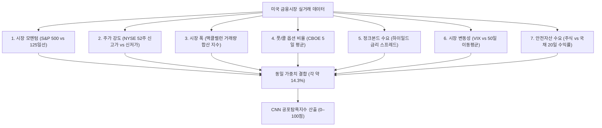

import Alert from '@/components/Alert.astro';
import Chart from '@/components/Chart.astro';
import FearGreedCalculator from '@/components/FearGreedCalculator.astro';

나스닥과 S&P 500이 출렁일 때마다 서학개미들이 가장 먼저 검색하는 시장 체온계가 **CNN 공포지수**(공식 명칭: **CNN 공포탐욕지수**, Fear & Greed Index)입니다. 막상 점수를 확인해도 "오늘 20점대면 지금 사야 하나, 더 떨어질 때까지 기다려야 하나?"가 늘 고민이죠. 아래에서 **오늘의 실시간 점수**를 바로 확인한 뒤, **10초 판별표**와 **분할 매수 계산기**로 이번 달 매수 금액까지 즉시 계산해보세요.

---

## ⚡ 10초 판별표: CNN 공포지수 실시간 확인 & 점수별 행동 기준

CNN 비즈니스 공식 페이지는 회원가입이나 유료 구독 없이 무료로 열람할 수 있으며, [미국 주식 정규장 개장 시간](/money/us-stock-trading-time)(한국 시간 23:30, 서머타임 22:30) 이후 시장 데이터를 반영해 실시간으로 갱신됩니다.

- **공식 실시간 게이지**: [CNN Business Fear & Greed Index 바로가기](https://edition.cnn.com/markets/fear-and-greed)

오늘 확인한 점수(Current Reading)를 아래 기준표에 바로 대입해 보세요.

| 점수 구간 | 심리 상태 | 월 적립 권장 배수 | 실전 한줄 판정 |
| :---: | :---: | :---: | :--- |
| **0 – 24** | **극도의 공포** (Extreme Fear) | **평소의 1.5 – 2.0배** | **적극 분할 매수 구간**. 투매로 우량 지수까지 헐값에 거래되는 시점 (단, 일괄 올인 금지) |
| **25 – 44** | **공포** (Fear) | **평소의 1.2 – 1.5배** | **비중 확대 구간**. 조정장을 활용해 정기 적립액보다 매수량을 조금 더 늘릴 자리 |
| **45 – 55** | **중립** (Neutral) | **평소의 1.0배** | **기본 루틴 유지**. 방향성 탐색 국면이므로 원래 정해둔 정액 적립만 집행 |
| **56 – 74** | **탐욕** (Greed) | **평소의 0.5 – 0.7배** | **속도 조절 구간**. 추격 매수를 줄이고 남는 현금은 단기채·파킹통장에 비축 |
| **75 – 100** | **극도의 탐욕** (Extreme Greed) | **신규 매수 보류** (0배) | **과열 경고등**. 신규 진입을 멈추고 급등 자산 일부를 리밸런싱해 현금 실탄 확보 |

아래 계산기에서 방금 확인한 **실시간 점수**와 **평소 월 투자금**을 맞추면, 내 계좌 현금 비중에 맞는 이번 달·이번 주 권장 매수액이 자동으로 계산됩니다.

<FearGreedCalculator defaultScore={22} defaultBudget={100} />

---

## 잠깐, 뉴스에 나오는 'VIX 공포지수'와 'CNN 공포지수'는 정반대입니다

한국 경제 뉴스에서 *"월가 공포지수 30 돌파, 패닉장 진입"* 같은 기사를 보고 CNN 페이지에 들어갔다가 숫자를 잘못 읽는 경우가 정말 많습니다. 국내에서 흔히 '공포지수'라고 부르는 지표는 **방향성이 정반대인 두 가지**가 섞여 쓰이기 때문이에요.

여기에 가상자산 투자자들이 보는 코인용 지수까지 합치면 총 3가지가 있습니다. 헷갈리지 않도록 핵심 차이만 딱 짚어두세요.

| 비교 항목 | **CNN 공포탐욕지수** | **VIX 지수** (월가 공포지수) | **Alternative.me 지수** |
| :--- | :--- | :--- | :--- |
| **대상 시장** | **미국 주식** (S&P 500·채권·옵션) | **S&P 500 옵션** (향후 30일 변동성) | **비트코인 및 가상자산** |
| **점수 범위** | **0 – 100점** | 상한 없음 (평시 12–20, 위기 시 30–80+) | 0 – 100점 |
| **숫자 방향성** | **낮을수록 공포** (0 = 극도의 공포) | **높을수록 공포** (30 이상 = 공포 급등) | 낮을수록 공포 (0 = 극도의 공포) |
| **설문·SNS 반영** | **0%** (100% 실제 자금·거래 데이터) | **0%** (실제 옵션 호가 데이터) | SNS 감성·구글 검색 트렌드 반영 |
| **핵심 용도** | 미국 주식 중기 분할 매수·현금 비중 조절 | 단기 급락 발작 및 옵션 헤지 강도 포착 | 크립토 개인 투자자 과열·투매 심리 파악 |

<Alert type="warning" title="가장 흔한 착각: 숫자 방향을 반대로 읽지 마세요">
**VIX 지수**는 숫자가 **치솟을수록** 시장이 겁에 질렸다는 뜻이지만, **CNN 공포탐욕지수**는 숫자가 **바닥(0점)으로 떨어질수록** 공포가 극에 달했다는 뜻입니다. 사실 VIX 지수 자체도 CNN 공포탐욕지수를 구성하는 7개 하위 재료 중 하나로 들어가 있으며, 15·20·30·40 구간별 기준과 VIX ETF 주의점은 [VIX 지수 실시간 확인 & 매수 기준표](/money/vix-index-guide)에서 따로 정리했습니다.
</Alert>

---

## CNN 공포탐욕지수를 만드는 7대 핵심 지표

초보 투자자 중에는 이 지수를 "투자자들에게 요즘 장이 어떠냐고 설문조사한 결과"로 오해하는 분들도 있습니다. 하지만 CNN 지수에는 개인의 주관적인 설문 응답이나 뉴스 댓글 감성이 단 1%도 들어가지 않습니다.

대신 뉴욕증권거래소(NYSE), 시카고옵션거래소(CBOE), 미국 회사채·국채 시장에서 **실제 거액의 기관 자금이 어디로 도망치고 어디로 몰리는지** 보여주는 7가지 지표를 각각 **14.3%씩 동일 비중**으로 합산해 0–100점으로 환산합니다.

CNN 공식 페이지 스크롤을 아래로 내리면 이 7개 세부 지표가 각각 현재 `Fear`인지 `Greed`인지 개별 차트로 표시됩니다. 각 지표가 잡아내는 시장 신호는 다음과 같습니다.

### 1. 시장 모멘텀 (Market Momentum)
S&P 500 지수가 **125일 이동평균선**(약 6개월 평균 주가)보다 얼마나 위나 아래에 있는지를 봅니다. 지수가 125일선 위로 멀찍이 치솟으면 탐욕, 125일선 아래로 급락하면 공포 신호가 켜집니다. 중기 [강세장(Bull)과 약세장(Bear)](/money/stock-market-bull-and-bear-meaning)의 흐름을 가늠하는 기본 뼈대입니다.

### 2. 주가 강도 (Stock Price Strength)
뉴욕증권거래소(NYSE) 상장 주식 중 **52주 신고가를 찍은 종목 수와 52주 신저가로 추락한 종목 수의 비율**입니다. 소수 빅테크 대형주만 올라 지수가 버티는 것처럼 보여도, 나머지 대다수 종목이 신저가를 기록 중이라면 이 지표가 먼저 공포 쪽으로 꺾이며 '속 빈 강정' 장세를 경고합니다.

### 3. 시장 폭 (Stock Price Breadth)
**맥클렐런 거래량 요약 지수**(McClellan Volume Summation Index)를 사용해 상승 종목에 실린 거래량과 하락 종목에서 빠져나간 거래량의 차이를 추적합니다. 거래량 없이 호가만 얇게 오르는 기술적 반등인지, 실제 매수 자금이 넓게 유입되는 진짜 상승인지를 가려냅니다.

### 4. 풋/콜 옵션 비율 (Put and Call Options)
CBOE에서 거래되는 **하락 베팅(풋옵션) 거래량을 상승 베팅(콜옵션) 거래량으로 나눈 5일 평균치**입니다. 하락장이 두려워진 기관이 포트폴리오 보험용으로 풋옵션을 대거 사들이면 이 비율이 1.0 위로 급등하며 강한 공포 점수로 반영됩니다.

### 5. 정크본드 수요 (Junk Bond Demand)
부도 위험이 있는 **투기등급 채권**(하이일드·정크본드)과 안전한 **투자등급 회사채 사이의 금리 차이**(스프레드)를 측정합니다. 경기가 불안할수록 기관은 정크본드부터 던지기 때문에 금리 차이가 크게 벌어지고(공포), 시장이 낙관에 취하면 조금이라도 높은 이자를 좇아 정크본드까지 사들이며 금리 차이가 좁아집니다(탐욕). 채권 시장 스마트 머니의 속내를 가장 정직하게 보여주는 항목입니다.

### 6. 시장 변동성 (Market Volatility)
앞서 살펴본 **VIX 지수**를 그 자신의 **50일 이동평균선**과 비교합니다. 단순히 VIX 절대 수치만 보는 게 아니라 최근 두 달 평균 대비 얼마나 급격히 튀어 올랐는지를 따져 급락장의 패닉 강도를 측정합니다.

### 7. 안전자산 수요 (Safe Haven Demand)
최근 **20거래일 동안 주식**(S&P 500) **수익률과 미국 국채 수익률의 격차**를 비교합니다. 주식을 판 돈이 안전자산인 미국 국채로 대피해 국채 수익률이 주식을 앞지르면 공포 신호로 집계됩니다.

---

## 역대 폭락장과 과열장에서는 몇 점까지 갔을까? (2020–2026)

"지금 20점인데 역대급 바닥 맞나요?"라는 질문에 답하려면 과거 굵직한 변곡점의 실제 기록을 대조해 보는 게 가장 확실합니다.

<Chart
  type="bar"
  height={300}
  caption="주요 시장 변곡점별 CNN 공포탐욕지수 극단치 기록 (2020–2026)"
  data={{
    labels: [
      '20.03 코로나 패닉',
      '20.08 유동성 랠리',
      '21.11 나스닥 고점',
      '22.06 자이언트스텝',
      '23.07 빅테크 랠리',
      '24.03 AI 랠리 과열',
      '25.04 관세 쇼크',
      '26년 조정장 저점'
    ],
    datasets: [
      {
        label: 'CNN 공포탐욕지수 (0–100)',
        data: [2, 82, 86, 8, 80, 79, 3, 16],
        backgroundColor: [
          '#ef4444',
          '#10b981',
          '#10b981',
          '#ef4444',
          '#10b981',
          '#10b981',
          '#ef4444',
          '#f97316'
        ]
      }
    ]
  }}
/>

| 주요 시장 변곡점 | 시점 | 지수 기록 | 심리 구간 | 이후 S&P 500 흐름 |
| :--- | :---: | :---: | :---: | :--- |
| **코로나19 팬데믹 서킷브레이커** | 2020년 3월 | **2점** | 극도의 공포 | 패닉 투매 정점 통과 후 역사적 유동성 대세 상승장 진입 |
| **유동성 장세 & 나스닥 사상 최고점** | 2021년 11월 | **86점** | 극도의 탐욕 | 대세 상승장 끝자락 과열 직후 2022년 하락장 전환 |
| **연준 자이언트스텝 금리 인상** | 2022년 6월 | **8점** | 극도의 공포 | 인플레이션 발작으로 상반기 진바닥 확인 후 여름 베어마켓 랠리 |
| **AI 반도체 열풍 & 1분기 신고가** | 2024년 2–3월 | **79점** | 극도의 탐욕 | 과열권 지속 후 4월 금리 인하 지연 우려로 단기 조정(18점대) |
| **글로벌 상호관세 충격** | 2025년 4월 | **3점** | 극도의 공포 | 코로나 이후 최저치(3–4점) 기록 직후 여름 V자 급반등 전개 |
| **유가·금리·AI 설비투자 수익성 경계** | 2026년 조정기 | **14–18점** | 극도의 공포 | 지수 급등기 대비 탐욕 피크(70점대 초반)는 낮아지고 반복적인 저가 매수 기회 제공 |

과거 기록이 일관되게 증명하는 사실은 명확합니다. **지수가 한 자릿수에서 10점대 중반**(극도의 공포)까지 내려왔을 때 공포에 질려 주식을 던진 사람은 거의 예외 없이 바닥에서 손절한 셈이 됐고, 반대로 **80점 이상**(극도의 탐욕)에서 뒤늦게 목돈을 추격 매수한 사람은 단기 물림을 겪었습니다. [월가 대가들의 13F 분기별 포트폴리오](/money/13f-sec-top10-investors-guide)를 추적해 봐도 기관의 대규모 저가 매집은 늘 대중의 공포가 극에 달한 분기에 집중됩니다.

---

## 왜 '극도의 공포 = 전 재산 올인'은 위험할까?

워런 버핏의 *"남들이 두려워할 때 탐욕스러워져라"* 라는 격언만 믿고, 지수가 20점 아래로 내려간 첫날 대기 자금을 100% 한 번에 털어 넣는 건 초보자가 가장 많이 저지르는 실수입니다.

### 바닥의 '가격'이 아니라 심리의 '온도'를 잴 뿐입니다
CNN 공포탐욕지수는 내일이 최저점이라고 알려주는 알람 시계가 아닙니다. 2008년 금융위기나 2022년 금리 인상기처럼 거시경제 악재가 길어질 때는 **지수가 10점 안팎의 극도의 공포에 머무른 채로도 주가가 두세 달 동안 추가 하락**하곤 합니다. 첫 공포 신호에 현금을 다 써버리면 정작 3점·5점짜리 진짜 바겐세일이 왔을 때 구경만 하다가 멘탈이 무너져 손절하게 됩니다.

그래서 현명한 적립식 투자자는 일괄 올인 대신 **동적 분할 매수**(Dynamic DCA) 규칙을 지킵니다.

### 내 계좌 상황에 맞춘 4분면 실전 매트릭스

같은 18점짜리 극도의 공포 장세라도 내 계좌에 현금이 많은지, 이미 주식이 가득 차 있는지에 따라 행동은 완전히 달라져야 합니다.

| 현재 내 계좌 상태 | **공포 구간** (0 – 44점) | **탐욕 구간** (56 – 100점) |
| :--- | :--- | :--- |
| **현금 비중이 넉넉한 경우** (25% 이상) | **적극 분할 매수 개시** 대기 현금을 4–12주로 쪼개 S&P 500·나스닥 100 등 대표 지수 ETF 매수 강도를 평소의 1.3–2.0배로 확대 | **추격 매수 자제 & 현금 적립** FOMO에 흔들리지 말고 월 적립액을 절반으로 축소, 아낀 현금은 단기 국채(SGOV 등)·파킹통장에 보관 |
| **주식 비중이 높은 경우** (풀매수 상태) | **패닉 셀 금지 & 버티기** 신용·미수 물타기 절대 금지. 보유 우량주를 지키며 월급·배당금 등 신규 현금 흐름 범위 안에서만 적립 | **부분 익절 & 리밸런싱** 신규 매수 중단 후 목표 비중을 넘어 급등한 종목 10–20%를 수익 실현해 다음 조정장 실탄 마련 |

<Alert type="danger" title="공포 구간 분할 매수는 반드시 '시장 대표 우량 자산'에만 적용하세요">
지수 10점대에 공격적으로 평단가를 낮추는 전략은 **S&P 500**(VOO·SPY·IVV), **나스닥 100**(QQQ·QQQM), **배당성장 ETF**(SCHD)처럼 장기 우상향 복원력이 검증된 지수 상품에 한해 유효합니다. 적자 테마주나 개별 급등주는 공포장이 끝난 뒤에도 전고점을 영영 회복하지 못할 수 있으며, 연금저축·ISA 계좌에서 국내 상장 ETF로 모으는 분이라면 [S&P 500·나스닥 100·미국배당다우존스 국내 ETF 수수료 비교](/money/etf-expense-ratio-comparing)를 함께 참고해 총보수 차이부터 점검해 두세요.
</Alert>

---

## 실시간 게이지 읽을 때 놓치기 쉬운 3가지 체크포인트

CNN 페이지에서 오늘 점수만 힐끗 보고 창을 닫기 전에 딱 세 가지만 함께 확인하면 판독 정확도가 훨씬 올라갑니다.

1. **오늘 숫자보다 '1주 전·1달 전 대비 방향'을 보세요**: 게이지 바로 옆에는 `Previous Close`(전일), `1 Week Ago`(1주 전), `1 Month Ago`(1달 전) 수치가 함께 적혀 있습니다. 같은 30점이라도 **8점 바닥을 찍고 30점으로 회복 중인 상승 초입**인지, **75점 과열에서 30점으로 수직 낙하 중인 칼날 구간**인지에 따라 매수 호흡이 달라집니다.
2. **기업 실적과 밸류에이션은 따로 챙겨야 합니다**: 이 지수는 시장 참여자들의 수급과 변동성만 집계할 뿐, 현재 S&P 500의 주가수익비율(PER)이 비싼지나 연준의 금리 결정이 어떻게 날지는 계산하지 못합니다.
3. **한국 주식(코스피·코스닥)에 그대로 대입하지 마세요**: 7개 산출 재료가 모두 미국 주식·미국 채권·미국 옵션 시장 데이터입니다. 글로벌 투매 시 커플링 현상은 나타나지만 국내 개별 종목의 매수 타점 지표로 쓰기에는 괴리가 큽니다.

폭락장 뉴스가 쏟아질 때마다 감정적으로 매매 버튼에 손이 간다면, 이 페이지를 북마크해 두고 **CNN 실시간 점수 확인 → 10초 판별표 대조 → 주간 4분할 집행**이라는 기계적인 루틴 하나만 지켜보세요. 시장의 공포를 내 계좌의 평단가를 낮추는 가장 든든한 무기로 바꿀 수 있습니다.
