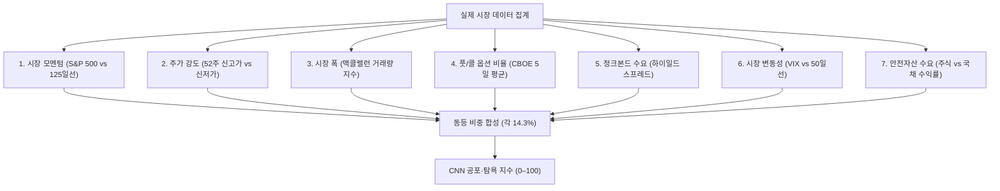

import Alert from '@/components/Alert.astro';

계좌가 온통 시퍼렇게 질린 폭락장에서는 당장이라도 주식을 모두 던지고 시장을 탈출하고 싶고, 연일 사상 최고가를 갈아치우는 상승장에서는 지금이라도 빚을 내서 따라붙어야 할 것 같은 조바심이 듭니다. 인간의 뇌는 본능적으로 고점에서 탐욕에 눈이 멀고 저점에서 공포에 질려 손절하도록 진화했기 때문입니다.

내 계좌의 잔고와 감정에 휘둘려 매매 버튼을 누르면 백전백패하기 십상입니다. 투자에 성공하려면 내 주관적인 감정 대신 시장 참여자 전체가 느끼는 공포와 탐욕의 온도를 객관적인 수치로 측정해야 합니다. 월가에서 가장 널리 쓰이는 시장의 체온계, 바로 **CNN 공포 탐욕 지수**(CNN Fear & Greed Index)입니다.

---

## 1. CNN 공포 탐욕 지수란? (0–100 점수 체계)

**CNN 공포 탐욕 지수**(Fear & Greed Index)는 미국 주식시장의 투자 심리를 0점부터 100점까지 단 하나의 숫자로 계량화한 지표입니다. CNN 비즈니스(CNN Business)가 매 영업일 시장 데이터를 바탕으로 자동 산출합니다.

원리는 단순하지만 강력합니다. 시장에 공포가 극에 달하면 주식은 본래 가치보다 헐값에 거래되고, 탐욕이 지배하면 기업 실적과 무관하게 주가가 비이성적으로 치솟는다는 역발상 투자 철학에 뿌리를 두고 있습니다.

지수는 점수에 따라 5개 심리 구간으로 나뉩니다.

| 점수 구간 | 심리 상태 | 시장 분위기와 투자자 행동 |
| :---: | :---: | :--- |
| **0 – 24** | **극도의 공포**(Extreme Fear) | 투매와 패닉 셀 발생. 우량 자산까지 무차별 하락하며 저평가 심화 |
| **25 – 44** | **공포**(Fear) | 비관론 우세. 악재에 민감하게 반응하며 관망세 지속 |
| **45 – 55** | **중립**(Neutral) | 매수세와 매도세의 팽팽한 균형. 방향성 탐색 국면 |
| **56 – 74** | **탐욕**(Greed) | 낙관론 확산. 호재에 적극 반응하며 주가 상승세 견인 |
| **75 – 100** | **극도의 탐욕**(Extreme Greed) | 비이성적 과열 및 FOMO(소외 공포) 극대화. 단기 고점 경고등 |

수치가 0에 가까울수록 시장 참여자들이 비이성적인 공포에 질려 주식을 내던지고 있음을 뜻하고, 100에 가까울수록 너도나도 추격 매수에 뛰어드는 과열 상태를 의미합니다.

---

## 2. 지수를 완성하는 7대 핵심 지표 뜯어보기

많은 초보 투자자가 공포 탐욕 지수를 "사람들에게 요즘 주식시장 어떠냐고 물어보는 설문조사 결과"로 오해하곤 합니다. 하지만 이 지수는 개인의 주관적인 설문 응답을 단 1%도 반영하지 않습니다.

대신 뉴욕증권거래소(NYSE)와 시카고옵션거래소(CBOE), 채권 시장에서 **실제 거액의 자금이 어떻게 이동하고 있는지**를 실시간으로 추적하는 7가지 객관적 지표를 동일한 비중(각각 약 14.28%)으로 합성해 만듭니다.



7개 지표는 독립된 금융 시장에서 서로 다른 취약점과 자금 이동 신호를 포착합니다.

### ① 시장 모멘텀 (Market Momentum)
- **측정 방식**: S&P 500 지수와 **125일 이동평균선**(약 6개월간의 평균 주가) 간의 이격도
- **작동 원리**: 주식시장이 건강하게 오르고 있다면 지수는 125일 이동평균선보다 위에서 움직입니다. 지수가 125일선 위로 크게 치솟으면 탐욕, 반대로 125일선 밑으로 굴러떨어지면 공포 신호로 판정합니다. 중기 추세가 상승세인지 하락세인지를 가늠하는 뼈대입니다.

### ② 주가 강도 (Stock Price Strength)
- **측정 방식**: 뉴욕증권거래소(NYSE) 상장 종목 중 **52주 신고가 종목 수 대비 52주 신저가 종목 수**의 비율
- **작동 원리**: 대형 기술주 몇 개만 올라서 지수를 왜곡하는 착시 현상을 걸러냅니다. 시장 지수는 상승하는데 52주 신저가를 기록하는 종목이 신고가 종목보다 훨씬 많다면, 속으로는 곪아가고 있다는 뜻이므로 공포 수치가 올라갑니다.

### ③ 시장 폭 (Stock Price Breadth)
- **측정 방식**: **맥클렐런 거래량 요약 지수**(McClellan Volume Summation Index)
- **작동 원리**: 단순히 오른 종목의 개수만 세는 것이 아니라, 상승 종목으로 유입된 거래량과 하락 종목에서 빠져나간 거래량의 차이를 누적 분석합니다. 거래량이 실린 건강한 상승인지, 아니면 거래량 없는 허수 반등인지를 예리하게 짚어냅니다.

### ④ 풋/콜 옵션 비율 (Put and Call Options)
- **측정 방식**: 시카고옵션거래소(CBOE)의 **5일 이동평균 풋/콜 비율**(Put/Call Ratio)
- **작동 원리**: 콜옵션은 상승에 베팅하는 상품이고, 풋옵션은 하락에 대비하는 보험(헷지) 성격의 상품입니다. 시장이 불안해지면 기관과 스마트 머니는 풋옵션을 대거 사들이며 풋/콜 비율이 1.0을 훌쩍 넘어 치솟습니다. 이 비율이 급등할수록 시장의 방어적 공포 심리가 극대화되었다고 판단합니다.

### ⑤ 정크본드 수요 (Junk Bond Demand)
- **측정 방식**: 신용등급이 낮은 **하이일드 채권**(정크본드)과 **투자등급 회사채 간의 금리 차이**(스프레드)
- **작동 원리**: 투자자들이 경기 침체나 부도 위험을 두려워하면 부실 채권인 정크본드를 가장 먼저 내다 팝니다. 그러면 정크본드 금리가 치솟아 스프레드가 벌어집니다(공포). 반대로 낙관론이 팽배해지면 조금이라도 높은 이자를 받기 위해 위험한 정크본드로 돈이 몰려 스프레드가 좁아집니다(탐욕). 채권 시장 스마트 머니의 리스크 선호도를 읽는 핵심 척도입니다.

### ⑥ 시장 변동성 (Market Volatility)
- **측정 방식**: CBOE 변동성 지수인 **VIX**(공포 지수)와 **VIX의 50일 이동평균선** 비교
- **작동 원리**: VIX는 S&P 500 옵션 가격에 반영된 향후 30일간의 예상 변동성을 뜻합니다. 주가가 급락하거나 불확실성이 커질 때 VIX는 폭등합니다. VIX가 평소 기준선인 50일 이동평균을 뚫고 가파르게 치솟으면 극단적 공포 상태로 집계됩니다.

### ⑦ 안전자산 수요 (Safe Haven Demand)
- **측정 방식**: 최근 20거래일 동안의 **미국 주식**(S&P 500) **수익률과 미국 국채 수익률 간의 스프레드**
- **작동 원리**: 돈은 언제나 더 안전하거나 더 수익률이 높은 곳으로 이동합니다. 주식 시장의 위험을 감수하기 싫은 자금이 미국 국채로 도망치면 국채 수익률이 주식을 압도하며 공포 신호가 켜집니다. 반대로 국채를 팔고 주식으로 돈이 쏟아져 들어오면 탐욕 신호로 해석합니다.

<Alert type="info" title="체크 포인트">
이 7개 지표는 독립된 별개의 시장(현물 주식, 파생 옵션, 회사채, 국채)에서 동시에 신호를 추출합니다. 따라서 특정 테마주나 소수의 작전 세력이 임의로 숫자를 조작할 수 없는 신뢰도를 자랑합니다.
</Alert>

---

## 3. 역사적 위기와 과열 국면: 지수는 어떻게 움직였나?

공포 탐욕 지수는 시장의 주요 역사적 변곡점마다 극단적인 신호를 명확히 남겼습니다. 과거 주요 위기와 과열 국면에서 지수가 어느 수준까지 갔는지 복기해보면, 현재 시장의 위치를 객관적으로 가늠하는 데 큰 도움이 됩니다.

| 주요 역사적 이벤트 | 시점 | 지수 수치 | 심리 구간 | 이후 시장 반응 |
| :--- | :---: | :---: | :---: | :--- |
| **코로나19 팬데믹 폭락** | 2020년 3월 | **2** | 극도의 공포 | 유례없는 글로벌 투매 발생 후 역사적 대세 상승장 시작 |
| **글로벌 유동성 V자 반등** | 2020년 8월 | **82** | 극도의 탐욕 | 제로금리와 양적완화에 힘입어 전고점 돌파 |
| **밈주식(GameStop 등) 광풍** | 2021년 2월 | **90** | 극도의 탐욕 | 개인 투자자 중심 단기 과열 후 테마주 급락 |
| **미 연준 자이언트스텝 금리 인상** | 2022년 6월 | **8** | 극도의 공포 | 고물가 충격 및 인플레이션 공포로 연중 최저점 형성 |
| **생성형 AI 랠리 촉발** | 2023년 6월 | **78** | 극도의 탐욕 | 빅테크 중심 실적 기대감으로 강한 반등 국면 전개 |
| **금리 인하 지연 우려 조정** | 2024년 4월 | **18** | 극도의 공포 | 단기 조정 후 저가 매수세 유입되며 재반등 |
| **연말 산타 랠리 / 신고가 경신** | 2024년 12월 | **85** | 극도의 탐욕 | 시장 전반 과열권 진입 후 차익 실현 매물 출회 |

역사적 데이터를 살펴보면 한 가지 명확한 패턴이 드러납니다. 지수가 **한 자릿수 극도의 공포(빨간 불)**에 도달했을 때는 단기적 고통이 따르더라도 결국 우량 자산을 가장 싼값에 주워 담을 수 있는 절호의 기회였습니다. 반대로 지수가 **80 이상 극도의 탐욕(초록 불)**에 머물 때는 추가 매수를 서두르기보다 차익 실현과 리스크 관리를 고민해야 할 시점이었습니다.

---

## 4. 주식용 CNN 지수 vs 코인용 Alternative 지수

가상자산에 투자하는 분들이라면 크립토 전용 **Alternative.me 공포·탐욕 지수**도 자주 접해보셨을 겁니다. 두 지수는 0–100점 체계라는 겉모습만 비슷할 뿐, 데이터를 구성하는 알맹이는 완전히 다릅니다.

| 비교 항목 | CNN 공포·탐욕 지수 (미국 주식) | Alternative.me 지수 (가상자산) |
| :--- | :--- | :--- |
| **추적 대상** | 미국 주식시장 (S&P 500, NYSE, 채권, 옵션) | 비트코인 및 주요 가상자산 시장 |
| **주요 데이터 원천** | 옵션 수급, 하이일드 채권 스프레드, 국채 자금 이동 등 제도권 금융 데이터 | 가격 변동성, 온체인 거래량, 소셜 미디어(SNS), 구글 트렌드 검색량 |
| **정성적 지표 반영** | 설문조사 및 SNS 언급량 **0%** (완전 배제) | 소셜 미디어 감성 분석 15%, 검색 트렌드 10% 반영 |
| **설문조사 항목** | 없음 | 본래 15% 비중이었으나 **현재 일시 중단**(0%) 상태 |
| **지표의 성격** | 기관 및 스마트 머니의 거시 자금 흐름 중심 | 리테일(개인) 투자자의 심리 및 바이럴 중심 |

두 지수를 가르는 결정적 차이는 **데이터의 기관성**입니다.

CNN 지수는 채권 시장 스프레드나 옵션 헷지 포지션처럼 기관 투자자가 움직이는 무거운 자금 흐름을 깊숙이 반영합니다. 반면 코인 지수는 레딧이나 X(구 트위터)의 텍스트 감성 분석, 구글 검색량 같은 대중의 입소문 비중이 큽니다.

따라서 미국 주식 투자 시에는 Alternative 지수가 아닌, 제도권 자금 흐름이 투명하게 반영된 CNN 원본 지표를 기준으로 삼아야 합니다.

---

## 5. 실전 동적 분할 매수(Dynamic DCA)와 포지션 대응 전략

투자의 전설 워런 버핏(Warren Buffett)은 유명한 조언을 남겼습니다.

> *"남들이 탐욕스러워할 때 두려워하고, 남들이 두려워할 때 탐욕스러워져라."*  
> *(Be fearful when others are greedy, and greedy when others are fearful.)*

하지만 이 격언을 기계적으로 해석해 “지수가 극단적 공포(0–24)에 도달했으니 전 재산을 한 번에 올인하자”며 성급하게 덤벼들면 계좌가 녹아내릴 수 있습니다.

### "극단적 공포 = 전액 매수"가 치명적인 이유

공포 탐욕 지수는 바닥의 '시점'을 정확히 짚어주는 타이밍 도구가 아닙니다. 단지 지금 시장이 얼마나 차갑게 얼어붙었는지를 보여주는 온도계일 뿐입니다.

2008년 글로벌 금융위기나 2022년 미 연준의 가파른 금리 인상기 당시, 공포 탐욕 지수는 10 이하의 극단적 공포 구간에 머무른 채 몇 달 동안 바닥 밑에 지하실을 파고 내려갔습니다. 첫 공포 신호에 현금을 한 번에 털어 넣은 투자자는 이어지는 2차, 3차 폭락을 견디지 못하고 최악의 바닥에서 손절매하고 말았습니다.

따라서 스마트한 투자자는 올인이 아니라 **동적 분할 매수**(Dynamic DCA, Dynamic Dollar-Cost Averaging) 전략을 구사합니다.

### 실전 동적 분할 매수(Dynamic DCA) 가이드

평소 매월 정해진 금액(예: 월 100만 원)을 기계적으로 적립 매수하던 투자자라면, 공포 탐욕 지수의 구간에 따라 매수 강도를 조절하여 평단가를 극적으로 낮출 수 있습니다.

| 지수 구간 | 심리 상태 | 권장 매수 배수 | 실전 행동 지침 |
| :---: | :---: | :---: | :--- |
| **0 – 24** | **극도의 공포** | **평소의 1.5 – 2.0배** | **적극적 분할 매수 구간**. 비축해 둔 현금을 가동해 3–6개월 동안 매주 분할 집행 |
| **25 – 44** | **공포** | **평소의 1.2 – 1.5배** | **우량주 위주 추가 매수**. 하락세를 즐기며 정기 적립액보다 비중을 늘려 매수 |
| **45 – 55** | **중립** | **평소의 1.0배** | **기본 적립 유지**. 시장 소음에 휘둘리지 않고 원래 계획대로 정액 매수 |
| **56 – 74** | **탐욕** | **평소의 0.5 – 0.7배** | **매수 강도 축소**. 신규 진입 자제, 추가 현금은 파킹통장/단기채로 적립 |
| **75 – 100** | **극도의 탐욕** | **매수 중단**(0배) | **현금 비축 및 리밸런싱**. 급등한 주식 일부를 수익 실현해 안전자산 비중 확대 |

```text
[동적 분할 매수의 핵심 메커니즘]

지수 80 (극단적 탐욕) ──> 매수 멈추고 현금(단기 국채/MMF) 차곡차곡 비축
                             │
                             ▼ 시장 조정 및 패닉 셀 발생
지수 15 (극단의 공포) ──> 비축해 둔 현금으로 3–6개월에 걸쳐 1.5–2배 공격적 분할 집행
```

### 내 계좌 상황에 맞춘 4분면 대응 매트릭스

단순히 지수 수치만 볼 것이 아니라, 현재 내 포트폴리오의 현금 비중과 주식 비중을 교차해서 점검하면 훨씬 냉철한 판단을 내릴 수 있습니다.

| 현재 내 계좌 상태 | 지수 공포 구간 (0 – 44) | 지수 탐욕 구간 (56 – 100) |
| :--- | :--- | :--- |
| **현금 비중이 높은 경우** | ✅ **적극적 분할 매수 개시**<br/>우량 지수 ETF(VOO, QQQ) 중심으로 3–6개월 분할 매수 집행 | ⚠️ **성급한 추격 매수 금지**<br/>대기 현금을 그대로 유지하며 정기 소액 적립 외 신규 매수 자제 |
| **주식 비중이 높은 경우** | 🔄 **보유 유지 및 패닉 셀 금지**<br/>멘탈을 잡고 배당금 재투자 및 여유 자금으로만 제한적 물타기 | ⚠️ **부분 익절 및 현금 확보**<br/>목표 수익률에 도달한 고평가 종목 일부를 덜어내 다음 하락장 실탄 마련 |

<Alert type="warning" title="주의: 감정적 물타기는 금물">
공포 구간에서 분할 매수할 대상은 **S&P 500**(VOO, SPY), **나스닥 100**(QQQ) 같은 시장 대표 지수 ETF나 독점적 해자를 지닌 빅테크 초우량주여야 합니다. 실적이 없는 테마주나 부실 잡주는 극단적 공포 구간에서 상장 폐지되거나 반토막 난 상태로 영영 회복하지 못할 수 있습니다.
</Alert>

---

## 6. 실시간 지수 확인 방법과 한계점

CNN 공포 탐욕 지수는 별도의 유료 구독 없이 웹 브라우저에서 실시간으로 무료 조회가 가능합니다.

- **공식 사이트 바로가기**: [CNN 비즈니스 공포·탐욕 지수 공식 페이지](https://edition.cnn.com/markets/fear-and-greed)

웹페이지에 접속하면 커다란 속도계 모양의 게이지와 함께 다음과 같은 수치들을 한눈에 대조해 볼 수 있습니다.

1. **Current Reading**: 현재 실시간 지수
2. **Previous Close**: 전일 마감 수치
3. **1 Week Ago / 1 Month Ago / 1 Year Ago**: 과거 주요 시점과의 비교
4. **하단 7개 세부 차트**: 앞서 살펴본 7개 지표 각각의 세부 위치와 상태

<Alert type="tip" title="실전 확인 팁">
단순히 "오늘 숫자가 몇 점인가"만 보지 마세요. **1주일 전, 1달 전 수치와 비교해 방향성이 어디로 꺾였는지**를 확인하는 것이 훨씬 중요합니다. 지수가 80에서 65로 꺾이는 중인지, 아니면 15에서 30으로 공포를 딛고 회복하는 중인지 그 모멘텀의 궤적에 주목하세요.
</Alert>

### 한계점과 최종 체크리스트

공포 탐욕 지수는 훌륭한 나침반이지만 만능 치트키는 아닙니다.

첫째, 이 지표는 이미 발생한 거래 데이터와 가격을 집계하는 **후행성 지표**의 성격을 띱니다. 둘째, 개별 기업의 펀더멘털(실적, 밸류에이션, 가이던스)이나 거시경제(연준의 기준금리 경로, 인플레이션 수치)를 직접 계산해 주지는 않습니다. 셋째, 미국 시장 데이터 기반이므로 국내 코스피/코스닥 종목에 그대로 대입하기는 어렵습니다.

지표 하나만 믿고 베팅하지 마세요. 시장의 온도를 재는 공포 탐욕 지수를 든든한 보조 바퀴로 삼고, 철저한 자산 배분과 동적 분할 매수 원칙을 지키는 투자자만이 폭락장의 공포를 인생의 기회로 바꿀 수 있습니다.
