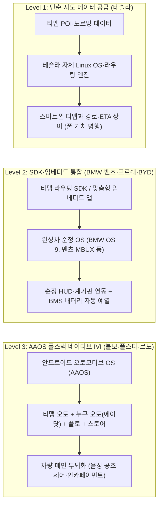

import Alert from '@/components/Alert.astro';

출근길 교차로에서 스마트폰 화면을 덮은 팝업 광고를 닫으며 한숨 쉬어본 적이 있으신가요? 한국 운전자들이 광고가 늘어난 티맵에 피로감을 호소하며 네이버 지도로 눈을 돌리는 2026년 가을, 월스트리트의 거인 **골드만삭스**가 **SK스퀘어**로부터 **티맵모빌리티 인수**를 추진하고 있다는 소식이 자본시장을 흔들고 있습니다. 모두가 내비게이션 앱의 전성기가 끝났다고 말하는 시점에, 가장 냉혹한 계산기를 두드리는 투자은행은 왜 수천억 원의 수표를 꺼내 들었을까요?

## 프롤로그: 월스트리트의 누군가는 다른 지도를 보고 있었다

*(아래 도입부 정경은 공개된 매각 협상 사실을 바탕으로 재구성한 가상 연출입니다.)*

2026년 10월 퇴근길 강변북로. 대시보드 스마트폰 화면에서는 목적지 검색창 아래로 스폰서 광고가 깜빡이고, 도착 시간을 1～2분 줄이겠다며 좁은 골목길로 핸들을 꺾으라는 안내가 흘러나옵니다. 운전자들은 "예전의 쾌적하던 티맵이 아니다"라며 네이버 지도나 카카오내비로 앱을 갈아타고 있죠.

같은 시각 서울 도심의 자문사 회의실에서는 전혀 다른 숫자가 오갑니다. **[FACT]** 최대주주 **SK스퀘어**(지분 63.23%)는 SK하이닉스 중심의 반도체·AI 밸류체인에 집중하기 위해 SK쉴더스, 원스토어, 11번가, 인크로스, 드림어스컴퍼니 등 비핵심·플랫폼 자산을 잇달아 정리해 왔고, 마지막 남은 플랫폼 자회사 티맵모빌리티까지 유동화 테이블에 올렸습니다.

몸값 낙폭은 가파릅니다. **[FACT]** 2020년 12월 SK텔레콤 물적분할 당시 1조 원이었던 기업가치는 2021년 4월 프리IPO(4,000억 원 유치) 때 1조 4,000억 원, 2022년 8월 KB국민은행 투자(2,000억 원 유치) 당시 2조 2,000억 원(포스트밸류 약 2조 4,000억 원)으로 정점을 찍었습니다. 그러나 적자 지속으로 2025년 적격상장(Q-IPO)이 무산돼 기한을 2027년으로 2년 연장했고, 중복 상장 논란과 플랫폼 밸류 저하가 겹치며 현재 거론되는 지분 100% 기준 기업가치는 8,000억～1조 원 초반, 순현금 제외 실질 기업가치(EV)는 6,000억 원대까지 내려앉았습니다. 고점 대비 반토막 이하, 2021년 프리IPO 대비로도 30～40% 할인된 수준입니다.

바로 이 순간 **골드만삭스 대체투자사업부**(Goldman Sachs Asset Management, 구 PIA) 펀드가 등판했습니다. **[FACT]** 골드만삭스는 SK스퀘어 지분 대부분과 재무적 투자자(FI) 어펄마캐피탈(9.83%), 이스트브릿지파트너스(9.83%), KB국민은행(약 6.4～8.3%) 지분을 묶어 총 60～70% 이상의 경영권 지분을 약 7,000억～8,000억 원에 인수하기 위해 실사 및 조건을 조율 중이며, 연내 주식매매계약(SPA) 체결을 목표로 움직이고 있습니다. (단, FI 원금·수익률 보전 조건 조율이 최종 SPA의 핵심 변수입니다.) 왜 하필 지금, 왜 하필 티맵일까요?

<Alert type="info" title="핵심 가설과 서술 원칙 안내">
**본 글의 핵심 가설**: *"골드만삭스가 원하는 것은 내비게이션 광고 수익이 아니다. 자율주행 시대에 한국 자동차 산업의 디지털 관문이 될 수 있는 플랫폼을 저렴하게 확보하려는 것은 아닐까?"*

본문에서는 사실과 추론을 구분하기 위해 세 가지 표기를 사용합니다.
- **[FACT]**: 공시 자료, 감사보고서, 공식 발표 및 교차 검증된 보도 사실
- **[ANALYSIS]**: 검증된 재무·산업 데이터를 바탕으로 도출한 구조적 해석
- **[HYPOTHESIS]**: 미검증 미래 시나리오 및 인수 주체의 전략적 의도 추론
</Alert>

---

## 1막: 내비게이션으로 돈을 벌겠다는 생각은 틀렸을지도 모른다

구글(Google Maps)과 애플(Apple Maps)은 매년 수조 원의 지도 구축비와 위성·스트리트뷰 유지비를 지출하면서도 왜 운전자에게 단 1원의 사용료도 받지 않을까요? **[ANALYSIS]** 내비게이션 앱 자체에서 뽑아내는 직접 광고 매출보다, 사용자를 자사 운영체제(Android·iOS)와 모빌리티 생태계 안에 묶어두는 락인(Lock-in) 효과와 고객 접점의 전략적 가치가 훨씬 거대하기 때문입니다.

> **"가장 비싼 내비게이션은 사용료를 받지 않는 내비게이션일지도 모른다."**

역설적이게도 2020년 말 SK텔레콤에서 분사한 직후 상장(IPO) 압박에 내몰린 티맵모빌리티는 이 명제와 정반대 길을 걸었습니다. **[FACT]** 단기간에 매출 외형을 키워 몸값을 증명해야 했던 티맵은 우버와의 합작법인 **우티**(UT), 서울공항리무진 등 공항버스, 대리운전 관제(**로지소프트**), 화물 중개(**와이엘피**)를 공격적으로 사들이며 오프라인 모빌리티 백화점을 지향했습니다. 결과는 가혹했습니다. 출혈 경쟁 탓에 2022년 영업손실 978억 원, 당기순손실 1,662억 원이라는 깊은 적자 늪에 빠졌고, 급해진 경영진은 앱 안에 목적지 검색 스폰서·팝업·음성 광고를 늘리고 대리·렌터카·숙박·장소추천 탭을 덕지덕지 붙인 무거운 슈퍼앱으로 서비스를 변질시켰습니다.

**[FACT]** 아이지에이웍스 모바일인덱스 기준 국내 지도 앱 월간활성이용자(MAU)는 네이버 지도(약 2,700만～3,000만 명)가 1위, 티맵(약 1,450만～1,500만 명)이 2위, 카카오맵·내비(약 1,100만～1,300만 명)가 3위입니다. 순수 차량 내비게이션 점유율(약 70%)과 1인당 체류 시간에서는 여전히 티맵이 선두를 지키고 있지만, 광고 피로감과 도착 예정 시간(ETA)을 1～2분 단축하겠다며 좁은 골목길·이면도로로 무리하게 우회시키는 경로 품질 논란에 지친 운전자들이 쾌적한 대로 주행을 선호하며 네이버 지도로 이동하는 징후가 뚜렷합니다.

| 연도 | 매출액 | 영업이익(손실) | 당기순이익(손실) | EBITDA | 주요 재무 이벤트 및 비고 (`[FACT]`) |
| :--- | :---: | :---: | :---: | :---: | :--- |
| **2021년** | 745억 원 | -678억 원 | -19억 원 | 적자 | 어펄마·이스트브릿지 4,000억 원 프리IPO 유치(밸류 1.4조) |
| **2022년** | 2,046억 원 | -978억 원 | -1,662억 원 | 적자 | KB국민은행 2,000억 원 유치(밸류 2.2조), 우티 지분법 손실 반영 |
| **2023년** | 2,871억 원 | -789억 원 | -423억 원 | 적자 | 오프라인 자회사 편입에 따른 외형 확대 |
| **2024년** | 2,858억 원 | -434억 원 | -774억 원 | 적자 | 계속영업 기준(중단영업 차감 전 3,226억 원), 비핵심 매각 개시 |
| **2025년** | 2,835억 원 | -141억 원 | **+233억 원** | **+44억 원** | **창사 첫 연간 EBITDA·순이익 흑자**, 우티·공항버스·캐롯 매각 |
| **2026년 1Q** | 622억 원 | -103억 원 | 적자 | 적자 | 계절적 비수기 영향 |
| **2026년 2Q** | 744억 원 | **-1억 원** | 흑자 기조 | **+44억 원** | **2026년 6월 월간 기준 창사 첫 영업이익 흑자 달성** |

**[ANALYSIS]** 물론 2025년 창사 첫 당기순이익 흑자(+233억 원)와 2026년 2분기 영업손실 -1억 원 도달을 무조건 장밋빛 턴어라운드로 해석해선 안 됩니다. 2024～2025년에 걸쳐 우티 지분 49% 전량 매각(약 569억～600억 원), 서울공항리무진 매각, 로지소프트·와이엘피 합병·슬림화, 캐롯손해보험 지분 매각 등 비핵심 사업을 대거 도려냈고, 본사 인력을 300명대 중후반으로 묶어두며 외주용역비·마케팅비·무형자산 상각비를 강하게 통제한 '비용 절감 다이어트' 효과가 컸기 때문입니다. 그 여파로 전체 매출 외형은 2023년(2,871억 원)에서 2025년(2,835억 원)으로 오히려 정체됐습니다.

그러나 숫자 행간을 자세히 들여다보면 본업의 질적 변화 또한 실재합니다. **[FACT]** 오프라인 중개 사업을 덜어내는 동안에도 고마진 핵심 사업인 **모빌리티 데이터 및 솔루션 부문 매출은 2025년 전년 대비 35.8% 급증**(티맵 오토 +30% 이상, UBI 운전습관 연계 보험 +29.4%, API/데이터 +19.3%)하며 적자 폭을 구조적으로 지워 나갔습니다. 월스트리트의 애널리스트들이 주목한 단서도 바로 이 지점에 숨어 있습니다.

---

## 2막: 자율주행차도 목적지는 알아야 한다

운전자가 핸들에서 손을 떼는 자율주행 시대가 오면 내비게이션은 사라질까요? **[FACT]** 기술적 혼동을 피하기 위해 먼저 선을 그어야 합니다. 인간 운전자가 시각적으로 참고하는 일반 내비게이션 지도(SD Map), 센티미터 단위의 차선·노면 표지 정보를 담은 자율주행용 고정밀 지도(HD Map), 그리고 카메라·라이다·레이더 센서로 주변 장애물을 인식해 조향과 제동을 수행하는 실시간 인지·제어(Perception & Control) 기술은 명확히 다른 영역입니다. 티맵모빌리티가 자율주행 차량의 주행 제어 알고리즘 자체를 만드는 회사는 아닙니다.

**[ANALYSIS]** 하지만 자동차가 스스로 운전하는 레벨 3～4 이상의 시대가 열리더라도 차량은 여전히 목적지를 알아야 합니다. 어느 도로가 공사 중으로 통제되었는지, 지금 강변북로와 올림픽대로 중 어디가 덜 막히는지, 목적지 근처 전기차 초급속 충전기 몇 대가 비어 있는지, 어린이 보호구역의 시간제 속도제한 규제가 어떻게 적용되는지 판단하는 상위 경로 계획(Mission & Route Planning)은 센서만으로 해결할 수 없습니다. 자율주행차가 도로망의 거시적 맥락(교통량, ETA, V2X 인프라)을 읽고 인간 탑승자와 대화하며 차량 제어기(배터리 관리 시스템·공조장치)에 명령을 내리는 디지털 인터페이스는 결국 내비게이션 계층입니다.

여기서 스릴러의 핵심 질문이 떠오릅니다.

> **"미래에는 사람이 티맵을 사용하는 것이 아니라 자동차가 티맵의 고객이 되는 것은 아닐까?"**

---

## 3막: 볼보는 이미 미래의 일부를 보여주고 있다

그 미래는 이미 한국 수입차 시장에서 현실이 되었습니다. **[FACT]** 완성차 내장형 솔루션인 **티맵 오토**(TMAP AUTO) 탑재 규모는 2025년 초 약 77만 대에서 **2026년 9월 기준 누적 115만 대를 돌파**(20여 개 브랜드 공급)하며 수입차 시장의 표준이 되었습니다. 다만 OEM별 통합 깊이는 3단계로 엄격히 구분됩니다.

| 연동 수준 | 대표 완성차 OEM | 통합 방식 및 기술적 차이 (`[FACT]` & `[ANALYSIS]`) |
| :--- | :--- | :--- |
| **Level 1** 단순 데이터 공급 | **테슬라**(Tesla) | 자체 리눅스 OS와 글로벌 단일 UI 고수. 티맵에서 POI·도로망 지도 데이터만 공급받으며 티맵 오토 SW나 3D 교차로 UI가 들어간 것이 아님. 경로·ETA 차이로 한국 오너들은 여전히 스마트폰 티맵을 거치해 사용 |
| **Level 2** SDK·임베디드 통합 | **BMW**, **벤츠**, **포르쉐**, **BYD**, **폭스바겐**, **아우디** | **BMW**(OS 9)는 순정 내비 백엔드에 티맵 라우팅·교통 SDK를 이식해 고유 AR 내비·HUD 및 전기차 충전소 목적지 설정 시 **배터리 자동 예열**(Pre-conditioning) 연동. **벤츠**(3세대 MBUX)는 맞춤형 임베디드 앱 탑재. **포르쉐**는 2027년형 911·타이칸·카이엔·파나메라 국내 모델 최초 탑재 발표(배터리 프리컨디셔닝 연동). **BYD**(아토3·씰 등)·폭스바겐·아우디 탑재 확대 |
| **Level 3** 풀스택 IVI 통합 | **볼보**(Volvo), **폴스타**, **르노**(그랑 콜레오스) | **볼보**가 300억 원을 투자해 구글 AAOS 위에 티맵 오토·음성비서 누구 오토(에이닷)·플로(FLO)·티맵 스토어를 메인 두뇌(IVI)로 통합 이식. 폰 연결 없이 시동 즉시 작동하며 음성으로 에어컨·열선·충전소 경유 제어 |

**[ANALYSIS]** 글로벌 완성차들이 한국 회전교차로·단속카메라·실시간 교통·충전 결제 인프라를 직접 구축하는 것은 비용 장벽이 너무 높습니다. 게다가 **구글**(AAOS+GAS)은 한국의 고정밀 지도 국외 반출 제한으로 구글맵 길안내가 반쪽짜리이고, **애플**이 2025년 출시한 **카플레이 울트라**(CarPlay Ultra)는 계기판·HUD·공조장치까지 장악하려 해 완성차들이 "데이터 주권과 브랜드 UX를 뺏길 수 없다"며 강하게 경계합니다. 이 틈새에서 브랜드 고유의 UI와 데이터 주권을 존중하는 티맵 오토가 한국 시장의 공통 차량용 소프트웨어 인프라를 독식한 것입니다.

---

## 4막: 그런데 왜 골드만삭스인가?

그렇다면 왜 완성차(SI)나 빅테크가 아닌 금융투자자 **골드만삭스**가 티맵을 인수하려 할까요? 5가지 전략적 이유로 요약됩니다.

1. **밸류에이션 비대칭성** (`[ANALYSIS]`): 고점 2조 2,000억 원에서 현재 지분가치 8,000억～1조 원대(실질 EV 6,000억 원대)로 낮아진 가격과 미래 SDV 플랫폼 가치 사이의 괴리를 노린 저가 바이아웃입니다.
2. **중립적 소유 구조의 역설** (`[ANALYSIS]`): 만약 현대차나 특정 완성차, 혹은 빅테크가 티맵을 인수한다면 벤츠·BMW·볼보·포르쉐·BYD는 경쟁사에 주행 데이터를 넘기지 않기 위해 즉시 티맵 오토를 버릴 것입니다. **재무적 투자자인 골드만삭스가 주인이 되어야만 모든 글로벌 완성차에 중립적인 '스위스 은행' 같은 B2B 소프트웨어 공급자로 남을 수 있습니다.**
3. **아시아 모빌리티 투자 방정식의 연장선** (`[FACT]` & `[ANALYSIS]`): 골드만삭스는 우버·디디추싱·그랩과 한국 배달의민족(2014년 초기 투자), 카카오모빌리티 투자 논의뿐 아니라, **2023년 5월 일본 1위 택시·모빌리티 앱 'GO'**(구 Mobility Technologies)에 100억 엔(약 1,000억 원) 유상증자를 주도해 유니콘(기업가치 약 1,350억 엔) 등극을 견인했습니다. 일본 'GO'에 이어 한국 티맵까지 확보해 동북아 독점 모빌리티 데이터 인프라를 완성하려는 포석입니다.
4. **자본 투입과 R&D 재가동** (`[HYPOTHESIS]`): Q-IPO 시한에 쫓겨 비용 절감에만 매달리던 티맵에 자본을 수혈해 B2B 차량용 SW 및 AI 데이터 파이프라인 R&D를 확대함으로써 기업가치 멀티플을 재평가받을 수 있습니다.
5. **엑시트를 전제한 체질 개조** (`[HYPOTHESIS]`): 영구적 주인이 될 필요 없이 3～5년간 고마진 B2B SaaS·SDV 체질로 탈바꿈시킨 뒤 전략적 매각이나 재상장으로 회수(Exit)하는 설계입니다.

---

## 5막: SK는 왜 완전히 떠나지 않을까?

**[FACT]** SK스퀘어는 지분 전량을 파는 대신 **약 10% 안팎의 소수 지분을 남겨 2대 주주**로 남을 계획입니다. **[ANALYSIS]** 골드만삭스는 자본과 글로벌 B2B 경영권을 제공하고, SK(SK스퀘어·SK텔레콤)는 에이닷(A.) AI 에이전트와 차량용 통신망(5G/6G 커넥티드카) 협력 고리를 유지하며 향후 기업가치 상승(Upside)에 동참하는 구조입니다.

향후 골드만삭스의 **3가지 엑시트 시나리오**(`[HYPOTHESIS]`)를 비교해 보면, ① **단독 IPO 재도전**(중복 상장 논란을 털고 B2B 오토모티브 SW 멀티플로 상장), ② **글로벌 자동차 전장·SW 기업에 전략적 매각**(완성차 간 중립성을 해치지 않는 보쉬, 콘티넨탈, 하만, 퀄컴 등 Tier-1 기술 기업에 매각), ③ **SK그룹의 재인수**(콜옵션 등)를 꼽을 수 있습니다. 다만 이미 자본 배분 축을 반도체·AI 데이터센터로 옮긴 SK가 비싸진 플랫폼을 되살 유인은 낮아, **①번 단독 상장과 ②번 글로벌 Tier-1 전략적 매각을 양손에 쥐는 회수 전략**이 가장 합리적입니다.

---

## 6막: 이 추리가 완전히 틀릴 수 있는 7가지 이유

매혹적인 가설 뒤에 숨은 7가지 반대 시나리오(Bear Case)와 리스크도 냉혹하게 짚어봐야 합니다.

1. **현대차그룹이라는 벽과 OEM 내재화** (`[FACT]` & `[ANALYSIS]`): 국내 신차 시장의 70% 이상을 차지하는 현대차·기아는 자체 OS(**플레오스 커넥트**, Pleos Connect)와 현대오토에버·네이버 동맹을 구축해 티맵 오토를 철저히 배제하고 있으며, 글로벌 OEM들도 장기적으로 자체 OS·지도를 내재화할 가능성이 있습니다.
2. **구글맵과 지도 반출 규제 리스크** (`[ANALYSIS]`): 향후 통상 압력 등으로 한국의 고정밀 지도 국외 반출 규제가 완화된다면, 구글맵이 AAOS 위에서 즉시 티맵을 대체할 수 있습니다.
3. **스마트폰 티맵 이용자 신뢰 하락** (`[ANALYSIS]`): B2B 티맵 오토의 경쟁력은 1,500만 스마트폰 운전자가 매일 만드는 실시간 주행 데이터에서 나옵니다. 광고 과다와 골목길 경로 논란으로 B2C 이용자가 네이버 지도로 이탈하면 B2B 데이터 정확도까지 무너지는 악순환에 빠집니다.
4. **막대한 R&D 자본 부담** (`[ANALYSIS]`): 단순 내비 앱을 넘어 SDV 미들웨어로 진화하려면 수천억 원의 R&D 비용과 고급 SW 인력이 필요한데, 막 손익분기점을 넘긴 회사가 이를 감당하기 쉽지 않습니다.
5. **한국 내수 시장의 규모 한계** (`[FACT]` & `[ANALYSIS]`): 한국 수입차 시장은 연간 약 25만～30만 대 규모에 불과합니다. 해외 확장이 어려운 로컬 지도 특성상 B2B 라이선스 매출의 천장(Ceiling)이 명확합니다.
6. **사모펀드 특유의 단기 수익성 집착 위험** (`[HYPOTHESIS]`): 가장 설득력 있는 반대 시나리오입니다. 골드만삭스가 장기 R&D 대신 비용을 더 쥐어짜고 앱 광고와 완성차 납품 단가를 올려 단기 EBITDA만 부풀리다 플랫폼의 생명을 깎아먹을 위험입니다.
7. **과거 2.2조 원 기업가치의 거품 가능성** (`[ANALYSIS]`): 현재 8,000억 원대 가격이 바겐세일이 아니라, 저금리 유동성 시절의 2조 2,000억 원이 과대평가였으며 지금이 적정(혹은 여전히 비싼) 가격일 가능성입니다.

---

## 에필로그: 골드만삭스가 산 것은 무엇이었을까?

**[HYPOTHESIS]** 시계를 5년 뒤인 **2031년**으로 돌려 상상의 필름을 펼쳐 봅니다.

한국에 진출한 글로벌 자동차들이 공통으로 티맵의 지도와 차량 인터페이스를 활용하고, 운전자가 스마트폰 화면을 터치하는 대신 자동차 자체가 목적지를 이해해 초급속 충전소 예약과 주차장 진입, 인카페이먼트(차량 내 자동 결제) 서비스를 스스로 요청하는 시대입니다. 그때 티맵은 더 이상 스마트폰 속에 깔린 무료 내비게이션 앱이 아니라, 한국 도로 위를 움직이는 수많은 자동차들이 반드시 거쳐야 하는 디지털 인프라(Tollgate)가 되어 있을 것입니다. 만약 그 시점에 골드만삭스가 경영권 지분을 매각 테이블에 올린다면, 한국 모빌리티 시장의 관문을 손에 넣기 위해 누가 가장 높은 가격을 지불하려 할까요?

다시 2026년 가을 퇴근길 강변북로로 돌아와, 대시보드 위 스마트폰 화면을 보며 마지막 질문을 던져봅니다.

> **"골드만삭스는 길 안내 서비스를 사려는 것일까, 아니면 미래의 자동차들이 지나가야 할 길목을 사려는 것일까?"**
