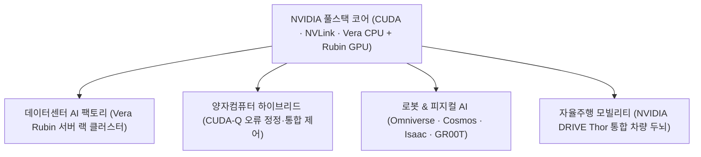

import Alert from '@/components/Alert.astro';
import Chart from '@/components/Chart.astro';

1996년 겨울, 폐업까지 단 30일을 남긴 서른셋 청년 **젠슨 황**이 일본 세가 오브 아메리카 사장실을 찾아가 폭탄선언을 던졌습니다. "우리가 설계 중인 칩은 방향이 틀렸으니 계약을 깨주십시오. 하지만 남은 개발비 500만 달러는 전액 주셔야 합니다. 안 그러면 **엔비디아**는 내일 당장 망합니다." 총알 자국 박힌 산호세 데니스 식당 구석 부스에서 출발한 이 무모한 회사는 훗날 **GPU**를 발명하고 **CUDA**라는 거대한 성벽을 쌓아 사상 최초의 시가총액 5조 달러 제국으로 우뚝 섰죠.

| 시기 | 결정적 변곡점 | 승부수와 결과 |
| :--- | :--- | :--- |
| **1993～1997** | 데니스 창업 & **RIVA 128** | NV1·NV2 실패 후 세가에서 받아낸 500만 달러로 기사회생 |
| **1999～2006** | **GeForce 256**·라데온 전쟁 | 최초 GPU 정의, 6개월 출시 주기와 통합 드라이버로 ATI 제압 |
| **2006～2016** | 월가가 비웃은 **CUDA** 올인 | 전 게이밍 칩에 연산 회로 탑재, AlexNet·DGX-1으로 결실 |
| **2020～2025** | 풀스택 제국과 **5조 달러** | 멜라녹스 인수·ChatGPT 폭발로 세계 시총 1위·5조 달러 돌파 |
| **2025～2026** | **Vera Rubin**과 제왕의 몰락 | 빅테크 탈엔비디아 포위망 속 스캔들로 젠슨 황 사상 초유 축출 |

---

## 1막. 총알 박힌 데니스 식당과 폐업 30일 전의 기적 (1993～1997)

열다섯 살 대만 이민자 소년의 미국 첫 직장은 24시간 패밀리 레스토랑 **데니스**(Denny's)였습니다. 화장실을 청소하고 접시를 닦으며 낯선 손님의 눈을 똑바로 바라보는 배짱을 배운 소년은 만 서른 살이 되던 1993년 4월 5일, 썬 마이크로시스템즈 출신 엔지니어 크리스 말라초스키·커티스 프리엄과 산호세 데니스 구석 부스에 마주 앉았죠. 치안이 험해 창문에 총알 구멍이 박혀 있던 그 식당에서 세 사람은 리필 커피를 열 잔씩 비우며 엔비디아를 세웠습니다.

야심 차게 내놓은 첫 작품 **NV1**(1995)은 처참하게 망했습니다. 남들과 똑같이 가서는 승산이 없다며 사각형 곡면 렌더링(QTM)에 사운드카드·세가 새턴 게임패드 포트까지 우겨넣었지만, 마이크로소프트가 Windows 95용 **Direct3D** 표준을 **삼각형 폴리곤**으로 못 박는 순간 시장에서 사형선고를 받고 산더미 같은 반품 폭탄을 맞았습니다.

세가 드림캐스트용 차기작 **NV2**를 개발하던 젠슨 황은 사각형 방식에 가망이 없음을 깨닫고 세가 오브 아메리카 CEO **이리마지리 쇼이치로**를 직접 찾아갑니다. 계약을 스스로 깨면서 동시에 남은 500만 달러를 달라는 황당한 담판이었죠. 실패를 숨기지 않은 청년의 정직함과 집념에 반한 이리마지리는 본사를 설득해 계약금을 **500만 달러 지분 투자**로 바꿔주었습니다.

산소호흡기는 달았지만 실탄은 단 한 발뿐이었습니다. 직원을 절반 넘게 눈물로 내보낸 젠슨 황은 남은 자금을 털어 **가상 실리콘 검증용 하드웨어 에뮬레이터**(Ikos) 장비를 사들였습니다. 실물 시제품 테스트 한 번 없이 곧장 양산에 돌입해 1997년 내놓은 **RIVA 128**은 출시 4개월 만에 100만 장을 팔아치우며 회사를 수렁에서 건져냈죠. 2026년 여름까지만 해도 버핏·팀 쿡의 퇴장 속에 [현역 글로벌 CEO 15인](/money/global-ceo-top-15) 중 최장수 사령탑으로 군림했던 그의 유명한 주문, "우리 회사는 폐업까지 단 30일 남았다"는 바로 그 피 말리던 겨울에 태어났습니다.

---

## 2막. "색감은 라데온, 게임은 지포스?" — ATI와의 그래픽카드 전쟁 (1999～2006)

1999년 나스닥에 상장한 엔비디아는 그때까지 CPU가 도맡던 조명·기하 연산(하드웨어 T&L)을 그래픽 칩 안에 품은 **GeForce 256**을 내놓으며 세상에 **GPU**(Graphics Processing Unit)라는 단어를 처음 정의했습니다. 2000년 말에는 왕년의 절대강자 **3dfx**의 핵심 자산까지 인수했죠. 하지만 그다음 기다리고 있던 진짜 숙적은 캐나다의 **ATI**(라데온)였습니다. 당시 용산 전자상가와 PC 커뮤니티를 지배했던 유명한 논쟁, "색감은 라데온, 게임 프레임은 지포스"는 과연 사실이었을까요?

<Alert type="info" title="하드웨어 도시전설 검증: 정말 라데온 색감이 더 쨍했을까?">
1. **아날로그 VGA(CRT) 시절엔 진짜였다**: 디지털 신호를 아날로그로 바꾸는 RAMDAC 뒤쪽 아날로그 저역통과 출력 필터 품질 차이였습니다. 직영 생산(Built by ATI) 비중이 높고 부품 규격이 깐깐했던 ATI와 달리, 엔비디아는 대만·중국 저가 비레퍼런스 제조사에 기판을 대거 개방했죠. 원가 절감용 싸구려 필터 탓에 고해상도 가독성과 색이 흐릿해지는 지포스 카드가 실제로 많았습니다.
2. **DVI 시절엔 플라시보, 그런데 HDMI에서 되살아난 유령**: 순수 디지털(DVI·DP) 전송에서는 칩셋 고유 색감 차이가 원리적으로 0이었습니다. 그런데 HDMI 보급기에 엔비디아 드라이버가 PC 모니터를 가전 TV로 착각해 출력 범위를 `Full RGB (0–255)` 대신 `Limited RGB (16–235)`로 강제 고정하는 버그를 2014년 말까지 방치했고, 검은색이 뿌연 회색으로 뜨는 '물 빠진 색감' 전설은 10년 넘게 생명력을 얻었습니다.
</Alert>

화질 논란에도 엔비디아가 결국 ATI를 제압한 건 세 가지 무기 덕분이었습니다. 업계 표준(18개월)을 박살 낸 3개 설계팀 중첩 **6개월 신제품 폭격 사이클**, 칩마다 쪼개진 버그투성이 드라이버 대신 전 세대를 하나로 묶은 **단일 드라이버**(Detonator·ForceWare), 그리고 게임 개발사에 엔지니어를 통째로 파견해 출시 전부터 지포스에 최적화시킨 **"The Way It's Meant to Be Played"** 생태계 전략이었죠.

여기에 결정적인 비하인드가 숨어 있습니다. 2006년 AMD는 원래 ATI보다 엔비디아 인수를 먼저 타진했습니다. 하지만 젠슨 황이 "합병 회사의 CEO는 무조건 내가 맡는다"고 버텨 협상이 결렬됐고, 결국 AMD가 차선책으로 ATI를 54억 달러에 인수해 긴 통합 진통을 겪는 사이 엔비디아는 전혀 다른 차원의 도박을 시작합니다.

---

## 3막. 모두가 미쳤다고 한 CUDA, 채굴 광풍과 AI 빅뱅을 만나다 (2006～2026)

2006년 11월 **GeForce 8800 GTX**(G80)와 함께 공개된 **CUDA**(이안 벅 영입)는 그래픽 코어를 C언어 기반 범용 병렬 연산기로 바꾸는 혁명이었습니다. 그러나 월가는 맹비난을 퍼부었죠. 당장 쓸 고객도 없는데 **출하되는 모든 게이밍 지포스에 범용 병렬 연산 회로를 집어넣어** 원가가 치솟고 이익률이 깎였기 때문입니다. 설상가상 2008년 노트북 칩 납땜 불량(범프게이트) 사태로 주가가 80% 폭락하고 애플과도 깊은 악연을 맺었습니다([엔비디아와 애플의 20년 전쟁](/dev/nvidia-ai-pc-vs-apple-silicon)). 하지만 모든 칩에 심어둔 그 회로 덕분에 전 세계 게이밍 PC 수억 대가 대학원생들의 무료 슈퍼컴퓨터 실험실이 됐습니다.

예상치 못한 첫 번째 파도는 **암호화폐 채굴 광풍**이었습니다. 비트코인 초기를 지나 VRAM 병렬 연산이 핵심인 **이더리움**(PoW) 채굴 대유행(2017년, 2020～2021년)으로 현금을 쓸어 담았지만, 거품이 꺼질 때마다 중고 매물과 재고 폭탄을 맞아 2018년(-54%)과 2022년 이더리움 PoS 전환기(-66%) 두 차례나 주가가 반토막 이상 무너지는 아찔한 롤러코스터를 탔습니다.

진짜 빅뱅은 채굴 소음 너머에서 조용히 점화됐습니다. 2012년 토론토대 대학원생 알렉스 크리제프스키와 일리야 수츠케버가 침실 PC에 꽂힌 게이밍 카드 **GeForce GTX 580 단 2장**과 **CUDA**로 학습시킨 신경망 **AlexNet**이 이미지 인식 대회를 평정하자, 젠슨 황은 사운을 걸고 AI 올인을 선언합니다. 2016년 8월에는 샌프란시스코의 작은 비영리 연구소 **OpenAI**에 세계 최초 AI 슈퍼컴퓨터 **DGX-1** 1호기를 직접 들고 가 친필 서명해 선물했죠. 그리고 6년 뒤인 2022년 말, **ChatGPT**가 터지며 세상이 뒤집혔습니다.

<Chart
  type="bar"
  height={340}
  caption="엔비디아 회계연도별 게이밍 vs 데이터센터 매출 추이 (단위: 십억 달러, 출처: NVIDIA SEC Form 10-K)"
  data={{
    labels: ['FY20', 'FY21', 'FY22', 'FY23', 'FY24', 'FY25', 'FY26'],
    datasets: [
      {
        label: '게이밍 (Gaming, $B)',
        data: [5.52, 7.76, 12.46, 9.07, 10.45, 11.35, 16.04],
        backgroundColor: '#64748b',
      },
      {
        label: '데이터센터 (Data Center, $B)',
        data: [2.98, 6.70, 10.61, 15.01, 47.53, 115.19, 193.74],
        backgroundColor: '#76b900',
      },
    ],
  }}
/>

불과 6년 전인 FY2020만 해도 게이밍의 절반이던 데이터센터 매출은 FY2026 기준 **1,937억 4,000만 달러**로 폭증하며 전사 매출(2,159억 4,000만 달러)에서 **약 90% 비중**을 차지하는 제국으로 탈바꿈했습니다. 이 폭발적인 실적에 힘입어 엔비디아는 2024년 6월 **전 세계 시가총액 1위**에 등극했고, 2025년에는 시총 **4조 달러**에 이어 **사상 최초 5조 달러**라는 인류 자본시장 신기록을 썼습니다.

---

## 4막. 칩 장수를 넘어 CPU·양자·로봇·자율주행을 삼키는 풀스택 제국

경쟁사들이 장부상 스펙이 더 좋은 칩을 만들어도 엔비디아를 못 이기는 이유는 20년간 쌓인 **CUDA 생태계**에 있습니다. 수백만 개발자와 `cuDNN`·`TensorRT` 등 수백 개 도메인 라이브러리가 거대한 전환 비용(해자)을 만들었기 때문이죠. 여기에 젠슨 황은 칩 단품을 넘어 인프라 전체를 집어삼키는 영토 확장을 감행했습니다.

먼저 2020년 인텔을 제치고 초고속 네트워킹 강자 **멜라녹스**(Mellanox)를 69억 달러에 인수해, 수만 장의 GPU를 `NVLink`·`InfiniBand`로 엮어 **데이터센터 건물 전체를 하나의 컴퓨터**로 파는 신의 한 수를 뒀습니다. 같은 해 도전한 CPU 설계 제국 **Arm 400억 달러 인수**는 2022년 규제 장벽에 막혀 무산됐지만, 포기하지 않고 20년 장기 Arm 라이선스를 바탕으로 자체 서버용 **Grace CPU**와 커스텀 코어 **Vera CPU**(2026년 양산 **Vera Rubin** 플랫폼)를 직접 설계해 인텔·AMD의 텃밭까지 침투했죠. 게다가 2025년 말에는 반독점 심사를 절묘하게 피해 추론 전용 칩(LPU) 다크호스 **Groq**과 **200억 달러 규모 비독점 기술 라이선스 계약**을 맺고 구글 TPU 주역인 창업자 조너선 로스와 핵심 인력을 영입하는 냉혹한 승부수를 던졌습니다.

이제 제국의 시선은 다음 10년을 책임질 4대 전선으로 뻗어갑니다.

- **데이터센터**(AI 팩토리): Blackwell을 넘어 2026년 본격 가동된 **Vera Rubin** 아키텍처로 대규모 추론 단가를 대폭 낮춥니다.
- **양자컴퓨터**: 양자컴퓨터가 현실화돼도 큐비트 오류 정정과 제어에는 GPU 슈퍼컴퓨터가 필수라는 계산 아래 모든 양자 하드웨어 위를 덮는 하이브리드 표준 `CUDA-Q`를 깔았습니다.
- **로봇 & 피지컬 AI**: 가상 물리 시뮬레이션 `Omniverse`·`Cosmos`에서 수만 번 연습한 지능을 `NVIDIA Isaac`과 `Project GR00T`로 현실 휴머노이드에 이식합니다.
- **자율주행**: 차량 한 대의 주행·콕핏 연산을 하나로 통합한 모빌리티 두뇌 `NVIDIA DRIVE Thor`로 미래차 표준을 노립니다.

---

## 5막. 창업 33년 만에 찾아온 최대 위기 — '제국의 역설'

과거의 위기가 현금이 말라 망할 뻔한 생존의 위기였다면, 정상에 선 2026년 지금 엔비디아가 마주한 위기는 **너무 강해졌기에 전 세계가 포위망을 좁혀오는 구조적 위기**입니다.

### 1. 최대 고객이 최대 적수로: 빅테크의 '탈엔비디아' 동맹

매출 절반 이상을 책임지는 핵심 고객사들(단일 직판 고객 A 22%·고객 B 14%, 두 곳 합산 전사 매출의 **36% 비중**)은 매출총이익률 70%대에 달하는 이른바 '젠슨 세금'에서 벗어나려 사활을 걸고 있습니다. 구글 **TPU**, 아마존 **Trainium**, 마이크로소프트 **Maia**, 메타 **MTIA**는 물론 10년 전 DGX-1을 선물 받았던 OpenAI까지 브로드컴과 손잡고 자체 주문형 반도체(ASIC) 개발에 뛰어들었죠.

### 2. '학습'에서 '추론'으로의 전환과 딥시크 쇼크

2025년 1월 27일 저비용 고효율 추론 모델 **DeepSeek-R1**이 등장했을 때 엔비디아는 **단 하루 만에 시가총액 약 5,900억 달러**(약 850조 원)가 증발하는 충격을 겪었습니다. 거대 모델을 처음 빚는 사전학습 독점기를 지나 매 순간 토큰 단가 가성비를 따지는 대규모 추론 시대에도 과연 70%대 마진을 지킬 수 있을까요?

### 3. 미·중 지정학 장벽, 반독점 칼날, 그리고 물리적 전력 한계

미국의 대중국 수출 통제가 저사양 `H20` 칩까지 막으면서 45억 달러의 재고 상각을 치른 것은 물론, 역설적으로 중국 시장을 **화웨이 Ascend** 중심의 '비(非) CUDA' 생태계로 독립시켜 주고 말았습니다. 여기에 미 법무부(DOJ)·EU·중국의 동시 반독점 칼날과 빅테크 설비투자(CAPEX) 수익성 논쟁, [데이터센터 전력 병목과 궤도 컴퓨팅](/dev/ai-datacenter-bottleneck-orbital-computing) 한계까지 겹치며 시장 일각에서는 2000년 정점에서 꺾인 [시스코 닷컴 버블의 교훈](/dev/cisco-name-logo-origin-dotcom-bubble-ai-comeback)을 다시 꺼내 들고 있습니다.

---

## 종장. 성벽 안에서 터진 폭탄: 스캔들과 33년 제왕의 해임 (2026. 11)

빅테크의 반란도, 딥시크의 기습도 무너뜨리지 못했던 난공불락의 성벽은 뜻밖에도 가장 깊은 안쪽에서 갈라졌습니다. 2026년 11월, 33년 제국을 통째로 뒤흔든 사상 초유의 위기는 기술이 아니라 창업자 본인의 치명적인 스캔들이었죠.

첫 도화선은 국가안보 게이트로 번진 **앨리스 황**(Alice Huang) 파문이었습니다. *뉴욕타임스*(NYT) 탐사보도를 통해 젠슨 황이 엔비디아의 대형 클라우드 고객사인 싱가포르 데이터센터 기업 메가스피드(Megaspeed) 전 임원 앨리스 황과 혼외 관계를 맺어왔다는 사실이 폭로된 것입니다. 단순한 사생활 일탈이 아니었습니다. 미 정보당국이 그녀를 중국 정보기관 연루 인물로 의심하고 메가스피드를 첨단 AI 칩 우회 밀반입 통로로 수사 중이었다는 정황이 드러나며 워싱턴 정가가 발칵 뒤집혔죠. 젠슨 황이 사내 서한으로 과오를 시인하고 이사회가 한 차례 진화에 나섰지만 불길은 꺼지지 않았습니다.

결정타는 곧바로 이어진 **킴벌리 파월**(Kimberly Powell) 헬스케어 부문 부사장과의 두 번째 사내 스캔들 폭로였습니다. 2008년 입사 이래 CEO에게 직접 보고해 온 직속 임원과 GTC 기간 호텔에서 부적절한 관계를 맺었고, 당시 현장을 촬영한 목격자에게 경호팀이 비밀유지계약서(NDA)를 들이밀며 입막음을 시도했다는 증언과 제3의 직원 연루 의혹까지 연달아 터져 나왔습니다. 안보 리스크에 직속 부하와의 이해충돌·윤리강령 위반이라는 거버넌스 붕괴가 겹치자 이사회도 더는 방패막이가 될 수 없었습니다.

이사회가 심야 긴급회의를 소집해 창업자 **해임**(Ouster) 절차에 착수하자, 결국 2026년 11월 12일 젠슨 황은 해임 표결 직전 CEO·사장·이사직에서 전격 사임하는 형식으로 자신이 세운 제국에서 축출됐습니다. 재무 수장 **콜레트 크레스**(Colette Kress) CFO가 급히 임시 CEO 지휘봉을 넘겨받았지만 시간외 주가가 급락하며 수천억 달러가 증발했고, 실리콘밸리의 복귀 청원과 미 의회의 청문회 압박이 정면충돌하고 있습니다. 평생 "우리 회사는 폐업까지 30일 남았다"며 외부의 적을 경계하던 가죽 재킷의 승부사가 정작 스스로 자초한 덫에 걸려 퇴장한 지금, **젠슨 황 없는 엔비디아**는 과연 CUDA라는 황금수갑만으로 이 거대한 제국을 지켜낼 수 있을까요?
