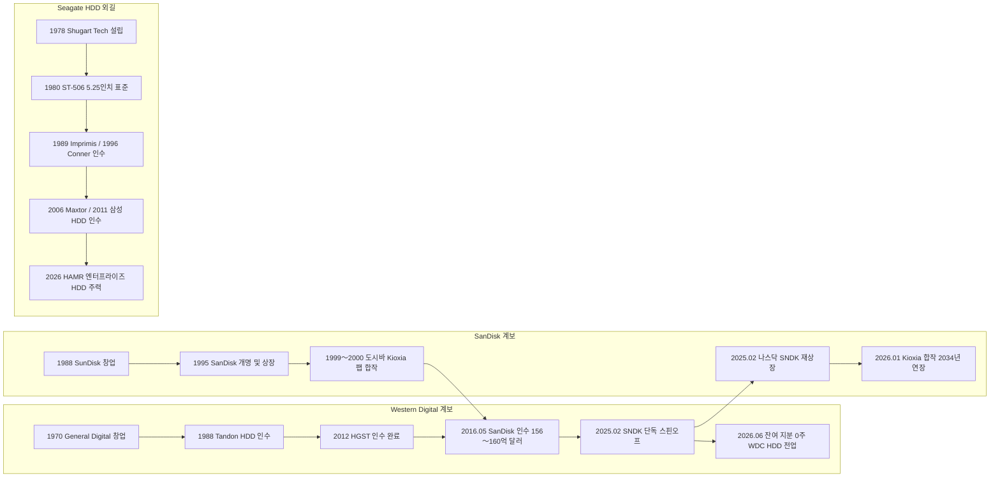

import Alert from '@/components/Alert.astro';
import StockCard from '@/components/StockCard.astro';
import StockInline from '@/components/StockInline.astro';
import Chart from '@/components/Chart.astro';

미국 증시에서 스토리지 관련주를 찾아보다 보면 낯익으면서도 묘한 티커 하나가 눈에 띕니다. 2016년 웨스턴디지털에 흡수되며 자취를 감췄던 <StockInline ticker="SNDK" name="샌디스크" />가 9년 만인 2025년 2월 나스닥에 다시 상장됐기 때문이죠. 더 충격적인 건 분사 이후의 주가 궤적입니다. 모회사 <StockInline ticker="WDC" name="웨스턴디지털" />가 2025년 6월 보유 지분을 주당 38.50달러에 털어냈는데, 불과 8개월 뒤인 2026년 2월 2차 매각 때는 같은 주식이 주당 545.00달러에 거래됐어요.

웨스턴디지털은 왜 160억 달러를 들여 사 왔던 샌디스크를 결국 떼어냈을까요? 반대로 라이벌 <StockInline ticker="STX" name="시게이트" />는 왜 45년 넘게 플래시 메모리에 한눈팔지 않고 HDD 외길만 걸었을까요? 2026년 AI 데이터센터 스토리지 전쟁을 제대로 이해하려면, 먼저 이 세 회사가 50년간 어떻게 합치고 갈라졌는지부터 짚고 넘어가야 합니다.

## 한눈에 보는 스토리지 3사 핵심 프로필

| 구분 | 웨스턴디지털 (`WDC`) | 시게이트 (`STX`) | 샌디스크 (`SNDK`) |
| :--- | :--- | :--- | :--- |
| **설립 연도** | 1970년 (General Digital) | 1978년 (Shugart Technology) | 1988년 (SunDisk) |
| **초기 주력** | MOS 반도체·계산기 칩·컨트롤러 | 세계 최초 5.25인치 HDD (`ST-506`) | 상용 플래시 SSD·메모리카드 |
| **결정적 M&A·동맹** | Tandon HDD(1988), HGST(2012), SanDisk 인수(2016) 후 분사(2025) | Imprimis(1989), Conner(1996), Maxtor(2006), 삼성 HDD(2011) | 도시바·Kioxia NAND 팹 합작(1999～2034 연장) |
| **2026년 정체성** | 순수 엔터프라이즈 HDD 양강 | 45년 HDD 외길·HAMR 선도 | 독립 순수 NAND 플래시·SSD 기업 |

## 1970～1980년대, 서로 다른 출발선에 선 세 회사

지금은 세 회사 모두 '데이터 저장장치'라는 같은 울타리 안에 묶여 있지만, 창업 당시 뿌리는 제각각이었습니다. 반도체 칩 제조사, PC용 하드디스크 개척자, 그리고 플래시 메모리의 발명가 집단이 각자의 길을 걷다가 데이터센터라는 거대한 전장에서 만나게 되죠.

### 계산기 칩 회사에서 HDD 양강으로 — 웨스턴디지털

웨스턴디지털의 시작은 하드디스크가 아니었습니다. 1970년 4월 23일, 전 모토로라 임원 앨빈 B. 필립스(Alvin B. Phillips)가 캘리포니아에서 세운 **General Digital Corporation**이 전신입니다. 초기에는 MOS 반도체 테스트 장비와 맞춤형 칩을 만들었고, 1971년 7월 사명을 **Western Digital**로 바꿨습니다.

당시 회사를 먹여 살린 효자는 시리얼 통신 칩인 `WD1402A UART`와 전자계산기용 MOS 칩이었어요. 세계 최대 계산기 칩 공급사로 급성장했지만, 1970년대 중반 핵심 고객사가 파산하면서 회사도 존폐 위기에 몰립니다. 이때 웨스턴디지털을 살려낸 선택이 스토리지 컨트롤러 전환이었습니다. 플로피 디스크 컨트롤러 `FD1771`에 이어, 훗날 PC의 표준 인터페이스가 된 ATA/IDE 규격의 토대인 HDD 컨트롤러 `WD1003`을 내놓으며 기사회생했죠.

컨트롤러만 만들던 회사가 직접 드라이브를 제조하기로 방향을 튼 건 1988년입니다. **Tandon Corporation**의 HDD 사업부를 인수하면서 완제품 제조사로 변신했고, 1990년대 *Caviar* 시리즈로 데스크톱 시장을 휩쓸었습니다. 결정타는 2012년 3월이었습니다. 구 IBM HDD 계보를 잇던 히타치 글로벌 스토리지(**HGST**)를 약 43억～48억 달러에 품에 안으면서, 시게이트와 나란히 글로벌 HDD 양강 체제를 굳혔습니다.

<StockCard
  ticker="WDC"
  sector="스토리지 · 엔터프라이즈 HDD"
  website="westerndigital.com"
  comment="2025년 샌디스크 분사와 2026년 잔여 지분 완전 청산을 마치며 순수 HDD 기업으로 회귀한 스토리지 양강."
/>

### 5.25인치 표준을 세우고 라이벌을 집어삼킨 HDD 외길 — 시게이트

시게이트는 출발부터 하드디스크 그 자체였습니다. 1978년 11월, 앨런 슈거트(Alan Shugart)와 피니스 코너, 톰 미첼, 더그 마혼, 사이드 이프티카르 다섯 명이 **Shugart Technology**로 법인을 세웠어요. 다만 제록스(Xerox)가 보유하던 기존 회사 'Shugart Associates'와 상표권 분쟁 소지가 생기자, 1979년 **Seagate Technology**로 간판을 바꿔 달고 본격 영업에 나섭니다.

1980년 시게이트가 내놓은 **ST-506**은 개인용 컴퓨터 역사를 바꾼 물건입니다. 세계 최초의 5.25인치 HDD로 용량은 5MB에 불과했지만, 기존 냉장고만 하던 디스크를 책상 위로 끌어내렸죠. 파생 모델인 `ST-412`가 1983년 IBM PC XT에 기본 탑재되면서 시게이트는 PC 스토리지 표준을 단숨에 장악합니다.

이후 시게이트의 전략은 철저한 'HDD 외길 통폐합'이었습니다. 치킨게임이 벌어질 때마다 자금력을 앞세워 경쟁사를 하나씩 흡수했어요. 1989년 Imprimis Technology를 시작으로 1996년 **Conner Peripherals**(10억 달러 이상), 2006년 **Maxtor**(19억 달러), 그리고 2011년 12월 **삼성전자 HDD 사업부**(13억 7,500만 달러)까지 차례로 인수했습니다. 1980년대 수십 곳에 달하던 HDD 제조사가 사실상 WDC·시게이트·도시바 3곳으로 압축되는 과정에서, 시게이트는 단 한 번도 주력 무대를 떠나지 않았습니다.

<StockCard
  ticker="STX"
  sector="스토리지 · HAMR HDD"
  website="seagate.com"
  comment="Maxtor·삼성전자 HDD 등 굵직한 인수로 45년 넘게 HDD 외길을 지켜온 기업. 차세대 HAMR 기술 상용화를 주도하고 있다."
/>

### 플래시 메모리의 개척자와 도시바·키옥시아 25년 동맹 — 샌디스크

회전하는 자기 디스크(HDD)가 세상을 지배하던 1988년 6월 1일, 실리콘밸리에서는 전혀 다른 발상을 가진 엔지니어 세 명이 회사를 세웁니다. **엘리 하라리**(Eli Harari), 훗날 마이크론 CEO가 되는 **산제이 메로트라**(Sanjay Mehrotra), 그리고 **잭 위안**(Jack Yuan)이 창업한 **SunDisk Corporation**입니다. 움직이는 부품 없이 반도체 칩에 데이터를 영구 저장하는 플래시 메모리를 상용화하겠다는 목표였죠.

1991년 IBM에 납품한 20MB PCMCIA 플래시 드라이브는 세계 최초의 상용 플래시 SSD로 기록됩니다. 1995년 11월에는 Sun Microsystems와 이름 혼동을 피하기 위해 사명을 **SanDisk**로 바꾸고 나스닥에 상장(`SNDK`)했어요.

샌디스크 역사에서 가장 영리한 승부수는 1999～2000년 시작된 일본 **도시바**(Toshiba, 2019년 **Kioxia**로 재출범)와의 팹 합작(JV)입니다. NAND 플래시를 처음 발명한 도시바의 제조 역량과 샌디스크의 컨트롤러·설계 기술을 결합해 일본 욧카이치(Yokkaichi)와 기타카미(Kitakami)에 거대 생산 기지를 함께 깔았죠. 단독으로 수십조 원대 팹을 짓는 리스크를 반으로 나눈 이 동맹은 25년 넘게 이어지고 있습니다. 2026년 1월에는 기존 2029년 만료 예정이던 Kioxia 합작 계약을 **2034년 12월 31일까지 5년 연장**했고, 샌디스크는 2026～2029년 분할로 11억 6,500만 달러의 제조 서비스 대가를 지급하기로 합의했습니다. 이어 2026년 8월에는 2032년까지 일본 내 310억 달러(약 5조 엔) 규모의 대규모 투자 계획까지 공개하며 동맹을 한층 더 굳혔습니다.

<StockCard
  ticker="SNDK"
  sector="반도체 · NAND 플래시 · SSD"
  website="sandisk.com"
  comment="2025년 2월 WDC에서 독립해 나스닥에 복귀한 순수 NAND 기업. Kioxia와 2034년까지 팹 합작을 연장하며 AI SSD 수요에 대응 중이다."
/>

## 160억 달러의 빅딜은 왜 '복합기업 할인'의 덫이 되었나

2015년 10월, 웨스턴디지털이 샌디스크 인수를 발표했을 때만 해도 월가의 시선은 기대 반 우려 반이었습니다. 당시 제시된 인수 금액은 약 190억 달러였어요. 자금 조달을 위해 중국 칭화유니그룹 계열 Unisplendour의 대규모 지분 투자를 끌어들이려 했지만, 미국 외국인투자심의위원회(CFIUS) 심사에 가로막혀 투자가 무산됩니다. 그 여파로 주가가 흔들리면서 2016년 5월 최종 클로징된 거래액은 약 **156억～160억 달러**로 조정됐습니다.

웨스턴디지털 경영진의 계산은 단순했습니다. "클라우드 시대에는 HDD가 당장 현금을 벌어주고, 미래 성장성은 SSD(NAND)가 책임질 테니 둘 다 쥐고 있으면 완벽한 포트폴리오가 된다"는 논리였죠. 하지만 자본시장은 이 동거를 전혀 반기지 않았습니다.

문제는 두 사업의 체질이 물과 기름처럼 달랐다는 데 있습니다. HDD는 이미 소수 기업이 과점한 성숙 산업이라 설비투자 부담이 상대적으로 적고 현금흐름이 꾸준합니다. 반면 NAND 플래시는 메모리 반도체 특유의 극심한 호황·불황 사이클을 타며, 미세 공정과 적층 경쟁을 버티기 위해 매년 천문학적인 설비투자(CapEx)를 쏟아부어야 합니다.

한 회사 안에 두 사업이 묶이자 투자자층이 완전히 어긋나 버렸어요. 안정적인 배당과 잉여현금흐름을 보고 들어온 가치 투자자는 NAND 불황 때마다 적자로 고꾸라지는 변동성에 질려 떠났습니다. 반대로 고성장 반도체 주식을 찾는 투자자는 무거운 HDD 사업부가 발목을 잡는다는 이유로 외면했죠. 결국 두 사업부를 따로 평가해 합산한 가치보다 회사 전체 시가총액이 훨씬 낮게 거래되는 **복합기업 할인**(Conglomerate Discount)이 수년째 고착화됐습니다.

<Alert type="info" title="복합기업 할인(Conglomerate Discount)이 주가를 누른 이유">
서로 다른 밸류에이션 멀티플과 자본 배분 논리를 가진 사업이 한 상장사에 묶이면, 시장은 대개 둘 중 더 낮은 멀티플을 기준으로 기업 전체를 평가합니다. WDC는 HDD의 안정성도, 순수 반도체 기업의 성장 프리미엄도 인정받지 못한 채 8년 넘게 박스권에 갇혀 있었습니다.
</Alert>

## 엘리엇의 압박, SK하이닉스의 변수, 그리고 2025년 단독 스핀오프

꽉 막혀 있던 판을 흔든 건 행동주의 펀드였습니다. 2022년 5월, **엘리엇 매니지먼트**(Elliott Investment Management)가 웨스턴디지털 이사회에 공개 서한을 보내며 HDD와 플래시 사업의 즉각적인 분리를 요구했어요. 두 사업을 떼어놓기만 해도 숨어 있던 기업 가치가 크게 재평가될 수 있다는 계산이었습니다. 월가 대형 기관이나 행동주의 펀드가 지분을 늘리며 이런 지배구조 개편을 압박할 때 어떤 공시로 움직임을 포착할 수 있는지는 [SEC 13F 공시 완벽 가이드](/money/13f-sec-top10-investors-guide)에서 따로 정리해 두었습니다.

압박을 받은 웨스턴디지털은 처음에 가장 이상적인 그림을 그렸습니다. 자사 플래시 사업부를 떼어내 20년 넘게 팹을 함께 돌려온 합작 파트너 **Kioxia**와 합병하는 시나리오였죠. 합병이 성사되면 삼성전자와 맞먹는 초대형 NAND 연합이 탄생할 판이었습니다.

하지만 여기서 예상치 못한 암초를 만납니다. Kioxia에 간접 투자해 지분을 쥐고 있던 **SK하이닉스**가 합병 조건과 자사 지분 가치 희석 우려를 이유로 강하게 반대하고 나선 것입니다. SK하이닉스의 동의 없이는 딜을 닫을 수 없었고, 결국 2023년 10월 합병 협상은 최종 결렬됩니다.

합병 카드가 날아가자 웨스턴디지털은 곧바로 '단독 스핀오프'로 방향을 틀었습니다. 1년 넘는 구조조정과 법인 분리 작업 끝에 2025년 2월 12일을 배정 기준일로 삼아 **2025년 2월 21일** 분사를 완료했고, **2025년 2월 24일** 나스닥에서 `SNDK` 티커의 정규 거래가 재개됐습니다.

- **주주 배정 비율**: 기존 WDC 주식 1주당 신설 SNDK 주식 **1/3주** 지급
- **지분 배분 구조**: WDC 주주에게 비과세 분배된 지분이 **80.1%**, WDC가 추후 부채 감축용으로 유보한 잔여 지분이 **19.9%**(28,827,787주)
- **경영진 분화**: 기존 WDC를 이끌던 **데이비드 괴켈러**(David Goeckeler) CEO가 독립 샌디스크의 초대 CEO로 이동했고, 글로벌 운영 수석부사장이던 **어빙 탄**(Irving Tan)이 HDD 전업 WDC의 새 CEO를 맡았습니다.

## 19.9% 잔여 지분 청산이 보여준 8개월의 드라마

분사 당시 웨스턴디지털이 쥐고 남은 샌디스크 지분 19.9%(약 2,883만 주)는 단순한 투자 자산이 아니었습니다. 분사 후 WDC 본체에 남은 차입금을 빠르게 갚고 재무구조를 털어내기 위한 '실탄'이었죠. 그런데 이 잔여 지분을 1년에 걸쳐 단계적으로 정리하는 과정에서 믿기 힘든 숫자 차이가 벌어집니다.

첫 번째 처분은 분사 넉 달 만인 **2025년 6월 9일**에 이뤄졌습니다. WDC는 보유 중이던 2,131만 4,768주를 채권단과의 부채-주식 스왑(Debt-for-Equity Exchange) 방식으로 넘기며 단숨에 7,513,019주만 남겼습니다. 이때 책정된 단가는 **주당 38.50달러**. NAND 업황 바닥론이 아직 가시지 않았던 시점이라, 시장에서도 "부채를 빨리 줄이는 게 우선"이라는 반응이 많았습니다.

반전은 불과 8개월 뒤에 터졌습니다. **2026년 2월 17～18일**, WDC가 2차 부채-주식 스왑으로 582만 1,135주를 처분했을 때 적용된 가격은 무려 **주당 545.00달러**(2026년 11월 8대 1 액면분할 전 기준)였습니다. 1차 매각가(38.50달러)와 비교하면 8개월 만에 주가가 **약 14배** 폭등한 셈이에요. 1차 때보다 훨씬 적은 주식 수(582만 주)만 넘겼는데도 회수한 부채 상환 가치는 약 **31억 7,000만 달러**에 달했습니다.

남은 약 169만 주도 깔끔하게 정리됐습니다. **2026년 5월 5～6일**에는 653,203주를 거래량가중평균가격(VWAP) 기준으로 WDC 자사주 1,865,801주와 맞교환했고, **2026년 6월** 마지막 1,038,681주까지 전량 처분하면서 두 회사의 지분 연결고리는 10년 만에 완전히 끝났습니다.

<Chart
  type="bar"
  height={320}
  caption="WDC 보유 SanDisk(SNDK) 잔여 지분 청산 타임라인 (단위: 백만 주)"
  data={{
    labels: [
      '2025.02 분사 직후',
      '2025.06 1차 스왑 ($38.50)',
      '2026.02 2차 스왑 ($545.00)',
      '2026.05 자사주 교환',
      '2026.06 완전 청산',
    ],
    datasets: [
      {
        label: 'WDC 보유 SNDK 잔여 주식 (백만 주)',
        data: [28.83, 7.51, 1.69, 1.04, 0],
        backgroundColor: ['#3b82f6', '#60a5fa', '#2563eb', '#93c5fd', '#cbd5e1'],
      },
    ],
  }}
/>

<Alert type="tip" title="WDC 입장에서는 아쉬운 1차 매각, 그러나 완벽했던 재무 엑시트">
2,131만 주를 주당 38.50달러에 먼저 털어낸 건 결과론적으로 속이 쓰릴 만한 타이밍이었습니다. 하지만 2차 스왑 한 방으로 31억 7,000만 달러 규모의 부채를 줄이고 5월에는 자사주 186만 주까지 회수하면서, WDC 역시 '복합기업 할인'과 재무 부담을 동시에 벗어던지는 데 성공했습니다.
</Alert>

## 3파전으로 재편된 스토리지 시장, 다음 전쟁은 AI 데이터센터다

2026년 하반기 현재, 글로벌 스토리지 상장사 구도는 반세기 만에 가장 명쾌한 삼국지로 정리됐습니다. HDD 전업으로 체질을 되돌린 <StockInline ticker="WDC" name="웨스턴디지털" />, 45년 HDD 외길을 걸어온 <StockInline ticker="STX" name="시게이트" />, 그리고 Kioxia와 2034년까지 생산 동맹을 연장한 순수 NAND 플레이어 <StockInline ticker="SNDK" name="샌디스크" />입니다.

여기서 자연스럽게 두 가지 질문이 남습니다. 첫째, 2025년 6월 주당 38.50달러에 넘어가던 샌디스크가 대체 무슨 이유로 불과 8개월 만에 545.00달러까지 14배나 치솟았을까요? 둘째, "머지않아 SSD에 밀려 사라질 것"이라던 HDD 기업 웨스턴디지털과 시게이트는 왜 2026년에도 AI 데이터센터의 핵심 수혜주로 꼽히며 역대급 실적을 갈아치우고 있을까요?

그 해답은 AI 추론·학습 데이터가 폭증하는 데이터센터 내부의 **용량·전력·비용 공식**, 그리고 시게이트·WDC의 차세대 **HAMR**(열보조자기기록) HDD와 샌디스크의 **초고용량 엔터프라이즈 SSD·HBF**가 맞붙는 기술 전쟁에 있습니다. 이어지는 2편([AI 스토리지 전쟁: 시게이트·WDC HAMR vs 샌디스크 HBF·실적 분석](/money/ai-storage-war-hamr-vs-ssd-wdc-sndk-stx))에서 3사의 기술 로드맵과 주가 변곡점을 본격적으로 뜯어보겠습니다.
