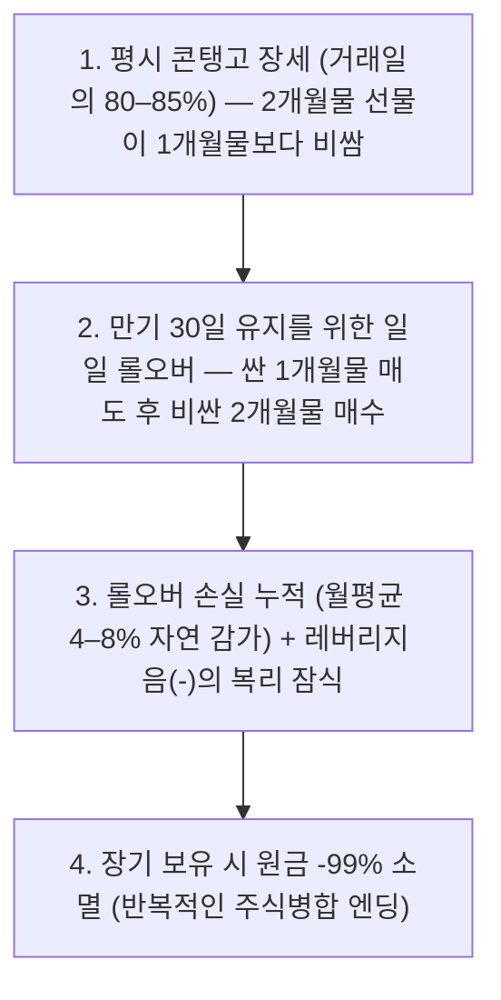

import Alert from '@/components/Alert.astro';
import Chart from '@/components/Chart.astro';
import ClockChart from '@/components/ClockChart.astro';
import VixCalculator from '@/components/VixCalculator.astro';

자고 일어났더니 나스닥과 S&P 500이 3% 넘게 급락하고 경제 뉴스마다 "*월가 공포지수 30 돌파*" 속보가 도배될 때, 계좌를 열어본 투자자의 머릿속은 하얘집니다. 지금이라도 손절해 현금을 챙겨야 할지, 남들이 공포에 던질 때 주워 담아야 할지 숫자의 기준선이 없기 때문이죠. 아래에서 오늘의 실시간 **VIX 지수**를 바로 확인한 뒤, **10초 판별표**와 **계산기**로 내 계좌의 예상 흔들림과 분할 매수 금액부터 냉정하게 따져보세요.

---

## ⚡ 10초 판별표: VIX 지수 실시간 확인 & 구간별 행동 기준

시카고옵션거래소(Cboe)가 산출하는 **VIX 지수**는 유료 단말기 없이도 무료 금융 사이트에서 실시간으로 조회할 수 있어요. 야후 파이낸스에서 검색할 때는 알파벳 `VIX` 앞에 반드시 캐럿 기호(`^`)를 붙여 `^VIX`로 입력해야 ETF가 아닌 실제 지수가 나옵니다.

- **실시간 무료 차트**: [Yahoo Finance (^VIX) 바로가기](https://finance.yahoo.com/quote/%5EVIX/) · [Google Finance 바로가기](https://www.google.com/finance/quote/VIX:INDEXCBOE)
- **산출 기관 공식 안내**: [Cboe VIX 공식 페이지](https://www.cboe.com/tradable_products/vix/)

1990년 이후 36년치 일별 데이터(세인트루이스 연은 FRED `VIXCLS`)의 역사적 중앙값은 **약 17.6**, 장기 평균은 **19.5**입니다. 오늘 확인한 숫자를 아래 5단계 기준표에 바로 대입해 보세요.

| VIX 구간 | 시장 상태 | 역사적 거래일 비중 | 월 적립 권장 배수 | 실전 한줄 판정 |
| :---: | :---: | :---: | :---: | :--- |
| **15 미만** | **안일·낙관 과열** | 약 30% | **평소의 0.7배** | **추격 매수 자제**. 옵션 보험료가 극도로 싼 강세장이지만 돌발 악재에 취약하므로 현금 쿠션 비축 |
| **15 – 20** | **평시 안정 장세** | 약 32% | **평소의 1.0배** | **기본 루틴 유지**. 가장 표준적인 정상 장세이므로 정해진 날짜에 원래 적립금만 집행 |
| **20 – 30** | **경계·일반 조정장** | 약 30% | **평소의 1.2배** | **1차 비중 확대**. 금리·실적 우려로 흔들리는 조정 국면, 핵심 현금은 아끼며 소폭 증액 |
| **30 – 40** | **공포·본격 투매** | **상위 6–8%** | **평소의 1.6배** | **적극 분할 매수**. 기관 리스크 축소로 우량주까지 투매되는 구간 (4주 시간차 매수) |
| **40 이상** | **극단 패닉·항복** | **상위 2% 내외** | **평소의 2.0배** | **역사적 바겐세일**. 마진콜 강제 청산 국면이나 여진에 대비해 반드시 **6–8주 이상** 쪼개 집행 |

아래 계산기에 방금 확인한 **실시간 VIX 수치**와 **내 미국주식 평가금액**을 넣으면, 옵션 시장이 계산 중인 오늘 하루·향후 한 달 예상 등락폭과 권장 매수액이 즉시 환산됩니다.

<VixCalculator defaultVix={32} defaultPortfolio={3000} defaultBudget={100} />

<Alert type="info" title="CNN 공포탐욕지수(0–100점)와 숫자 방향을 거꾸로 읽지 마세요">
서학개미들이 함께 즐겨 보는 [CNN 공포지수(공포탐욕지수) 실시간 가이드](/money/fear-greed-index-guide)는 숫자가 **0점으로 내려갈수록 공포**를 뜻하지만, **VIX 지수는 숫자가 위로 치솟을수록 공포**를 뜻하며 상한선도 없습니다. CNN 지수는 주식·채권·옵션 등 7개 지표를 합산한 중기 심리 체온계이고, VIX는 그 7개 재료 중 하나로도 들어가는 **S&P 500 옵션 시장의 순수 원천 변동성 지표**예요.
</Alert>

---

## VIX 32점이 정확히 무슨 뜻일까? '16의 법칙' 3초 암산법

많은 투자자가 VIX를 막연한 '공포 점수'로만 알고 넘어가지만, 원래 VIX의 단위는 점수가 아니라 **퍼센트**(%)입니다. 정확히는 Cboe에 상장된 S&P 500 지수 옵션(`SPX` 월간물 및 `SPXW` 위클리물 중 만기 23–37일 외가격 콜·풋옵션) 가격을 바탕으로 **옵션 시장 참여자들이 예상하는 향후 30일간의 변동성을 연율화해 1년치로 환산한 수치**예요.

연간 수치를 내 계좌의 **오늘 하루 등락폭**으로 바꾸는 방법은 아주 간단합니다. 월가 트레이더들이 입버릇처럼 쓰는 **16의 법칙**(Rule of 16) 하나만 기억하면 되거든요.

- **왜 하필 16으로 나눌까?**: 미국 증시의 1년 개장일수는 보통 **252거래일**입니다. 통계학에서 변동성(표준편차)은 시간의 제곱근에 비례하므로 연간 변동성을 하루 단위로 쪼개려면 `√252 ≈ 15.87`로 나누면 되는데, 암산하기 좋게 반올림한 숫자가 바로 **16**입니다.
- **오늘 하루 예상 변동폭** (약 68% 확률, 1표준편차) = **`VIX ÷ 16`**
- **향후 30일 예상 변동폭** (약 68% 확률, `√12 ≈ 3.46`) = **`VIX ÷ 3.46`**

| VIX 수치 | 장세 온도 | 오늘 하루 S&P 500 예상 진폭 (`÷16`) | 향후 30일 예상 진폭 (`÷3.46`) | 3,000만 원 계좌 일일 체감 등락 |
| :---: | :--- | :---: | :---: | :---: |
| **12** | 극단적 평온·과열 | ±0.75% | ±3.46% | 하루 약 ±22만 원 |
| **16** | 평시 안정 장세 | **±1.00%** | **±4.62%** | 하루 약 ±30만 원 |
| **20** | 장기 평균선·경계 진입 | ±1.25% | ±5.77% | 하루 약 ±38만 원 |
| **32** | 공포·뚜렷한 조정장 | **±2.00%** | ±9.24% | 하루 약 ±60만 원 |
| **48** | 패닉·강제 청산 투매 | **±3.00%** | ±13.86% | 하루 약 ±90만 원 |
| **80** | 시스템 금융위기 정점 | **±5.00%** | ±23.09% | 하루 약 ±150만 원 |

예를 들어 오늘 VIX가 **32**라면 "*시장이 망했다*"고 패닉에 빠질 게 아니라, "*당분간 S&P 500이 하루 ±2%씩 출렁이는 건 옵션 시장이 이미 가격에 다 반영해 둔 정상 범위구나*"라고 받아들이면 됩니다.

참고로 공식 자체는 위아래 방향 구분이 없는 양방향(`±`) 진폭을 뜻합니다. 하지만 현실 증시에서는 주가가 급락할 때 [헤지펀드와 기관 투자자들의 하방 방어](/money/short-selling-hedge-fund-guide-for-beginners)용 풋옵션 매수가 폭발적으로 몰리기 때문에, S&P 500 일간 수익률과 VIX는 약 **-0.7～-0.8의 강한 역상관관계**로 움직여요.

---

## VIX 30·40 돌파할 때 사면 정말 돈 벌까? (1990–2026 실증 통계)

공포에 사라는 격언이 실제 계좌 수익률로도 증명되는지 확인해 볼까요? 산출 기관인 Cboe와 글로벌 자산운용사 슈로더(Schroders), 세인트루이스 연은(FRED) 데이터를 기반으로 한 장기 백테스트 결과는 일관되게 한 방향을 가리킵니다.

<Chart
  type="bar"
  height={300}
  caption="VIX 종가 기준선 돌파 시 S&P 500 향후 1년 평균 수익률 비교 (출처: Cboe Insights·Schroders·FRED 종합)"
  data={{
    labels: [
      '평시 모든 거래일 평균',
      'VIX 30 초과 마감 (Cboe)',
      'VIX 32.9+ 상위 5% (슈로더)',
      'VIX 35 초과 마감 (Cboe)',
      'VIX 40 초과 전체 거래일'
    ],
    datasets: [
      {
        label: '1년 후 S&P 500 평균 수익률 (%)',
        data: [10.1, 23.0, 25.0, 28.0, 22.1],
        backgroundColor: [
          '#64748b',
          '#f97316',
          '#f97316',
          '#ef4444',
          '#dc2626'
        ]
      }
    ]
  }}
/>

- **평시 대비 2배 이상의 기대수익률**: 1990년 이후 아무 날에나 S&P 500을 매수했을 때 1년 뒤 평균 수익률은 **약 +10.1%** 수준입니다. 반면 Cboe의 히스토리컬 분석(1990–2021)에 따르면 **VIX 종가가 30을 넘은 날** 매수했을 때 1년 뒤 평균 수익률은 **+23.0%**, **35를 넘은 날**은 **+28.0%까지** 뛰었어요.
- **VIX 40 돌파 시 1년 승률 약 83%**: 전체 거래일의 약 2%에 불과한 **VIX 종가 40 초과 구간**에서 매수했을 때도 1년(250거래일) 뒤 플러스 수익을 기록할 확률은 **약 83%**, 평균 수익률은 **약 +22.1%** 수준이었습니다. Hartford Funds 집계에 따르면 1990년 이후 36개 이상의 연도 중 **25개 이상의 해에서는 VIX 종가 40이 단 하루도 출현하지 않았습니다.**
- **공포 회피 손절의 대가**: 슈로더 자산운용이 "*VIX가 상위 5% 공포 구간(32.9)을 넘을 때마다 주식을 전량 팔아 현금화했다가, 32.9 아래로 잠잠해지면 재매수하는 전략*"을 1990년부터 백테스트한 결과는 뼈아픕니다. 투매 정점 직후에 터지는 역사상 가장 큰 폭등 거래일들을 모조리 놓치면서, 아무것도 안 하고 그냥 버틴 단순 보유(Buy & Hold) 투자자보다 장기 자산이 참담하게 뒤처졌거든요.

### 단, 'VIX 40 = 오늘이 최저점'은 아닙니다: 2008년의 반례

통계가 이토록 훌륭한데 왜 전 재산을 한 번에 넣으면 안 될까요? **VIX 40 돌파가 곧바로 주가 진바닥 날짜와 일치하지는 않기 때문**이에요.

대표적인 반례가 **2008년 글로벌 금융위기**입니다. 당시 리먼 브라더스 사태 직후인 2008년 9월 말–10월 초에 VIX가 일찌감치 40을 돌파했지만, 금융기관과 레버리지 펀드들의 연쇄 [마진콜(강제 반대매매)](/money/understanding-margin-call-stock-market)이 꼬리를 물면서 S&P 500은 이듬해인 2009년 3월 진바닥까지 **추가로 30% 넘게 더 추락**했습니다. 첫 40 돌파일에 현금을 100% 털어 넣은 투자자는 반년 동안 계좌가 반토막 나는 고통을 맨몸으로 견뎌야 했죠.

따라서 VIX 30·40 신호는 "*내일 당장 반등한다*"는 단타 알람이 아니라, "**지금부터 4주–8주에 걸쳐 비축 현금을 나눠 담으면 1–2년 뒤 웃을 확률이 80%가 넘는다**"는 중장기 분할 매집 개시 신호로 써야 안전합니다.

---

## 역대 폭락장 VIX 기록과 두 가지 착시 (프리마켓 왜곡 & 2022년 미스터리)

뉴스나 블로그마다 "*역대 최고 VIX는 89다*", "*아니다, 82다*"라며 숫자가 엇갈리는 이유는 **장중 최고치**(Intraday High)와 **종가 최고치**(Closing High)를 섞어 부르기 때문입니다. 주요 위기 국면의 정확한 공식 기록을 나란히 대조해 보면 결정적인 판독 노하우 두 가지가 보여요.

<Chart
  type="bar"
  height={340}
  caption="역대 주요 쇼크별 CBOE VIX 장중 최고치 vs 종가 최고치 비교 (출처: Cboe, FRED VIXCLS)"
  data={{
    labels: [
      '2008 금융위기',
      '2020 코로나19',
      '2022 금리인상장',
      '2024.08 엔캐리 쇼크',
      '2025.04 상호관세 쇼크',
      '2026 지정학·기술주 조정'
    ],
    datasets: [
      {
        label: '장중 최고치 (Intraday)',
        data: [89.53, 85.47, 38.94, 65.73, 60.13, 35.30],
        backgroundColor: '#f87171'
      },
      {
        label: '종가 최고치 (Close)',
        data: [80.86, 82.69, 36.45, 38.57, 52.33, 31.05],
        backgroundColor: '#4f46e5'
      }
    ]
  }}
/>

| 위기 이벤트 | 장중 최고치 (날짜) | 종가 최고치 (날짜) | 핵심 판독 포인트 |
| :--- | :---: | :---: | :--- |
| **2008 글로벌 금융위기** | **89.53** (08.10.24) | **80.86** (08.11.20) | **역대 장중 1위 기록**. VIX 고점(10–11월) 이후에도 주가 바닥은 4개월 뒤(09년 3월) 형성 |
| **2020 코로나19 팬데믹** | **85.47** (20.03.18) | **82.69** (20.03.16) | **역대 종가 1위 기록**. 연준 무제한 양적완화 직후 V자 대세 상승장 직행 |
| **2022 연준 금리 인상기** | **38.94** (22.01.24) | **36.45** (22.03.07) | S&P 500이 -25.4% 하락하는 동안 **단 한 번도 40을 넘지 않은** 계단식 약세장 |
| **2024.08 엔캐리 청산 쇼크** | **65.73** (24.08.05) | **38.57** (24.08.05) | 한국 저녁 프리마켓 호가 왜곡으로 장중 65 급등 후 본장 마감 시 38선으로 급락 |
| **2025.04 상호관세 쇼크** | **60.13** (25.04.07) | **52.33** (25.04.08) | 코로나 이후 5년 만의 50선 돌파, 직후 관세 유예 발표와 함께 급반등 전개 |
| **2026 지정학·기술주 조정** | **35.30** (26.03.09) | **31.05** (26.03.27) | 3월 중동 유가 급등기 장중 35.30·종가 31.05로 30선 돌파, 11월 기술주 조정(종가 28.18) 후 평시 복귀 |

### 착시 1: 한국 저녁 시간대 VIX 폭등은 '호가 착시'일 수 있습니다

2024년 8월 5일 월요일 저녁을 기억하시는 분들이 많을 겁니다. 일본 엔캐리 트레이드 청산 공포로 한국 저녁 시간대에 VIX가 무려 **65.73**까지 수직 폭등하며 "*2008년·2020년급 시스템 붕괴가 터졌다*"는 공포를 불렀지만, 막상 그날 새벽 미국 본장 종가는 **38.57**로 무려 27포인트나 낮게 끝났죠.

미국 증권거래위원회(SEC) 경제위험분석국(DERA)이 발간한 분석 보고서에 따르면 범인은 **프리마켓 시간대의 얇은 호가창**이었습니다. VIX는 [미국 주식 정규장 거래 시간](/money/us-stock-trading-time)뿐 아니라 한국 늦은 오후부터 시작되는 글로벌 거래 시간대(GTH)에도 실시간으로 산출돼요.

<ClockChart
  caption="한국 시간(KST, 동절기 표준시) 기준 CBOE VIX 산출 시간대 — GTH 실제 종료는 23:25 후 5분 대기 (서머타임 시 1시간 앞당김)"
  segments={[
    { start: 17.25, end: 23.5,  label: '프리마켓(GTH)', color: '#eab308' },
    { start: 23.5,  end: 6.25,  label: '정규장(RTH)',   color: '#22c55e' },
    { start: 6.25,  end: 17.25, label: '산출 휴지',     color: '#6b7280' },
  ]}
/>

VIX 공식은 실제 체결 가격이 아니라 옵션의 **매수·매도 호가 중간값**(Bid-Ask Midpoint)을 읽어들입니다. 거래량이 부족한 한국 저녁 프리마켓 시간대에 마켓메이커들이 방어적으로 호가 간격을 확 벌려 놓으면, 실제 대량 거래가 없어도 VIX 숫자만 풍선처럼 부풀어 오를 수 있어요. 당시 실제 돈이 걸린 VIX 선물 가격은 35 아래에 머물렀습니다. **따라서 한국 저녁에 뜬 장중 스파이크만 보고 흥분하지 말고, 반드시 미국 정규장 개장 이후 수치와 종가를 확인한 뒤 매수 버튼을 눌러야 합니다.**

### 착시 2: 2022년 하락장에서는 왜 VIX가 한 번도 40을 안 넘었을까?

반대로 2022년 금리 인상기에는 S&P 500이 고점 대비 **-25.4%나** 빠졌는데도 VIX 최고 종가가 **36.45**에서 멈췄습니다. "*VIX 40 오면 사야지*" 하고 현금만 쥐고 기다렸던 투자자들은 매수 타점을 아예 잡지 못했어요.

이유는 두 가지입니다. 첫째, 2022년은 예상치 못한 돌발 전염병이나 파산 사태가 아니라 FOMC 금리 인상에 맞춰 기관들이 미리 현금 비중을 늘리며 내려간 **질서 있는 계단식 하락**이었습니다. 둘째, 2022년부터 **0DTE**(당일 만기 초단기 옵션) 거래가 폭발하면서 단기 악재 헤지 수요가 하루짜리 옵션으로 대거 쏠렸는데, **VIX 산출 공식은 만기 23–37일 옵션만 계산하고 23일 이하 단기 옵션은 100% 제외**하기 때문이에요.

결국 완만한 금리·실적 약세장에서는 VIX가 40까지 안 가고 28–36 선에서 바닥을 다지는 경우가 흔합니다. 이럴 때는 VIX 숫자 하나만 고집하지 말고 [CNN 공포탐욕지수](/money/fear-greed-index-guide)가 10점대(극도의 공포)에 들어왔는지 함께 교차 점검하면 타점을 놓치지 않아요.

---

## 하락장 방어용으로 VIX ETF(UVXY·VXX)를 사 모으면 계좌가 녹는 이유

"*주식이 떨어질 때 VIX가 치솟는다면, 평소에 VIX가 낮을 때 VIX ETF를 사 모아서 폭락장 보험으로 들고 있으면 대박 아닌가요?*"

미국 주식을 시작하고 한 번쯤 누구나 떠올리는 아이디어지만, 실행에 옮기는 순간 계좌에 치명상을 입는 최악의 함정입니다.

### 1. VIX 현물은 살 수 없고, ETF는 '선물'을 매일 갈아탑니다

우리가 화면에서 보는 VIX 현물 지수는 옵션 호가로 계산해 낸 통계 숫자일 뿐이라 주식처럼 직접 사고팔 수 없습니다. 시중에 상장된 **`VXX`**(단기선물 1배 ETN), **`UVXY`**(일간 1.5배 레버리지 ETF — *2018년 2월 '볼마게돈' 폭등 사태 직후 2배에서 1.5배로 축소*), **`UVIX`**(일간 2배 레버리지 ETF)는 모두 **Cboe 선물거래소**(CFE)의 **VIX 1개월물·2개월물 선물**을 추종해요.

문제는 VIX 선물 시장의 가격 구조에 있습니다.

- **콘탱고**(Contango, 전체 거래일의 **80–85%**): 평시 정상 상태예요. 당장 오늘보다 한두 달 뒤의 불확실성이 더 크기 때문에 **2개월물 선물 가격이 1개월물 선물이나 현물 VIX보다 항상 비싸게** 형성됩니다.
- **백워데이션**(Backwardation, 전체 거래일의 **15–20%**): 당장 눈앞에 폭락이 터져 발등에 불이 떨어졌을 때만 현물 VIX와 1개월물 선물이 2개월물보다 비싸지는 **가격 역전 현상**입니다. ([VIX Central](https://vixcentral.com/)에서 무료로 선물 곡선 역전 여부를 확인할 수 있으며, 월가 프로들은 이 역전이 풀리는 시점을 단기 투매 정점 신호로 활용해요.)

### 2. 매일 '싸게 팔고 비싸게 사는' 확정 손실 구조

VIX 단기선물 ETF는 만기 30일을 맞추기 위해 **매일 기계적으로 만기가 다가온 싼 1개월물을 팔고, 더 비싼 2개월물을 사들이는 롤오버**(Roll-over)를 반복합니다. 1년 중 80% 넘는 날이 콘탱고 상태이니, 가만히 들고만 있어도 평시 기준 **한 달에 약 4–8%씩 롤오버 비용으로 계좌가 저절로 깎여 나가요.** 여기에 `UVXY`·`UVIX` 같은 레버리지 상품은 일간 등락에 따른 음(-)의 복리 잠식까지 겹칩니다.

<Alert type="danger" title="실제 기록: UVXY는 상장 이후 13차례 병합되며 원금의 -99.9999%가 소멸됐습니다">
ProShares 공식 기록을 보면 2011년 10월 상장한 `UVXY`는 주가가 0달러에 수렴해 상장폐지되는 것을 막기 위해 2025년 11월(1:5 병합)까지 무려 **통산 13차례 역분할**(주식병합)을 단행했습니다. 누적 병합 비율만 **150억 대 1**에 달해요. `VXX` 역시 발행사 신용위험까지 안고 있는 ETN(상장지수채권)이며 반복적인 병합을 거쳤습니다. 운용사 공식 투자설명서조차 "**단 하루**(Single-day) **거래 목적 상품이며, 하루를 초과해 보유할 경우 원금 거의 전액을 잃을 수 있다**"고 명시하고 있으니 절대 장기 헤지나 물타기 용도로 매수하지 마세요.
</Alert>

개인 투자자에게 가장 확실하고 비용이 들지 않는 하락장 방어막은 파생형 VIX ETF가 아닙니다. 평시(`VIX 15 미만`)에 파킹통장이나 달러 단기국채(SGOV 등)로 현금 비중을 20–30% 챙겨 두었다가, 공포(`VIX 30 이상`)가 터졌을 때 [총보수가 가장 저렴한 S&P 500·나스닥 100 지수 ETF](/money/etf-expense-ratio-comparing)를 시간차로 모아가는 것이죠. [월가 투자 대가들의 분기별 13F 포트폴리오](/money/13f-sec-top10-investors-guide)를 열어봐도 시장 폭락기를 이겨내는 무기는 늘 복잡한 파생상품이 아니라 두둑한 현금과 우량 자산 분할 매집이었습니다.

---

## 실전 체크리스트 3줄 정리

급락장 속보에 흔들리지 않으려면 매매 버튼을 누르기 전 딱 세 단계만 순서대로 점검해 보세요.

1. **시간대 확인**: 한국 저녁 프리마켓(GTH)에 튄 숫자라면 호가 왜곡일 수 있으니, 미국 본장(23:30, 서머타임 22:30) 개장 이후에도 VIX와 선물 가격이 함께 높은지 먼저 확인합니다.
2. **변동폭 환산**: 오늘 VIX를 **16으로 나눠** 내 계좌가 하루 몇 % 흔들리는 장세인지 가늠하고, 감당 가능한 범위 안에서만 현금을 투입해요.
3. **시간차 분할**: VIX 30 돌파 시 4주, 40 돌파 시 6–8주 이상으로 기간을 쪼개 시장 대표 지수 ETF만 기계적으로 담습니다.
