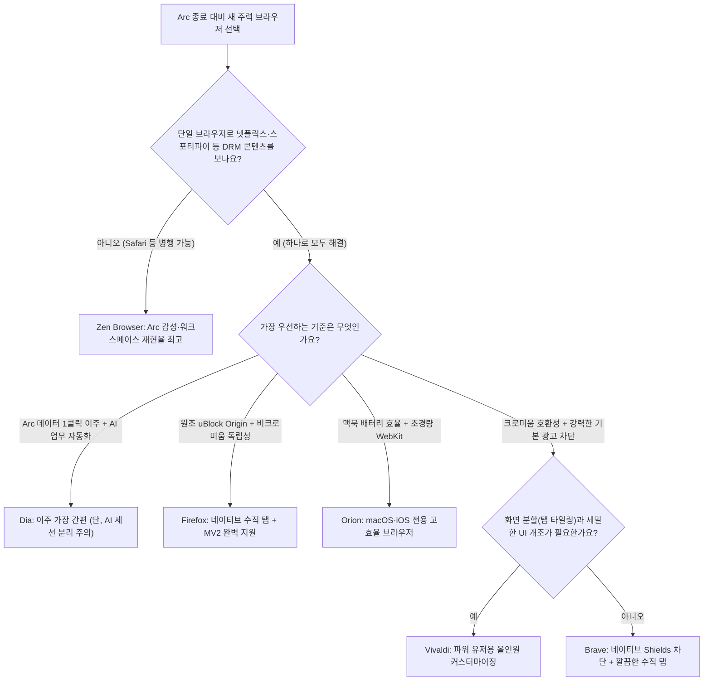

import Alert from '@/components/Alert.astro';
import Chart from '@/components/Chart.astro';

"보안 패치는 계속 해준다더니, 이제는 아예 앱이 안 열린다고요?" 지난 10월 22일 **Arc 브라우저 서비스 종료** 공지가 올라왔을 때 맥 사용자 커뮤니티와 개발자 슬랙 채널에서 가장 먼저 터져 나온 탄식입니다. 오는 12월 22일부터는 macOS와 Windows용 데스크톱 Arc 실행 자체가 완전히 차단되고, 계정에 묶인 서버 데이터도 30일 안에 영구 삭제돼요.

단순히 좋아하던 생산성 앱 하나가 문을 닫는 사건으로만 보기엔 올해 웹 생태계의 판도 변화가 꽤 거셉니다. AI 에이전트 브라우저들의 난립과 보안 역설, Chrome의 Manifest V2 확장 프로그램 완전 퇴출까지 겹치면서 주력 브라우저를 다시 골라야 하는 시점이 왔거든요. 이삿짐을 싸기 전에 반드시 챙겨야 할 Arc 종료 데드라인과 백업 방법, 그리고 **2026 브라우저** 시장의 네 가지 흐름 속에서 고른 현실적인 정착지 후보들을 실무 기준으로 비교해 봤습니다.

## Arc 브라우저 서비스 종료 타임라인: 유지보수 모드에서 완전 셧다운까지

불과 1년 반 전만 해도 Arc는 크롬의 대항마이자 맥 파워 유저들의 필수 앱처럼 불렸습니다. 어떻게 이렇게 빠르게 완전 종료 수순을 밟게 됐는지 흐름을 복기해 보면 현재 브라우저 시장의 냉혹한 현실이 그대로 읽혀요.

- **2025년 5월 — 유지보수 모드 선언과 Dia로의 피벗**: 개발사 The Browser Company의 CEO Josh Miller는 "Arc는 파워 유저들에게 큰 사랑을 받았지만, 대중이 쓰기에는 배워야 할 새로운 개념이 너무 많았다"고 자평하며 신기능 개발 중단을 선언했습니다. 대신 차세대 AI 브라우저인 **Dia**에 집중하겠다고 발표했죠. 당시 안내만 보면 보안 패치는 계속 제공되니 기존 Arc 유저들은 쓰던 대로 남을 수 있을 것처럼 보였습니다.
- **2025년 9월 4일 — Atlassian의 6억 1,000만 달러 전격 인수**: 엔터프라이즈 협업 소프트웨어 공룡 **Atlassian**(아틀라시안)이 The Browser Company를 전액 현금 **6억 1,000만 달러**(약 8,300억 원)에 인수한다고 발표했습니다. 브라우저를 단순한 웹 탐색기가 아니라 Jira, Confluence, Slack 등 기업용 SaaS 업무 전반을 제어하는 'AI 컨트롤 플레인'으로 삼겠다는 명확한 전략적 인수였습니다.
- **2026년 10월 22일 — Arc 공식 서비스 종료 발표**: 결국 약 1년 만에 "AI 시대에 브라우저 보안을 유지하는 엔지니어링 비용이 감당하기 어렵다"는 이유로 **공식 서비스 종료**(Sunset)가 확정됐습니다. 두 개의 브라우저 엔진과 보안 파이프라인을 동시에 유지하는 대신 모든 인력과 보안 리소스를 **Dia** 한 곳에 올인하겠다는 결정이었죠. 발표 당일 신규 계정 가입이 즉시 막혔고 설정에 데이터 내보내기(`Export Data`) 메뉴가 추가됐습니다.

### 놓치면 복구 못 하는 2단계 종료 데드라인

종료 절차는 모바일과 데스크톱 순으로 한 달 간격을 두고 진행됩니다. 오늘(11월 13일) 기준으로 첫 번째 관문까지는 딱 열흘 남았어요.

1. **열흘 뒤인 11월 23일**: 모바일 앱인 **Arc Search**(iOS·Android)의 핵심 AI 요약 기능('Browse for Me')과 계정 로그인, 기기 간 탭 동기화가 전면 중단됩니다.
2. **오는 12월 22일**: **macOS 및 Windows용 데스크톱 Arc 브라우저 작동이 완전히 멈춥니다.** 로그인 서버 차단과 백엔드 인프라 종료가 동시에 이루어지기 때문에 데스크톱 앱을 더블클릭해도 아예 열리지 않아요. 모든 Arc 계정은 일괄 비활성화되며 **30일 이내에 서버에 저장된 개인 데이터가 영구 삭제**됩니다. 같은 날 Android용 Arc Search는 Google Play 스토어에서 내려가고, iOS용 Arc Search만 동기화 기능이 빠진 로컬 기본 브라우저 형태로 잔류합니다.

<Alert type="danger" title="유지보수 모드가 아닙니다 — 12월 22일부터 데스크톱 앱 실행 불가">
아직도 일부 커뮤니티에서 "업데이트만 안 나올 뿐 로컬에 깔린 앱은 계속 쓸 수 있다"고 잘못 알고 계신 분들이 많습니다. 데스크톱 Arc는 실행 시 계정 세션과 백엔드 검증을 거치는 구조라 **오는 12월 22일 이후에는 앱 자체가 열리지 않는 완전 종료**입니다. 그 전에 반드시 스페이스와 고정 탭 데이터를 빼두셔야 해요.
</Alert>

## 숫자와 사건으로 보는 2026 브라우저 시장 4대 트렌드

Arc를 떠나 새 정착지를 고르려면 지금 브라우저 생태계가 어디로 굴러가고 있는지부터 읽어둘 필요가 있습니다. 지난 2년간 수백억 달러 규모의 AI 투자금이 브라우저 시장에 쏟아졌지만, 실제 점유율 성적표는 의외로 냉정하거든요. 지난 10월 집계된 StatCounter 글로벌 데스크톱 점유율 데이터를 먼저 보시죠.

<Chart
  type="bar"
  height={320}
  caption="2026년 10월 글로벌 데스크톱 브라우저 점유율 (%) — 출처: StatCounter GlobalStats"
  data={{
    labels: [
      'Google Chrome',
      'Microsoft Edge',
      'Apple Safari',
      'Mozilla Firefox',
      'Opera',
      '기타 (Brave·Zen·Arc 등)',
    ],
    datasets: [
      {
        label: '데스크톱 점유율 (%)',
        data: [66.98, 13.24, 7.83, 5.72, 2.65, 3.58],
        backgroundColor: [
          '#3b82f6',
          '#0ea5e9',
          '#06b6d4',
          '#f97316',
          '#ef4444',
          '#8b5cf6',
        ],
        borderRadius: 6,
      },
    ],
  }}
/>

수많은 신생 AI 브라우저의 공세에도 **Google Chrome**은 `66.98%`라는 압도적인 수치로 시장의 3분의 2를 틀어쥐고 있습니다. 미 법무부(DOJ)가 제기한 반독점 소송에서도 작년 9월 미 연방지법(Amit Mehta 판사)이 "생성형 AI의 부상이 검색 시장 구도를 흔들고 있다"는 이유로 법무부의 Chrome 강제 매각 요구를 기각하고 데이터 공유 같은 행태적 시정명령만 내렸죠(현재 법무부 항소가 진행 중입니다).

하지만 이 견고한 점유율 표면 아래에서는 개발자와 파워 유저들의 실사용 환경을 완전히 바꿔놓은 네 가지 굵직한 흐름이 동시에 진행됐습니다.

### 1. AI 에이전틱 브라우저 대전과 간접 프롬프트 인젝션의 역설

올해 브라우저 업계의 최대 화두는 단연 "사용자를 대신해 클릭하고 입력하는 에이전틱(Agentic) 브라우저"였습니다. 주요 플레이어들의 행보도 뚜렷하게 갈렸어요.

- **Dia**(Atlassian): Arc의 유산인 수직 탭과 고정 탭, 스페이스(프로필 단위로 개편) 감성을 일부 흡수하면서 엔터프라이즈 SaaS 워크플로 자동화에 초점을 맞췄습니다. Arc 계정을 그대로 불러오는 원클릭 이주를 무기로 기존 유저 흡수를 시도하고 있죠.
- **ChatGPT Atlas**(OpenAI, 2025년 10월 출시): 독자 UI 레이어(OWL)와 Chromium 렌더러를 분리한 아키텍처를 채택했고, 복잡한 폼 입력부터 결제까지 대행하는 'Agent Mode'를 전면에 내세웠습니다.
- **Comet**(Perplexity, 2025년 7월 출시): 수십 개의 열린 탭 맥락을 동시에 교차 분석해 리서치 결과를 뽑아주는 조사 특화 브라우저로 자리 잡았습니다.
- **Project Mariner의 후퇴**(Google): 화면 캡처 기반 자율 브라우징 에이전트를 야심 차게 실험했지만, 감당하기 벅찬 추론 비용과 보안 문제에 부딪혀 올해 5월 단독 실험을 접고 Chrome 내장 Gemini 기능으로 조용히 흡수했습니다.

문제는 편리함의 대가로 치러야 하는 **보안 리스크**입니다. Brave 보안팀과 보안 연구자 Simon Willison이 거듭 경고했듯, 에이전틱 브라우저가 웹페이지의 DOM과 텍스트를 직접 읽고 **사용자가 로그인해 둔 세션 권한**으로 행동하면서 **간접 프롬프트 인젝션**(Indirect Prompt Injection) 취약점이 최대 뇌관으로 떠올랐습니다.

원리는 생각보다 단순하고 치명적입니다. 공격자가 평범해 보이는 기술 블로그나 댓글 창 구석에 사람 눈에는 안 보이는 흰색 글씨로 악성 지시문을 심어둡니다. 사용자가 AI 브라우저에게 "이 페이지 요약해 줘"라고 시키는 순간, 브라우저 에이전트가 숨겨진 지시문을 명령으로 오인해 옆 탭에 로그인된 사내 메일함이나 SaaS 데이터를 읽어 외부 서버로 전송해 버릴 수 있는 구조죠.

<Alert type="warning" title="실무 보안 정석: 인증 세션 브라우저와 AI 브라우저를 분리하세요">
간접 프롬프트 인젝션은 모델 가드레일만으로 100% 막기 어렵습니다. 금융 거래, 사내 어드민, AWS·GCP 콘솔처럼 민감한 세션이 로그인된 **메인 업무용 브라우저**와 외부 문서 요약·자동화 실험에 쓰는 **AI 브라우저**를 물리적으로 분리해 운영하는 것이 2026년 개발자들의 실무 표준으로 자리 잡았습니다.
</Alert>

### 2. Chrome Manifest V3 강행·MV2 완전 퇴출과 광고 차단 유목민의 이동

AI 못지않게 기술 직군의 브라우저 이탈을 부추긴 사건은 Google의 확장 프로그램 정책 강행이었습니다. 단계적 비활성화를 거친 끝에 **지난 8월 31일 Chrome 웹 스토어에서 모든 Manifest V2 확장 프로그램이 완전히 퇴출**됐거든요.

이로써 네트워크 요청을 실시간으로 가로채 정밀하게 필터링하던 `webRequestBlocking` 기반의 원조 **uBlock Origin**이 Chrome에서 완전히 막혔고, 규칙 수와 동적 필터링에 제약이 있는 `uBlock Origin Lite`로 대체됐습니다. 무거운 웹 광고와 트래커를 깐깐하게 제어하던 파워 유저들 입장에서는 역체감이 상당했죠.

이 조치의 반사이익은 정확히 두 브라우저가 흡수했습니다.

- **Mozilla Firefox**: MV2와 `webRequestBlocking` 지원을 계속 유지하겠다고 못 박은 데 이어, 작년 3월(Firefox 136)부터 **네이티브 수직 탭과 탭 그룹**을 기본 탑재하며 UI 노후화 불만까지 씻어냈습니다. 덕분에 글로벌 점유율 `5.72%`를 단단히 방어하며 의미 있는 반등을 이뤄냈어요.
- **Brave**: 확장 프로그램 API 제약과 무관하게 브라우저 엔진 내부에 C++로 구현된 네이티브 광고 차단 엔진(Shields)을 내장하고 있어, 크로미움 호환성을 포기하지 못하면서도 강력한 차단을 원하는 개발자 유입이 크게 늘었습니다.

### 3. 포스트 Arc 난민들의 현실적인 정착지 비교

그렇다면 당장 오는 12월 22일 전에 어디로 이삿짐을 옮겨야 할까요? 현재 포스트 Arc 대안으로 가장 많이 거론되는 후보들의 장단점은 명확합니다.

가장 뜨거운 관심을 받는 1순위 후보는 Firefox 기반 오픈소스 프로젝트인 **Zen Browser**입니다. 세련된 수직 탭, 워크스페이스 전환, 깔끔한 여백과 커뮤니티 Mods 생태계까지 갖춰 "써보니 Arc 감성에 가장 가깝다"는 호평을 받고 있죠. **하지만 반드시 알고 넘어가야 할 치명적인 단점이 하나 있습니다.** Google의 **Widevine DRM 상용 라이선스를 취득하지 못해 넷플릭스, 디즈니+, 스포티파이 웹 플레이어 재생이 아예 불가능해요.** 브라우저 설정에 DRM 재생 체크박스가 있긴 하지만 상용 서버 서명 단계에서 거부되기 때문에, Zen을 주력으로 쓰려면 영상·음악 스트리밍용 보조 브라우저(Safari 등)를 필수로 병행해야 합니다.

반면 이주 편의성만 놓고 보면 Atlassian의 **Dia**가 가장 매끄럽습니다. Arc 계정 데이터를 원클릭으로 가져올 수 있으니까요. 다만 개인용 감성 브라우저였던 Arc와 달리 B2B 업무용 AI 도구 색채가 짙어졌고, "특정 기업의 사업 방향 전환 한 번에 또 주력 도구를 잃을 수 있다"는 벤더 종속 피로감이 적지 않습니다.

맥북 배터리 효율과 확장성을 동시에 챙기고 싶다면 검색엔진 기업 Kagi가 만드는 WebKit 기반 **Orion**도 매력적인 선택지입니다. Safari처럼 가볍고 전력을 적게 먹으면서 Chrome과 Firefox 확장 프로그램을 동시에 지원하거든요. 단, Kagi가 지난 10월 개발 리소스 집중을 이유로 Linux·Windows 버전 개발을 중단(오픈소스 이관)하고 다시 **macOS·iOS 전용**으로 회귀했기 때문에 Windows나 Linux 데스크톱과 환경을 맞춰야 한다면 아쉽습니다.

| 브라우저 | 기반 엔진 | 네이티브 수직 탭 | OTT DRM (넷플릭스 등) | 원조 MV2 차단기 | 핵심 특징 및 실사용 한계 |
| :--- | :---: | :---: | :---: | :---: | :--- |
| **Zen Browser** | Gecko (Firefox) | 기본 지원 | **재생 불가** | 지원 | Arc UI·워크스페이스 감성 재현율 1위, 스트리밍용 보조 브라우저 필수 |
| **Dia** | Chromium | 지원 (개편) | 정상 지원 | 미지원 (MV3) | Arc 원클릭 이주 및 SaaS AI 자동화 강점, B2B 색채·벤더 종속 우려 |
| **Orion** | WebKit | 기본 지원 | 정상 지원 | 부분 호환 | Safari급 배터리 효율 + Chrome/FF 확장 지원, **macOS·iOS 전용** |
| **Firefox** | Gecko | 기본 지원 | 정상 지원 | **완벽 지원** | 원조 uBlock Origin + 공식 수직 탭 조합, 장기 생존성 검증 완료 |
| **Brave** | Chromium | 기본 지원 | 정상 지원 | 내장 엔진 대체 | C++ 네이티브 Shields 차단, 크로미움 확장 생태계 100% 호환 |
| **Vivaldi** | Chromium | 기본 지원 | 정상 지원 | 내장 + MV3 | 탭 타일링·단축키·레이아웃 등 극한의 커스터마이징 지원 |

내 작업 패턴에 딱 맞는 정착지가 아직 헷갈린다면 아래 의사결정 흐름도를 따라가 보세요. 10초면 주력 후보를 좁힐 수 있습니다.



### 4. 탈 Chromium의 작은 불씨, 독립 엔진 Ladybird

거대 자본의 AI 브라우저 각축전 한편에서는 웹 엔진 독점을 깨려는 의미 있는 도전도 영글고 있습니다. Andreas Kling이 주도하는 완전 백지상태(from-scratch) 독립 웹 엔진 프로젝트 **Ladybird**가 올해 Linux와 macOS용 첫 알파 공개 막바지 단계에 접어들었거든요.

특히 올해 2월에는 기존 C++로 작성된 자체 JavaScript 엔진(LibJS)의 프런트엔드 파이프라인을 약 25,000줄의 Rust 코드로 성공적으로 포팅하며 메모리 안전성과 실행 엔진 완성도를 한 단계 끌어올렸습니다. 아직 일반 배포용 패키지와 웹 호환성을 다듬는 알파 단계라 당장 업무용 메인 브라우저로 쓰기엔 이르지만, 크로미움 일극 체제에 피로감을 느낀 개발자라면 2027～2028년 실사용을 기약하며 지켜볼 만한 반가운 불씨입니다.

## 오는 12월 22일 전 필수 체크: Arc 데이터 백업 및 설치 가이드

마음에 드는 차기 브라우저를 골랐다면, 서버가 내려가기 전에 Arc에 쌓인 자산부터 안전하게 빼내야 합니다. 백업은 공식 내보내기와 원본 파일 복사 두 가지를 모두 해두는 것을 강력히 권해요.

### 1단계: 공식 내보내기(Arc Data Export.md)와 StorableSidebar.json 원본 통백업

먼저 Arc 상단 메뉴바에서 `Arc` → `Settings` (`Cmd + ,`) → `Advanced` → `Export Data`를 차례로 실행해 스페이스와 탭 링크 목록이 정리된 `Arc Data Export.md` 파일을 내려받습니다(저장된 비밀번호는 함께 백업되지 않으니 주소창에 `arc://password-manager/settings`를 입력해 별도 CSV로 빼두세요).

문제는 공식 내보내기 결과물이 표준 북마크 HTML이 아니라 **단순 마크다운 텍스트**(`.md`) 파일이라 타 브라우저의 북마크 관리자에 바로 가져오기(Import)가 안 된다는 점입니다. Zen이나 Vivaldi, Firefox용 오픈소스 마이그레이션 스크립트들은 대부분 **스페이스별 Pinned 탭과 중첩 폴더 계층 구조**를 온전히 복원하기 위해 Arc가 로컬 디스크에 기록한 원본 사이드바 JSON 파일을 직접 파싱해요. 터미널을 열고 아래 명령어로 `StorableSidebar.json` 원본을 바탕화면이나 개인 클라우드에 하나 더 복사해 두세요.

```bash
cp ~/Library/Application\ Support/Arc/StorableSidebar.json ~/Desktop/arc-sidebar-backup.json
```

이 파일 하나만 안전하게 챙겨두면 오는 12월 22일 이후 데스크톱 앱 실행이 막히더라도 스페이스 목록, 고정 탭 URL, 폴더 트리를 언제든 온전히 추출할 수 있습니다. Windows 환경이라면 `%LOCALAPPDATA%\Packages\TheBrowserCompany.Arc_*\LocalCache\Local\Arc\StorableSidebar.json` 경로에서 동일한 파일을 백업해 둘 수 있어요.

### 2단계: Homebrew Cask로 대안 브라우저 깔끔하게 설치하기

macOS를 쓰고 계신다면 각 브라우저 공식 홈페이지를 일일이 돌아다니며 `.dmg` 파일을 내려받을 필요 없이 Homebrew Cask로 설치와 추후 버전 관리를 한 줄로 끝낼 수 있습니다. 아직 새 맥에 Homebrew가 깔려 있지 않거나 Apple Silicon PATH 설정이 안 되어 있다면 [Homebrew 설치 가이드](/tools/install-homebrew-2026)를 먼저 참고해 초기 구성을 마친 뒤, 아래 명령어 중 마음에 드는 후보를 골라 실행해 보세요.

```bash
# Arc 감성에 가장 가까운 오픈소스 대안 (DRM 미지원 참고)
brew install --cask zen

# 초경량 WebKit 기반 + 크롬/파이어폭스 확장 지원 (macOS 전용)
brew install --cask orion

# 원조 uBlock Origin(MV2) + 공식 수직 탭 지원
brew install --cask firefox

# 크로미움 호환성 + 강력한 C++ 네이티브 광고 차단
brew install --cask brave-browser

# 탭 타일링과 극한의 UI 커스터마이징
brew install --cask vivaldi
```

브라우저 이사는 막상 날을 잡고 한 번에 끝내려 하면 확장 프로그램 로그인과 단축키 적응 때문에 꼭 미루게 됩니다. 일단 오늘 터미널에서 `StorableSidebar.json` 백업 명령어 한 줄만 먼저 실행해 두세요. 그리고 데드라인인 오는 12월 22일이 닥치기 전에 후보 브라우저 한두 개를 미리 깔아두고, 사내 어드민·금융 세션용 메인 브라우저와 AI 리서치용 보조 브라우저를 나누어 일주일만 가볍게 병행해 보시길 권합니다. 손에 익은 단축키 몇 개만 다시 맞춰두면 생각보다 훨씬 쾌적하게 Arc 이후의 작업 환경을 꾸릴 수 있을 겁니다.
