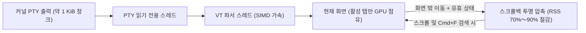

import Alert from '@/components/Alert.astro';
import Chart from '@/components/Chart.astro';

프로젝트마다 터미널 탭을 열댓 개씩 띄워둔 채 로그를 쌓아두다 보면 GPU 메모리가 수백 MiB씩 불어나고, 새 원격 서버에 SSH로 붙을 때마다 `xterm-ghostty: unknown terminal type` 에러로 백스페이스와 색상이 깨지던 경험, **Ghostty** 사용자라면 익숙하실 겁니다. 2026년 10월 27일 정식 출시된 **Ghostty 1.4**(1.4.0)는 1.3.0 이후 약 7개월간 172명의 기여자가 다듬은 2,889개 커밋으로 이 고질병들을 엔진 구조부터 뜯어고친 최신 정식 버전이에요.

바쁜 분들을 위해 체감 폭이 가장 큰 핵심 변경점부터 표로 정리했습니다.

| 영역 | Ghostty 1.4.0 핵심 변화 | 실무 체감 효과 |
| :--- | :--- | :--- |
| **메모리 · GPU** | 유휴 스크롤백 투명 압축(`scrollback-compression`), 숨김 탭 GPU 리소스 해제 | 텍스트 스크롤백 RSS **70%～90% 절감**, 숨김 20탭 GPU 메모리 **385 MiB → 18 MiB**(약 95% 감소) |
| **스크롤백 제어** | 기본 한도 10 MB → **50 MB** 상향, `scrollback-limit-lines` 신설 | 바이트(`scrollback-limit-bytes`)와 줄 수 기준을 병행해 대용량 로그 보존 |
| **I/O · 파서 엔진** | PTY 읽기 전용 스레드와 VT 파싱 스레드 분리 | M4 Max 기준 I/O 처리량 **25%～55% 향상**, ASCII **5.7배** · 한중일(CJK) **3.4배** 가속 |
| **원격 SSH · CLI** | 드롭인 래퍼 `ghostty +ssh`, 레퍼런스 조회 `ghostty +explain-config` | 원격 서버 `terminfo` 자동 설치(실패 시 폴백), 터미널 안에서 설정·액션 문서 즉시 검색 |
| **그래픽 · 보안** | Kitty Graphics Protocol **100% 구현**, 10건의 보안 취약점(GHSA) 패치 | `yazi` · `chafa` · `image.nvim` 애니메이션/상대 배치 완벽 호환, 붙여넣기 우회 차단 |
| **브레이킹 체인지** | macOS `copy-on-select` 기본값 `none` 변경, `cmd+arrow_up/down` 복원 | 드래그 자동 복사를 쓰려면 `copy-on-select = clipboard` 명시 필요 |

---

## 업그레이드 방법과 먼저 손봐야 할 브레이킹 체인지

macOS에서는 Homebrew Cask 명령 한 줄로 1.4.0 정식 버전을 올릴 수 있습니다. 패키지 매니저가 아직 없다면 [Homebrew 설치 가이드](/tools/install-homebrew-2026)를 먼저 참고하세요.

```bash
brew upgrade --cask ghostty
```

버전을 올린 직후 1.3.x 시절 손버릇 때문에 가장 먼저 당황하기 쉬운 변경점이 두 가지 있습니다.

### 1. 드래그 선택 자동 복사 해제: `copy-on-select` 개편

1.3까지는 macOS에서 마우스로 텍스트를 드래그하면 즉시 복사되는 `true`가 기본이었지만, 로그를 잠깐 긁어 읽다가 클립보드에 담아둔 코드나 비밀번호를 덮어쓰는 사고가 잦았습니다. 1.4.0부터는 `copy-on-select` 허용 값이 `none` | `primary` | `clipboard` | `both`로 세분화되면서 **macOS 기본값이 `none`으로 변경**되었고, 마우스 가운데 클릭 동작도 `middle-click-action`(`primary-paste` | `clipboard-paste` | `ignore`)으로 분리되었어요. 드래그 즉시 시스템 클립보드 복사를 유지하려면 `copy-on-select = clipboard`를 직접 지정해야 합니다.

### 2. `Cmd + ↑/↓` 프롬프트 이동 복원

1.3에서 화면 최상단·최하단 스크롤(`scroll_to_top` / `scroll_to_bottom`)로 바뀌었던 `cmd+arrow_up` / `cmd+arrow_down`이 macOS 기본 터미널 및 1.2 시절과 같은 **프롬프트 간 이동**(`jump_to_prompt`)으로 돌아왔습니다. 이전 명령 실행 지점으로 단번에 거슬러 올라갈 때 훨씬 직관적이죠.

<Alert type="warning" title="macOS에서 ~/.config/ghostty/config 수정이 먹통일 때">
Ghostty는 `~/.config/ghostty/config`(또는 `config.ghostty`)를 먼저 읽고, `~/Library/Application Support/com.mitchellh.ghostty/config`가 있으면 **나중에 읽어 덮어씁니다**. [Mac dotfiles 관리 가이드](/tools/mac-dotfiles-guide)처럼 `~/.config/ghostty/config`를 버전 관리하는데 설정이 안 먹는다면 `Application Support` 쪽 잔여 파일을 확인해보세요.
</Alert>

---

## 메모리 대수술: 스크롤백 투명 압축과 숨김 탭 GPU 95% 절감

로컬 서버와 컨테이너 로그를 종일 띄워두는 환경에서 이번 업데이트의 핵심은 메모리 구조 개편입니다. macOS와 64비트 Linux에서 기본 켜지는 **유휴 스크롤백 투명 압축**(`scrollback-compression = true`)은 터미널이 유휴(idle) 상태일 때 화면 밖 스크롤백 페이지를 백그라운드에서 압축하고, 스크롤이나 검색(`Cmd+F` / `Ctrl+Shift+F`) 시 온디맨드로 즉시 해제합니다. 텍스트 위주 히스토리의 **물리 메모리**(RSS) **점유율이 70%～90% 절감**돼요.

압축 효율 덕분에 기본 스크롤백 한도는 10 MB(`10000000`)에서 **50 MB**(`50000000`)로 **5배 상향**되었습니다. 기존 `scrollback-limit`의 새 정식 명칭인 `scrollback-limit-bytes`(단위 접미사 없는 순수 정수, `unlimited` 허용)와 함께 줄 수 제한 옵션인 `scrollback-limit-lines`가 신설되었으며, 둘 다 적으면 먼저 도달하는 한도가 적용됩니다.

빈 터미널 초기 메모리도 macOS 기준 128 KiB에서 **16 KiB로 87.5% 감소**했고, 화면 초기화나 트리밍 시 해제 메모리를 OS에 즉시 반환합니다. 특히 비활성 **숨김 탭**이 GPU 리소스를 내려놓도록 바뀌어 **활성 탭 1개 + 숨김 탭 20개 구동 시 GPU 메모리가 385 MiB에서 18 MiB로 약 95% 급감**했어요. 탭 전환 시 복구 시간은 **1ms 미만**입니다.

<Chart
  type="bar"
  height={260}
  caption="활성 탭 1개 + 숨김 탭 20개 구동 시 GPU 메모리 점유량 비교 (단위: MiB, 낮을수록 우수)"
  data={{
    labels: ['Ghostty 1.3', 'Ghostty 1.4.0'],
    datasets: [
      {
        label: 'GPU 메모리 점유량 (MiB)',
        data: [385, 18],
        backgroundColor: ['rgba(148, 163, 184, 0.65)', 'rgba(37, 99, 235, 0.85)'],
        borderRadius: 6,
      },
    ],
  }}
/>

### PTY 읽기 스레드 분리와 파서 벤치마크

macOS 커널의 PTY 읽기 청크 제한(약 1 KiB)으로 인한 순차 처리 병목을 깨기 위해, 1.4.0은 **PTY 읽기 전용 스레드와 VT 파싱 스레드를 분리**했습니다. 데이터 유입부터 유휴 압축까지의 파이프라인은 다음과 같습니다.



스레드 분리와 파서 최적화로 주요 처리 지표가 일제히 뛰었습니다.

| 벤치마크 항목 | Ghostty 1.3 대비 1.4.0 변화 |
| :--- | :--- |
| **종단 간 I/O 처리량** (Apple M4 Max) | **25%～55% 향상** |
| **순수 ASCII 파싱 속도** | 128 MB/s → **725 MB/s** (약 **5.7배**) |
| **한중일**(CJK) **텍스트 처리** | **3.4배** 가속 (한글 대량 로그 출력 시 체감 큼) |
| **macOS 150 MB 텍스트 `cat` 출력** | 1,500ms(1.5초) → **566ms** |
| **10,000줄 스크롤백 창(`120x80`) 리사이징** | 약 **6배** 가속 |
| **OSC 52 클립보드 파싱 / `asciinema` 재생** | 각각 약 **30배** / **25%** 가속 |

---

## `xterm-ghostty` 에러를 끝내는 `ghostty +ssh`와 `+explain-config`

신규 클라우드 서버에 처음 SSH로 붙을 때마다 `xterm-ghostty` terminfo가 없어 `vim`이나 백스페이스가 깨지던 문제는 네이티브 래퍼 `ghostty +ssh`가 해결합니다.

```bash
# 원격 서버 terminfo 자동 설치 + 환경변수 전달
ghostty +ssh -- user@example.com

# 원격 캐시 관리 및 30일 지난 항목 정리
ghostty +ssh-cache user@example.com:2222
ghostty +ssh-cache --prune=30d
```

기본 활성화된 `--terminfo`가 최초 접속 시 `tic`으로 `xterm-ghostty`를 자동 설치하고, 권한 문제 등으로 실패하면 안전하게 `TERM=xterm-256color`로 폴백합니다. `--forward-env`는 원격 `sshd`의 `AcceptEnv`가 허용할 때 `COLORTERM`, `TERM_PROGRAM`, `TERM_PROGRAM_VERSION`을 전달하되 기존 `~/.ssh/config`의 `SetEnv`를 덮어쓰지 않도록 다듬어졌어요. 매번 `+ssh`를 입력하기 번거롭다면 `config`에 `shell-integration-features = ssh-env,ssh-terminfo`를 켜두거나 셸에 `alias ssh="ghostty +ssh --"`를 등록해 평소처럼 `ssh`만 치고도 동일한 효과를 얻을 수 있습니다.

<Alert type="tip" title="ghostty +ssh-cache 인자 체계 변경 주의">
`ghostty +ssh-cache`는 위치 인자(`user@example.com:2222`)와 기간 단위 정리(`--prune=30d`, 단위 `s` · `m` · `h` · `d` · `w`)를 쓰도록 개편되었으니 기존 자동화 스크립트가 있다면 인자를 점검하세요.
</Alert>

함께 추가된 `ghostty +explain-config`를 쓰면 브라우저를 열지 않고도 설정 옵션과 키바인드 액션의 공식 문서를 터미널에서 바로 조회할 수 있습니다(대화형 실행 시 페이저 자동 연결, `--no-pager` 지원).

```bash
ghostty +explain-config scrollback-limit-lines
ghostty +explain-config --keybind=move_tab_to_new_window
ghostty +explain-config --no-pager copy-on-select
```

---

## Kitty 그래픽 100% 구현, 보안 패치, 플랫폼별 개선

Ghostty 1.4.0은 Kitty 외 터미널 최초로 **Kitty Graphics Protocol 사양을 100% 구현**했습니다. 프레임 애니메이션 재생·합성·제어와 부모-자식 이미지를 연동하는 `Relative Placements`를 완벽 지원하고, SIMD 벌크 파싱으로 대용량 이미지 파싱 속도를 **약 16배** 끌어올려 `yazi`, `chafa`, Neovim `image.nvim` 호환성을 완성했어요.

클립보드 쪽은 **Kitty Clipboard Protocol**(OSC 5522) 지원, 클립보드 읽기 권한 팝업 내 **텍스트·이미지 미리보기**, 단일 쓰기 상한 `clipboard-write-limit-bytes`(기본 64 MiB = `67108864`)가 추가되었습니다. 동시에 붙여넣기 보호 `\r` 우회(`GHSA-4hwh-wx3w-3fqg`), 악성 Kitty 그래픽 시퀀스 경로 이탈·크래시, 특수 디렉터리 `cd` 시 셸 통합 이스케이프 주입, 스크롤백 메모리 오염 등 **총 10건의 보안 취약점**(GHSA)도 이번 버전에서 모두 해결했어요.

참고로 보안 패치 내역에 저수준 tmux 제어 모드 파서의 악성 출력 크래시 수정이 들어 있지만, UI 차원의 `tmux -CC` 네이티브 탭 통합은 여전히 미지원입니다. 실전에서는 표준 `tmux` 세션을 물려 쓰는 구성이 가장 안정적이며, 세부 세팅은 [Ghostty + tmux + Karabiner 터미널 환경 구축](/tools/macos-terminal-ghostty-tmux-karabiner) 글을 참고하세요.

### macOS & Linux(GTK) 주요 변경점

- **macOS**: macOS 13 Ventura를 유지하면서 **macOS 27** 공식 호환을 마쳤습니다. 현재 탭을 새 창으로 떼어내는 `move_tab_to_new_window` 액션, 분할 패인 상단 드래그 핸들 표시 제어 `drag-handle`(`auto` | `always` | `never`), 테마 경로 `~` 확장이 들어갔고, 신규 번들 테마 **356종**이 더해져 [tmux 테마 추천 TOP 5](/tools/tmux-theme-top5)의 상태바 팔레트와 색감을 맞추기 한결 수월해요.
- **Linux / FreeBSD**(GTK): `GtkGLArea`를 걷어내고 전용 스레드 기반 **EGL + DMABUF OpenGL 렌더러와 트리플 버퍼링**을 도입했습니다. **125% · 150% 분수 배율**(Fractional Scaling)에서 폰트와 박스 문자가 번지던 블러 현상을 뿌리 뽑았고, 분할 패인 드래그 앤 드롭 재배치도 GTK에서 그대로 쓸 수 있습니다.

<Alert type="info" title="Ubuntu 24.04 LTS 패키지 설치 주의">
최소 요구 사양이 `GTK 4.18+` / `libadwaita 1.7+`로 상향되어 **Ubuntu 24.04 LTS** 기본 저장소 환경에서는 실행되지 않습니다. 최신 런타임이 포함된 **Flatpak**이나 **Snap** 컨테이너 패키지를 이용하세요.
</Alert>

---

## 바로 복사해 쓰는 Ghostty 1.4 실전 추천 `config`

위에서 짚은 1.4.0 신규 옵션과 브레이킹 체인지 대응 설정을 묶은 `~/.config/ghostty/config` 스니펫입니다. 필요한 줄만 골라 반영한 뒤 `Cmd + Shift + ,`로 리로드해보세요.

```ini
# ~/.config/ghostty/config (Ghostty 1.4.0 기준)

# 1. 스크롤백 투명 압축 및 한도 (바이트·줄 수 중 먼저 도달하는 한도 적용)
scrollback-compression = true
scrollback-limit-bytes = 50000000
scrollback-limit-lines = 100000

# 2. 1.4 브레이킹 체인지 대응: 드래그 선택 시 클립보드 복사 복원
# 덮어쓰기 실수를 막고 싶다면 기본값(none) 유지
copy-on-select = clipboard
middle-click-action = clipboard-paste

# 3. 원격 SSH 접속 시 terminfo 자동 설치 & 환경변수 전달 통합
shell-integration-features = ssh-env,ssh-terminfo

# 4. 클립보드 단일 쓰기 상한 (기본값 64 MiB)
clipboard-write-limit-bytes = 67108864

# 5. 분할 패인 드래그 핸들 & 현재 탭을 새 창으로 분리하는 단축키
drag-handle = auto
keybind = cmd+ctrl+n=move_tab_to_new_window

# (선택) 1.3 시절처럼 Cmd+위/아래로 최상단·최하단 스크롤을 쓰려면 주석 해제
# 기본값은 프롬프트 간 이동(jump_to_prompt)
# keybind = cmd+arrow_up=scroll_to_top
# keybind = cmd+arrow_down=scroll_to_bottom
```

Ghostty 1.4.0은 화려한 겉치레 대신 숨김 탭 GPU 메모리 절감, 대용량 한글·영문 로그 파서 가속, `ghostty +ssh` 원격 접속 자동화처럼 매일 겪던 실무 마찰을 지우는 데 집중한 릴리스입니다. 업그레이드 직후 `copy-on-select` 동작 방식만 본인 작업 습관에 맞게 정리해 두면 한결 가벼워진 반응 속도를 바로 체감하실 수 있습니다.
