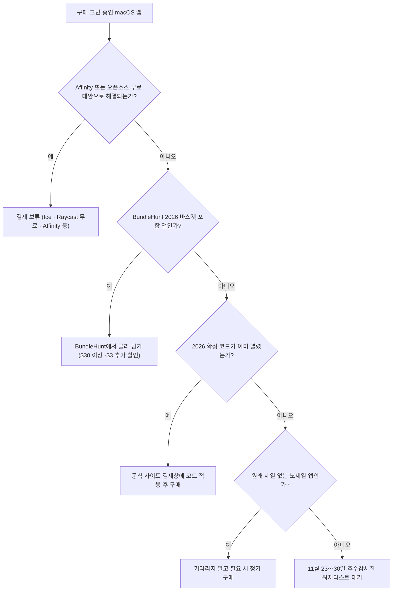

import Alert from '@/components/Alert.astro';
import Chart from '@/components/Chart.astro';
import AppCard from '@/components/AppCard.astro';
import GitHubRepoCard from '@/components/GitHubRepoCard.astro';
import LinkPreviewCard from '@/components/LinkPreviewCard.astro';

해마다 11월 셋째 주면 작년 글을 날짜만 바꿔 복사한 페이지와 만료된 쿠폰이 검색 상단을 뒤덮습니다. 결제창에서 `INVALID CODE`를 몇 번 마주하고 나면 정작 필요한 맥 앱을 살 타이밍마저 놓치기 십상이죠. **2026년 11월 20일**(블프 D-7) 기준으로 공식 검증이 끝난 2026 블랙 프라이데이 맥 앱 할인을 지금 살 딜, 다음 주 대기 리스트, 헛기다림 금지 앱으로 갈라 정리했습니다.

<Alert type="info" title="2026년 11월 20일 기준 검증 안내">
2026년 추수감사절은 **11월 26일**, 블랙 프라이데이는 **11월 27일**, 사이버 먼데이는 **11월 30일**입니다. 모든 가격은 **USD**(미국 달러) 기준이며, 공식 코드가 열린 확정 딜과 역대 패턴 기반 대기 리스트를 구분해 표기했습니다. 결제 직전 최종 금액과 기기 수·업데이트 조건을 꼭 다시 확인하세요.
</Alert>

## 10초 요약: 지금 바로 결제할 2026 확정 딜

11월 20일 현재 바로 코드가 먹히거나 일정이 공식 확정된 대표 맥 앱 딜부터 한 표에 묶었습니다.

| 앱 · 번들 | 분류 | 정가 → 할인가 | 할인 코드 | 기간 | 라이선스 형태 |
| :--- | :--- | :--- | :--- | :--- | :--- |
| **Mountain Duck 5** | 클라우드 마운트 | `$49 → $14.99` | BundleHunt | 진행 중 | 영구 (BH) |
| **Commander One PRO** | 파일 매니저 | `$44.98 → $5.99` | BundleHunt | 진행 중 | 영구 (BH) |
| **TablePlus Basic** | DB 클라이언트 | `$99 → $74.25` | `BLACK_FRIDAY_2026` | 진행 중 | 영구+1년 업데이트 |
| **Proxyman Standard** | HTTP 프록시 | `$89 → $62.30` | `BF2026` | 11/16～12/3 | 영구+1년 업데이트 |
| **BoltAI 3 Pro** | AI 워크스페이스 | `$99 → $59.00` | `BFCM2026` | ～12/1 | 영구 (Pro) |
| **Wins Pro** | 윈도우 관리 | `$39.99 → $23.99` | `BF_26` | ～12/1 | 영구 3대·평생 업데이트 |
| **EagleFiler** | 문서 아카이빙 | `$69.99 → $52.49` | `BLACKFRIDAY2026` | 11/20～11/30 | 영구 |
| **Snippety** | 스니펫 관리 | `$49.99 → $29.99` | 자동 40%↓ | 진행 중 | macOS+iOS 영구 |
| **Craft Plus 연간** | 문서·노트 | `월 $8 → $4.80` | `BLACKFRIDAY26-A` | 11/16～12/9 | 연간(갱신 40% 고정) |
| **VoiceInk Solo** | 로컬 받아쓰기 | `$25 → $15.00` | `BFVI2640` | 11/11～12/5 | 영구 (GPL v3) |

할인 폭이 큰 영구 라이선스 8종의 정가 합계는 `$540.95`지만 이번 블프 확정가로 담으면 `$323.00`까지 내려갑니다. 총 `$217.95`, 평균 **약 40.3%** 정도를 아끼는 셈이에요.

<Chart
  type="bar"
  height={340}
  caption="2026 블랙 프라이데이 확정 영구 라이선스 8종 정가 vs 할인가 비교 (USD)"
  data={{
    labels: [
      'Mountain Duck 5 (BH)',
      'Commander One (BH)',
      'EagleFiler',
      'TablePlus Basic',
      'Proxyman Standard',
      'Wins Pro',
      'BoltAI 3 Pro',
      'Snippety',
    ],
    datasets: [
      {
        label: '정가 (USD)',
        data: [49, 44.98, 69.99, 99, 89, 39.99, 99, 49.99],
        backgroundColor: 'rgba(148, 163, 184, 0.55)',
        borderRadius: 4,
      },
      {
        label: '2026 블프 할인가 (USD)',
        data: [14.99, 5.99, 52.49, 74.25, 62.3, 23.99, 59, 29.99],
        backgroundColor: 'rgba(16, 185, 129, 0.85)',
        borderRadius: 4,
      },
    ],
  }}
/>

무턱대고 장바구니를 채우기 전에 무료 대안으로 해결되는 앱부터 아래 순서도로 걸러내 보세요.

## 번들 & 구독 플랫폼: BundleHunt vs Unclutter vs Setapp

### 1. BundleHunt Black Friday 2026 — 골라 담는 바스켓형 (진행 중)

BundleHunt는 전체 44개 라인업 중 필요한 앱만 1개부터 골라 담는 바스켓형(basket, not a box) 번들입니다. 장바구니가 `$30`을 넘으면 추가로 `$3`을 더 깎아주는 Savings Ladder가 붙으니, 살 앱이 여럿이라면 한 번에 묶어 결제하는 쪽이 유리해요.

<LinkPreviewCard
  url="https://bundlehunt.com"
  title="BundleHunt Black Friday 2026 Bundle"
  description="44개 macOS 앱 중 원하는 영구 라이선스만 골라 담는 바스켓형 블랙 프라이데이 번들"
  siteName="BundleHunt"
/>

올해 44개 중 체감 가성비 1순위는 공식 단독 세일이 거의 없는 **Mountain Duck 5**와 정가 대비 87% 내려간 **Commander One PRO**입니다.

<AppCard
  name="Mountain Duck 5"
  platform={["macOS", "Windows"]}
  category="클라우드 마운트"
  price="정가 $49 → $14.99 (69%↓ · BundleHunt)"
  href="https://mountainduck.io"
  brew="--cask mountain-duck"
  description="S3·WebDAV·SFTP·클라우드 드라이브를 Finder 로컬 디스크처럼 마운트합니다."
  comment="공식 단독 세일이 거의 없어 이번 BundleHunt 2026에서 실사용 가성비가 가장 뛰어납니다."
/>

<AppCard
  name="Commander One PRO"
  platform="macOS"
  category="듀얼 패널 파일 매니저"
  price="정가 $44.98 → $5.99 (87%↓ · BundleHunt)"
  href="https://mac.eltima.com/file-manager.html"
  brew="--cask commander-one"
  description="듀얼 패널 탐색과 원격 서버 연결, 압축 파일 내부 탐색을 지원하는 파일 매니저입니다."
  comment="정가 대비 87% 할인된 $5.99에 PRO 영구 라이선스를 챙길 수 있는 알짜 슬롯입니다."
/>

이 밖에 런처 **Monarch**(`$30 → $5.99`), 작업공간 복원 도구 **Spencer**(`$25 → $7.00`), AI 보조 툴 **Fluent 2 • The AI Multitool**(`$29 → $4.99`), **NotchNook Classic**(`$10 → $3.99`, Pro가 아닌 Classic 에디션 주의)도 쓸 만합니다. 반대로 **SwifDoo PDF**처럼 표시 정가 `$636`을 `$8.99`로 파는 액면 99% 과장 할인에는 현혹되지 마세요.

### 2. Unclutter Black Friday 2026 — 추수감사절 주간 오픈 대기

11월 20일 현재 Unclutter의 2026 번들 라인업은 아직 비공개로, 추수감사절 주간 런칭을 앞두고 있습니다. 역대 패턴상 인기 인디 맥 앱 **10～12종**을 큐레이션해 풀 번들은 **75～79%**, 단품은 **50%** 할인해 왔으므로 급하지 않다면 다음 주 라인업을 보고 결정해도 늦지 않아요.

<LinkPreviewCard
  url="https://unclutterapp.com/black-friday/"
  title="Unclutter Black Friday 2026"
  description="인기 인디 macOS 앱 영구 라이선스 큐레이션 번들 공식 대기 페이지"
  siteName="Unclutter"
/>

### 3. Setapp 요금 인상과 StackSocial 'Lifetime' 함정

2026년 Setapp 요금이 개편되면서 단일 Mac은 **월 $14.99**(기본 AI 크레딧 포함), Mac+iOS는 **월 $18.99**로 올랐습니다. 공개 블프 쿠폰이 드물어 **연간 결제 할인**이나 **학생·교직원 20% 교육 할인**(일부의 50% 오기 주의)이 현실적 대안이며, CleanShot X·Paste·TextSniper 같은 유료 앱을 **최소 3～4개 이상 매일** 돌리지 않는다면 블프 영구 구매가 훨씬 쌉니다.

<Alert type="warning" title="StackSocial 결제 전 반드시 확인할 2가지">
외부 딜 사이트인 StackSocial 특가를 고를 때는 아래 두 가지를 꼭 걸러내세요.

**1.** StackSocial의 **Setapp 상품은 영구권이 아닌 선불 1년 구독권**입니다.

**2.** 타 앱의 "Lifetime" 표기도 약관상 **제품 유지 기간**(lifetime of the product) 또는 현재 메이저 버전 한정인 경우가 많아 v3 업그레이드와 향후 macOS 호환 제외 여부를 반드시 체크해야 합니다.
</Alert>

## 분야별 2026 확정 개별 앱 알짜 딜

이미 코드가 열린 앱이 주축이며, 사전 일정이 공식·커뮤니티에 공개된 일부 앱(SQLPro Studio·Dropzone 5 Pro 등)은 오픈 일정을 함께 표기했습니다.

### 개발자 필수 도구 — Proxyman · TablePlus · DevUtils · SQLPro Studio

개발자 도구는 평소 세일이 드물어 블프 시즌이 사실상 최저가입니다. **Proxyman**은 **11월 16일～12월 3일** 코드 `BF2026`으로 전 플랜 **30% 할인** 중이에요. Standard 1대는 `$89 → $62.30`, Personal 2대는 `$99 → $69.30`이며 **영구 사용 + 1년 무료 업데이트** 조건입니다.

<AppCard
  name="Proxyman"
  platform="macOS"
  category="HTTP 디버깅 프록시"
  price="정가 $89 → $62.30 (30%↓ · BF2026)"
  href="https://proxyman.com"
  brew="--cask proxyman"
  description="네이티브 Swift UI로 빠릿하게 동작하는 HTTP/HTTPS 트래픽 캡처·API 디버깅 툴입니다."
  comment="Charles Proxy보다 가볍고 SSL 프록시 설정이 직관적입니다. 1년 후에도 해당 빌드는 계속 쓸 수 있습니다."
/>

**TablePlus**는 코드 `BLACK_FRIDAY_2026`으로 **25% 할인**이 붙어 Basic 1대 라이선스가 `$99 → $74.25`입니다. 역시 **영구 사용 + 1년 무료 업데이트** 구조라 1년 뒤 만료 없이 마지막 빌드를 계속 쓸 수 있으니 평생 업데이트와 혼동하지 마세요. 실무 세팅은 [TablePlus 완벽 가이드](/tools/tableplus-complete-guide), 무료 대안은 [MySQL 무료 DB 툴 추천(Sequel Ace & DBeaver)](/tools/macos-free-db-client)을 참고하세요.

<AppCard
  name="TablePlus"
  platform={["macOS", "Windows"]}
  category="DB 클라이언트"
  price="정가 $99 → $74.25 (25%↓ · BLACK_FRIDAY_2026)"
  href="https://tableplus.com"
  brew="--cask tableplus"
  description="MySQL·PostgreSQL·SQLite·Redis 등을 네이티브 속도로 다루는 멀티 DB 클라이언트입니다."
  comment="무료 버전의 탭 2개 제한을 넘기고 싶다면 사실상 연중 최대 폭인 25% 세일에 들일 만합니다."
/>

**DevUtils**는 **11월 2일～12월 30일** 코드 `BLACKFRIDAY2026`으로 오프라인 유틸 40여 종을 할인합니다(영구 정가 `$29`부터). 다만 출처마다 할인율 표기가 **50～60% 수준**으로 다르므로 체크아웃 화면에서 최종 할인가를 확인하고 결제하세요.

<AppCard
  name="DevUtils"
  platform="macOS"
  category="개발자 유틸리티"
  price="정가 $29부터 · 50～60%↓ (BLACKFRIDAY2026)"
  href="https://devutils.com"
  brew="--cask devutils"
  description="JSON·JWT·Base64·정규식 등 40가지 넘는 개발 도구를 오프라인 로컬에서 즉시 처리합니다."
  comment="민감한 사내 토큰이나 페이로드를 웹 도구에 붙여넣기 찝찝할 때 Raycast와 함께 손이 자주 갑니다."
/>

네이티브 SQL 작업에 특화된 **SQLPro Studio**는 **11월 25일～12월 1일 예정**입니다. 연간 첫해 50%(`BFHALFOFF`, `$69.99 → 약 $35.00`, 크로스플랫폼)와 영구 25%(`BFLIFETIME`, `$149.99 → 약 $112.49`) 중 고를 수 있으나, **영구 라이선스는 단일 플랫폼 한정**인 점을 확인하세요.

### 생산성 · 클립보드 · 창 관리 · 시스템 유틸리티

윈도우 관리 앱 **Wins**는 **～12월 1일** 코드 `BF_26`으로 **40% 할인**을 엽니다. Single 1대 `$19.99 → $11.99`, Pro 3대·평생 업데이트 `$39.99 → $23.99`, X 5대 `$49.99 → $29.99`예요. 무료 대안 비교는 [맥 윈도우 관리 앱 추천 2026](/tools/mac-window-manager-apps) 글을 먼저 보고 결정해도 좋습니다.

<AppCard
  name="Wins"
  platform="macOS"
  category="윈도우 관리"
  price="Single $11.99 · Pro $23.99 (40%↓ · BF_26)"
  href="https://wins.cool"
  brew="--cask wins"
  description="macOS Dock 창 미리보기와 윈도우 스냅, 흔들어 최소화 등 창 제어 기능을 통합했습니다."
  comment="창 분할에 Dock 호버 미리보기까지 원한다면 Pro 3대 평생 업데이트($23.99) 구성이 제일 알찹니다."
/>

클립보드 앱 3종은 과금 구조가 갈립니다(전체 비교는 [맥 클립보드 관리 앱 추천 2026](/tools/mac-clipboard-manager-apps) 참고). **CleanClip**은 **11월 4일～12월 15일** `BF2026`으로 30% 할인(Standard `$19.99 → $13.99`, Pro `$29.99 → $20.99`)하며, **Paste**는 **11월 20일～12월 1일** `BLACKFRIDAY2026` 연간 첫해 50%(`$29.99 → $14.99`, 구독형·Setapp 포함, 공식 랜딩 오픈 확인 권장)가 예고됐습니다. 영구 라이선스가 필요하다면 스탠드얼론 50% 할인(`INDIEGOODIESBF26`)이 걸린 **PastePal**이 가장 무난해요.

<AppCard
  name="PastePal"
  appStoreId="1503446680"
  platform={["macOS", "iOS"]}
  category="클립보드 관리"
  price="스탠드얼론 정가 $14.99 → 약 $7.50 (50%↓ · INDIEGOODIESBF26)"
  href="https://indiegoodies.com/pastepal"
  description="iCloud 동기화와 사이드바·컬렉션 정리를 지원하는 macOS·iOS 통합 클립보드 매니저입니다."
  comment="구독료 없이 맥과 아이폰·아이패드 클립보드를 하나로 묶으려 할 때 가장 현실적인 대안입니다."
/>

C-Command 3종(**EagleFiler · SpamSieve · DropDMG**)도 **11월 20일～11월 30일** 코드 `BLACKFRIDAY2026` 전 제품 **25% 할인**이 공식 확정됐습니다. 각각 `$69.99 → $52.49`, `$39.99 → $29.99`, `$24.99 → $18.74`입니다.

<AppCard
  name="EagleFiler"
  platform="macOS"
  category="문서·메일 아카이빙"
  price="정가 $69.99 → $52.49 (25%↓ · BLACKFRIDAY2026)"
  href="https://c-command.com/eaglefiler/"
  brew="--cask eaglefiler"
  description="PDF·웹페이지·이메일을 표준 macOS 폴더 구조 그대로 저장하고 검색하는 아카이빙 앱입니다."
  comment="독점 DB 대신 Finder 폴더 그대로 남아 백업 안정감이 높고 DEVONthink보다 가볍습니다."
/>

단품 가격이 작지만 손이 자주 가는 소형 영구 라이선스 7종도 아래 표로 모았습니다.

| 앱 이름 | 용도 | 정가 → 할인가 | 코드 · 기간 | 체크 포인트 |
| :--- | :--- | :--- | :--- | :--- |
| **OpenIn** | 링크·메일 분기 | `60%↓` | `BLACKFRIDAY26` (～12/1) | `loshadki.app` · 무료 대안 [Finicky](/tools/macos-finicky-web-browsers) |
| **TextSniper** | 화면 OCR 복사 | `$7.99 → $5.59` | `AD2026` (웹, ～2027/1) | `brew install --cask textsniper` · Setapp 포함 |
| **Snippety** | 스니펫·템플릿 | `$49.99 → $29.99` | 자동 40%↓ | macOS+iOS 유니버설 영구 |
| **Presentify** | 화면 주석·강조 | `$14.00 → $9.80` | `PRESENTIFY30` (11/18～12/7) | 웹 직구 vs App Store 정가 비교 필수 |
| **Dropzone 5 Pro** | 드래그 자동화 | `$35 → $21.00` | `BLACKFRIDAY26` (11/23～12/6 예정) | 파일 이동·업로드 단축 |
| **Picmal** | 미디어 일괄 변환 | `$29 → $14.50` | `BLACKFRIDAY` (50%↓) | 오프라인 포맷 변환 |
| **Recorder.app** | 로컬 오디오 녹음 | `$44.99 → $17.99` | 자동 60%↓ (11/20～12/1) | 시스템·마이크 동시 녹음 |

### AI 워크스페이스 · 노트 · 로컬 음성 받아쓰기

**BoltAI 3**는 **～12월 1일** 코드 `BFCM2026`으로 **40% 할인**을 열어 Pro `$99 → $59`, Lifetime `$399 → $239.40`에 판매합니다. 본인 API 키나 로컬 LLM을 연결하는 BYOK 방식이라 여러 AI 웹 구독을 줄이기 좋습니다.

<AppCard
  name="BoltAI 3"
  platform={["macOS", "iOS"]}
  category="AI 워크스페이스"
  price="Pro $99 → $59 (40%↓ · BFCM2026)"
  href="https://boltai.com"
  brew="--cask boltai"
  description="OpenAI·Anthropic·Gemini API와 로컬 Ollama를 네이티브 앱에서 다루는 BYOK 클라이언트입니다."
  comment="매달 여러 AI 구독을 중복 결제하는 대신 종량제 API로 비용을 통제하기에 딱 맞습니다."
/>

노트 앱 **Craft**는 **11월 16일～12월 9일** 연간 Plus·Family **40% 할인**(`BLACKFRIDAY26-A`, 월 환산 `$8.00 → $4.80`)을 진행합니다. 구독을 유지하는 동안 **갱신 시에도 40% 할인이 영구 고정**되며, App Store가 아닌 `craft.do/pricing` 웹 결제 전용으로만 적용됩니다.

<AppCard
  name="Craft"
  appStoreId="1487937127"
  platform={["macOS", "iOS"]}
  category="문서 · 노트"
  price="연간 Plus 월 $4.80 (40%↓ · BLACKFRIDAY26-A)"
  href="https://www.craft.do/pricing"
  brew="--cask craft"
  description="네이티브 속도와 깔끔한 웹 문서 공유를 강점으로 내세운 Apple 생태계 노트 앱입니다."
  comment="첫해만 싸고 끝나는 일반 구독과 달리 유지 시 40% 할인가가 계속 고정되는 게 핵심입니다."
/>

로컬 `whisper.cpp` 기반 음성 받아쓰기 앱 **VoiceInk**는 **11월 11일～12월 5일** 코드 `BFVI2640` 40% 할인으로 Solo 라이선스가 `$25 → $15`입니다. GPL v3 오픈소스라 직접 빌드도 가능해요.

<AppCard
  name="VoiceInk"
  platform="macOS"
  category="로컬 AI 받아쓰기"
  price="Solo $25 → $15 (40%↓ · BFVI2640)"
  href="https://github.com/Beingpax/VoiceInk"
  brew="--cask voiceink"
  description="로컬 whisper.cpp 엔진으로 외부 서버 전송 없이 빠른 음성 받아쓰기를 처리합니다."
  comment="월 구독형 받아쓰기 앱의 고정비와 클라우드 전송이 부담스럽다면 $15 일회성 결제로 해결됩니다."
/>

## 11월 23～30일 기다릴 앱 vs 헛기다림 금지 앱

### 추수감사절 주간 오픈 대기 워치리스트 (11/20 기준 미발표)

아래 앱들은 **11월 20일 현재 2026 코드가 미발표** 상태입니다. 다만 매년 추수감사절 주간에 딜을 열어온 이력이 뚜렷하니 11월 23～30일 오픈 여부를 지켜보고 결제하세요.

| 앱 이름 | 역대 블프 패턴 | 비고 및 무료·교육 대안 |
| :--- | :--- | :--- |
| **CleanShot X** | 통상 20～30%↓ | Setapp 포함 · 학생 30% 상시 · [맥 필수 앱 가이드](/tools/best-mac-apps-guide-2026) |
| **DEVONthink** | 추수감사절～화요일 25%↓ | 대용량 리서치·문서 DB |
| **Little Snitch** | 통상 30%↓ | macOS 아웃바운드 방화벽 |
| **BetterTouchTool** | 통상 25～33%↓ | 트랙패드·키보드 제스처 커스텀 |
| **Things 3** | 비정기 약 30%↓ | macOS·iPadOS·iOS 별도 구매 주의 |
| **Default Folder X** | 통상 25%↓ | 열기/저장 대화상자 확장 |
| **DaisyDisk** | 추수감사절 주간 할인 | 원형 디스크 용량 분석 |
| **CleanMyMac** | 통상 30～40%↓ | Setapp 구독 내 포함 |
| **AdGuard** | 추수감사절 평생·가족 특가 | 무료 대안은 [NextDNS 프로필 가이드](/tools/nextdns-profile-ad-block-apple) 참고 |
| **1Password** | 신규 연간·기프트카드 할인 | 기존 구독 연장 적용 여부 확인 |
| **Parallels Desktop** | 추수감사절 주간 프로모션 | 외부 `PD50` 등 미검증 주의 · `parallels.com` 직접 확인 필수 |

### 2026년 헛기다림 금지 — 이미 무료화됐거나 원래 세일 안 하는 앱

**Affinity**는 더 이상 블프를 기다릴 필요가 없습니다. Canva가 기존 Photo·Designer·Publisher를 단일 앱 **Affinity**(`affinity.studio`)로 통합하면서 개인 핵심 기능을 **영구 무료**($0)로 전환했거든요(클라우드 AI만 Canva Pro 연동).

**Pixelmator Pro** 역시 마찬가지입니다. Apple 인수 후 Mac 단품 영구(`$49.99`)를 유지하며 **Apple Creator Studio** 구독(`$12.99/월`, 교육 `$2.99/월`)에도 들어갔는데, Apple 공식 블프(11월 27～30일)는 하드웨어 구매 시 기프트카드만 증정할 뿐 소프트웨어 할인은 열지 않습니다.

원래부터 **노세일 정책**인 **Alfred**, **Keyboard Maestro**, **Scrivener**, **JetBrains**(연속 구독 Loyalty 최대 40%), **Bear**, **Ulysses**도 블프 쿠폰을 기대하기 어렵습니다. **Raycast Pro** 역시 연간·학생 50% 할인만 상시 운영하며 무료 플랜만으로도 기능이 충분하죠([Raycast 완벽 가이드](/tools/raycast-complete-guide-2026)). 결제 전 메뉴바 관리용 **Ice**, 링크 분기용 [Finicky](/tools/macos-finicky-web-browsers), Raycast 무료 창·클립보드 기능부터 먼저 챙겨보세요.

<GitHubRepoCard
  repo="jordanbaird/Ice"
  comment="유료 메뉴바 관리 앱을 대체하는 Swift 네이티브 무료 오픈소스 유틸리티."
/>

## 실시간 딜 추적 허브와 결제 전 마지막 체크

추수감사절 주간에 추가되는 깜짝 딜은 아래 5개 실시간 허브를 북마크해 두면 가장 빨리 찾을 수 있습니다.

<GitHubRepoCard
  repo="trungdq88/Awesome-Black-Friday-Cyber-Monday"
  comment="Developer macOS Apps·Productivity 전용 섹션이 잘 정리된 대표 개발자 블프 리스트."
/>

<GitHubRepoCard
  repo="mRs-/Black-Friday-Deals"
  comment="macOS·iOS 인디 앱 특화 최장수 커뮤니티 저장소."
/>

<GitHubRepoCard
  repo="s1ntoneli/Awesome-Black-Friday-Cyber-Monday-for-Mac-Apps"
  comment="맥 앱 전용으로 할인율·쿠폰·기간을 깔끔하게 분류한 큐레이션 리스트."
/>

<LinkPreviewCard
  url="https://www.indieappsales.com"
  title="Indie App Sales — Black Friday ’26 Edition"
  description="11월 27일부터 30일까지 본행사가 열리는 인디 Apple 앱 공식 할인 이벤트"
  siteName="Indie App Sales"
/>

<LinkPreviewCard
  url="https://www.apps.deals"
  title="Apps.Deals — macOS Black Friday Deals"
  description="일회성 구매와 구독 필터, 검증된 쿠폰 코드를 제공하는 맥 앱 전용 딜 디렉터리"
  siteName="Apps.Deals"
/>

결제 직전에는 **동명 앱·에디션 혼동**만 꼭 걸러내세요. 노치 앱 `Alcove` 대신 전혀 다른 `Alcove Tasks & Notes`를 결제하거나 `NotchNook Classic`을 Pro로 오인하기 쉽습니다. `Fluent 2`의 BundleHunt vs 직구 에디션 차이, `Presentify` 웹 할인(`PRESENTIFY30`)과 App Store 가격 차이도 체크아웃 전 직접 대조하는 편이 안전합니다.

할인 시즌에 앱을 여럿 들였다면 `.dmg`를 일일이 받기보다 Homebrew Cask로 설치해 `Brewfile`에 묶어두세요. 초기 세팅은 [Homebrew 설치 가이드](/tools/install-homebrew-2026)를, `Brewfile`로 새 맥에서도 10분 만에 복원하는 방법은 [dotfiles 완전 정복](/tools/mac-dotfiles-guide) 글을 참고하면 깔끔하게 이어집니다.
