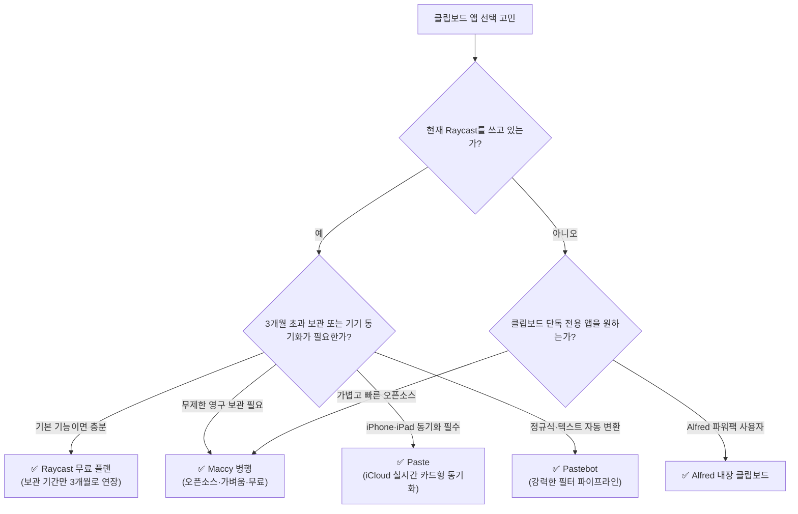

import Alert from '@/components/Alert.astro';

맥을 쓰다 보면 반드시 한 번은 겪는 순간이 있습니다. 링크를 복사해서 붙여넣고, 다시 앞 화면으로 돌아가 방금 전에 복사했던 그 문장을 찾으려는데 — 온데간데없습니다. 다음 `⌘C`가 덮어써 버렸기 때문이죠.

**클립보드 관리 앱(clipboard manager)**은 이 문제 하나를 확실하게 해결합니다. 복사한 모든 텍스트와 이미지, 링크를 기록해 두고, 필요할 때 단축키 하나로 검색해 꺼내 쓰게 해줍니다. 문제는 "그래서 내 맥에 뭘 깔아야 하는가"입니다. 특히 이미 [Raycast](/tools/raycast-complete-guide-2026)를 런처로 쓰고 있다면 더욱 고민스럽습니다. **Raycast 자체에 클립보드 히스토리 기능이 이미 탑재되어 있는데, 굳이 별도 앱을 또 설치해야 할까요?**

핵심부터 짚자면 **무료 플랜 기준으로도 대다수 사용자에게는 Raycast 하나만으로 차고 넘칩니다.** 다만 "대다수"에 속하지 않는 명확한 예외 상황이 세 가지 있고, 그때는 다른 전용 앱이 확실한 해답이 됩니다. 이 글에서 그 명쾌한 판단 기준선과 활용 팁을 정리해 드립니다.

---

## 30초 요약: 나에게 맞는 클립보드 앱 찾기



| 상황 | 추천 선택 | 핵심 이유 |
| :--- | :--- | :--- |
| 이미 Raycast를 쓰고 있다 | **Raycast 단독** | 추가 설치 불필요. 보관 기간만 3개월로 올리면 해결 |
| 3개월보다 오래 보관하고 싶다 (무료로) | **Maccy** | 오픈소스, 무제한 아카이브, 초경량 네이티브 앱 |
| 아이폰·아이패드와 클립보드를 공유하고 싶다 | **Paste** | iCloud 기반 양방향 실시간 동기화 지원 |
| 복사한 텍스트를 규칙으로 자동 변환하고 싶다 | **Pastebot** | URL 트래커 제거, 대소문자 변환, 정규식 필터 독보적 |
| Raycast 대신 Alfred를 쓴다 | **Alfred Powerpack** | 런처 내장 클립보드 히스토리 활용 |

---

## 맥 클립보드 관리 앱 한눈에 비교

| 앱 | 가격 | 보관 기간 | 기기 동기화 | 오픈소스 | 성격 |
| :--- | :--- | :--- | :---: | :---: | :--- |
| **Raycast** (무료) | 무료 | 최대 3개월 | ✗ | ✗ | 런처 내장, 올인원 |
| **Raycast Pro** | 구독 | 무제한 | ✗ (히스토리는 로컬) | ✗ | 위 + AI 연동 |
| **Maccy** | 무료 (App Store $9.99 후원판) | 무제한 | ✗ | ✓ | 초경량 전용 앱 |
| **Paste** | 월 $2.49 (연간 결제) | 무제한 | ✓ iCloud | ✗ | Mac·iPhone·iPad |
| **Pastebot 3** | $39 일회성 (또는 연 $24.99) | 무제한 | ✗ | ✗ | 붙여넣기 변환 필터 |
| **Alfred Powerpack** | £34 일회성 (약 $43) | 무제한 | ✗ | ✗ | 런처 내장 |
| **CopyClip / Flycut** | 무료 | 제한적 | ✗ | 일부 ✓ | 메뉴바 최소 기능 |

<Alert type="info" title="공통 조건">
어떤 앱을 쓰든 **시스템 설정 → 개인정보 보호 및 보안 → 손쉬운 사용** 권한이 필요합니다. 붙여넣기를 대신 눌러주려면 키 입력 권한이 있어야 하기 때문입니다.
</Alert>

---

## Raycast 무료 플랜의 클립보드, 정확히 어디까지 되나

가장 많이 오해하는 부분입니다. "무료라서 반쪽짜리 아니야?"라고 생각하기 쉬운데, 실제로 무료와 Pro를 가르는 선은 **딱 하나, 보관 기간**입니다.

| 항목 | 무료 | Pro |
| :--- | :---: | :---: |
| 보관 기간 선택지 | 1일 / 1주 / 1개월 / **3개월** | + 6개월 / 1년 / **무제한** |
| 텍스트·이미지·파일·링크·이메일·컬러 기록 | ✓ | ✓ |
| 타입별 필터 검색 | ✓ | ✓ |
| 항목 고정(Pin) | ✓ | ✓ |
| 서식 없이 붙여넣기 | ✓ | ✓ |
| 이름 변경 / 삭제 / 일괄 삭제 | ✓ | ✓ |
| 스니펫으로 전환 | ✓ | ✓ |
| 순차 붙여넣기 | ✓ | ✓ |
| 이미지 OCR·QR 코드 인식 | ✓ | ✓ |
| 제외 앱 설정 (비밀번호 관리자 등) | ✓ | ✓ |
| Ask Clipboard (AI로 클립보드 다루기) | ✗ | ✓ |

즉 **기능 목록의 90%는 무료에서 그대로 쓸 수 있습니다.** 유료 전환 압박이 걸리는 지점은 "3개월 전에 복사한 걸 찾아야 하는 상황"뿐입니다. 그런 상황이 실제로 얼마나 자주 오는지가 판단 기준입니다.

<Alert type="tip" title="가장 먼저 할 일">
Raycast 설정 → **Extensions → Clipboard History → Keep history for**를 열어 무료 플랜의 최대치인 **3 Months**로 바꿔두세요. 기본값이 더 짧게 잡혀 있을 수 있습니다. 이거 하나만 해도 체감이 크게 달라집니다.
</Alert>

또 하나 짚어둘 점 — **Raycast의 클립보드 기록은 클라우드로 올라가지 않습니다.** Pro의 Cloud Sync가 동기화하는 건 설정·스니펫·Quick Link 같은 항목이고, 클립보드 아카이브는 Pro여도 맥 안에만 남습니다. 프라이버시 측면에서는 장점이고, 기기 간 공유를 원한다면 단점입니다.

---

## Raycast 클립보드 최대 활용 팁 8가지

무료 플랜 기준으로 전부 됩니다. 순서대로 한 번씩만 눌러보면 손에 붙습니다.

### 1. 전용 단축키부터 지정하기

Raycast 창을 띄우고 "Clipboard History"를 타이핑하는 건 너무 느립니다. 설정에서 Clipboard History 커맨드에 직접 핫키를 지정하세요.

- 추천: `⌥⌘V` 또는 `⌘⇧V`
- `⌘V`와 손 모양이 비슷해서 근육 기억이 빨리 붙습니다

이거 하나 안 하면 나머지 7개는 의미가 없습니다.

### 2. `⌘P` — 타입 필터로 후보 줄이기

목록을 열고 `⌘P`를 누르면 **Text / Images / Files / Links / Emails / Colors** 중에서 고를 수 있습니다. "아까 복사한 그 이미지"를 찾을 때 텍스트 수백 개를 스크롤할 필요가 없어집니다.

### 3. `⌘.` — 자주 쓰는 항목 고정

계좌번호, 사업자등록번호, 자주 쓰는 마크다운 템플릿처럼 반복해서 붙여넣는 값은 핀으로 고정하면 목록 최상단에 남습니다. 3개월이 지나도 사라지지 않습니다.

### 4. `⌘E` — 항목 이름 바꾸기

긴 텍스트는 미리보기만 봐서는 뭔지 알기 어렵습니다. 이름을 붙여두면 검색어로도 잡힙니다. 핀 기능과 같이 쓰면 사실상 **개인 스니펫 보관함**이 됩니다.

### 5. 서식 없이 붙여넣기 (Paste as Plain Text)

노션·웹페이지에서 복사한 텍스트를 그대로 붙이면 폰트·색상·링크가 딸려옵니다. `⌘K` 액션 패널에서 **Paste as Plain Text**를 고르면 순수 텍스트만 들어갑니다.

매번 서식이 거슬린다면 설정에서 **기본 붙여넣기를 plain text로 바꿔버리는 것**도 방법입니다. 서식이 필요한 날에만 액션 패널을 열면 되니까요.

### 6. 순차 붙여넣기 (Sequential Pasting)

여러 항목을 골라 **순서대로 연속 붙여넣기**하는 기능입니다. 엑셀 표의 값들을 웹 폼에 하나씩 옮겨 넣는 작업, 계정 정보를 여러 필드에 나눠 입력하는 작업에서 클릭 수가 절반으로 줄어듭니다.

### 7. 이미지에서 텍스트 뽑기 (OCR·QR)

스크린샷을 복사한 뒤 클립보드 히스토리에서 액션 패널을 열면, 이미지 안의 텍스트를 추출하거나 QR 코드를 읽을 수 있습니다. 에러 메시지 스크린샷에서 문구만 뽑아 검색할 때 유용합니다. 별도 OCR 앱이 필요 없어지는 지점입니다.

### 8. 반복되는 항목은 스니펫으로 승격

같은 문장을 이번 주에 세 번 복사했다면, 그건 클립보드가 아니라 **스니펫**에 있어야 합니다. 액션 패널에서 곧장 스니펫으로 변환하고 키워드를 지정하면, 다음부터는 `;sig` 같은 축약어만 쳐도 자동 확장됩니다.

<Alert type="warning" title="보안 설정은 반드시 확인">
설정에서 **Excluded Applications**에 1Password·Bitwarden·키체인 접근 등 비밀번호 관련 앱을 꼭 넣어두세요. Raycast는 앱이 "민감함(concealed)"으로 표시한 클립보드는 기본적으로 기록하지 않지만, 모든 앱이 그 표준 플래그를 제대로 붙이는 것은 아닙니다.

또한 개발 중 터미널이나 웹에서 복사한 API 키, 임시 비밀번호, 인증 토큰이 기록에 남았다면, 히스토리 목록에서 해당 항목을 선택하고 `⌘⌫`를 눌러 즉시 개별 삭제하는 습관을 들이는 편이 안전합니다.
</Alert>

---

## Raycast만으로 부족해지는 순간 3가지

### 1. 3개월보다 오래 보관하고 싶다 → Maccy

무료 플랜의 상한선이 3개월입니다. "반년 전에 정리해둔 그 터미널 명령어"를 클립보드에서 찾는 습관이 있다면 여기서 막힙니다.

Pro 결제가 답이지만, **클립보드 하나 때문에 매달 구독료를 내기는 아깝다면 [Maccy](https://maccy.app)**가 최고의 대안입니다. 오픈소스이고, 완전 무료이며, 보관 개수 제한이 사실상 없습니다. Swift로 작성된 순수 네이티브 앱이라 메모리 점유율도 30~50MB 수준으로 극도로 가볍습니다.

```bash
brew install --cask maccy
```

> Homebrew가 없다면 [맥 Homebrew 설치 가이드](/tools/install-homebrew-2026)를 먼저 참고하세요.

Maccy의 진짜 매력은 속도와 단축키입니다:
- `⌘1` ~ `⌘9`: 팝업이 뜨자마자 번호 키만 누르면 해당 순번의 항목이 즉시 붙여넣어집니다.
- `⇧Enter`: 서식을 제거한 순수 텍스트(Plain Text)로 즉시 붙여넣기.
- `⌥P`: 자주 쓰는 텍스트를 상단에 고정(Pin).

Raycast와 함께 쓸 때는 **단축키만 깔끔하게 분리**하세요. Raycast의 Clipboard History 단축키를 비우고 Maccy에 `⌥⌘V`를 할당하는 방식이 좋습니다. 두 앱이 동시에 클립보드를 감시해도 충돌은 없지만, 리소스를 아끼려면 클립보드 기능은 한쪽으로 몰아주는 편이 깔끔합니다.

### 2. 아이폰·아이패드와 공유하고 싶다 → Paste

macOS의 기본 기능인 **범용 클립보드(Universal Clipboard)**는 "가장 최근에 복사한 단 1개의 항목"만 기기 간에 넘겨줍니다. 이전 히스토리는 전혀 공유되지 않죠.

맥에서 복사해 둔 여러 텍스트와 이미지를 아이폰이나 아이패드에서 자유롭게 골라 쓰고 싶다면 **[Paste](https://pasteapp.io)**가 사실상 가장 완성도 높은 선택지입니다. iCloud를 통해 실시간 양방향 동기화가 이루어지며, 화면 하단에 가로 카드 형태로 클립보드 기록이 시각적으로 펼쳐지는 UI가 압도적으로 유려합니다. 가격은 **연간 결제 기준 월 $2.49**(연 약 $29.99)이며, 7일 무료 체험을 제공합니다.

Raycast를 메인 런처로 쓰면서 모바일 동기화 전용으로 Paste를 병행하는 조합도 훌륭합니다. 다만 Paste는 모든 복사본을 iCloud에 올리므로, 보안 규정이 엄격한 업무용 맥에서는 사내 클라우드 정책을 먼저 확인하세요.

### 3. 붙여넣을 때 내용을 자동으로 바꾸고 싶다 → Pastebot

Raycast나 일반 클립보드 앱에 없는 독보적인 기능이 바로 이것입니다. 유명 개발사 Tapbots의 **[Pastebot](https://tapbots.com/pastebot/)**은 **필터(Filter)** 엔진을 탑재하고 있어, 복사한 텍스트를 붙여넣는 순간 원하는 규칙대로 자동 변환합니다.

- **URL 트래커 제거**: 링크를 복사하면 지저분한 `?utm_source=...` 마케팅 파라미터를 자동으로 날려 깔끔한 원본 URL만 붙여넣기
- **줄바꿈 ➔ 쉼표 변환**: 엑셀이나 파일에서 복사한 여러 줄 텍스트를 `a, b, c` 형태의 한 줄 SQL 쿼리 조건문으로 즉시 변환
- **대소문자/네이밍 변환**: `snake_case`, `camelCase`, `kebab-case` 등 개발용 변수명 포맷 즉시 변환
- **연쇄 필터 파이프라인**: 정규식 치환과 공백 제거를 순차적으로 연결해 나만의 맞춤 가공 필터 생성

이런 텍스트 가공을 개발이나 문서 작업 중 매일 반복한다면 충분히 돈값을 합니다. 2026년 정식 출시된 Pastebot 3은 **직접 구매 $39(1년 업데이트 포함, 이후 연 $19 갱신형 라이선스)** 또는 **App Store 구독(연 $24.99)** 모델을 채택하고 있습니다.

---

## 그래서, 당신은 어느 쪽인가

| 사용자 유형 | 추천 조합 |
| :--- | :--- |
| Raycast 이미 사용 중, 특별한 불만 없음 | **Raycast 단독** (보관 기간 3개월로 설정) |
| 오래된 기록까지 무료로 다 남기고 싶음 | **Raycast + Maccy** (단축키 분리) |
| 아이폰·아이패드까지 이어서 쓰고 싶음 | **Raycast + Paste** |
| 텍스트 가공을 자주 함 (개발자·에디터) | **Raycast + Pastebot** |
| Alfred 사용자 | **Alfred Powerpack 단독** |
| Raycast·Alfred 안 씀, 클립보드만 필요 | **Maccy 단독** |

가장 흔한 실수는 **클립보드 앱을 세 개 깔아놓고 어느 게 어느 단축키인지 헷갈리는 것**입니다. 클립보드는 근육 기억으로 쓰는 도구라서, 진입점이 둘 이상이면 오히려 손이 느려집니다. 하나를 정하고 나머지는 지우세요.

---

## 자주 묻는 질문

**Q. 맥에 기본 클립보드 히스토리 기능이 있나요?**
없습니다. macOS는 기본적으로 마지막에 복사한 항목 단 1개만 메모리에 유지합니다. iPhone과 Mac 사이를 이어주는 Apple의 '유니버설 클립보드(Universal Clipboard)' 역시 직전에 복사한 1개 항목만 넘겨줄 뿐, 과거 내역은 남지 않습니다. 따라서 여러 복사 기록을 다시 꺼내 쓰려면 반드시 별도 클립보드 앱이 필요합니다.

**Q. 클립보드 관리 앱이 비밀번호도 기록하나요?**
설정하기 나름입니다. 1Password 등 주요 비밀번호 관리자는 복사 시 클립보드 데이터에 '민감함(concealed)' 플래그를 붙이고, Raycast와 Maccy는 이 표시를 감지해 자동으로 기록에서 제외합니다. 다만 모든 앱이 이 규격을 완벽히 지원하는 것은 아니므로, 클립보드 앱 설정의 **제외 앱(Excluded Apps)** 목록에 비밀번호 앱을 명시적으로 추가해 두는 편이 안전합니다.

**Q. 무료 앱만으로 충분한가요?**
네. Raycast 무료 플랜이나 Maccy만으로도 클립보드 관리의 95% 이상은 충분히 해결됩니다. 유료 구독이나 결제가 꼭 필요한 경우는 **기기 간 실시간 동기화(Paste)**와 **텍스트 자동 변환 필터(Pastebot)**라는 특수한 니즈가 있을 때뿐입니다.

**Q. 클립보드 앱이 맥을 느리게 만들지 않나요?**
Maccy나 Raycast 수준의 검증된 네이티브 앱은 CPU/메모리 부하를 체감하기 어렵습니다. 다만 고해상도 이미지를 자주 복사하면 로컬 데이터베이스 캐시 용량이 수백 MB까지 늘어날 수 있으므로, 설정에서 이미지 보관 기간을 짧게 잡거나 필요시 캐시를 주기적으로 비워주는 것이 좋습니다.

---

## 마무리

정리하면 이렇습니다.

1. **Raycast를 쓰고 있다면 새 앱을 깔 이유가 거의 없습니다.** 무료 플랜의 3개월 보관으로 충분한 경우가 대부분입니다.
2. 보관 기간이 유일한 걸림돌이라면 **Maccy**가 무료로 해결해 줍니다.
3. **기기 간 동기화**와 **자동 변환 필터**만이 돈을 낼 만한 이유입니다.

Raycast를 이제 막 시작했다면 [Raycast 완벽 가이드](/tools/raycast-complete-guide-2026)와 [Raycast 실전 가이드](/tools/raycast-advanced-guide-2026)를, Pro 결제를 고민 중이라면 [Raycast Pro 7일 무료체험 활용법](/tools/raycast-pro-trial-guide)을 함께 읽어보시길 권합니다.
