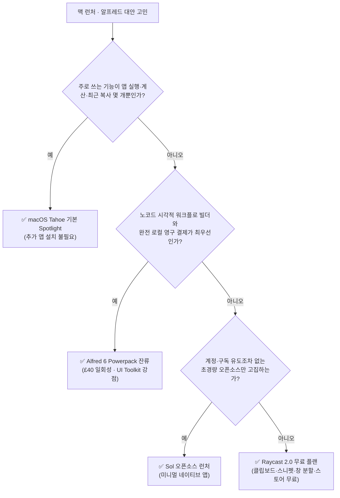

import Alert from '@/components/Alert.astro';
import AppCard from '@/components/AppCard.astro';
import GitHubRepoCard from '@/components/GitHubRepoCard.astro';

2026년 11월 **Alfred 6**가 정식 출시되면서 유료 업그레이드 안내창을 마주했거나, 새로 산 맥북 초기 세팅에서 **Powerpack**(Single £40 · Mega Supporter £70) 결제 버튼을 앞에 두고 멈칫한 분들이 많을 겁니다. **알프레드 대안**을 검색해 이 글에 들어오셨다면 고민은 결국 세 갈래로 좁혀집니다 — 대폭 강화된 macOS Tahoe 순정 **Spotlight**로 충분할지, 핵심 기능이 무료인 **Raycast 2.0**(레이캐스트)으로 넘어갈지, 아니면 지갑을 열어 Alfred에 남을지죠.

무턱대고 앱부터 깔고 단축키를 덮어쓰면 사흘 만에 손이 꼬여 원래 쓰던 런처로 되돌아가기 십상입니다. 세 도구가 갈리는 정확한 기준선부터 갈아탈 때 겪는 역체감 해결법, 수년간 쌓은 스니펫을 10분 만에 옮기는 절차까지 한 번에 짚어드립니다.

---

## 30초 결론: 순정 Spotlight vs Raycast 무료 vs Alfred 6

지금 내 작업 패턴에 어떤 런처가 맞는지 아래 흐름도와 요약표로 먼저 가늠해 보세요.



| 내 상황 | 추천 선택 | 결정적 이유 |
| :--- | :--- | :--- |
| 앱 실행, 사칙연산, 직전 복사 항목 붙여넣기가 전부다 | **macOS Tahoe 기본 Spotlight** | OS에 클립보드 히스토리·Quick Actions가 내장되어 서드파티 앱이 필요 없음 |
| Powerpack 결제 없이 클립보드·스니펫·창 관리·확장을 다 쓰고 싶다 | **Raycast 2.0 (무료 플랜)** | 핵심 생산성 도구와 1,500개 이상의 스토어 확장이 계정 로그인 없이 `$0` |
| 코딩 없이 드래그 앤 드롭으로 복잡한 로컬 자동화를 직접 짠다 | **Alfred 6 Powerpack** | 시각적 Workflow 편집기와 v6 신규 UI Toolkit은 여전히 대체 불가 영역 |
| 클라우드·구독 요소가 아예 없는 미니멀 오픈소스를 원한다 | **Sol** | 창 분할·클립보드·이모지를 가볍게 묶은 무료 오픈소스 네이티브 런처 |

---

## 비용과 무료 범위 비교: Powerpack £40 없이 어디까지 공짜인가

알프레드 대안을 찾는 가장 현실적인 이유는 "**Alfred 무료판은 사실상 빈 껍데기에 가깝다**"는 데 있습니다. 클립보드 히스토리, 스니펫 자동 완성, 커스텀 워크플로가 전부 유료 Powerpack 뒤에 잠겨 있거든요. 반면 macOS 26 Tahoe의 기본 Spotlight와 Raycast 2.0 무료 플랜은 돈을 내지 않아도 열리는 범위가 훨씬 넓습니다.

| 비교 항목 | Spotlight (macOS Tahoe) | Alfred 6 (무료 / Powerpack) | Raycast 2.0 (무료 / Pro) |
| :--- | :--- | :--- | :--- |
| **가격 구조** | 완전 무료 (OS 내장) | 무료 / **£40** (Single) · **£70** (평생) | 개인 코어 **무료** / Pro 월 **$8～$10** |
| **통합 파일 검색** | ✓ (네이티브 인덱스) | ✓ (`Space` 접두어 즉시 검색) | ✓ (2.0 자체 Rust 파일 인덱서 탑재) |
| **클립보드 히스토리** | ✓ (최근 단기 내역 · `⌘4` 호출) | ✗ (**Powerpack 필수**) | ✓ (**무료 최대 3개월** · OCR·핀 지원) |
| **텍스트 스니펫 확장** | ✗ (시스템 텍스트 대치만) | ✗ (**Powerpack 필수**) | ✓ (**무료 무제한** · 동적 플레이스홀더) |
| **윈도우 관리 (창 분할)** | 별도 OS 단축키 (삼분할 불가) | 별도 워크플로 설치 필요 | ✓ (**무료 기본 내장** · 삼분할·멀티 모니터) |
| **확장 생태계** | Apple 단축어(Shortcuts) 연동 | `.alfredworkflow` 파일 수동 설치 | 앱 내 **Store** 원클릭 설치 (1,500개+) |
| **커스텀 자동화 난이도** | 단축어 앱 (제한적) | **노코드 시각적 빌더** + v6 UI Toolkit | Script Commands(셸/Python) 또는 React/TS |
| **기기 간 설정 동기화** | iCloud 기본 연동 | 폴더 지정 방식 (iCloud·Dropbox 무료) | 수동 `.rayconfig` 무료 / 자동 동기화는 **Pro** |
| **AI 통합** | Apple Intelligence | 자체 API 키 워크플로 연동 | **Pro** (월 500 크레딧 · 멀티 모델 · MCP) |
| **지원 플랫폼** | macOS | macOS (Intel·구형 OS 포함) | **macOS** (v2는 Tahoe·Apple Silicon, 구형은 v1) **+ Windows** |

<Alert type="info" title="Raycast도 결국 유료 구독 앱 아닌가요?">
가장 흔한 오해입니다. Raycast가 월 구독(`$8` 연간 결제 / `$10` 월간 결제)을 받는 영역은 **내장 AI 크레딧, 기기 간 실시간 Cloud Sync, 무제한 클립보드 보관, 커스텀 테마, 전역 딕테이션**뿐입니다. Alfred에서 £40을 내야 열리던 **클립보드 히스토리(3개월), 스니펫, Quicklinks, 창 관리, 스토어 확장, 스크립트 실행은 회원가입조차 하지 않아도 평생 무료**로 동작합니다.
</Alert>

---

## 설치 직후 지워도 되는 앱들 (올인원 통합 효과)

Raycast로 넘어왔을 때 가장 먼저 체감하는 이득은 메뉴바와 백그라운드에 상주하던 자잘한 유틸리티 앱을 서너 개씩 걷어낼 수 있다는 점입니다.

<AppCard
  name="Raycast"
  platform={["macOS", "Windows"]}
  category="런처 · 커맨드 팔레트"
  price="개인 코어 무료 (Pro 월 $8～$10)"
  href="https://www.raycast.com"
  brew="--cask raycast"
  description="앱 실행, 3개월 클립보드 히스토리, 스니펫, 창 분할, 1,500개 이상의 스토어 확장을 하나로 묶은 올인원 런처."
  comment="Alfred Powerpack 결제 없이도 맥 필수 유틸리티 4종 역할을 무료 코어 하나로 대체합니다."
/>

- **창 분할 앱 (Rectangle · Magnet 대체):** `Window Management` 확장이 기본 탑재되어 절반·삼분할·육분할·다음 모니터 이동을 모두 무료로 지원합니다. 설치 직후엔 단축키가 비어 있으니 쓰던 키맵만 그대로 입혀주면 됩니다. 프리셋 외 커스텀 비율이 필요한 경우 등 세밀한 비교는 [맥 윈도우 관리 앱 추천 2026](/tools/mac-window-manager-apps) 글에서 따로 다뤘습니다.
- **클립보드 매니저 (Maccy 대체):** 복사한 텍스트·이미지·링크·색상 코드를 최대 **3개월**까지 기록하고, 복사한 스크린샷 안의 글자를 뽑아내는 **OCR**까지 무료로 처리합니다. 설치 후 `Settings → Extensions → Clipboard History → Keep history for`를 기본값에서 **3 Months**로 늘려두는 것만 잊지 마세요. 전용 앱과의 상세 경계선은 [맥 클립보드 관리 앱 추천 2026](/tools/mac-clipboard-manager-apps)을 참고하세요.
- **메뉴바 달력·회의 링크 (Itsycal 대체):** `My Schedule`을 켜두면 다음 일정 남은 시간과 Zoom·Google Meet 참여 버튼이 런처 최상단에 바로 뜹니다. 회의 1분 전에 메일함이나 캘린더 앱을 뒤질 일이 사라져요.
- **단위·환율·날짜 계산기:** 검색창에 `180 usd in krw`, `320px to rem`, `now in utc`, `today + 45 days`처럼 자연어로 치면 엔터를 누르기 전에 즉시 답이 나옵니다.

---

## Alfred 유저가 갈아탈 때 겪는 '3대 역체감' 해소 세팅

기능이 아무리 많아도 손끝 감각이 어긋나면 결국 안 쓰게 됩니다. 오랜 Alfred 사용자가 Raycast 설치 첫 주에 가장 많이 답답해하는 지점 세 가지와 해결 세팅입니다.

### 1. 파일 검색: 스페이스바 근육 기억과 Raycast 2.0 통합 인덱서

Alfred 유저는 `⌘Space`를 누른 직후 **스페이스바**(`Space`)나 작은따옴표(`'`)를 쳐서 파일을 즉시 호출하는 습관이 몸에 배어 있습니다. 예전 Raycast는 파일을 찾으려면 `Search Files` 명령 안으로 한 단계 더 들어가야 해서 이 지점에서 이탈하는 사람이 정말 많았어요.

2026년 8월 정식 출시된 **Raycast 2.0**([2.0 아키텍처 개편 상세](/tools/raycast-2-beta) 참고)에서는 Spotlight 인덱스에 기대지 않는 **자체 Rust 기반 파일 인덱서**가 들어오면서, 런처 첫 화면(루트 검색)에서 앱·커맨드와 함께 파일과 폴더가 곧바로 검색되도록 바뀌었습니다.

그래도 파일만 깔끔하게 걸러 보던 Alfred의 감각이 그립다면 아래 두 줄만 설정해 두세요.

1. `Settings (⌘,)` → `Extensions` → `File Search` → `Search Files` 항목을 찾습니다.
2. **Alias** 칸에 `f`를 입력하거나, **Hotkey** 칸에 `⌥Space`를 할당합니다.

이제 런처를 띄우고 `f` + `Space`만 치면 다른 앱이나 명령어 개입 없이 초고속 파일 전용 검색창으로 즉시 전환됩니다.

### 2. 한/영 전환 꼬임 방지: 실행 시 영문 입력 자동 고정

한글 문서를 쓰다가 런처를 띄워 `terminal`을 쳤는데 `ㅅㄷ그ㅑㅜ미`이 찍히는 현상만큼 맥락을 끊는 게 없죠. Alfred Powerpack 유저들이 아끼던 '실행 시 영문 강제 전환' 옵션은 Raycast에도 기본 내장되어 있습니다.

- **설정 경로:** `Settings` → `Advanced` → **Auto-switch input source** → `ABC` (또는 `U.S.`) 선택

이 옵션을 켜두면 한글 입력 도중에 Raycast를 호출해도 입력창 안에서는 무조건 영문으로 타이핑되고, `Esc`나 실행으로 창을 닫는 순간 원래 쓰던 한글 입력 모드로 알아서 복귀합니다. macOS 자체의 한/영 전환 딜레이나 한글 상태에서 백틱(`` ` ``) 대신 원화 기호(`₩`)가 찍히는 문제까지 함께 잡고 싶다면 [Karabiner Complex Modifications 가이드](/tools/karabiner-elements-guide-2) 또는 [구름입력기 소스 빌드 가이드](/tools/gureum-update-and-build-guide)를 병행하는 구성을 권합니다.

### 3. 엔터를 한 번 더 누르는 느낌 줄이기: Alias · Hotkey · Fallback

Alfred는 최소 글자만 치고 곧장 `Enter`를 누르는 직결형 구조인 반면, Raycast는 '확장 선택 → 하위 명령 실행 → 액션 패널(`⌘K`)'로 이어지는 팔레트 구조라 초기 세팅 상태에서는 타수가 한두 번 늘어난 느낌을 받습니다.

해결책은 **자주 쓰는 상위 10개 동작을 루트 바깥으로 꺼내두는 것**입니다.

- **전역 Hotkey 직결:** 하루에 열 번 이상 여는 `Clipboard History`(`⌥⌘V`), `Window Management` 좌우 분할(`⌃⌥←/→`), 자주 여는 메신저·터미널에는 런처를 거치지 않는 직접 단축키를 심으세요.
- **2글자 Alias 부여:** `GitHub` 확장의 `Search Pull Requests`에 `pr`, `Brew` 확장의 `Upgrade`에 `bu`, `AppCleaner`에 `ac` 같은 짧은 별칭을 붙이면 런처 호출 후 세 타 만에 실행이 끝납니다.
- **Fallback Commands 등록:** Alfred의 Fallback Search처럼 일치하는 앱이 없을 때 곧장 웹이나 사전으로 넘기려면, 아무 검색어나 친 뒤 하단 `Manage Fallback Commands`를 눌러 Google·Naver·GitHub 검색을 최상단에 올려두세요.

---

## 10분 이사 가이드: Alfred 단축키·스니펫·웹 검색 그대로 옮기기

수년간 모아둔 스니펫과 커스텀 검색어 때문에 발이 묶여 있었다면 아래 세 단계로 10분 안에 이사를 끝낼 수 있습니다.

### Step 1. `⌘Space` 단축키 충돌 없이 넘겨받기

Spotlight, Alfred, Raycast 셋이 같은 키를 물고 있으면 키 입력이 씹히거나 두 창이 겹쳐 뜹니다. 순서대로 정리하세요.

1. **Spotlight 비우기:** `시스템 설정 → 키보드 → 키보드 단축키 → Spotlight`에서 'Spotlight 검색 보기' 체크를 끄거나 다른 키로 바꿉니다.
2. **Alfred 임시 대피:** 바로 지우기 불안하다면 `Alfred Preferences → General`에서 핫키를 `⌥Space` 같은 보조 키로 옮겨 일주일간 보험용으로 남겨둡니다. 적응이 끝났다면 로그인 항목(Launch Alfred at login)에서 해제하세요.
3. **Raycast 메인 지정:** Raycast `Settings → General → Raycast Hotkey`를 클릭하고 `⌘Space`를 등록합니다.

### Step 2. Alfred 스니펫(`.alfredsnippets`) 일괄 변환해 가져오기

수백 개 스니펫을 손으로 다시 등록할 필요는 없습니다. Alfred에서 내보낸 `.alfredsnippets` 파일의 정체는 개별 JSON 파일들을 묶어둔 표준 `.zip` 압축 파일이고, Raycast의 **Import Snippets** 명령은 `name`·`text`·`keyword` 키를 가진 JSON 배열을 그대로 읽어들입니다.

1. `Alfred Preferences → Features → Snippets`에서 옮길 컬렉션을 우클릭해 **Export**로 저장합니다(예: `~/Downloads/MySnippets.alfredsnippets`).
2. 터미널을 열고 아래 명령어로 압축을 푼 뒤 `jq`로 단일 JSON 배열로 합칩니다(`jq`가 없다면 `brew install jq`로 설치하며, Homebrew 세팅이 안 되어 있다면 [맥 Homebrew 설치 가이드](/tools/install-homebrew-2026)를 먼저 참고하세요).

```bash
# 1. 내보낸 .alfredsnippets(실체는 zip) 압축 해제 (이전 임시 폴더 초기화 포함)
rm -rf /tmp/alfred-snippets && mkdir -p /tmp/alfred-snippets
unzip -qo ~/Downloads/MySnippets.alfredsnippets -d /tmp/alfred-snippets

# 2. Raycast Import 규격 JSON으로 변환 (빈 이름은 uid 폴백, 빈 keyword·자동확장 제외 항목은 keyword 생략)
jq -s 'map(select(.alfredsnippet != null) | .alfredsnippet | {
  name: (if ((.name // "") | length) > 0 then .name else .uid end),
  text: .snippet
} + (if ((.keyword // "") | length) > 0 and (.dontautoexpand | not) then { keyword: .keyword } else {} end))' \
  /tmp/alfred-snippets/*.json > ~/Desktop/raycast-snippets.json
```

3. Raycast를 띄우고 `Import Snippets`를 실행한 뒤, 방금 바탕화면에 만들어진 `raycast-snippets.json`을 선택하면 기존 키워드와 상용구 본문이 한 번에 등록됩니다.

<Alert type="warning" title="동적 플레이스홀더 문법 차이 확인">
일반 텍스트 스니펫은 100% 그대로 동작하지만, Alfred 전용 동적 문법(예: `{date:yyyy-MM-dd}`, `{cursor}`)이 들어간 항목은 가져온 뒤 Raycast 문법(`{date format="yyyy-MM-dd"}`, `{cursor}`는 동일)에 맞게 몇 개만 손봐주시면 됩니다.
</Alert>

### Step 3. Custom Web Searches → Quicklinks 이전하기

Alfred의 `Features → Web Searches`에서 쓰던 커스텀 검색 URL도 그대로 가져올 수 있습니다. 검색어가 들어가는 자리 표시자만 Alfred의 `{query}`에서 Raycast 동적 인자 문법인 `{argument name="query"}`로 바꿔 `Create Quicklink`에 붙여넣으면 됩니다(띄어쓰기와 한글 퍼센트 인코딩은 Raycast가 자동 처리합니다).

```text
# Alfred Web Search 주소
https://search.naver.com/search.naver?query={query}

# Raycast Quicklink 주소 (Alias를 'n'으로 지정하면 'n 검색어'로 즉시 실행)
https://search.naver.com/search.naver?query={argument name="query"}
```

더 구체적인 북마크 연동과 Quicklinks 활용 패턴은 이어지는 [2편 Raycast 실전 가이드](/tools/raycast-advanced-guide-2026)에서 다룹니다.

---

## 솔직한 역추천: Raycast 대신 Alfred에 남거나 다른 대안을 택할 때

모든 사람에게 Raycast가 정답은 아닙니다. 아래 네 가지 기준 중 하나라도 강하게 걸린다면 억지로 갈아타지 않는 편이 시간과 돈을 아낍니다.

### 1. 코딩 없이 복잡한 로컬 자동화를 직접 설계한다면 → Alfred 6 잔류

Raycast Store에는 이미 만들어진 확장 프로그램이 1,500개 넘게 올라와 있어 **남이 만든 도구를 가져다 쓰는 경험**은 압도적입니다. 하지만 스토어에 없는 다단계 개인 워크플로를 직접 만들려면 셸 스크립트(`Script Commands`)를 짜거나 React·TypeScript 기반 확장 API를 다뤄야 해요.

반면 Alfred는 마우스로 노드를 이어 붙이는 시각적 **Workflow 편집기**가 핵심 자산이고, **Alfred 6**에서는 별도 컴파일 없이 입력 폼·선택 피커·구조화된 데이터 뷰를 띄우는 **Alfred UI Toolkit**까지 추가됐습니다. 비개발자이거나 노코드 로컬 자동화 자산을 수십 개 굴리고 있다면 £40 업그레이드 비용을 내고 남는 쪽이 훨씬 생산적입니다.

### 2. 계정·클라우드 없는 완전 로컬과 무료 기기 동기화를 원한다면 → Alfred 또는 수동 백업

Raycast 무료 플랜도 클립보드와 스니펫 데이터를 로컬 맥 안에만 저장하지만, 집 맥북과 회사 맥북 두 대를 **실시간 자동 동기화**(Cloud Sync)하려면 월 `$8～$10` Pro 구독이 필요합니다. 계정 자체를 만들지 않고 iCloud Drive나 Dropbox 폴더 지정만으로 무료 동기화를 해오던 Powerpack 유저에게는 분명한 역체감 포인트죠.

구독 없이 Raycast 설정을 새 맥에 옮기고 싶다면 `Export Settings & Data` 명령으로 암호화된 `.rayconfig` 파일을 뽑아 [Git 기반 dotfiles 환경](/tools/mac-dotfiles-guide)이나 개인 클라우드 폴더에 넣어두는 수동 백업 방식을 쓰면 됩니다. 참고로 Alfred와 Raycast 모두 전통적인 [블랙 프라이데이 노세일 앱](/tools/mac-apps-black-friday-2026)에 속하므로 연말 쿠폰을 기다리며 결정을 미룰 필요는 없습니다(Raycast Pro는 학생 50% 상시 할인만 운영).

### 3. 서드파티 상주 앱과 구독 유도가 피로하다면 → Tahoe Spotlight 또는 Sol

단순히 앱을 빠르게 띄우고, 환율을 계산하고, 방금 전에 복사한 텍스트 두세 개만 다시 붙여넣는 수준이라면 macOS Tahoe의 **순정 Spotlight**(`⌘Space` 호출 후 `⌘4`로 클립보드 조회)만으로도 이제 충분히 쾌적합니다.

Spotlight보다는 창 분할과 이모지 피커, 넉넉한 클립보드가 더 필요하지만 상업용 앱의 Pro 업그레이드 배너나 계정 연동이 싫다면 오픈소스 런처 **Sol**(`brew install --cask sol`)이 가장 깔끔한 제3의 선택지입니다.

<GitHubRepoCard
  repo="ospfranco/sol"
  comment="계정·구독·클라우드 없이 앱 실행, 창 분할, 클립보드 히스토리, 캘린더 확인을 가볍게 제공하는 오픈소스 macOS 네이티브 런처."
/>

### 4. 파일을 집어 던지는 `Instant Send` 손맛이 핵심이라면 → LaunchBar

검색창에 명령어를 치는 대신, 파일이나 텍스트를 먼저 집어 올린 뒤 키보드 연쇄 조작으로 다른 앱·폴더·스크립트에 넘기는 **Instant Send** 방식을 주력으로 써왔다면 Raycast나 Alfred보다 전통의 **[LaunchBar](https://www.obdev.at/products/launchbar/index.html)** 문법이 여전히 가장 빠릅니다.

---

## 마무리: 오늘 딱 3가지만 먼저 해보세요

백 마디 비교보다 내 손가락에 맞는지 사흘만 써보는 게 가장 정확합니다. 오늘 Raycast를 설치했다면 처음부터 스토어 확장을 수십 개씩 깔지 말고 아래 세 가지만 먼저 잡아두세요.

1. `⌘Space`를 Raycast에 넘기고, `Auto-switch input source`를 **ABC**로 고정해 한/영 스트레스 없애기
2. `Clipboard History` 보관 기간을 **3 Months**로 올리고 전용 단축키(`⌥⌘V`) 연결하기
3. 기존에 쓰던 `MySnippets.alfredsnippets`만 변환해 들여오고, 일주일 뒤 Alfred 보조 단축키를 한 번도 안 눌렀다면 그때 깔끔히 지우기

기본 적응이 끝났다면 아래 시리즈 후속편으로 이어서 작업 속도를 끌어올려 보세요.

- [2편 — Raycast 실전 가이드: 웹 검색·북마크부터 창 관리/달력 통합까지](/tools/raycast-advanced-guide-2026)
- [3편 — Raycast Pro AI 완전 정복: AI Commands와 커스텀 프롬프트 세팅](/tools/raycast-ai-guide-2026)
- [4편 — Raycast Pro 7일 무료체험, 하루 하나씩 검증하는 실행 플랜](/tools/raycast-pro-trial-guide)
